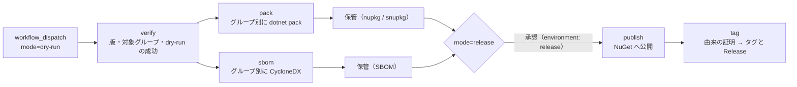

# リリース手順（GitHub Actions）

本ドキュメントは **EsUtil のパッケージを公開する開発者**向けの手順です。
開発の進め方は [`開発手順.md`](開発手順.md)、検証の合否基準は [`検証手順.md`](検証手順.md)、
利用方法は [`../README.md`](../README.md) を参照してください。

**手順の所有者は本ドキュメント**です（ワークフローはその実装であり、手順を重複して書かない）。
リリースは **手動実行のみ**で、バージョンの**自動インクリメントは行いません**。

## 1. 構成

リリースの設定と処理は、次のファイルが持ちます。 **同じ知識を複数箇所に置かない**ことが設計方針です。

| ファイル | 内容 |
| --- | --- |
| [`release-config.json`](release-config.json) | 製品名、**ソリューション ファイル**（`solutionFile` / `solutions`）、**リリースを許可するブランチ** |
| [`../Directory.Build.props`](../Directory.Build.props) | **グループ別のバージョン**（`EsUtil_VersionPrefix` / `EsUtil_Ui_<UI>_VersionPrefix`）。 各 `.csproj` では指定しない |
| [`../global.json`](../global.json) | .NET SDK のバージョン。 ワークフローでは指定しない |
| [`../.config/dotnet-tools.json`](../.config/dotnet-tools.json) | SBOM を作るツール（CycloneDX）の版。 CI とローカルで同じものを使う |
| [`workflows/release.yml`](workflows/release.yml) | dry-run / 公開 / タグ付けの実装 |
| [`../buildScript/pack.ps1`](../buildScript/pack.ps1) | **ローカル フィード用**のパッケージ作成（未公開の版を試すときだけ使う。 公開はワークフローが行う） |
| [`../buildScript/generateSbom.ps1`](../buildScript/generateSbom.ps1) | SBOM（CycloneDX）の作成 |

**版は 5 つのグループ**（`EsUtil` / `EsUtil.Ui.AvaloniaUI` / `EsUtil.Ui.MewUI` / `EsUtil.Ui.WinUI3` / `EsUtil.Ui.WinForms`）ごとに 1 つです。
グループ内の全パッケージが同じ版になり、タグもグループ別（`<グループ>/v<版>`。 例: `EsUtil/v0.2.0`）になります。

## 2. 依存関係の更新

[`dependabot.yml`](dependabot.yml) が GitHub Actions と NuGet パッケージの更新を Pull Request で通知します。

- **`directories` は `.csproj` を持つ全フォルダを列挙する**（Dependabot は直下しか走査しないため）。 列挙漏れは `verify.ps1` が不合格にします。
- **メジャー更新の一部は自動で作らない**（`xunit.v3` / `xunit.analyzers`）: テストの書き方と実行基盤が変わるため、人が判断します。
- **MewUI（0.x）は固定して手動で更新する**: 破壊的変更でビルドが通らなくなるためです。
- **Dependabot は `packages.lock.json` を一部のプロジェクトしか更新しない**（直接参照する一部だけ。 実測: アナライザーの更新で 76 個中 3 個）。 そのため Dependabot の Pull Request は、**そのままでは CI が `NU1004`（lock が古い）で失敗します**。
  ブランチを取得して `buildScript/updateLocks.ps1` を実行し、lock を追加コミットしてからマージします（版の更新自体は PR の内容のままで、変えるのは lock だけです）。

## 3. リポジトリの設定（初回のみ）

| 設定 | 内容 |
| --- | --- |
| `Protect main`（ブランチ保護） | `main` への直接 push を禁止し、`ci` の成功を必須にする |
| `release`（Environment） | **Required reviewers** を設定する。 公開ジョブはこの環境の承認が無いと動かない |
| NuGet の Trusted Publishing | ポリシーを「リポジトリ + ワークフロー ファイル（`release.yml`）+ `environment: release`」に紐づける。 **長期の API キーは持たない** |
| `NUGET_USER`（Secret） | Trusted Publishing のユーザー名 |

## 4. ワークフロー



**公開が成功した後にだけタグを打ちます**（公開できなかった版にタグを残さないため）。

## 5. リリース手順

1. **版を上げてコミットする**（`Directory.Build.props` のグループ別 `VersionPrefix`）。 `dev` で上げ、`main` へマージする
2. `Actions` → **Build** が成功するまで待つ（検証の合否基準は [`検証手順.md`](検証手順.md)）
3. `Actions` → **Release** → `Run workflow` で **`dry-run`** を選ぶ
   - 版の検証・対象グループの決定・`pack`・**SBOM の作成**まで行う（公開もタグ作成もしない）
   - 前回のグループ別タグから**変更の無いグループは対象外**になる（`git diff` で判定）
4. 問題が無ければ、**同じコミット**で **`release`** を選んで実行する
   - **同じコミットの dry-run が成功していないと中止**する
   - `environment: release` の**承認**を経て、NuGet へ公開し、その後にタグと GitHub Release を作成する

**公開済みの版は不変**です。 同じ版を再公開しようとすると `release` は失敗します（`dry-run` は確認のため続行します）。

## 6. バージョンの指定

版は **`Directory.Build.props` にコミットした値**を使います（ワークフローは書き換えません）。
入力 `version` は確認用であり、ツリーの値と一致しなければ失敗します。

```xml
<EsUtil_VersionPrefix>0.2.0</EsUtil_VersionPrefix>
<EsUtil_Ui_AvaloniaUI_VersionPrefix>0.1.1</EsUtil_Ui_AvaloniaUI_VersionPrefix>
```

- **形式は 3 桁の数値**（`<主>.<副>.<修正>`）。
- **ローカル識別子（`-`）を含めない**（公開する版にだけ適用する規則。 ローカルで試すときは `buildScript/pack.ps1` が `local.<n>` を付ける）。
- **グループごとに独立**して上げられる（変更の無いグループはリリースされない）。

## 7. Release の添付ファイル

各グループの Release には、**そのグループの SBOM**（`<グループ>.<版>.sbom.cdx.json`）が添付されます。
パッケージ本体は nuget.org が配布元であり、SBOM は「どの依存のどの版を使ったか」を公開物から辿るために付けます。

**公開したパッケージには由来の証明（build provenance）を付けます**（`actions/attest-build-provenance`）。
どのワークフロー・どのコミットが作ったパッケージかを後から検証できます。

## 8. 失敗した場合の復旧

| 失敗した箇所 | 状態 | 復旧 |
| --- | --- | --- |
| `verify`（dry-run 失敗） | 何も作っていない | 原因を直して再実行する |
| `pack` / `sbom` | 成果物が無い（公開していない） | 原因を直して再実行する |
| `publish`（一部だけ公開） | 公開済みの版は取り消せない | 残りを再実行する（公開済みの版は HEAD で確認して**省略**する） |
| `tag`（タグ作成の失敗） | 公開済み・タグ無し | `release` を再実行する（公開は省略され、タグだけが作られる） |

**版を公開した後に中身を直すことはできません**。 修正は**版を上げて**行います。

## 9. ローカルでの確認

```powershell
# 検証（ビルド・テスト・パッケージング・走査。 合否基準は .github/検証手順.md）
pwsh -NoProfile -File buildScript/verify.ps1

# 未公開の版をローカル フィード（.nupkg/）へ出す（利用側のアプリで試すとき）
pwsh -NoProfile -File buildScript/pack.ps1

# SBOM だけを作る
pwsh -NoProfile -File buildScript/generateSbom.ps1 -Output sbom
```

## 10. 注意点

- **公開は取り消せません**（nuget.org の版は不変）。 版を上げる前に `dry-run` で確かめる。
- **`main` 以外では公開できません**（`releaseBranches`）。 `dry-run` は `dev` でも実行できます。
- **タグはワークフローだけが作ります**（人が打たない。 グループ別のタグは版の記録であり、リリースの単位）。
- **SBOM とパッケージは同じコミットから作ります**（`pack` と `sbom` は同じ `github.sha` を checkout する）。

## 関連ドキュメント

- [`検証手順.md`](検証手順.md) … 検証の合否基準（所有者）
- [`ビルド設定規約.md`](ビルド設定規約.md) … 版と単一所有の規則
- [`開発手順.md`](開発手順.md) … 日常の開発の進め方
- [`../CHANGELOG.md`](../CHANGELOG.md) … 利用者に影響する変更
