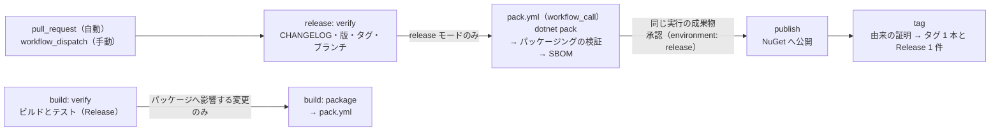

# リリース手順（GitHub Actions）

本ドキュメントは **EsUtil のパッケージを公開する開発者**向けの手順です。
開発の進め方は [`開発手順.md`](開発手順.md)、検証の合否基準は [`検証手順.md`](検証手順.md)、
利用方法は [`../README.md`](../README.md) を参照してください。

**手順の所有者は本ドキュメント**です（ワークフローはその実装であり、手順を重複して書かない）。
リリースは **手動実行のみ**で、バージョンの**自動インクリメントは行いません**。

## 1. 構成

リリースの設定と処理は、次のファイルが持ちます。 **同じ知識を複数箇所に置かない**ことが設計方針です。

| ファイル | 内容 |
| --- | --- |
| [`release-config.json`](release-config.json) | 製品名、**ソリューション ファイル**（`solutionFile` / `solutions`）、**リリースを許可するブランチ** |
| [`../Directory.Build.props`](../Directory.Build.props) | **公開する版**（`VersionPrefix` 1 行。 すべてのパッケージが同じ版）。 各 `.csproj` では指定しない |
| [`../global.json`](../global.json) | .NET SDK のバージョン。 ワークフローでは指定しない |
| [`../.config/dotnet-tools.json`](../.config/dotnet-tools.json) | SBOM を作るツール（CycloneDX）の版。 CI とローカルで同じものを使う |
| [`workflows/release.yml`](workflows/release.yml) | dry-run / 公開 / タグ付けの実装 |
| [`../buildScript/pack.ps1`](../buildScript/pack.ps1) | **ローカル フィード用**のパッケージ作成（未公開の版を試すときだけ使う。 公開はワークフローが行う） |
| [`../buildScript/generateSbom.ps1`](../buildScript/generateSbom.ps1) | SBOM（CycloneDX）の作成 |

**版はすべてのパッケージで 1 つ**です（`Directory.Build.props` の `VersionPrefix`）。 タグも Release も **1 件**（`v<版>`。 例: `v0.4.0`）になります。

## 2. 依存関係の更新

[`dependabot.yml`](dependabot.yml) が GitHub Actions と NuGet パッケージの更新を Pull Request で通知します。

- **NuGet の対象は版の単一所有（`Directory.Packages.props`）のフォルダだけ**（`directory: "/"`）。 版は Central Package Management で 1 ファイルが持つため、プロジェクトごとに列挙する必要はありません。 列挙すると **Dependabot がフォルダごとに依存を解決して実行が長引きます**（実測 2026-11-02: 85 フォルダで 12〜56 分。 時間切れで Pull Request が作られないことがありました）。 登録漏れは `verify.ps1` が不合格にします（規則は [`検証手順.md`](検証手順.md) §8）。
- **メジャー更新の一部は自動で作らない**（`xunit.v3` / `xunit.analyzers`）: テストの書き方と実行基盤が変わるため、人が判断します。
- **MewUI（0.x）は固定して手動で更新する**: 破壊的変更でビルドが通らなくなるためです。
- **lock の更新は CI が行います**（[`workflows/locks.yml`](workflows/locks.yml)）。 `dev` からの Pull Request で `packages.lock.json` が古ければ、bot が `buildScript/updateLocks.ps1` を実行し、**`dev` へ自動でコミット**します（開発者の手作業はありません）。 **走るのは lock が変わりうるファイルを触った Pull Request だけ**です（文書だけの Pull Request では走りません）。 対象は**配布するプロジェクト（`src`）だけ**です（テスト・サンプルは lock を持たない。 版を上げるたびに 44 ファイルの機械的な差分が出るため。 [`ビルド設定規約.md`](ビルド設定規約.md) §8）。
  - Dependabot の Pull Request も同じ仕組みで lock が更新されます（版を書き換えるのは `Directory.Packages.props` だけ）。
  - 手元で先に直したいときは `pwsh -NoProfile -File buildScript/updateLocks.ps1`。

## 3. リポジトリの設定（初回のみ）

| 設定 | 内容 |
| --- | --- |
| `Protect main`（ブランチ保護） | `main` への直接 push を禁止し、`ci` の成功を必須にする。 **`strict_required_status_checks_policy` を `true`** にし、Pull Request が最新の `main` に追随していないとマージできないようにする（[`rulesets/protect-main.json`](rulesets/protect-main.json)） |
| `release`（Environment） | **Required reviewers** を設定する。 公開ジョブはこの環境の承認が無いと動かない |
| NuGet の Trusted Publishing | ポリシーを「リポジトリ + ワークフロー ファイル（`release.yml`）+ `environment: release`」に紐づける。 **長期の API キーは持たない** |
| `NUGET_USER`（Secret） | Trusted Publishing のユーザー名 |

## 4. ワークフロー

### 4.1 実行契機とコスト

**フル検証は Pull Request の 1 回だけ**です。 `main` へ入るのは Pull Request だけであり（ruleset）、Pull Request の検証は**マージ後に `main` へ載るツリーそのもの**（`refs/pull/<番号>/merge`）を対象にします。 同じツリーをもう一度検証しても結果は変わらないため、**`dev` への push と `main` への push では検証しません**。

**古い `main` に対する検証結果は使いません**。 ruleset の `strict_required_status_checks_policy` が `true` のため、Pull Request が最新の `main` に追随していないとマージできません。 追随すると `refs/pull/<番号>/merge` が作り直され、`ci` がその組み合わせで走り直されます（複数の Pull Request が古い `main` のまま順にマージされ、**実際に載る組み合わせが未検証**になるのを防ぐ）。

| 契機 | 実行する内容 | 理由 |
| --- | --- | --- |
| `dev` への push | なし | 手元の `verify.ps1` と、`main` 向け Pull Request の検証で足りる |
| `main` 向け Pull Request | フル検証（`build.yml`。 必須チェックは `ci`） | **唯一のゲート**。 最新の `main` とマージしたツリーを検証する（配布物・パッケージングの検証・SBOM は `pack.yml` が持つ。 §4.2） |
| `main` 向け Pull Request | **`dry-run` を自動実行**（`release.yml`。 版・タグ・ブランチ・CHANGELOG の検証だけ） | マージ後に手動で dry-run を回さない（公開物は `release` の実行で作り、そのまま公開する） |
| `main` 向け Pull Request（**lock が変わりうるファイルを触ったときだけ**） | `Locks`（`locks.yml`。 `packages.lock.json` の自動更新と `dev` への自動コミット） | 版やパッケージを変えると lock が古くなり `NU1004` で落ちるため。 文書・コードだけの Pull Request では**ジョブを起動しない**（実測 2026-11-06: 1 回 110 秒） |
| `main` への push（マージ） | なし | Pull Request と同じツリーのため重複する（最新の `main` への追随が前提） |
| `workflow_dispatch`（`build.yml`） | フル検証（配布物の作成と検証・SBOM を含む） | 任意のブランチを今すぐ確かめたいとき |
| Release `dry-run`（手動） | 版・タグ・ブランチ・CHANGELOG の検証 | `dev` などで先に確かめたいとき（配布物は作らない） |
| Release `release`（手動） | **この実行で配布物を作り**（`pack.yml`）、検証したバイト列をそのまま公開し、タグ付けする | 検証したバイト列と公開するバイト列を一致させる（別の実行の成果物を探さない） |

- **Pull Request の `dry-run` は自動**です（`release.yml` の `pull_request`）。 版・CHANGELOG・タグ・ブランチの検証を PR のたびに行うため、**マージ後に dry-run を実行する必要はありません**。 配布物と SBOM は `pack.yml` が作り（PR では `build.yml` の `package` ジョブ、公開時は `release` の実行そのもの）、**パッケージへ影響する変更のときだけ**です。
- **作業ブランチで早く壊れを見つけたいとき**は、手元の `buildScript/verify.ps1`（[`検証手順.md`](検証手順.md)）か、`build.yml` の `workflow_dispatch` を使います。
- **README の build バッジ**は `?event=pull_request` を指定します（既定は**既定ブランチの最新実行**であり、`main` の push では実行しないため、`dev` の古い push の結果が残って PR の失敗を表示できません）。

### 4.2 ジョブの流れ



**公開が成功した後にだけタグを打ちます**（公開できなかった版にタグを残さないため）。 **ジョブの実行条件は既定の `success()` に任せます**（`!cancelled()` も `needs.*.result` の手書きもしません）。 `pack` は `release` モードのときだけ走り、`publish` はその後に、`tag` は `publish` の後に置くため、**スキップされた `needs` を持つジョブは自動的にスキップされます**（dry-run でも、リリースする変更が無いときも、公開もタグ付けも走りません）。

**配布物は [`workflows/pack.yml`](workflows/pack.yml) が単一所有します**（`build.yml` の `package` ジョブも `release.yml` の `pack` ジョブも、このワークフローを `workflow_call` で呼びます）。 作成の手順（`dotnet pack --no-build` で `verify` のビルドを使い、変更の無かったソリューションだけ作り足す）も、パッケージングの検証（`verifyPackaging.ps1 -SkipPack -Feed artifacts -Version <版>`）も、SBOM も 1 か所にあります。

**`release` は自分の実行で配布物を作ります**（`pack.yml` を呼ぶ）。 以前は `build.yml` の実行を API で走査して同じツリーの成果物を探し、最大 5 分待ち、無ければフォールバックで作り直していました（条件式の誤りと待機の費用がレビュー指摘の温床でした。 2026-11-07 に撤去）。 **別の実行を探さない**ため、**待機・フォールバック・出所の判定という仕組みが丸ごと不要**になり、**検証したバイト列と公開するバイト列が同一**になります。 代償は `release` 1 回あたり 3〜4 分の作成です（Pull Request では `build.yml` が 1 回だけ作り、**2 回 pack しません**）。

**`ci`（必須チェック）は `package` を待ちません**（`ci` の `needs` に `package` を入れない）。 そのため**マージ直後に `release` を始めても `build.yml` の `package` を待つ必要はありません**（`release` が自分で作る）。

**パッケージング（nuget の正しさ）の検証は `pack.yml` が持ちます**（`build.yml` の `package` ジョブと `release.yml` の `pack` ジョブの両方。 **`ci` の needs には入れません**＝必須チェックを遅らせない）。 検証は**全パッケージが揃ったフィード**を要求するため、変更の無かったソリューションのパッケージはそのジョブで 1 本ずつ作ります（ビルドし直すのはその分だけ）。 検証は `verifyPackaging.ps1 -SkipPack -Feed artifacts -Version <版>`（同封物・nuspec の依存・パッケージ参照での復元/ビルド/起動）。 **パッケージへ影響する変更のときだけ**実行します（workflow や `.editorconfig` の変更では実行しない）。

**`pack.yml` は NuGet のグローバル パッケージ フォルダをキャッシュしません**（同じ ID・版の EsUtil パッケージが残っていると、検証の復元が**別のビルドのパッケージ**を再利用し、新しい nupkg の欠陥を検出できない。 実測 2026-11-06。 復元は 40 秒程度であり、正しさと引き換えにしない）。

**`pack` はソリューションを 1 本ずつ実行します**（UI ソリューションは共通基盤を `ProjectReference` で参照するが共通基盤をソリューションへ含まないため、同時に動かすと共有の `obj/Release` を奪い合って `GenerateDepsFile` が失敗する。 実測 2026-11-05: CI で再現）。 手元の実測でも、直列が 19 秒であるのに対し、ソリューションごとに出力を隔離した並列は参照先の再ビルドが増えて遅い。 `build.yml` の `verify` はマトリクスで分かれているため、**この制約は `pack.yml` の `pack` ジョブに当てはまります**。

**SBOM は `pack.yml` がソリューションごとに 1 ファイル作ります**（`generateSbom.ps1`。 5 本を並列に走らせ、ツールの復元は 1 回だけ行う）。 依存の解析は復元を伴うため（実測 2026-11-06: 1 本あたり復元込み 11.8 秒 → 復元なし 1.0 秒）、**自前で復元します**（`verify` がビルドしたソリューションはこのジョブで復元していないため、他の手順の復元を当てにしない）。 復元が無いと components が 0 件になって失敗します（`generateSbom.ps1` が 0 件を不合格にする）。

**公開するバイト列は、その実行で作って検証したものだけです**（別の実行の成果物を探しません）。 公開の直前に次を確かめます（[`workflows/release.yml`](workflows/release.yml)）。

| 確認 | 内容 |
| --- | --- |
| 配布物の中身 | リポジトリの全パッケージが**過不足なく同じ版**で入っていること。 XML ドキュメントと `README.md` が同封されていること（公開の直前に検証する） |
| 作成と検証の一致 | 公開するのは、**同じ実行の `pack.yml` が作った直後に `verifyPackaging.ps1` が検証したバイト列**であること（`actions/download-artifact` に `run-id` を渡さない） |
| 由来の証明 | 公開の後に `actions/attest-build-provenance` で、どのワークフロー・どのコミットが作ったかを証明する（§7） |

- **他の実行の成果物を使わないため、fork の Pull Request の成果物や保存期間の失効を気にしません**（`pack.yml` は呼び出し元の実行の中で走る）。 公開できるのは `releaseBranches`（`main`）での `release` だけです。

## 5. リリース手順

### 5.1 手順

1. **CHANGELOG の見出しを確定してコミットする**（`## 未リリース` → `## <版>（<公開日>）`。 §5.2）
2. **版を上げてコミットする**（`Directory.Build.props` の `VersionPrefix`。 §6）。 `dev` で上げ、`main` へ Pull Request で入れる
3. **Pull Request の `ci` と `DryRun` が成功するまで待つ**
   - `ci` は検証のゲート（合否基準は [`検証手順.md`](検証手順.md)）
   - `DryRun` は **Pull Request で自動実行**され、**版・タグ・ブランチ・CHANGELOG を検証**する（公開もタグ作成もしない）
   - 配布物（パッケージ）と SBOM は **`pack.yml`** が作る（PR では `build.yml` の `package` ジョブ。 パッケージへ影響する変更のときだけ。 §4.2）
   - 前回のタグから**変更が無ければリリースしない**（`git diff` で判定）
4. **Pull Request をマージする**
5. `main` で **`release`** を実行する（§5.3）
   - `pack` が**この実行で配布物を作り、その場で検証**する（`pack.yml`。 3〜4 分。 他の実行のビルドは待たない）
   - `environment: release` の**承認**を経て、NuGet へ公開し、その後にタグと GitHub Release を作成する

**公開済みの版は不変**です。 同じ版を再公開しようとすると `release` は失敗します（`dry-run` は確認のため続行します）。

### 5.2 CHANGELOG の確定

**公開するコミットに `## 未リリース` を残しません**。 残っていると `dry-run` と `release` の両方が `verify` で失敗します（`CHANGELOG.md` の検査）。

- 見出しは **`## <版>（<公開日>）`**（例: `## 0.4.0（2026-11-02）`）。 日付は**公開する日**を書く。
- 版が含まれていないと**警告**が出る（失敗はしない）。
- **`## 未リリース` の節は、次の変更を書き始めるときに作る**（公開のコミットには含めない）。
- 節の中は `### 破壊的な変更` / `### 追加` / `### 変更` / `### 修正` で分ける（[`../CHANGELOG.md`](../CHANGELOG.md) の既存の並びに合わせる）。

### 5.3 操作（コマンド）

`gh` はリポジトリの権限で認証済みであることが前提です（`gh auth status`）。

```powershell
# 版と CHANGELOG を確認する（ワーキング ツリーが汚れていないこと）
git status --short
Select-String -Path Directory.Build.props -Pattern 'VersionPrefix>'
Select-String -Path CHANGELOG.md -Pattern '^## '

# Pull Request を作り、ci と DryRun の両方が成功するまで待つ（DryRun は自動で走る）
gh pr create --base main --head dev --title "<要約>" --body "<本文>"
gh pr checks --watch

# マージする（DryRun の成果物が公開に使われる）
gh pr merge --merge

# main を取り、release を実行する（マージ後の新しいコミットで実行する）
git switch main
git pull
gh workflow run release.yml --ref main -f mode=release

# 承認を待つ（environment: release。 Web か gh で承認する）
gh run list --workflow release.yml --limit 3

# 結果を確認する（タグ・Release・nuget.org）
git fetch --tags
git tag --list 'v*'
gh release list --limit 6
(Invoke-RestMethod 'https://api.nuget.org/v3-flatcontainer/esutil.platform.core/index.json').versions
```

- **dry-run を手で実行する必要はありません**（Pull Request で自動で走ります）。 `dev` などで先に確かめたいときだけ `gh workflow run release.yml --ref dev -f mode=dry-run` を使います。
- **`release` は「同じツリー」の dry-run を要求します**。 マージで `main` が進んでも、Pull Request の dry-run が検証したツリー（`refs/pull/<番号>/merge`）とマージ後のツリーは同じため、そのまま使えます。 別の Pull Request を先にマージした場合はツリーが変わるので、**最後にマージした Pull Request の `DryRun`**（自動で走っています）が使われます。
- **`release` は `main` でのみ実行できます**（`releaseBranches`）。

## 6. バージョンの指定

版は **`Directory.Build.props` にコミットした値**を使います（ワークフローは書き換えません）。
入力 `version` は確認用であり、ツリーの値と一致しなければ失敗します。

```xml
<VersionPrefix>0.4.1</VersionPrefix>
```

- **形式は 3 桁の数値**（`<主>.<副>.<修正>`）。
- **ローカル識別子（`-`）を含めない**（公開する版にだけ適用する規則。 ローカルで試すときは `buildScript/pack.ps1` が `local.<n>` を付ける）。
- **すべてのパッケージが同じ版**になる（版グループは持たない）。

## 7. Release の添付ファイル

Release には、**ソリューションごとの SBOM**（`<ソリューション>.<版>.sbom.cdx.json`。 5 件）がまとめて添付されます。
パッケージ本体は nuget.org が配布元であり、SBOM は「どの依存のどの版を使ったか」を公開物から辿るために付けます。

**公開したパッケージには由来の証明（build provenance）を付けます**（`actions/attest-build-provenance`）。
どのワークフロー・どのコミットが作ったパッケージかを後から検証できます。

## 8. 失敗した場合の復旧

| 失敗した箇所 | 状態 | 復旧 |
| --- | --- | --- |
| `verify`（dry-run 失敗） | 何も作っていない | 原因（版・CHANGELOG・ブランチ）を直して再実行する |
| `package`（`build.yml` 失敗） | 成果物が無い（公開していない） | 原因を直して再実行する（`package` は**パッケージングの検証と SBOM の作成も兼ねる**。 §4.2）。 `release` は自分の実行で作るため、公開への影響は無い |
| `pack`（`release` の作成・検証の失敗） | 何も公開していない | 原因を直して `release` を再実行する（作成からやり直す） |
| `publish`（一部だけ公開） | 公開済みの版は取り消せない | 残りを再実行する（公開済みの版は HEAD で確認して**省略**する） |
| `tag`（タグ作成の失敗） | 公開済み・タグ無し | `release` を再実行する（公開は省略され、タグだけが作られる） |

**版を公開した後に中身を直すことはできません**。 修正は**版を上げて**行います。

## 9. ローカルでの確認

```powershell
# 検証（ビルド・テスト・パッケージング・走査。 合否基準は .github/検証手順.md）
pwsh -NoProfile -File buildScript/verify.ps1

# 未公開の版をローカル フィード（.nupkg/）へ出す（利用側のアプリで試すとき）
pwsh -NoProfile -File buildScript/pack.ps1

# SBOM だけを作る（既定は復元から行う。 `pack.ps1` や `verify.ps1` の直後なら解析だけで済む）
pwsh -NoProfile -File buildScript/generateSbom.ps1 -Output sbom
pwsh -NoProfile -File buildScript/generateSbom.ps1 -Output sbom -SkipPackageRestore
```

## 10. 注意点

- **公開は取り消せません**（nuget.org の版は不変）。 版を上げる前に `dry-run` で確かめる。
- **`main` 以外では公開できません**（`releaseBranches`）。 `dry-run` は `dev` でも実行できます。
- **タグはワークフローだけが作ります**（人が打たない。 `v<版>` は公開した版の記録であり、リリースの単位）。
- **SBOM とパッケージは同じコミットから作ります**（`pack.yml` が同じ実行・同じ `github.sha` から両方を作る）。
- **公開するコミットに `## 未リリース` を残しません**（`verify` が失敗する。 §5.2）。
- **検証は Pull Request の 1 回だけです**（push では実行しない。 §4.1）。 マージ後に検証をやり直しても、同じツリーの同じ結果になるためです。 前提として、Pull Request は**最新の `main` に追随**してからマージします（ruleset の `strict_required_status_checks_policy`）。
- **配布物の名前は `nupkg-<ツリー>` / `sbom-<ツリー>`** です（同じ実行の中で受け渡す識別子であり、**他の実行を探すためには使いません**）。
- **公開するバイト列は、その実行で作って検証したものだけ**です（`release` は自分の実行で `pack.yml` を呼ぶ。 §4.2）。

## 関連ドキュメント

- [`検証手順.md`](検証手順.md) … 検証の合否基準（所有者）
- [`ビルド設定規約.md`](ビルド設定規約.md) … 版と単一所有の規則
- [`開発手順.md`](開発手順.md) … 日常の開発の進め方
- [`../CHANGELOG.md`](../CHANGELOG.md) … 利用者に影響する変更
