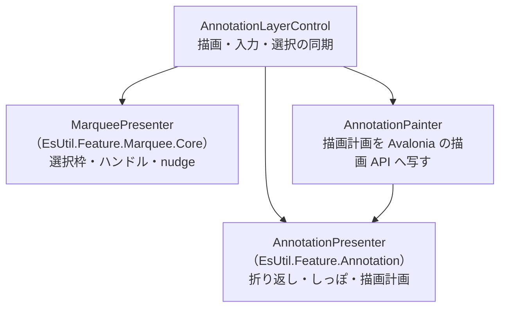

# EsUtil.Ui.AvaloniaUI.Annotation システム仕様書

## 目次

- [1. 概要](#1-概要)
- [2. 技術スタック](#2-技術スタック)
- [3. アーキテクチャ](#3-アーキテクチャ)
- [4. コンポーネント](#4-コンポーネント)
  - [4.1 本文の書式を変える経路](#41-本文の書式を変える経路)
  - [4.2 元に戻す・やり直す（操作の単位）](#42-元に戻すやり直す操作の単位)
- [5. 依存関係](#5-依存関係)
- [6. 例外処理ポリシー](#6-例外処理ポリシー)

## 1. 概要

画像に注釈（枠線・吹き出し）を重ねる Avalonia UI 版のコントロールです。 画像は焼き込まず、注釈をレイヤーとして重ねます。

| 項目 | 内容 |
| --- | --- |
| 目的 | 注釈の表示・選択・移動・サイズ変更・しっぽの移動・本文の編集 |
| 保存 | 行わない（注釈 JSON と合成画像の書き出しはホストの責務。 合成は `RenderComposedImage()` が元画像ピクセルの 1:1 で作る） |
| 座標 | 注釈は元画像ピクセル。 表示は縦横比を保って中央へ置く |

## 2. 技術スタック

| 項目 | 内容 |
| --- | --- |
| 対象フレームワーク | `net10.0-windows10.0.17763.0` |
| UI | Avalonia（`Control` を継承した自前描画。 XAML のテンプレートを持たない） |
| 選択枠 | `EsUtil.Feature.Marquee.Core` の提示層（`MarqueePresenter`） |
| 色の選択 | `EsUtil.Ui.AvaloniaUI.ColorSelector`（`ColorSelectorControl`。 注釈では代表色 40 色のタブと ColorPicker を出す） |
| 画像 | `IImage`（ホストが `EsBitmapAdapter` 等で用意する） |

## 3. アーキテクチャ

- **入力は 1 本の経路**です（押下 → しっぽの先端 → 注釈の本体（Marquee へ転送）→ 背景の順に判定）。
- **Marquee からの通知（選択矩形の変化）を文書へ書き戻します**（移動・サイズ変更の結果が `Document` に残る）。
- **描画は元画像座標で行います**（表示倍率の変換を 1 回だけ掛ける。 枠線・文字の比率が保存画像と一致する）。
- **本文は行のベースラインで揃えます**（行の高さは斜体を外した書式で測り、区間ごとの実寸では縦位置を決めません。 斜体にした区間だけが上下へずれたり、行の間隔が広がったりしないようにするため）。

## 4. コンポーネント

| コンポーネント | 分類 | 責務 |
| --- | --- | --- |
| `AnnotationLayerControl` | `public` | 画像の表示・注釈の描画・入力の受付・選択の同期・文書の変更通知・保存用の合成（`RenderComposedImage`） |
| `AnnotationTextEditor` | `public` | 本文の表示・その場編集と書式バーを 1 つにまとめたコントロール（`Layer` を内側で持ち、編集の開始・終了と本文の位置に合わせてバーを配置する） |
| `AnnotationFormatBar`（内部） | `internal` | 本文の上に出す書式バー（フォント・大きさ・色・B / I / U / S。 項目名は出さずツールチップで示す） |
| `AnnotationPalette` | `public` | 注釈の色選択で使う代表色 40 色（色名付き）と、色の選択をその構成にする処理 |
| `AnnotationStyleFlyout`（内部） | `internal` | 右クリックの編集 UI（外観・吹き出し・本文の書式・重なり順）。 `AnnotationEditorControls` の部品で組み立てる |
| `AnnotationEditorControls` | `public` | 編集 UI の行の部品（見出し・項目名・色・数値・選択肢・装飾の切り替え）。 フライアウトとホストの設定ペインが共有する |
| `AnnotationFonts` | `public` | 本文で選べるフォント名の一覧（優先フォントを先頭に置く） |
| `AnnotationHistory`（コア） | `public` | 変更履歴（元に戻す・やり直す）。 不変の文書をそのまま積む（ドラッグ中の書き換えで過去が変わらない） |
| `AnnotationTextInputClient`（内部） | `internal` | 本文の編集で IME（日本語入力）とやり取りする（変換候補の位置・選択範囲・変換中の文字列） |
| `AnnotationPainter`（内部） | `internal` | 描画計画の写像（角丸・しっぽ・文字・下線/取り消し線）と文字の実寸計測 |
| `AnnotationMarqueeEffects`（内部） | `internal` | Marquee が要求する効果（再描画・フォーカス・カーソル・キャプチャ）の写像 |

### 4.1 本文の書式を変える経路

| 経路 | 範囲の決め方 | 使いどころ |
| --- | --- | --- |
| 右クリックのフライアウト | `TextSelectionRange`（0 文字なら本文全体）。 画面に「適用先」を表示する | 本文を編集していないとき |
| ホストが置く書式バー | 本文の選択範囲（選択なしは全体）。 適用しても編集は続き、その場で反映される（項目名は出さずツールチップで示す。 同じ値でも適用できる） | 本文を編集中 |
| `Ctrl+B` / `Ctrl+I` / `Ctrl+U` / `Alt+Shift+5` | 本文の選択範囲（選択なしは全体） | 本文を編集中（バーを探さない） |

### 4.2 元に戻す・やり直す（操作の単位）

| 場面 | 単位 |
| --- | --- |
| 追加・削除・外観・書式・重なり順 | 1 回の操作 = 1 手 |
| 移動・サイズ変更・しっぽの移動 | 押下から離すまで = 1 手（`AnnotationHistory.BeginChange` で控え、`CommitChange` で積む） |
| 本文の確定 | 文字が変わったときだけ 1 手（同じ文字列なら記録しない） |

**履歴は変更前の文書をそのまま持ちます**（文書は不変）。 注釈の座標・しっぽはドラッグ中に変わるため、
変更前の文書を書き換えないため、記録した過去の状態が変わりません。 元に戻した後も**選択は識別子で引き継ぎます**（続けて操作できるようにする）。

**適用は 1 文字単位**です（`RichText.ApplyStyle` が run を分割・結合する。 コアが単一所有）。
ホストは本文の選択範囲をそのまま `TransformTextStyle(start, length, transform)` へ渡せます
（`ApplyTextStyle` は書式を丸ごと差し替えるため、色や大きさが既定へ戻る。 1 つの属性だけを変えるときは使わない）。

**ログ**: `AnnotationLayerControl.Log` / `LogPrefix`（`AnnotationTextEditor` も同じプロパティを持つ）で出力先と接頭辞を設定します（既定の接頭辞は `[Annotation]`）。 レベルは頻度で決めます。 `Information` は注釈ファイルの読み書きとファサードの生成、`Debug` は選択・本文の編集・書式の適用・パネルの表示と位置・押下と解放・注釈の追加、`Trace` はドラッグ中の文書の変更、`Error` は公開ファサードの例外です。 定義は `EsUtil.Feature.Annotation.Core` の `AnnotationLogMessage` が単一所有し、本アセンブリは同じロガーをコアと提示層へ渡します（規則は [`.github/ログ規約.md`](../../../.github/ログ規約.md)）。

## 5. 依存関係

| 方向 | 内容 |
| --- | --- |
| 許可 | 本アセンブリ → `EsUtil.Feature.Annotation.Core` / `EsUtil.Feature.Marquee.Core` / `EsUtil.Platform.Core` / `EsUtil.Ui.AvaloniaUI.ColorSelector` |
| 禁止 | 本アセンブリ → ホスト（アプリ。 本アセンブリは上位の層に依存しない） |
| 禁止 | 本アセンブリ → 本アセンブリの外の層（撮影セッション等。 本アセンブリは可搬でなければならない） |

規則の所有者は [`.github/依存関係.md`](../../../.github/依存関係.md) です。

## 6. 例外処理ポリシー

| 場面 | 扱い |
| --- | --- |
| 文書が空・選択が無い | 何もしない（null を返す。 例外にしない） |
| 画像が未設定 | 注釈だけを描く（`Source` が null でも動作する） |
| 文字の計測に失敗しうる環境 | フォントが無い場合は優先順の次のフォントへ落とす（例外にしない） |

共通方針は [`.github/例外処理規約.md`](../../../.github/例外処理規約.md) が所有します。
