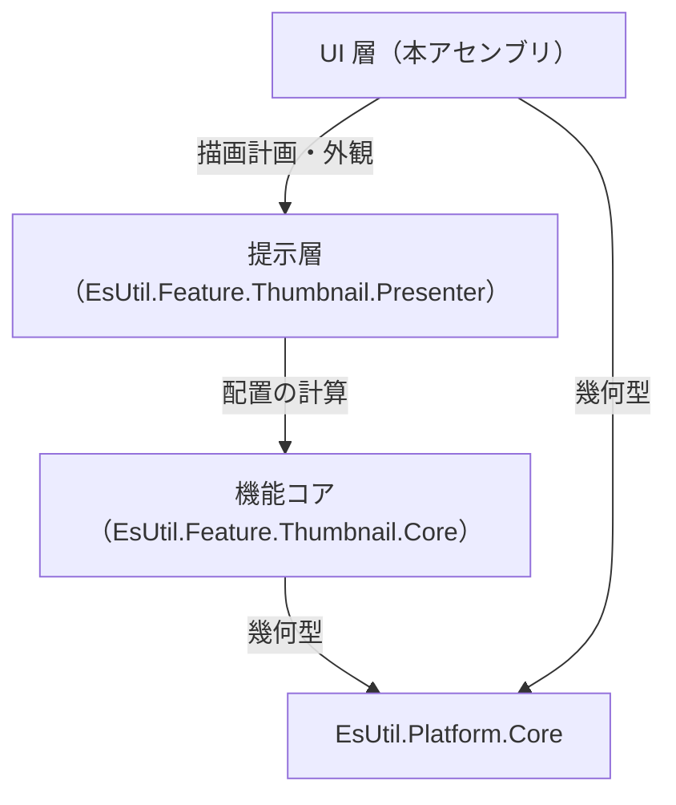
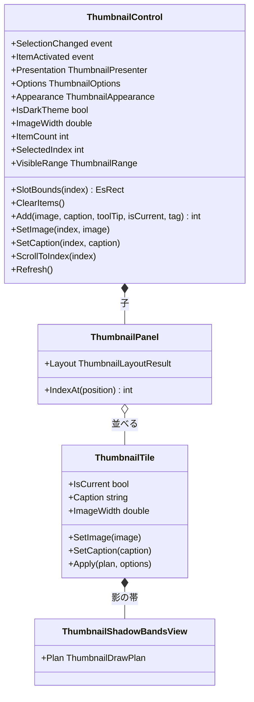
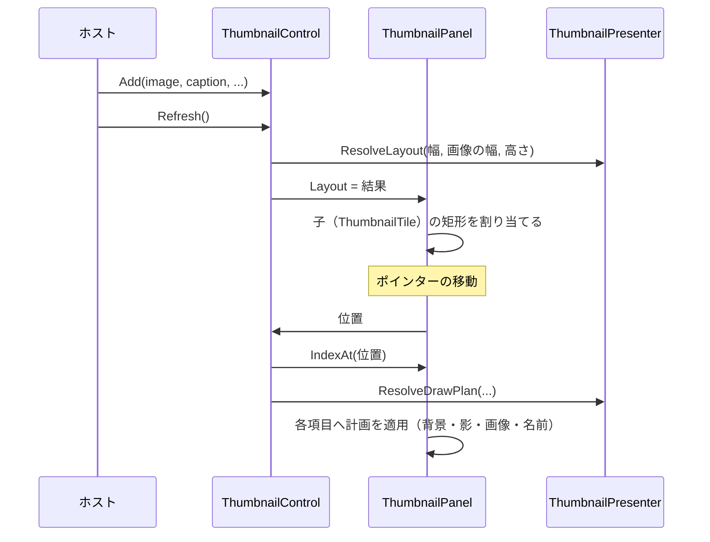

# EsUtil.Ui.AvaloniaUI.Thumbnail システム仕様書

Avalonia UI 版のサムネイル一覧コントロールの構造・依存・設計判断を扱います。 開発者向けの文書です。

## 目次 <!-- omit from toc -->

- [1. システム概要](#1-システム概要)
- [2. 技術スタック](#2-技術スタック)
- [3. アーキテクチャ](#3-アーキテクチャ)
  - [3.1 依存方向](#31-依存方向)
  - [3.2 責務の分担](#32-責務の分担)
  - [3.3 設計判断](#33-設計判断)
- [4. コンポーネント構成](#4-コンポーネント構成)
  - [4.1 可視性](#41-可視性)
- [5. クラス図](#5-クラス図)
- [6. 入力から描画までの流れ](#6-入力から描画までの流れ)
- [7. 影の描画](#7-影の描画)
- [8. エラー処理ポリシー](#8-エラー処理ポリシー)
- [9. 実装上の注意](#9-実装上の注意)

## 1. システム概要

本アセンブリは、サムネイル一覧を Avalonia のコントロールとして提供します。

- **配置と見た目は下の層が単一所有します**（`EsUtil.Feature.Thumbnail.Core` が並べ方、`EsUtil.Feature.Thumbnail.Presenter` が描画計画と外観）。
- **本アセンブリが行うのは 4 つだけ**: 入力の受付（ポインター → 添字）、スクロール、計画の適用（要素の配置）、描画計画の自 UI への写像。
- 対象フレームワークは `net10.0` です。

## 2. 技術スタック

| 種別 | 内容 |
| --- | --- |
| 言語 / フレームワーク | C# / .NET 10（`net10.0`） |
| UI フレームワーク | Avalonia（`ScrollViewer` / `Panel` / `Border` / `TextBlock`） |
| 参照パッケージ | `EsUtil.Feature.Thumbnail.Presenter` / `EsUtil.Platform.Core` / `Avalonia` |
| テスト | xUnit v3 + Avalonia ヘッドレス（`EsUtil.Ui.AvaloniaUI.Thumbnail.Tests`。 公開 API とログを検証する） |

## 3. アーキテクチャ

### 3.1 依存方向



- **依存は一方向**です（コアも提示層も Avalonia を知りません）。
- **本体プロジェクトは `ProjectReference` を持ちません**（ローカル フィードのパッケージを参照します）。

### 3.2 責務の分担

| 責務 | 所有者 |
| --- | --- |
| 折り返し・行の高さ・当たり判定・可視範囲 | `EsUtil.Feature.Thumbnail.Core` |
| 背景・影・名前の体裁、層の順序 | `EsUtil.Feature.Thumbnail.Presenter` |
| ポインターの受付・選択の決定・2 回押しの通知 | `ThumbnailControl` |
| 項目の要素（背景・影・画像・名前）の配置 | `ThumbnailTile`（内部） |
| 差し替えた影の算法の帯を塗る | `ThumbnailShadowBandsView`（内部） |
| 項目を並べる（配置の結果を子へ割り当てる） | `ThumbnailPanel`（内部） |

### 3.3 設計判断

- **`ScrollViewer` を継承する**: スクロール・ビューポート・ホイール操作を自前で実装しないためです（MewUI の `ScrollViewer` は sealed のため同じ形にできません）。
- **入力は位置から判定する**: 子要素のヒット テストに依存すると、影・名前の要素の有無や `IsHitTestVisible` の設定で当たり判定が変わります。 `IndexAt` を使い、入力の経路を 1 つにします。
- **影は要素に任せる（既定の算法だけ）**: 既定の `ThumbnailShadowPlan` は Avalonia の `BoxShadow` の実測値から作られており、`BoxShadow` に描かせれば 4 辺・4 隅がそのまま正しく出ます。
- **差し替えた算法は帯を塗る**: `BoxShadow` は計画の値（色・ぼかし）しか受け取れないため、別の算法の帯は `ThumbnailShadowBandsView` が 1 画素の帯として塗ります（全 UI で同じ結果にするため）。
- **要素は計算を持たない**: `ThumbnailTile` は計画の矩形をそのまま写します。 計算を要素へ置くと、UI ごとに並びがずれる原因になります。
- **配置は計測のたびに解く**: `MeasureOverride` が `ResolveLayout` を呼ぶため、幅が確定した後の呼び直しは不要です（`Refresh()` は `IsDarkTheme` の変更など、計測を伴わない変更に使います）。

## 4. コンポーネント構成

```text
EsUtil.Ui.AvaloniaUI/Thumbnail/
├── docs/
└── src/
```

| コンポーネント | 所在 | 内容 |
| --- | --- | --- |
| コントロール | `EsUtil.Ui.AvaloniaUI/Thumbnail/src/ThumbnailControl.cs` | 公開面。 入力の受付・選択・スクロール・計画の適用 |
| 項目の要素 | `EsUtil.Ui.AvaloniaUI/Thumbnail/src/ThumbnailTile.cs` | 背景・影・画像・名前の重ね合わせ（内部） |
| 影の帯 | `EsUtil.Ui.AvaloniaUI/Thumbnail/src/ThumbnailShadowBandsView.cs` | 差し替えた算法の帯を塗る面（内部） |
| イベント引数 | `EsUtil.Ui.AvaloniaUI/Thumbnail/src/ThumbnailActivatedEventArgs.cs` | 2 回押しの通知（公開） |
| 並べるパネル | `EsUtil.Ui.AvaloniaUI/Thumbnail/src/ThumbnailControl.cs`（入れ子） | 配置の結果を子へ割り当てる（内部） |

### 4.1 可視性

| 対象 | 可視性 | 理由 |
| --- | --- | --- |
| `ThumbnailControl` / `ThumbnailActivatedEventArgs` | `public` | ホストが使う |
| `ThumbnailTile` / `ThumbnailShadowBandsView` | `internal` | コントロールの実装詳細（ホストは `Add` / `SetImage` / `SetCaption` を使う） |
| `ThumbnailPanel` | `private`（入れ子） | コントロールだけが使う入れ子型 |

## 5. クラス図



## 6. 入力から描画までの流れ



1. `Refresh()` が配置を解き、`ThumbnailPanel` が子の矩形を割り当てます。
2. ポインターの移動は位置から添字へ変換し、ホバーの項目を切り替えます。
3. 押下は選択、2 回押しは `ItemActivated` の通知になります。
4. 各項目は自分の計画（背景・影・画像・名前）を適用します。

## 7. 影の描画

| 影の計画 | 描き方 |
| --- | --- |
| `ThumbnailShadowPlan`（既定） | `Border.BoxShadow` に任せる（`Blur` と `Color` を計画から渡す） |
| それ以外の `IThumbnailShadowPlan` | `ThumbnailShadowBandsView` が `BuildDeviceBands` の帯を塗る |
| `null` | 描かない |

- **帯の座標は物理ピクセル**です。 `ThumbnailShadowBandsView` は `TopLevel.RenderScaling` で割り、DIP の矩形へ戻してから描きます（格子に一致させるため端数を内側へ寄せます）。
- 帯を描く面は影を含む矩形（`ShadowArea`）へ配置されるため、画像の矩形を面の原点へ移してから帯を作ります。

## 8. エラー処理ポリシー

- **公開メソッドは引数を検証する**: 範囲外の添字は**何もせずに戻る**（一覧の組み直し中に古い添字が渡される経路があるため、例外で止めない）。
- **null の画像は許容する**: `Add` / `SetImage` は画像なしの項目を作ります（生成前のプレースホルダーを許すため）。
- 共通方針は [`../../../.github/例外処理規約.md`](../../../.github/例外処理規約.md) が所有します。

## 9. 実装上の注意

- **計画は 1 フレーム 1 回だけ解決する**: 描画のたびに解くと、状態の変化と表示がずれます。
- **要素をヒット テストの対象にしない**: 影と画像の要素は `IsHitTestVisible` を false にし、入力はパネルが受けます。
- **`IsDarkTheme` の変更は `Refresh()` を呼ぶ**: `Options` / `Appearance` / `ImageWidth` は setter が計測を無効化するため自動で反映されます。
- **ログ**: 画像と項目数の変更は本コントロールが記録します（`Log` / `LogPrefix`。 設定・外観の変更は提示層、選択の変更はコアが記録するため、本コントロールは重複して出力しません）。
