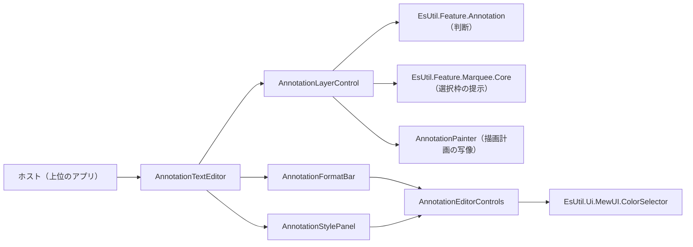

# EsUtil.Ui.MewUI.Annotation システム仕様書

MewUI 版の注釈レイヤーの構成と、他アセンブリとの関係をまとめます。 操作と描画の規則は Avalonia UI 版と同じで、本アセンブリは**自 UI の描画 API へ写す層**です。

## 目次

- [1. 概要](#1-概要)
- [2. 技術スタック](#2-技術スタック)
- [3. アーキテクチャ](#3-アーキテクチャ)
- [4. コンポーネント](#4-コンポーネント)
  - [4.1 本文の書式を変える経路](#41-本文の書式を変える経路)
  - [4.2 元に戻す・やり直す（操作の単位）](#42-元に戻すやり直す操作の単位)
  - [4.3 斜体の行高](#43-斜体の行高)
- [5. 依存関係](#5-依存関係)
- [6. 例外処理ポリシー](#6-例外処理ポリシー)

## 1. 概要

画像の上へ注釈（枠線・吹き出し）を重ね、本文をその場で編集するためのコントロール群です。 ホストは `AnnotationTextEditor` を 1 つ置くだけで、本文の編集と書式の変更ができます。

- **判断はコアが単一所有**: 当たり判定・折り返し・描画計画・履歴は `EsUtil.Feature.Annotation` が持ちます。 本アセンブリは判断を持ちません。
- **選択枠とハンドルは Marquee の提示層を再利用**: 移動・サイズ変更・nudge・カーソル形状が UI 版で揃います。
- **色の選択は ColorSelector を使う**: 自前の色入力を作りません。

## 2. 技術スタック

| 項目 | 内容 |
| --- | --- |
| UI | `Aprillz.MewUI`（`Aprillz.MewUI.Core`） |
| 描画 | MewUI の描画コンテキスト（`IGraphicsContext`）とテキスト レイアウト |
| 画像 | `EsUtil.Platform.Core` の `EsBitmap` / `EsReadOnlyBitmap` |
| 選択枠 | `EsUtil.Feature.Marquee.Core` の提示層（`MarqueeEffectsBase`） |
| 色の選択 | `EsUtil.Ui.MewUI.ColorSelector` |
| 対象 | `net10.0-windows10.0.17763.0` |

## 3. アーキテクチャ

**層の向き**: ホスト → 本アセンブリ → コア（`Feature.Annotation` / `Marquee` / `Platform`）。 逆向きの参照はありません（可搬性のため、本アセンブリはアプリも撮影スタックも参照しません）。

## 4. コンポーネント

| 型 | 役割 |
| --- | --- |
| `AnnotationTextEditor` | レイヤーと書式バーを重ね、本文編集の開始・終了でバーを出し入れする |
| `AnnotationLayerControl` | 画像の表示・注釈の描画・入力の受付（`Input` / `TextEditing` の部分クラスへ分ける） |
| `AnnotationPainter` | コアの描画計画を MewUI の描画 API へ写す |
| `AnnotationTextMetrics` | 行の寸法とベースラインの解決（斜体でも行の高さを変えない） |
| `AnnotationFormatBar` | 文字単位の書式（B / I / U / S・色・大きさ・フォント）の操作 |
| `AnnotationStylePanel` | 外観・しっぽ・重なり順の編集 |
| `AnnotationEditorControls` | 編集 UI の行の部品（書式バーと外観パネルが共有する） |
| `AnnotationPalette` | 代表色（40 色）と色選択のタブ |

### 4.1 本文の書式を変える経路

書式バーと右クリックのフライアウトは、どちらも `TransformTextStyle(start, length, transform)` を呼びます（1 つの属性だけを変え、色や大きさを保つ）。 適用は 1 文字単位で、run の分割・結合はコアの `RichText.ApplyStyle` が単一所有します。

### 4.2 元に戻す・やり直す（操作の単位）

変更の直前に `AnnotationHistory.BeginChange` で文書を控え、通知時に `CommitChange` で積みます。 ドラッグは押下から離すまでで 1 手です。 変更前の文書を書き換えないため、記録した過去の状態が変わりません。

### 4.3 斜体の行高

幅（折り返し）は指定どおりの書式で測り、行の高さは斜体を外した書式で測り、描画は行のベースラインで揃えます（区間ごとに縦位置を決めると、斜体にした区間だけが上下へずれ、行の間隔が変わります）。

**ログ**: `AnnotationLayerControl.Log` / `LogPrefix`（`AnnotationTextEditor` も同じプロパティを持つ）で出力先と接頭辞を設定します（既定の接頭辞は `[Annotation]`）。 レベルは頻度で決めます。 `Information` は注釈ファイルの読み書きとファサードの生成、`Debug` は選択・本文の編集・書式の適用・パネルの表示と位置・押下と解放・注釈の追加、`Trace` はドラッグ中の文書の変更、`Error` は公開ファサードの例外です。 定義は `EsUtil.Feature.Annotation.Core` の `AnnotationLogMessage` が単一所有し、本アセンブリは同じロガーをコアと提示層へ渡します（規則は [`.github/ログ規約.md`](../../../.github/ログ規約.md)）。

## 5. 依存関係

| 方向 | 内容 |
| --- | --- |
| 許可 | 本アセンブリ → `EsUtil.Feature.Annotation.Core` / `EsUtil.Feature.Marquee.Core` / `EsUtil.Platform.Core` / `EsUtil.Ui.MewUI.ColorSelector` |
| 禁止 | 本アセンブリ → ホスト（アプリ。 本アセンブリは上位の層に依存しない） |
| 禁止 | 本アセンブリ → 本アセンブリの外の層（撮影セッション等。 本アセンブリは可搬でなければならない） |

規則の所有者は [`.github/依存関係.md`](../../../.github/依存関係.md) です。

## 6. 例外処理ポリシー

| 場面 | 扱い |
| --- | --- |
| 文書が空・選択が無い | 何もしない（`false` を返す。 例外にしない） |
| 画像が未設定 | 注釈だけを描く（`Source` が null でも動作する） |
| 文字の計測に失敗しうる環境 | フォントが無い場合は優先順の次のフォントへ落とす（例外にしない） |
| ホストの操作（フライアウトの表示など） | 例外を投げず、操作を無視する |

共通方針は [`.github/例外処理規約.md`](../../../.github/例外処理規約.md) が所有します。
