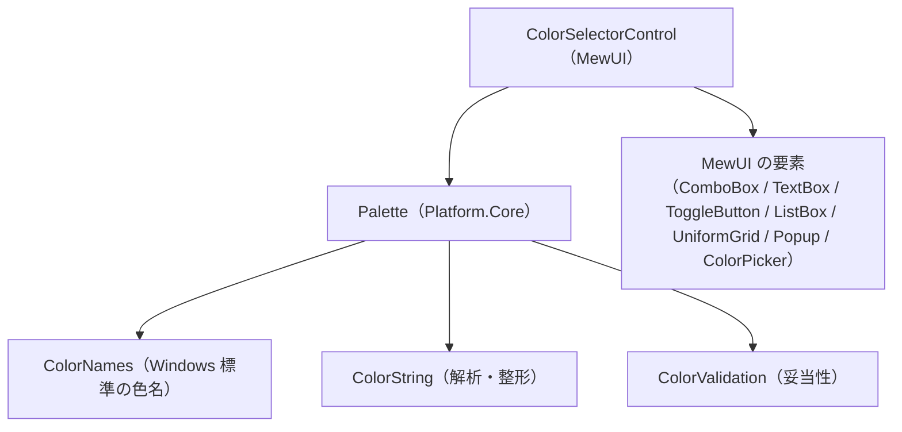

# EsUtil.Ui.MewUI.ColorSelector システム仕様書

## 目次 <!-- omit from toc -->

- [1. 概要](#1-概要)
- [2. 技術スタック](#2-技術スタック)
- [3. アーキテクチャ](#3-アーキテクチャ)
- [4. 例外処理ポリシー](#4-例外処理ポリシー)
- [5. コンポーネント構成](#5-コンポーネント構成)
- [6. 依存関係](#6-依存関係)

---

## 1. 概要

MewUI の要素だけで色選択の UI を組み立て、**色名・色文字列の規則はコア（`EsUtil.Platform.Core` の `Palette`）へ委譲**します。 これにより 3 つの UI 版が同じ入力と同じ保存値を共有します。

## 2. 技術スタック

| 項目 | 内容 |
| --- | --- |
| 言語 | C# 14（.NET 10） |
| UI | MewUI 0.22.1（`Grid` / `ComboBox` / `TextBox` / `Button` / `ToggleButton` / `ListBox` / `UniformGrid` / `Popup` / `ColorPicker`） |
| ログ | `Microsoft.Extensions.Logging.Abstractions`（`LoggerMessage` ソース生成） |
| 色の規則 | `EsUtil.Platform.Core` の `Palette` |

## 3. アーキテクチャ

- **UI 層が持つもの**: 標準のコンボボックス（枠と展開ボタン）と、その文字の位置へ重ねるテキスト入力（編集可の代替）、入力と状態の同期、タブ付きのポップアップ（カスタム / テーマカラー / 色名 / ColorPicker）とピッカーの開閉、ツールチップ、`SelectedColorChanged` の発火、一覧のタブの構成（表示の設定と `CustomTabs` から作り直す）と並べ方（一覧 / 色の四角 6 列の格子）・幅の決定。
- **コアが持つもの**: 受理する入力、保存値と表示の形式（`ColorTextFormat`）、色名の表、並び順、妥当性の判定。

## 4. 例外処理ポリシー

共通方針は [`例外処理規約.md`](../../../.github/例外処理規約.md) に従います。 本プロジェクト固有の扱いはありません（無効な入力は例外ではなく検証状態として扱います）。

## 5. コンポーネント構成

| 型 | 役割 |
| --- | --- |
| `ColorSelectorControl` | 公開 API。 入力・一覧・ピッカーの 3 経路を `SelectedColor` へ集約する。 **入力欄は標準の `ComboBox`**（枠と展開ボタン）と、その文字の位置へ重ねた `TextBox`（編集可の代替）で成り、コンボボックスの `MouseDown` を処理して標準の一覧の代わりにタブ付きの `Popup` を出す。 一覧のタブは表示の設定と `CustomTabs` から `CreateTabs` で作り、`RefreshList` のたびに `ToggleButton` と中身を作り直す（MewUI はコードで組み立てるため、タブを静的に持てない）。 タブの中身は「色スウォッチ + 色名」の `ListBox` と、色の四角を 6 列に並べる `UniformGrid`（スクロールしない）。 「ColorPicker」タブは MewUI の `ColorPicker` がドロップダウンのため、一覧を閉じてから 1×1 の入れ物に置いたピッカーを開く（折り畳み時の見出しは切り取って出さない）。 入力欄にはカスタム タブの色名を出す（`FormatDisplayText` / `ResolveCustomName`。 値は色として比べ、不透明度はアルファから求める）。 一覧の幅は `ApplyListWidth` が決め、**コントロールの幅は変えず**一覧だけを枠と内容の広い方へ合わせる |
| `ColorSelectorCustomTab` | 利用者が追加するタブ（題名・並べる色・並べ方）。 空の `Colors` は表示しない |
| `ColorSelectorCustomColor` | カスタム タブの 1 色（一覧に表示する名前と、選んだときに適用する色） |
| `ColorSelectorTabLayout` | カスタム タブの並べ方（`List` = 色名付きの一覧 / `Grid` = 色の四角を 6 列に並べる格子） |
| `ColorSelectorCategory` | 一覧の項目の分類（`Theme` / `Named` / `Custom`。 internal） |
| `ColorSelectorItem` | 一覧の 1 件（表示名・適用値・分類・テーマの識別子。 internal） |
| `ColorSelectorTabSpec` | 一覧の 1 タブ（題名・識別子・並べ方・項目・カラーピッカーか。 internal。 表示の設定と中身から作り、空のタブは作らない） |
| `LogMessage` | 変更の記録（`設定: 選択色 <旧> → <新>`） |

## 6. 依存関係

`EsUtil.Platform.Core` と MewUI、ログ抽象だけを参照します（参照の許可範囲は [`依存関係.md`](../../../.github/依存関係.md)）。
