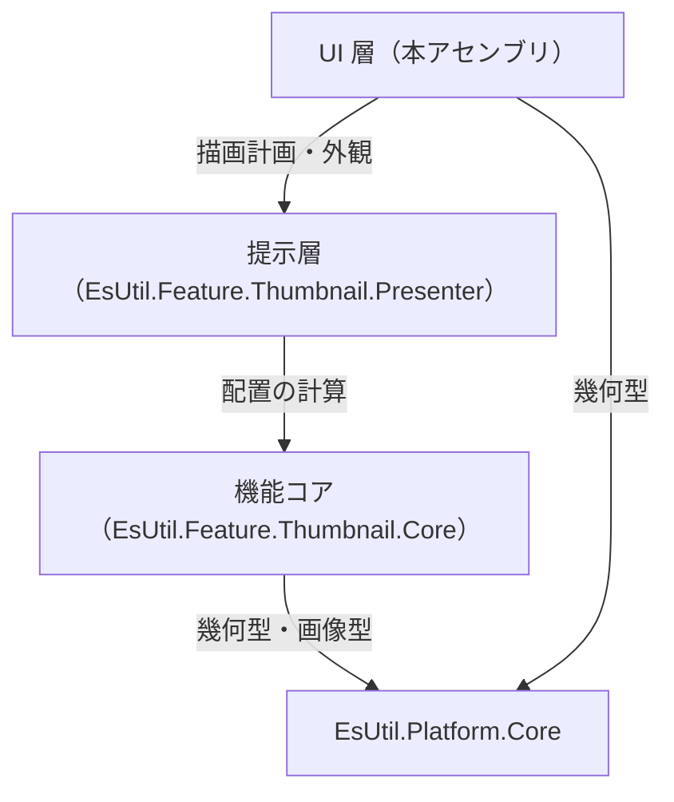
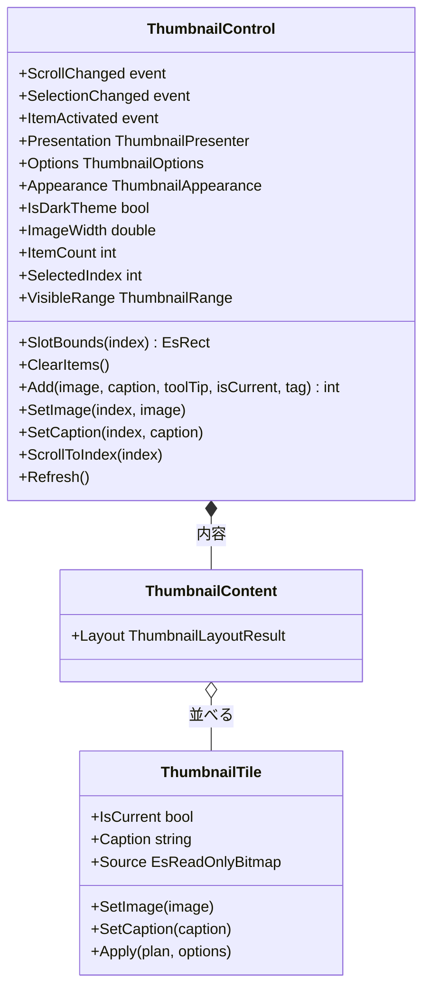
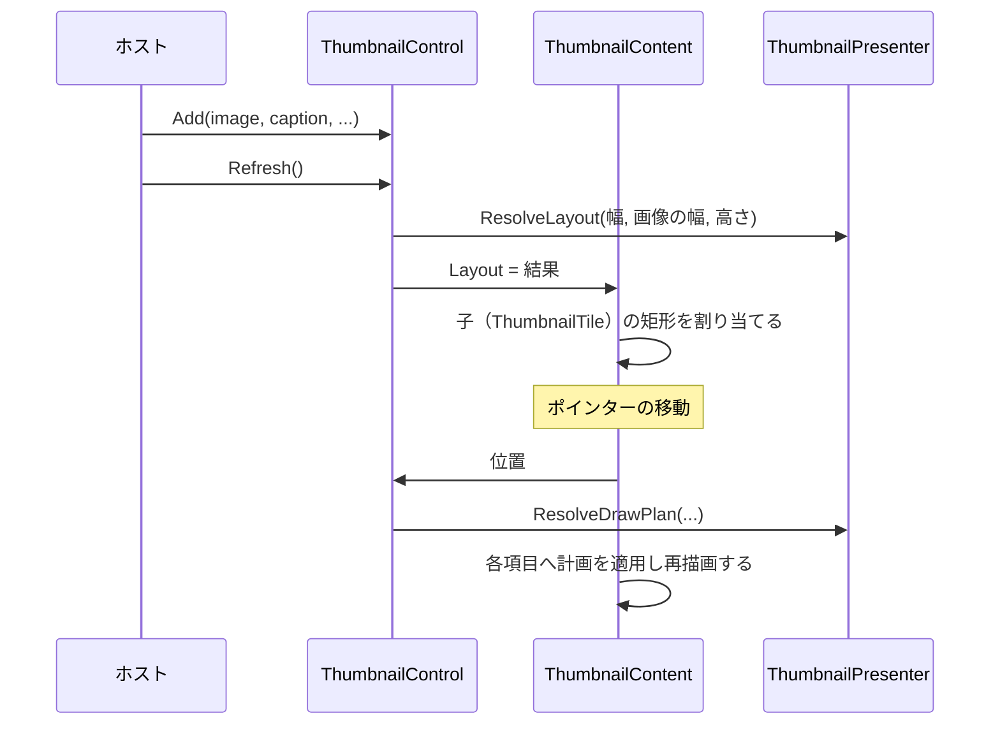

# EsUtil.Ui.MewUI.Thumbnail システム仕様書

MewUI 版のサムネイル一覧コントロールの構造・依存・設計判断を扱います。 開発者向けの文書です。

## 目次 <!-- omit from toc -->

- [1. システム概要](#1-システム概要)
- [2. 技術スタック](#2-技術スタック)
- [3. アーキテクチャ](#3-アーキテクチャ)
  - [3.1 依存方向](#31-依存方向)
  - [3.2 責務の分担](#32-責務の分担)
  - [3.3 設計判断](#33-設計判断)
- [4. コンポーネント構成](#4-コンポーネント構成)
  - [4.1 可視性](#41-可視性)
- [5. クラス図](#5-クラス図)
- [6. 入力から描画までの流れ](#6-入力から描画までの流れ)
- [7. 影と画像の描画](#7-影と画像の描画)
- [8. エラー処理ポリシー](#8-エラー処理ポリシー)
- [9. 実装上の注意](#9-実装上の注意)

## 1. システム概要

本アセンブリは、サムネイル一覧を MewUI のコントロールとして提供します。

- **配置と見た目は下の層が単一所有します**（`EsUtil.Feature.Thumbnail.Core` が並べ方、`EsUtil.Feature.Thumbnail.Presenter` が描画計画と外観）。
- **本アセンブリが行うのは 4 つだけ**: 入力の受付、スクロール、計画の適用、Skia による描画。
- 対象フレームワークは `net10.0` です。

## 2. 技術スタック

| 種別 | 内容 |
| --- | --- |
| 言語 / フレームワーク | C# / .NET 10（`net10.0`） |
| UI フレームワーク | MewUI（`Panel` / `ScrollViewer` / Skia の描画面）。 **バージョンは固定**（API が安定化中（0.x）のため） |
| 描画 | Skia（`SKCanvas`。 `Aprillz.MewUI.Skia`） |
| 参照パッケージ | `EsUtil.Feature.Thumbnail.Presenter` / `EsUtil.Platform.Core` / `Aprillz.MewUI.Skia` |
| テスト | xUnit v3（`EsUtil.Ui.MewUI.Thumbnail.Tests`。 公開 API とログを検証する） |

## 3. アーキテクチャ

### 3.1 依存方向



- **依存は一方向**です（コアも提示層も MewUI を知りません）。
- **本体プロジェクトは `ProjectReference` を持ちません**（ローカル フィードのパッケージを参照します）。

### 3.2 責務の分担

| 責務 | 所有者 |
| --- | --- |
| 折り返し・行の高さ・当たり判定・可視範囲 | `EsUtil.Feature.Thumbnail.Core` |
| 背景・影・名前の体裁、層の順序 | `EsUtil.Feature.Thumbnail.Presenter` |
| ポインターの受付・選択の決定・2 回押しの通知 | `ThumbnailControl` |
| スクロール（`ScrollViewer` の保持と通知） | `ThumbnailControl` |
| 項目の描画（背景・影・画像・名前） | `ThumbnailTile`（内部） |
| 内容の配置（レイアウトの結果を子へ割り当てる） | `ThumbnailContent`（内部） |
| DIP → 物理ピクセルの倍率の解決 | `Internal.ClientPixelScale` |
| コアの画像 ⇔ Skia の画像の変換 | `Internal.EsBitmapSkiaExtensions` |
| 影の帯の描画 | `Internal.SkiaShadowRenderer` |

### 3.3 設計判断

- **`ScrollViewer` を継承しない**: MewUI の `ScrollViewer` は sealed です。 一覧は `Panel` を継承し、スクロールと内容を子として持ちます（AvaloniaUI 版と継承関係が異なる理由）。
- **項目は Skia の描画面で描く**: 背景・影・画像・名前のうち、背景・影・画像は Skia の描画面へ描き、名前は要素として重ねます（テキストの折り返しと省略を要素の機能に任せるため）。
- **描画面は明示的に再描画を要求する**: Skia の描画面は寸法が変わらなければ再描画されません。 計画・画像を差し替えた時点で `InvalidateVisual()` を呼ばないと、生成したサムネイルが反映されません（実測）。
- **影は 1 画素の帯を塗る**: グラデーション ブラシの端の扱いに依存せず、全 UI で同じ結果にするためです。
- **画像は非所有ビューで描く**: コアの画像（`EsReadOnlyBitmap`）のピクセルを複製せず、Skia の画像として包んで描きます（一覧に数百件を並べても複製でメモリを圧迫しません）。
- **倍率は描画面と割り当て領域の比から解決する**: DPI の通知が届かない状況でも、描画面の物理ピクセルと DIP の比から正しい倍率が得られます（`ClientPixelScale`）。
- **入力は位置から判定する**: 子要素のヒット テストに依存せず、`IndexAt` で添字を求めます。

## 4. コンポーネント構成

```text
EsUtil.Ui.MewUI/Thumbnail/
├── docs/
└── src/
    └── Internal/
```

| コンポーネント | 所在 | 内容 |
| --- | --- | --- |
| コントロール | `EsUtil.Ui.MewUI/Thumbnail/src/ThumbnailControl.cs` | 公開面。 入力の受付・選択・スクロール・計画の適用 |
| 項目の要素 | `EsUtil.Ui.MewUI/Thumbnail/src/ThumbnailTile.cs` | Skia の描画面と名前の要素（内部） |
| イベント引数 | `EsUtil.Ui.MewUI/Thumbnail/src/ThumbnailActivatedEventArgs.cs` | 2 回押しの通知（公開） |
| 倍率の解決 | `EsUtil.Ui.MewUI/Thumbnail/src/Internal/ClientPixelScale.cs` | 描画面と割り当て領域から倍率を求める（内部） |
| 画像の変換 | `EsUtil.Ui.MewUI/Thumbnail/src/Internal/EsBitmapSkiaExtensions.cs` | コアの画像を Skia の画像として包む（内部） |
| 影の描画 | `EsUtil.Ui.MewUI/Thumbnail/src/Internal/SkiaShadowRenderer.cs` | 帯を単色で塗る（内部） |

### 4.1 可視性

| 対象 | 可視性 | 理由 |
| --- | --- | --- |
| `ThumbnailControl` / `ThumbnailActivatedEventArgs` | `public` | ホストが使う |
| `ThumbnailTile` / `Internal.*` | `internal` | コントロールの実装詳細 |
| `ThumbnailContent` / `ThumbnailViewport` | `private`（入れ子） | コントロールだけが使う入れ子型 |

## 5. クラス図



## 6. 入力から描画までの流れ



1. `Refresh()` が配置を解き、`ThumbnailContent` が子の矩形を割り当てます。
2. ポインターの移動は位置から添字へ変換し、ホバーを切り替えます。
3. 押下は選択、2 回押しは `ItemActivated` の通知になります。
4. スクロールは内側の `ScrollViewer` が行い、変化は `ScrollChanged` で通知します。

## 7. 影と画像の描画

- **影**: `Internal.SkiaShadowRenderer` が `BuildDeviceBands` の帯を 1 画素ずつ単色で塗ります。 倍率は `ClientPixelScale` が解決します。
- **画像**: コアの画像を Skia の画像として包み（`Internal.EsBitmapSkiaExtensions`）、`SKCanvas.DrawImage` で描きます。 **ピクセルは複製しません**。
- **名前**: 要素（テキスト）として重ねます。 計画の `Bounds` をそのまま割り当てます。

## 8. エラー処理ポリシー

- **公開メソッドは引数を検証する**: 範囲外の添字は**何もせずに戻る**（一覧の組み直し中に古い添字が渡される経路があるため）。
- **null の画像は許容する**: `Add` / `SetImage` は画像なしの項目を作ります。
- **倍率が解決できない場合は 1.0 を使う**: 描画面の寸法が 0 の間は倍率を 1.0 とし、次の描画で解決し直します。
- 共通方針は [`../../../.github/例外処理規約.md`](../../../.github/例外処理規約.md) が所有します。

## 9. 実装上の注意

- **コアの画像を保持しない**: コントロールは画像の所有権を持ちません（`ClearItems` でも解放しません）。
- **描画のたびに計画を解き直さない**: 状態が変わったときだけ解決し、項目へ適用します。
- **`Refresh()` は明示的な解き直しに使う**: 各 setter が配置を解き直すため、通常は呼ぶ必要がありません（同じ値を入れ直したときなどに使います）。
- **子は自分で計測・配置する**: MewUI の `Panel` は子のレイアウトを持たないため、`MeasureContent` / `ArrangeContent` を上書きしないと子は大きさ 0 のまま描かれません（実測: スクロールは表示されたが中身が空だった）。
- **子へ渡す矩形はウィンドウ絶対座標**: MewUI の `Arrange` は絶対座標を受け取ります。 内容の座標に親の絶対座標を加算しないと、項目が画面の左上へ寄ります（実測）。
- **見た目の適用は計測フェーズで行う**: 配置フェーズで子の計測を無効化するとレイアウト サイクルになります。 `ApplyState` は `MeasureContent` で計測の前に呼びます。
- **ログ**: 画像と項目数の変更は本コントロールが記録します（`Log` / `LogPrefix`。 設定・外観の変更は提示層、選択の変更はコアが記録するため、本コントロールは重複して出力しません）。
