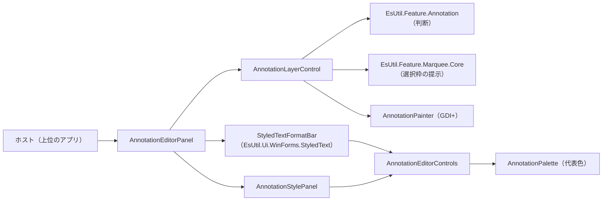

# EsUtil.Ui.WinForms.Annotation システム仕様書

WinForms 版の注釈レイヤーの構成と、他アセンブリとの関係をまとめます。 操作と描画の規則は Avalonia UI 版と同じで、本アセンブリは**GDI+ へ写す層**です。

## 目次

- [1. 概要](#1-概要)
- [2. 技術スタック](#2-技術スタック)
- [3. アーキテクチャ](#3-アーキテクチャ)
- [4. コンポーネント](#4-コンポーネント)
  - [4.1 描画のまとまり](#41-描画のまとまり)
  - [4.2 本文の編集と書式](#42-本文の編集と書式)
- [5. 依存関係](#5-依存関係)
- [6. 例外処理ポリシー](#6-例外処理ポリシー)

## 1. 概要

画像の上へ注釈（枠線・吹き出し）を重ね、本文を編集するためのコントロール群です。 ホストは `AnnotationEditorPanel` を 1 つ置くだけで、本文の編集と書式の変更ができます。

- **判断はコアが単一所有**: 当たり判定・折り返し・描画計画・履歴は `EsUtil.Feature.Annotation` が持ちます。
- **選択枠とハンドルは Marquee の提示層を再利用**: 移動・サイズ変更・nudge が UI 版で揃います。
- **色は代表色のメニューと色ダイアログ**: WinForms には色選択コントロールが無いため、代表色（40 色）をメニューへ並べます。

## 2. 技術スタック

| 項目 | 内容 |
| --- | --- |
| UI | WinForms（`UseWindowsForms`） |
| 描画 | GDI+（`System.Drawing`。 画面と保存で同じ手順を使う） |
| 画像 | `EsUtil.Ui.WinForms.Interop` の `EsBitmapDrawingInterop` |
| 選択枠 | `EsUtil.Feature.Marquee.Core` の提示層 |
| 対象 | `net10.0-windows10.0.17763.0` |

## 3. アーキテクチャ

**層の向き**: ホスト → 本アセンブリ → コア（`Feature.Annotation` / `Marquee` / `Platform`）。 逆向きの参照はありません。

## 4. コンポーネント

| 型 | 役割 |
| --- | --- |
| `AnnotationEditorPanel` | レイヤーと書式バーを重ね、編集の開始・終了でバーを出し入れする |
| `AnnotationLayerControl` | 画像・注釈の図形の表示と選択・移動の入力（`Input` の部分クラスへ分ける）。 **本文の入力・IME・キャレットは持たない**（`StyledTextControl` が単一所有する） |
| `AnnotationPainter` | 描画計画を GDI+ の図形と文字へ写す（画面と保存で共有する） |
| `AnnotationTextMetrics` | 本文の実寸（送り幅・行の高さ）を GDI+ で測る |
| `StyledTextFormatBar`（`EsUtil.Ui.WinForms.StyledText`） | 文字単位の書式（B / I / U / S・色・大きさ・フォント）の操作。 ホストは `FormatBarFactory` で独自の GUI へ差し替えられる |
| `AnnotationStylePanel` | 外観・しっぽ・重なり順の編集 |
| `AnnotationEditorControls` | 編集 UI の部品（書式バーと外観パネルが共有する） |
| `AnnotationPalette` | 代表色（40 色） |

### 4.1 描画のまとまり

注釈は**元画像ピクセルの座標**で保持し、描画のたびに表示倍率と位置を掛けます（画像へ焼き込まない）。
保存する合成画像は同じ手順を 1:1 で呼びます（画面と保存で見た目が一致する）。
本文は区間ごとに描き、行の高さいっぱいの中央へ置きます（斜体でも行の間隔を変えない）。

### 4.2 本文の編集と書式

本文の編集は**その場で**行います（表示中のレイアウトのままキャレットと選択範囲を描き、入力欄を重ねません）。 入力のたびに本文と文字単位の書式をコアの `RichText`（run の並び）へ写します。 日本語入力は `WM_IME_COMPOSITION` から受け取ります。
書式バーの操作は本文の選択範囲へ適用し、同じ内容をモデルへ写します。
編集中は下の注釈の本文を描きません（本文を二重に表示しない）。

**ログ**: `AnnotationLayerControl.Log` / `LogPrefix`（`AnnotationEditorPanel` も同じプロパティを持つ）で出力先と接頭辞を設定します（既定の接頭辞は `[Annotation]`）。 レベルは頻度で決めます。 `Information` は注釈ファイルの読み書きとファサードの生成、`Debug` は選択・本文の編集・書式の適用・パネルの表示と位置・押下と解放・注釈の追加、`Trace` はドラッグ中の文書の変更、`Error` は公開ファサードの例外です。 定義は `EsUtil.Feature.Annotation.Core` の `AnnotationLogMessage` が単一所有し、本アセンブリは同じロガーをコアと提示層へ渡します（規則は [`.github/ログ規約.md`](../../../.github/ログ規約.md)）。

## 5. 依存関係

| 方向 | 内容 |
| --- | --- |
| 許可 | 本アセンブリ → `EsUtil.Feature.Annotation.Core` / `EsUtil.Feature.Marquee.Core` / `EsUtil.Platform.Core` / `EsUtil.Ui.WinForms.Interop` |
| 禁止 | 本アセンブリ → ホスト（アプリ。 本アセンブリは上位の層に依存しない） |
| 禁止 | 本アセンブリ → 本アセンブリの外の層（撮影セッション等。 本アセンブリは可搬でなければならない） |

規則の所有者は [`.github/依存関係.md`](../../../.github/依存関係.md) です。

## 6. 例外処理ポリシー

| 場面 | 扱い |
| --- | --- |
| 文書が空・選択が無い | 何もしない（`false` を返す。 例外にしない） |
| 画像が未設定 | 注釈だけを描く（`Source` が null でも動作する） |
| 付随ファイルの削除に失敗 | ホストがログへ記録して続行する（本アセンブリは投げない） |
| 本文を編集中でない | 何もしない（モデルの書式だけを変える） |

共通方針は [`.github/例外処理規約.md`](../../../.github/例外処理規約.md) が所有します。
