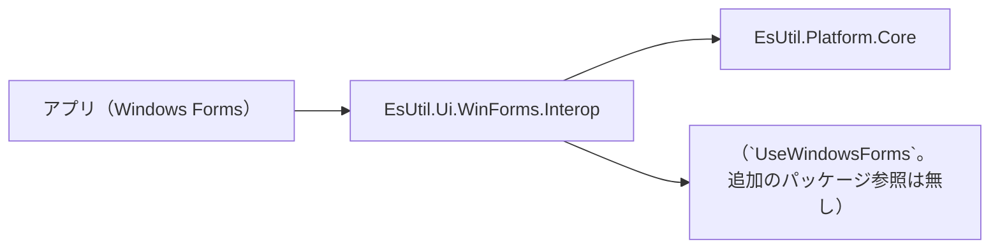

# EsUtil.Ui.WinForms.Interop システム仕様書

Windows Forms と EsUtil の型の境界を担うアセンブリの構造・依存・設計判断を扱います。 開発者向けの文書です。

## 目次 <!-- omit from toc -->

- [1. システム概要](#1-システム概要)
- [2. 技術スタック](#2-技術スタック)
- [3. アーキテクチャ](#3-アーキテクチャ)
- [4. コンポーネント構成](#4-コンポーネント構成)
- [5. 依存関係](#5-依存関係)
- [6. エラー処理ポリシー](#6-エラー処理ポリシー)
- [7. 実装上の注意](#7-実装上の注意)

## 1. システム概要

Windows Forms の型と EsUtil の型の**境界**を担うアセンブリです。 UI フレームワークに依存する処理（型の変換と UI 固有の描画）だけを置き、それ以外は下の層へ委ねます。

## 2. 技術スタック

| 項目 | 内容 |
| --- | --- |
| 対象フレームワーク | `net10.0-windows` |
| UI フレームワーク | （`UseWindowsForms`。 追加のパッケージ参照は無し） |
| 共通基盤 | `EsUtil.Platform.Core`（値型・画像・OS の抽象） |
| テスト | xUnit v3 |

## 3. アーキテクチャ

- **依存の向きは 1 方向です**（アプリ → 本アセンブリ → コアと UI フレームワーク）。 本アセンブリからアプリへは参照しません。
- **変換の規則を 1 か所に持ちます**: 同じ変換をアプリや各コントロールへ写すと、片方だけ直したときに挙動が食い違います。

## 4. コンポーネント構成

| 区分 | 型 |
| --- | --- |
| `Imaging.EsBitmapDrawingInterop` | コアの画像 ↔ `System.Drawing.Bitmap` |
| `Imaging.ImageView` | 画像を描く表示ビュー（`Control` + `OnPaint`） |
| `Imaging.ImageRenderer` | コアの画像を GDI+ で描く |
| `Imaging.GdiFill` / `GdiText` / `GdiLabel` | GDI+ の塗り・文字・ラベル |
| `EsImageDrawMath`（コア） | 配置の矩形の純粋計算 |
| `EsImageDrawMode`（コア） | 配置の仕方（`Fill` / `Uniform`） |

## 5. 依存関係

`EsUtil.Platform.Core` と （`UseWindowsForms`。 追加のパッケージ参照は無し） を参照します。 参照してよいプロジェクトの規則は [`.github/依存関係.md`](../../../.github/依存関係.md) §3 が定めます。

## 6. エラー処理ポリシー

- **未対応の値は既定値へ落とします**（キーの未定義値は `None`、対応の無い幾何は 0）。 例外にしません（UI の入力経路で例外を投げると操作が止まります）。
- **引数の null は `ArgumentNullException`** にします（呼び出し側の誤りであり、黙って既定値へ落とすと原因が分かりません）。
- **グラフィックス バックエンドが未登録の環境**（MewUI のテキスト計測など）では、UI フレームワークが投げる例外をそのまま伝えます（本アセンブリで握りつぶしません）。

## 7. 実装上の注意

- 描画は GDI+ の標準 API を使います（Skia を使いません）。
