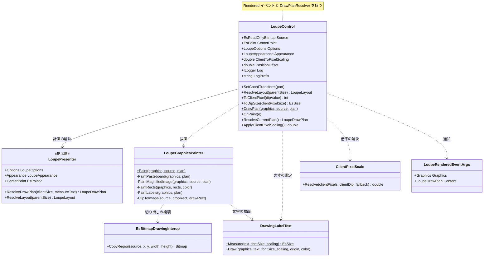
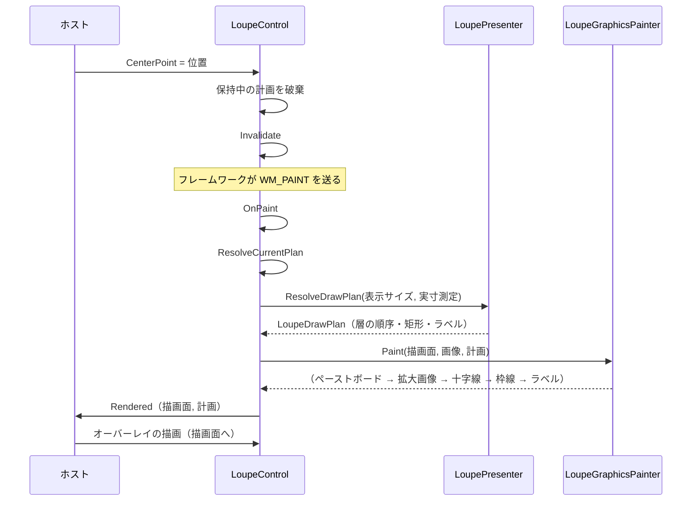

# EsUtil.Ui.WinForms.Loupe システム仕様書

`LoupeControl`（WinForms 版ルーペ）のシステム概要・アーキテクチャ・依存関係・設計判断を記載します。

## 目次 <!-- omit from toc -->

- [1. システム概要](#1-システム概要)
- [2. 技術スタック](#2-技術スタック)
- [3. アーキテクチャ](#3-アーキテクチャ)
  - [3.1 依存方向](#31-依存方向)
  - [3.2 責務の分担](#32-責務の分担)
- [4. 例外処理ポリシー](#4-例外処理ポリシー)
- [5. コンポーネント構成](#5-コンポーネント構成)
- [6. クラス図](#6-クラス図)
- [7. シーケンス図（描画）](#7-シーケンス図描画)
- [8. 設計判断](#8-設計判断)
- [9. テスト方針](#9-テスト方針)
- [10. 未実装・今後の対応](#10-未実装今後の対応)
- [11. ログ](#11-ログ)

## 1. システム概要

`EsUtil.Ui.WinForms.Loupe` は、他の UI 版と**同一の UI 非依存コア（`EsUtil.Feature.Loupe.Core`）と提示層（`EsUtil.Feature.Loupe.Presenter`）** を使い、
描画のみを Windows Forms（GDI+ / `System.Drawing`）で実装したルーペコントロールです。

コアが担う範囲（数値の安全域補正・切り出し領域の計算・表示レイアウト）と、提示層が担う範囲（層の順序・装飾の矩形・ラベルの文言と配置・外観）は各 UI で共通であり、
本プロジェクトはその計画を GDI+ の描画面へ写すだけです。
これにより **UI ごとの見た目の差を作らずに済み**、UI 追加時の再実装は描画 API の呼び出しのみになります。

## 2. 技術スタック

| 区分 | 採用技術 |
| --- | --- |
| 対象フレームワーク | .NET 10（`net10.0-windows`。 `UseWindowsForms` により Windows 専用） |
| 言語 | C# 14 |
| UI フレームワーク | Windows Forms（基底クラスは `System.Windows.Forms.Control`） |
| 描画 | System.Drawing（GDI+。 描画実装 `LoupeGraphicsPainter` が `Graphics` へ描く） |
| 依存パッケージ | `EsUtil.Feature.Loupe.Presenter` / `EsUtil.Platform.Core` / `Microsoft.Extensions.Logging.Abstractions` |
| 参照しないパッケージ | **SkiaSharp**（`SkiaSharp.Views.WindowsForms`（4.153.1）は `net10.0-windows10.0.19041` 向けの資産のみを持ち、`net10.0-windows` では .NET Framework 向けの資産へフォールバックして復元に失敗する。 実測 `NU1701`） / `EsUtil.Platform.Core.Windows`（UI 層からは参照できないため、必要な画像変換を `Internal` へ複製する） |

## 3. アーキテクチャ

### 3.1 依存方向

層の全体像（Core / Presenter / UI）は [`src/README.md`](../README.md) を参照してください。

```text
UI 層（Avalonia / MewUI / WinUI 3 / WinForms の実装）
  入力の受付・表示位置の決定・描画先の用意・描画計画の解決と描画
    └──> EsUtil.Feature.Loupe.Presenter   どう描くか（描画計画の解決と外観の保持）
           └──> EsUtil.Feature.Loupe.Core   何を描くか + 判断（状態・値・純粋計算・幾何）
                  └──> EsUtil.Platform.Core（Es* 値型・DpiScaler・ICoordTransform）
※ Core は Presenter / UI を参照しない（依存は UI → Presenter → Core の一方向）。
```

UI 版の間には依存がありません（互いを参照しません）。 各 UI に共通する計算は必ず `EsUtil.Feature.Loupe.Core` を経由します。

### 3.2 責務の分担

| 層 | 責務 |
| --- | --- |
| `EsUtil.Feature.Loupe.Core` | 数値の安全域補正、表示レイアウト、切り出し領域の幾何（`LoupeGeometry`）。 設定（`LoupeOptions`）の保持 |
| `EsUtil.Feature.Loupe.Presenter` | 描画計画（層の順序・装飾の矩形・ラベルの文言と配置）と外観（`LoupeAppearance`）の保持。 UI フレームワークを参照しない |
| `EsUtil.Ui.WinForms.Loupe` | 提示層が解決した描画計画を `LoupeGraphicsPainter` で `Graphics` へ写す。 プロパティによる入力の受付。 DPI の自動追従。 描画完了の通知 |
| ホスト（上位のアプリ） | `Source` / `CenterPoint` の設定、表示位置と表示サイズの決定（`ResolveLayout` を利用）、オーバーレイの描画（`Rendered`） |

## 4. 例外処理ポリシー

| 状況 | 挙動 |
| --- | --- |
| 描画中に拡大元が破棄された（`ObjectDisposedException`） | 画像の層を描かずに戻る（描画実装 `LoupeGraphicsPainter` が吸収する。 [例外処理規約.md](../../../.github/例外処理規約.md) §4「破棄済みソースの吸収は描画実装の責務」） |
| 描画で例外が発生した | 記録してアプリを継続する（`LoupeControl.OnPaint` が `BoundaryCatch` の判定で捕捉し、`[Loupe] Update exception` を出力する） |
| 公開メソッドで内部の例外が発生した（`SetCoordTransform`） | 記録して呼び出し側へ伝搬する（`[Loupe] {Operation} で例外が発生`） |
| 描画先または画像の引数が不正 | `ArgumentNullException` / `ArgumentOutOfRangeException` を送出する（描画実装の入口で検証する） |

共通方針（送出・捕捉・翻訳）は [例外処理規約.md](../../../.github/例外処理規約.md) §2・§3 に従います。

## 5. コンポーネント構成

| コンポーネント | 種別 | 責務 |
| --- | --- | --- |
| `LoupeControl` | 公開 | プロパティの受付と変更の記録、描画計画の解決（1 フレーム 1 回）、GDI+ による描画の起動、`Rendered` の通知、DPI への追従、`ResolveLayout` の転送、DIP ↔ 物理ピクセルの換算（`ToClientPixel` / `ToDipSize`） |
| `LoupeGraphicsPainter` | 内部 | 描画計画を GDI+ へ写す（層の順序は計画に従う）。 拡大画像の切り出しの複製、十字線・枠線の塗り、ラベルの背景と文字の描画 |
| `LoupeRenderedEventArgs` | 公開 | 描画完了の通知の引数（描画面と描画計画） |
| `LoupeLogMessage` | 内部 | 本プロジェクトが所有する値（拡大元画像）の変更と描画の例外のログ定義 |
| `ClientPixelScale` | 内部 | クライアント領域（物理ピクセル）と DIP から実効倍率を解決する（複製元は他 UI 版の同名クラス） |
| `EsBitmapDrawingInterop` | 内部 | コアの画像の指定領域を GDI+ のビットマップへ複製する |
| `EsGeometryDrawingInterop` | 内部 | コアの幾何型を GDI+ の型へ変換する |
| `DrawingLabelText` | 内部 | ラベルの文字の実寸測定と描画（測る API と描く API を同じ体裁設定にする） |

利用側から見た型とメンバーは [`SPEC_API.md`](SPEC_API.md) を参照してください。

## 6. クラス図



## 7. シーケンス図（描画）



## 8. 設計判断

| 判断 | 理由 |
| --- | --- |
| **SkiaSharp を使わず GDI+ で描く** | `SkiaSharp.Views.WindowsForms`（4.153.1）は `net10.0-windows10.0.19041` 向けの資産のみを持ち、`net10.0-windows` では .NET Framework 向けの資産へフォールバックして復元に失敗する（実測 `NU1701`）。 対象フレームワークの方針（WinForms は Windows の版を含めない）と併せ、WinForms 自身の描画 API で描く |
| **描画実装を `Graphics` を受け取る独立クラスにする** | 描画の検証（画素）を `Bitmap` とその描画面で行えるため（ウィンドウもメッセージ ループも不要）。 計画を渡すだけの層であるため、UI の初期化なしに並列で検証できる |
| **ラベルも描画実装が描く** | WinForms の子コントロールは半透明の背景を持てない（既定の背景色は黒 60%）。 要素として置くと背景のアルファを再現できないため、計画の配置指示（`DipRect` は DIP）を倍率で換算して描画面へ描く |
| **透明なペーストボードは描画面を置き換えない** | WinForms は画面へアルファを伝えられないため、透明は「下地（コントロールの背景色）を見せる」ことを意味する。 透明で塗ると未定義の下地が残る。 下地はフレームワークが毎フレーム塗るため、前のフレームは残らない |
| **表示位置と表示サイズはホストが決める** | WinForms のレイアウトは親が所有する。 位置の計算（オフセットと親領域内への補正）はコアが行い、ホストは `ResolveLayout` の結果を配置へ写す（DIP ↔ 物理ピクセルの換算は `ToClientPixel` / `ToDipSize`） |
| **実効倍率をクライアント領域と DPI から解決する** | DPI の変更通知は追加直後のコントロールへ届かないことがある（他 UI での実測）。 クライアント領域（物理ピクセル）とその DIP 換算の比を実測として扱い、未確定の間は DPI の換算値を使う |
| **拡大は切り出し領域だけを複製して最近傍で描く** | 画像全体を複製すると描画のたびに画素数に比例した費用がかかる。 切り出しは表示サイズ ÷ 拡大率の画素数であり、交差しない部分は描かない（ペーストボードが出る） |
| **描画の前後で描画面の状態を復帰する** | 拡大画像の補間方法と塗りの合成方法を変えるため、復帰しないと `Rendered` へ渡した後のオーバーレイ描画へ影響が残る |

## 9. テスト方針

| 対象 | 方針 |
| --- | --- |
| 描画（`LoupeGraphicsPainter`） | `Bitmap` とその描画面で画素を検証する（層の順序・ペーストボード・拡大画像の切り出しと行幅・十字線・枠線・ラベル・描画面の状態の復帰・引数の検証） |
| コントロール（`LoupeControl`） | **ハンドルを生成しない範囲**を検証する（既定値・安全域への補正・DIP ↔ 物理ピクセルの換算・表示レイアウトの解決・描画計画の解決と再解決の条件・ログ）。 描画はハンドル（ウィンドウ）を必要とするため対象外とする |
| 内部ヘルパー | `ClientPixelScale`（倍率の解決）・`EsBitmapDrawingInterop`（切り出しの複製）・`EsGeometryDrawingInterop`（幾何の変換）・`DrawingLabelText`（実寸と描画）を個別に検証する |
| イベント引数・ログ定義 | 保持する値と出力書式を検証する（`NullLogger` と実ロガーの両方で生成コードの両パスを通す） |

## 10. 未実装・今後の対応

| 項目 | 内容 |
| --- | --- |
| ハンドルを持つ描画の自動テスト | 描画の起動（`OnPaint`）と `Rendered` の発火はウィンドウを必要とするため、単体テストでは検証していない（描画の内容は `LoupeGraphicsPainter` のテストが、通知の契約は `LoupeRenderedEventArgs` のテストが担う） |
| マウス入力 | 拡大中心の更新はホストが行う（コントロールは入力を持たない）。 入力の解釈はアプリ固有のため、ライブラリの範囲外とする |

## 11. ログ

| レベル | 出力例 |
| --- | --- |
| Debug | `[Loupe] Setting: Source 800x600 → null`（拡大元画像。 変化の判定は本プロジェクトのログ定義が行う） |
| Error | `[Loupe] Update exception`（描画の例外）/ `[Loupe] {Operation} で例外が発生`（公開メソッドの例外） |
| Debug / Trace | 設定（`Options`）・環境値（`ClientToPixelScaling`）・拡大中心（`CenterPoint`）の変更と通過の記録は、コアと提示層のログ定義が出力する |

レベル・接頭辞・書式の規則は [ログ規約.md](../../../.github/ログ規約.md) に従います。
