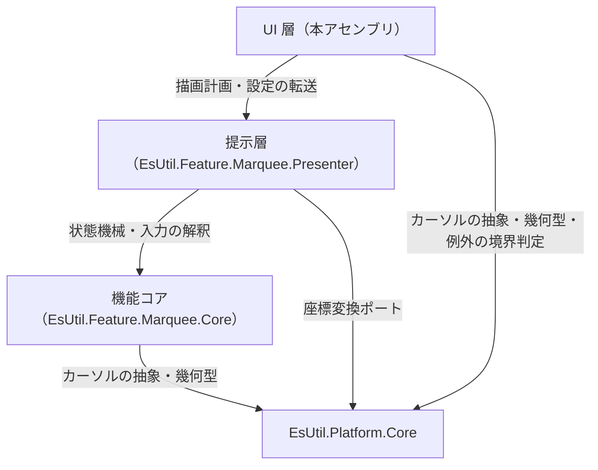
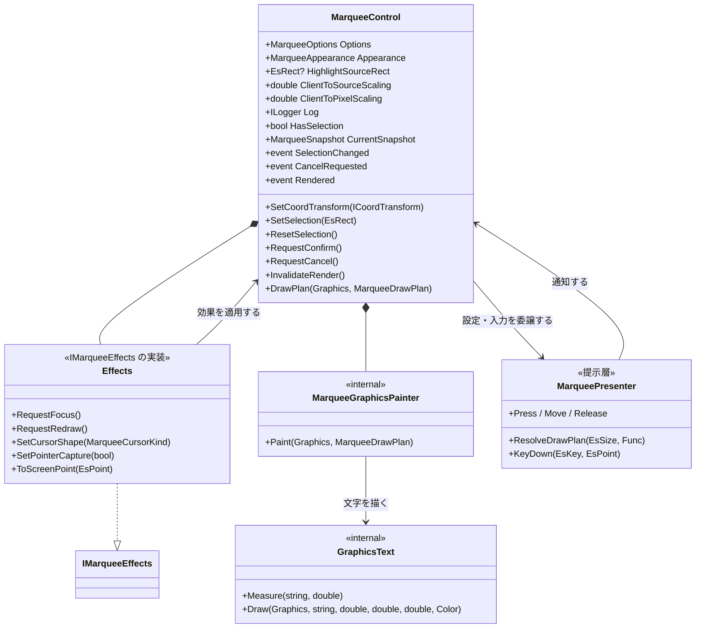
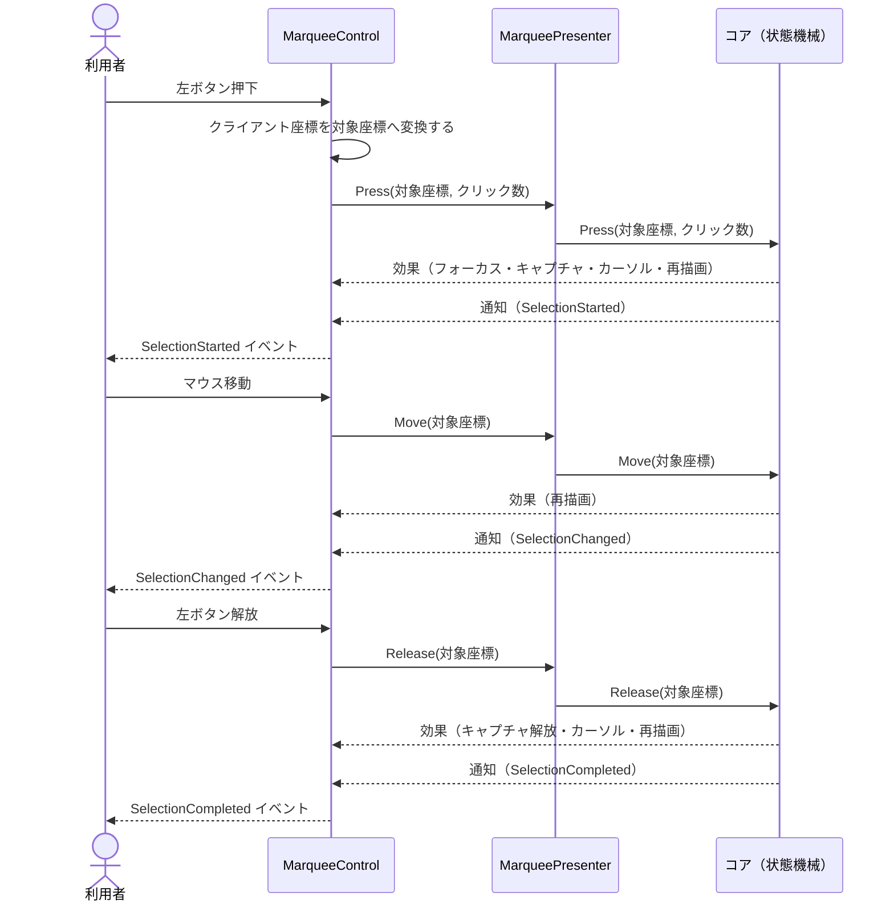
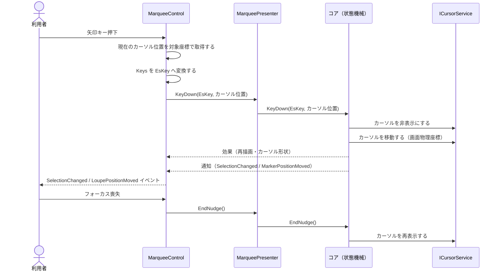
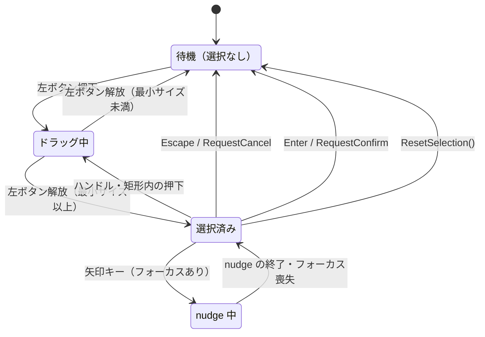
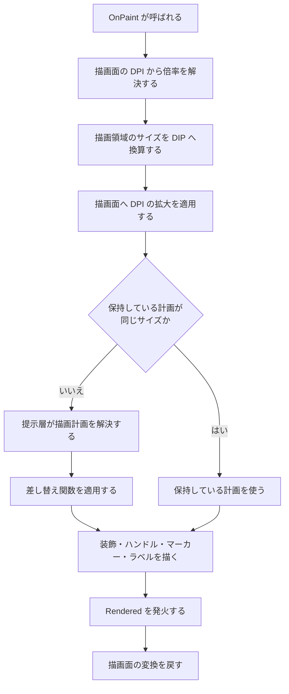

# EsUtil.Ui.WinForms.Marquee システム仕様書

WinForms 版の選択矩形コントロールの構造・依存・設計判断を扱います。 開発者向けの文書です。

## 目次 <!-- omit from toc -->

- [1. システム概要](#1-システム概要)
- [2. 技術スタック](#2-技術スタック)
- [3. アーキテクチャ](#3-アーキテクチャ)
  - [3.1 依存方向](#31-依存方向)
  - [3.2 責務の分担](#32-責務の分担)
  - [3.3 設計判断](#33-設計判断)
- [4. コンポーネント構成](#4-コンポーネント構成)
  - [4.1 可視性](#41-可視性)
- [5. クラス図](#5-クラス図)
- [6. シーケンス図（新規選択のドラッグ）](#6-シーケンス図新規選択のドラッグ)
- [7. シーケンス図（矢印キー nudge）](#7-シーケンス図矢印キー-nudge)
- [8. 状態遷移](#8-状態遷移)
- [9. 描画フロー](#9-描画フロー)
- [10. エラー処理ポリシー](#10-エラー処理ポリシー)
- [11. 実装上の注意](#11-実装上の注意)

## 1. システム概要

本アセンブリは、リサイズ可能なドラッグ矩形（マーキー）を WinForms のコントロールとして提供します。

- **UI 非依存のコアを共有する**: 選択の状態機械・入力の解釈・注目矩形の決定・ハンドルの位置・設定の既定値と補正は `EsUtil.Feature.Marquee.Core` が単一所有します。
- **描画計画を提示層から受け取る**: 層の順序・装飾の矩形・ラベルの文言と配置は `EsUtil.Feature.Marquee.Presenter` が単一所有します。
- **本アセンブリが行うのは 4 つだけ**: 入力の受付（WinForms のメッセージ → コア型）、効果の適用（フォーカス・再描画・カーソル・キャプチャ・画面座標）、通知の転送（コアの通知 → 公開イベント）、描画（描画計画 → GDI+）。

対象は Windows デスクトップです。 対象フレームワークは `net10.0-windows10.0.17763.0` です。

## 2. 技術スタック

| 種別 | 内容 |
| --- | --- |
| 言語 / フレームワーク | C# / .NET 10（`net10.0-windows10.0.17763.0`） |
| UI フレームワーク | WinForms（`UseWindowsForms`。 `System.Windows.Forms.Control` を継承する） |
| 描画 | GDI+（`System.Drawing.Graphics`。 `System.Drawing.Common` は WinForms と共に解決される） |
| 参照パッケージ | `EsUtil.Feature.Marquee.Presenter` / `EsUtil.Platform.Core` / `Microsoft.Extensions.Logging.Abstractions` |
| テスト | xUnit v3（`net10.0-windows10.0.17763.0`。 ウィンドウを作らず `Bitmap` 上で描画を検証する） |
| サンプル | WinForms アプリケーション（`WinExe`） |

## 3. アーキテクチャ

### 3.1 依存方向



- **依存は一方向**です（コアは UI を知りません。 提示層はフレームワーク非依存です）。
- 本アセンブリは**同一機能のコアと提示層だけ**を参照します（他の機能やプラットフォーム層へは依存しません）。 プラットフォーム層に依存する変換・描画ヘルパーは、必要なものだけを `Internal` へ複製して所有します。
- **本体プロジェクトはプロジェクト参照を持ちません**（ローカル フィードのパッケージを参照します）。 テストとサンプルは対象プロジェクトを `ProjectReference` で参照します。

### 3.2 責務の分担

| 責務 | 所有者 |
| --- | --- |
| 選択の状態機械・入力の解釈・注目矩形の決定・ハンドルとマーカーの位置・設定の既定値と補正・ログ | `EsUtil.Feature.Marquee.Core` |
| 描画計画（層の順序・装飾の矩形・ラベルの文言と配置）・外観（色・体裁・表示可否） | `EsUtil.Feature.Marquee.Presenter` |
| 入力の受付（メッセージ → コア型への変換） / 効果の適用 / 通知の転送 / 描画 | 本アセンブリ（`MarqueeControl`） |
| 描画計画の GDI+ への写像 | `MarqueeGraphicsPainter`（内部） |
| コア型と GDI+ の型の変換 | `Internal.EsGeometryWinFormsInterop` / `Internal.EsKeyWinFormsInterop` |
| 矩形の塗り・テキストの測定と描画 | `Internal.GraphicsFill` / `Internal.GraphicsText` |
| 描画面と表示領域からの倍率の解決 | `Internal.ClientPixelScale` |
| ログの定義（接頭辞・書式） | `MarqueeLogMessage`（内部） |

### 3.3 設計判断

- **描画は `Graphics` だけを要求する**: 描画実装（`MarqueeGraphicsPainter`）は `Graphics` と `MarqueeDrawPlan` だけを受け取ります。 これにより、ウィンドウを持たない単体テストでも `Bitmap` 上の実寸の画素を検査できます（見た目の検証可能性を最優先した判断です）。
- **背景を透明にする**: 下の画像を透かすため、背景を透明にして親の描画を自分の背景として使います。 透明のコントロールは**親の描画**だけを使うため、利用側は画像を持つコントロールの子として重ねます。
- **文字は本コントロールが描く**: 他の UI 版はテキスト要素を子に置きますが、WinForms の子コントロールは透過の合成が親の描画に依存するため、文字も同じ描画面へ描きます。 実寸の測定（`Internal.GraphicsText`）と描画が同じ API になり、測定と描画の不一致が起きません。
- **DPI の倍率は描画面の DPI から解決する**: DPI の通知はハンドル生成より前に届かず、オフスクリーンの描画面は基準 DPI を報告します。 描画面の DPI を実測として使い、`ClientToPixelScaling`（通知から保持した値）を代替値にします。
- **矢印キーを入力キーにする**: WinForms は矢印キーをダイアログ キー（フォーカス移動）として扱うため、`IsInputKey` を上書きして nudge が届くようにします。
- **マウス キャプチャを使う**: ドラッグ中にポインターがコントロールの外へ出ても移動を受け取るため、押下時に `Control.Capture` を設定します（コアが要求する効果として適用します）。
- **公開プロパティはデザイナーの対象外**: 設定・外観・座標変換ポート・ログは実行時にコードで与える値であるため、`DesignerSerializationVisibility.Hidden` を付けます。

## 4. コンポーネント構成

```text
EsUtil.Ui.WinForms/Marquee/
├── docs/
├── sample/
│   ├── Imaging/
│   └── Logging/
├── src/
│   └── Internal/
└── tests/
    └── Internal/
```

| コンポーネント | 所在 | 内容 |
| --- | --- | --- |
| コントロール | `EsUtil.Ui.WinForms/Marquee/src/MarqueeControl.cs` | 公開面（設定・操作・イベント）。 入力の受付・効果の適用・通知の転送・描画の起動。 |
| 描画実装 | `EsUtil.Ui.WinForms/Marquee/src/MarqueeGraphicsPainter.cs` | 描画計画を GDI+ へ写す（内部）。 |
| ログ定義 | `EsUtil.Ui.WinForms/Marquee/src/MarqueeLogMessage.cs` | 接頭辞と書式（内部）。 |
| イベント引数 | `EsUtil.Ui.WinForms/Marquee/src/MarqueePointEventArgs.cs` | 座標の通知（公開）。 |
| イベント引数 | `EsUtil.Ui.WinForms/Marquee/src/SelectionRectEventArgs.cs` | 選択矩形の通知（公開）。 |
| イベント引数 | `EsUtil.Ui.WinForms/Marquee/src/MarqueeRenderedEventArgs.cs` | 描画完了の通知（公開）。 |
| 倍率の解決 | `EsUtil.Ui.WinForms/Marquee/src/Internal/ClientPixelScale.cs` | 描画面と表示領域からの倍率の解決（内部）。 |
| 幾何の変換 | `EsUtil.Ui.WinForms/Marquee/src/Internal/EsGeometryWinFormsInterop.cs` | コア幾何型 ⇔ GDI+ の型（内部）。 |
| キーの変換 | `EsUtil.Ui.WinForms/Marquee/src/Internal/EsKeyWinFormsInterop.cs` | `EsKey` ⇔ `Keys`（内部）。 |
| 塗り | `EsUtil.Ui.WinForms/Marquee/src/Internal/GraphicsFill.cs` | 矩形の単色塗り（内部）。 |
| テキスト | `EsUtil.Ui.WinForms/Marquee/src/Internal/GraphicsText.cs` | 実寸の測定と描画（内部）。 |
| テスト | `EsUtil.Ui.WinForms/Marquee/tests/` | 描画の画素検査・公開 API の検証。 |
| サンプル | `EsUtil.Ui.WinForms/Marquee/sample/` | 画像へ重ねる操作の確認。 |

### 4.1 可視性

| 型 | 可視性 |
| --- | --- |
| `MarqueeControl` / `MarqueePointEventArgs` / `SelectionRectEventArgs` / `MarqueeRenderedEventArgs` | `public` |
| `MarqueeGraphicsPainter` / `MarqueeLogMessage` / `Internal` の各型 | `internal` |

`internal` 型は本アセンブリの単体テスト（`InternalsVisibleTo`）だけが参照します。

## 5. クラス図



## 6. シーケンス図（新規選択のドラッグ）



## 7. シーケンス図（矢印キー nudge）



## 8. 状態遷移



状態の判断はコアが単一所有します。 本コントロールは状態を保持せず、`CurrentSnapshot`（`MarqueeSnapshot.State`）から同じ真実を読み取れます。

## 9. 描画フロー



- 描画計画は 1 フレームにつき 1 回だけ解決します（同じ基準サイズでは再解決しません）。
- **背景を塗りません**（透明のままにして親の描画＝下の画像を透かします）。

## 10. エラー処理ポリシー

共通方針（送出・捕捉・翻訳）は [`.github/例外処理規約.md`](../../../.github/例外処理規約.md) が所有します。 本アセンブリ固有の状況だけを示します。

| 状況 | 挙動 |
| --- | --- |
| 公開操作（`SetCoordTransform` / `SetSelection` / `ResetSelection` / `RequestConfirm` / `RequestCancel`）でコアが例外を送出した場合 | 境界として捕捉し、`MarqueeLogMessage.LogOperationError` で `Error` を記録してから呼び出し側へ再送出する。 |
| カーソル位置の取得に失敗した場合 | 例外にせず `false` を返す（追従位置の取り直しを諦め、nudge の基点を記録しない）。 |
| 画面座標への変換を要求されたがハンドルが未生成の場合 | 例外にせず既定値を返す（`PointToScreen` は例外を送出するため、呼ぶ前に判定する）。 |
| 設定値が安全域を外れている場合 | 例外にせずコアの安全域へ補正する。 |
| 描画引数が null の場合 | `ArgumentNullException` を送出する（`ArgumentNullException.ThrowIfNull`）。 |
| ログの出力先が未設定の場合 | `NullLogger` へフォールバックする（記録しないだけで処理は続行する）。 |

## 11. 実装上の注意

- **透明のコントロールは親の描画だけを使う**: 兄弟として重ねると画像が隠れます。 画像を持つコントロールの子として追加します。
- **`PointToScreen` / `PointToClient` はハンドルを要求する**: ハンドルが無い状態で呼ぶと例外になるため、呼ぶ前に `IsHandleCreated` を判定します。 追従位置の取り直しと画面座標への変換が該当します。
- **`Cursor` へ null を設定できない**: コアの `MarqueeCursorKind.Default` は `Cursors.Default` へ写します。
- **`IsInputKey` を上書きしないと矢印キーが届かない**: 既定ではダイアログ キー（フォーカス移動）として処理されます。
- **キーの変換は名前ベース**: `EsKey` の値は列挙の序数であり、WinForms の `Keys`（Win32 の仮想キーコード）とは体系が異なります。 綴りが異なる名前は別名表で解決します。
- **テキストの実寸は DIP で測る**: 測定は基準 DPI の専用描画面で行い、描画は描画面の変換（DPI の拡大）に従います。 同じフォント サイズ（ピクセル単位）を使うため、測定値で作った背景から文字がはみ出しません。
- **描画リソースはスレッドごとに使い回す**: `Pen` / `SolidBrush` / `Font` / `StringFormat` はスレッドごとに 1 つを保持し、色とサイズだけを書き換えます（`Font` のサイズは読み取り専用のため、大きさごとに作り直して古いものを破棄します）。
- **`?.Invoke` をイベントへ直接書かない**: 発火は private の `Raise...` ヘルパーへ集約します。
- **公開プロパティはデザイナーのシリアル化の対象外にする**: `DesignerSerializationVisibility.Hidden` を付けます（実行時にコードで与える値のため）。
