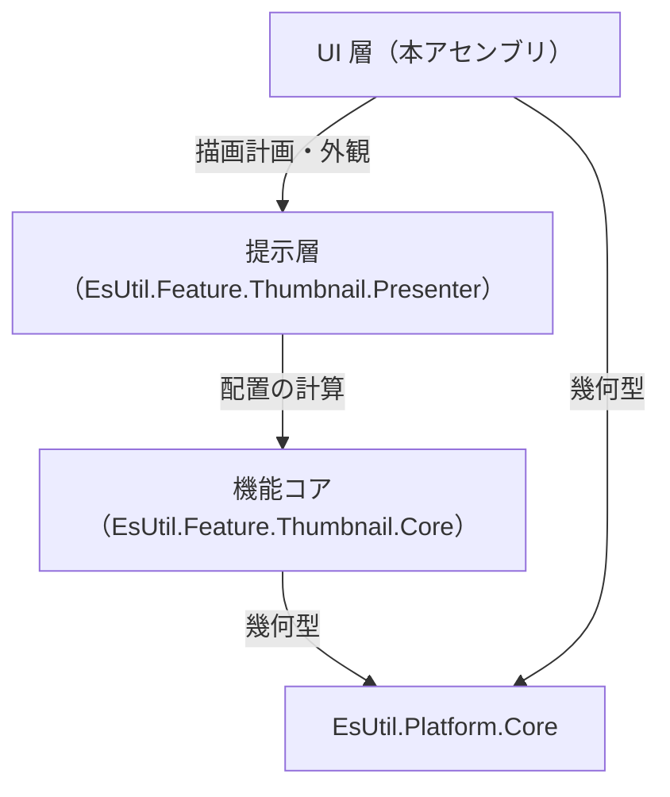
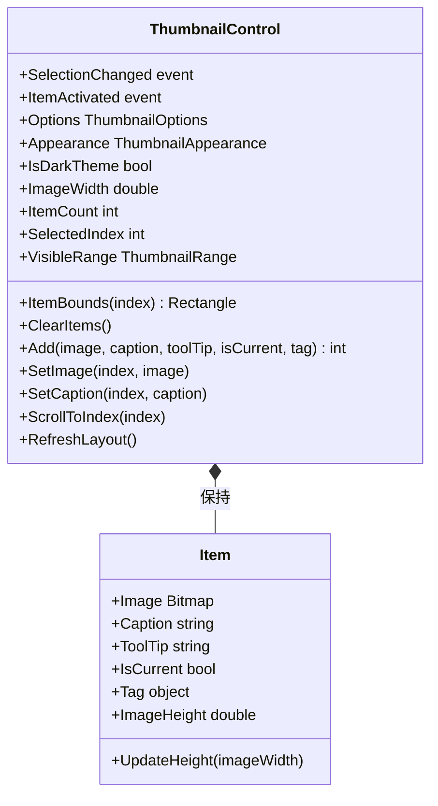
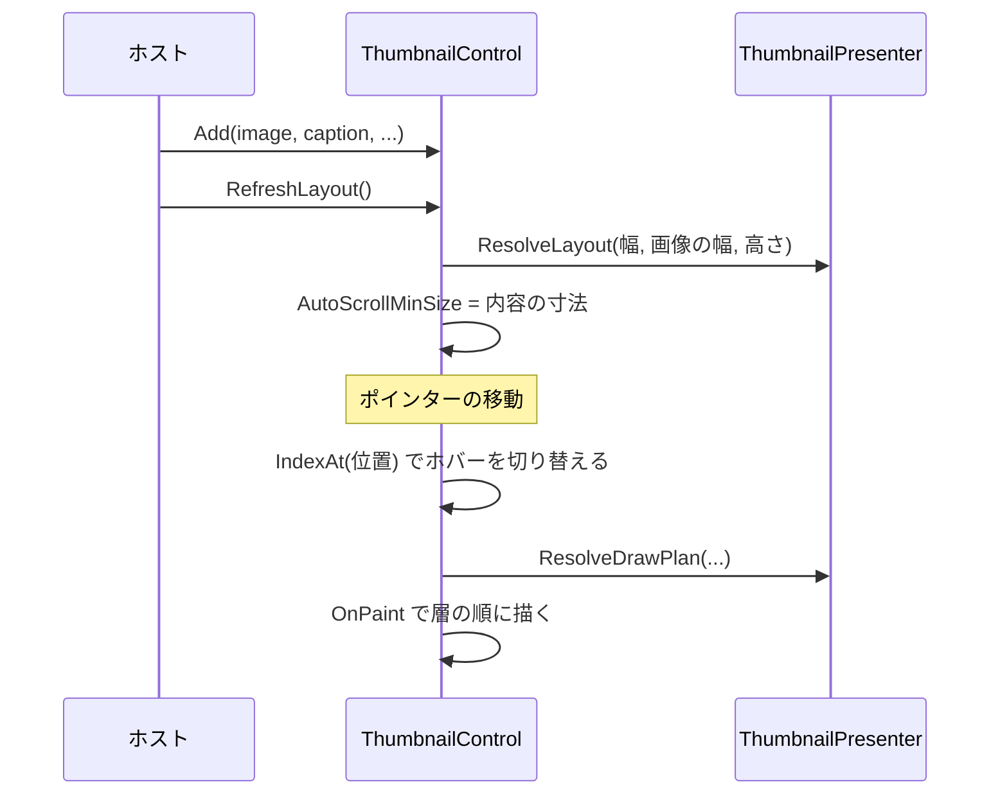

# EsUtil.Ui.WinForms.Thumbnail システム仕様書

WinForms 版のサムネイル一覧コントロールの構造・依存・設計判断を扱います。 開発者向けの文書です。

## 目次 <!-- omit from toc -->

- [1. システム概要](#1-システム概要)
- [2. 技術スタック](#2-技術スタック)
- [3. アーキテクチャ](#3-アーキテクチャ)
  - [3.1 依存方向](#31-依存方向)
  - [3.2 責務の分担](#32-責務の分担)
  - [3.3 設計判断](#33-設計判断)
- [4. コンポーネント構成](#4-コンポーネント構成)
  - [4.1 可視性](#41-可視性)
- [5. クラス図](#5-クラス図)
- [6. 入力から描画までの流れ](#6-入力から描画までの流れ)
- [7. 影と画像の描画](#7-影と画像の描画)
- [8. エラー処理ポリシー](#8-エラー処理ポリシー)
- [9. 実装上の注意](#9-実装上の注意)

## 1. システム概要

本アセンブリは、サムネイル一覧を WinForms のコントロールとして提供します。

- **配置と見た目は下の層が単一所有します**（`EsUtil.Feature.Thumbnail.Core` が並べ方、`EsUtil.Feature.Thumbnail.Presenter` が描画計画と外観）。
- **本アセンブリが行うのは 3 つだけ**: 入力の受付、スクロール（`AutoScroll`）、GDI+ による描画。
- **子コントロールを持ちません**（内容をすべて自分で描きます）。
- 対象フレームワークは `net10.0-windows10.0.17763.0`（`UseWindowsForms`）です。

## 2. 技術スタック

| 種別 | 内容 |
| --- | --- |
| 言語 / フレームワーク | C# / .NET 10（`net10.0-windows10.0.17763.0`） |
| UI フレームワーク | WinForms（`ScrollableControl` を継承する） |
| 描画 | GDI+（`System.Drawing.Graphics`。 `System.Drawing.Common` は WinForms と共に解決される） |
| 参照パッケージ | `EsUtil.Feature.Thumbnail.Presenter` / `EsUtil.Platform.Core` |
| テスト | xUnit v3（`EsUtil.Ui.WinForms.Thumbnail.Tests`。 公開 API・ログ・描画（`Bitmap` 上の画素）を検証する） |

## 3. アーキテクチャ

### 3.1 依存方向



- **依存は一方向**です（コアも提示層も WinForms を知りません）。
- **本体プロジェクトは `ProjectReference` を持ちません**（ローカル フィードのパッケージを参照します）。

### 3.2 責務の分担

| 責務 | 所有者 |
| --- | --- |
| 折り返し・行の高さ・当たり判定・可視範囲 | `EsUtil.Feature.Thumbnail.Core` |
| 背景・影・名前の体裁、層の順序 | `EsUtil.Feature.Thumbnail.Presenter` |
| 入力の受付・選択の決定・2 回押しの通知 | `ThumbnailControl` |
| スクロール範囲（`AutoScrollMinSize`）の設定 | `ThumbnailControl` |
| 描画（背景・影・画像・名前。 GDI+） | `ThumbnailControl` |
| 項目の保持（画像・名前・状態・ツールヒント） | `Item`（内部の入れ子） |

### 3.3 設計判断

- **子コントロールを持たない**: WinForms の子コントロールは透過の合成が親の描画に依存し、影や背景の重なりが UI ごとに変わります。 内容をすべて `OnPaint` で描けば、層の順序を計画どおりにできます。
- **`ScrollableControl` を継承する**: スクロールは `AutoScroll` に任せ、内容の寸法だけをコアの計算結果から設定します（`AutoScrollMinSize`）。
- **座標は DIP と同じ単位で描く**: `AutoScaleMode` は `Dpi` を前提とし、GDI+ の座標をそのまま DIP として扱います。 影の帯も倍率 1 で作り、`Graphics` の座標系で塗ります（DPI の換算を 2 重に行わない）。
- **影は 1 画素の帯を単色で塗る**: GDI+ のグラデーション ブラシは軸の外側を繰り返し、影の外側へ最も濃い 1 画素を描きます（実測）。 画素単位の帯なら、他の UI 版と同じ結果になります。
- **文字は `TextRenderer` で描く**: `Graphics.DrawString` よりも WinForms の標準の見た目（`DefaultFont` と `TextFormatFlags`）に一致します。
  描画計画の `FontSize` は DIP（96 DPI 基準）のため、`Font` が受け取る pt へ `×72÷96` で換算して渡します（DIP 値を pt として扱うと 4/3 倍になります）。
- **画像の所有権をコントロールへ移す**: `Bitmap` は破棄が必要な資源です。 一覧が保持する画像の寿命を一覧が決めれば、ホストの解放漏れと二重解放を防げます。
- **入力は位置から判定する**: 子コントロールが無いため、ポインターの位置から `IndexAt` で添字を求めます。

## 4. コンポーネント構成

```text
EsUtil.Ui.WinForms/Thumbnail/
├── docs/
└── src/
```

| コンポーネント | 所在 | 内容 |
| --- | --- | --- |
| コントロール | `EsUtil.Ui.WinForms/Thumbnail/src/ThumbnailControl.cs` | 公開面。 入力の受付・選択・スクロール・描画 |
| イベント引数 | `EsUtil.Ui.WinForms/Thumbnail/src/ThumbnailActivatedEventArgs.cs` | 2 回押しの通知（公開） |
| 項目の保持 | `EsUtil.Ui.WinForms/Thumbnail/src/ThumbnailControl.cs`（入れ子） | 画像・名前・状態・ツールヒント（内部） |

### 4.1 可視性

| 対象 | 可視性 | 理由 |
| --- | --- | --- |
| `ThumbnailControl` / `ThumbnailActivatedEventArgs` | `public` | ホストが使う |
| `Item` | `private`（入れ子） | コントロールだけが使う保持用の型 |

## 5. クラス図



## 6. 入力から描画までの流れ



1. `RefreshLayout()` が配置を解き、スクロール範囲を設定します。
2. ポインターの移動は位置から添字へ変換し、ホバーを切り替えて描き直します。
3. 押下は選択、2 回押しは `ItemActivated` の通知になります。
4. `OnPaint` は `AutoScrollPosition` だけ座標系を移し、各項目を層の順に描きます。

## 7. 影と画像の描画

- **影**: `BuildDeviceBands` の帯（倍率 1）を 1 画素ずつ単色で塗ります。
- **画像**: `Bitmap` を `DrawImage` で描きます（`InterpolationMode` は高品質系へ切り替え、元の値へ戻します）。
- **名前**: `TextRenderer.DrawText` で描きます（中央揃え・語単位の折り返し・末尾の省略）。

## 8. エラー処理ポリシー

- **公開メソッドは引数を検証する**: 範囲外の添字は**何もせずに戻る**（一覧の組み直し中に古い添字が渡される経路があるため）。
- **null の画像は許容する**: `Add` / `SetImage` は画像なしの項目を作ります（直前の画像は解放します）。
- **画像の解放はコントロールが行う**: `ClearItems` と `SetImage` の差し替え、および破棄時に解放します。
- 共通方針は [`../../../.github/例外処理規約.md`](../../../.github/例外処理規約.md) が所有します。

## 9. 実装上の注意

- **座標を 2 重に換算しない**: 描画は DIP と同じ単位で行い、`AutoScrollPosition` の分だけ平行移動します。
- **`Options` / `Appearance` の変更は配置を解き直す**: 両方の setter が `InvalidateLayout()` を呼びます（余白が変わる可能性があるため）。
- **画像をホストが解放しない**: 所有権はコントロールへ移ります（二重解放になります）。
- **ログ**: 画像と項目数の変更は本コントロールが記録します（`Log` / `LogPrefix`。 直前の画像は解放するため、寸法は解放する前に整形して渡します）。 設定・外観の変更は提示層、選択の変更はコアが記録します。
