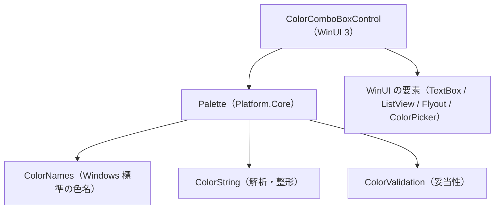

# EsUtil.Ui.WinUI3.ColorComboBox システム仕様書

## 目次 <!-- omit from toc -->

- [1. 概要](#1-概要)
- [2. 技術スタック](#2-技術スタック)
- [3. アーキテクチャ](#3-アーキテクチャ)
- [4. 例外処理ポリシー](#4-例外処理ポリシー)
- [5. コンポーネント構成](#5-コンポーネント構成)
- [6. 依存関係](#6-依存関係)

---

## 1. 概要

WinUI 3 の要素だけで色選択の UI を組み立て、**色名・色文字列の規則はコア（`EsUtil.Platform.Core` の `Palette`）へ委譲**します。 これにより 4 つの UI 版が同じ入力と同じ保存値を共有します。

## 2. 技術スタック

| 項目 | 内容 |
| --- | --- |
| 言語 | C# 14（.NET 10） |
| UI | WinUI 3（`Grid` / `Border` / `TextBox` / `Button` / `ListView` / `Flyout` / `ColorPicker`） |
| ログ | `Microsoft.Extensions.Logging.Abstractions`（`LoggerMessage` ソース生成） |
| 色の規則 | `EsUtil.Platform.Core` の `Palette` |
| AOT | `IsAotCompatible=true`。 一覧へは `Items.Add` で 1 件ずつ渡す |

## 3. アーキテクチャ

- **UI 層が持つもの**: 要素の組み立て、入力と状態の同期、Flyout の開閉、`SelectedColorChanged` の発火。
- **コアが持つもの**: 受理する入力、保存値と表示の形式、色名の表、並び順、妥当性の判定。

## 4. 例外処理ポリシー

共通方針は [`例外処理規約.md`](../../../.github/例外処理規約.md) に従います。 本プロジェクト固有の扱いはありません（無効な入力は例外ではなく検証状態として扱います）。

## 5. コンポーネント構成

| 型 | 役割 |
| --- | --- |
| `ColorComboBoxControl` | 公開 API。 入力・一覧・ピッカーの 3 経路を `SelectedColor` へ集約する |
| `LogMessage` | 変更の記録（`Setting: SelectedColor <旧> → <新>`） |

## 6. 依存関係

`EsUtil.Platform.Core` と Windows App SDK、ログ抽象だけを参照します（参照の許可範囲は [`依存関係.md`](../../../.github/依存関係.md)）。
