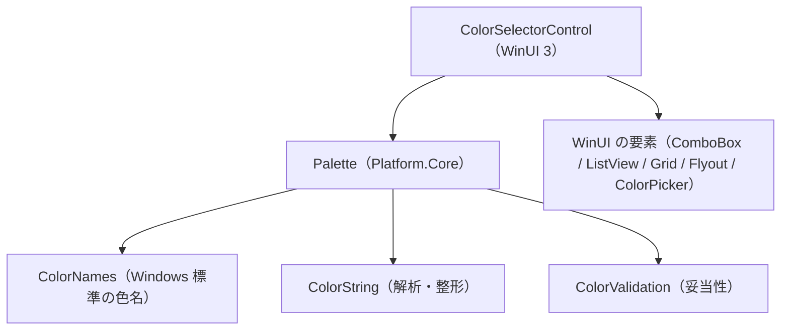

# EsUtil.Ui.WinUI3.ColorSelector システム仕様書

## 目次 <!-- omit from toc -->

- [1. 概要](#1-概要)
- [2. 技術スタック](#2-技術スタック)
- [3. アーキテクチャ](#3-アーキテクチャ)
- [4. 例外処理ポリシー](#4-例外処理ポリシー)
- [5. コンポーネント構成](#5-コンポーネント構成)
  - [5.1 入力欄（標準のコンボボックス + 現在色の四角）](#51-入力欄標準のコンボボックス--現在色の四角)
  - [5.2 一覧のタブと幅](#52-一覧のタブと幅)
- [6. 依存関係](#6-依存関係)

---

## 1. 概要

WinUI 3 の要素だけで色選択の UI を組み立て、**色名・色文字列の規則はコア（`EsUtil.Platform.Core` の `Palette`）へ委譲**します。 これにより 3 つの UI 版が同じ入力と同じ保存値を共有します。

## 2. 技術スタック

| 項目 | 内容 |
| --- | --- |
| 言語 | C# 14（.NET 10） |
| UI | WinUI 3（`UserControl` / `ComboBox`（編集可） / `ListView` / `Grid` / `Border` / `Button` / `Flyout` / `ColorPicker`） |
| ログ | `Microsoft.Extensions.Logging.Abstractions`（`LoggerMessage` ソース生成） |
| 色の規則 | `EsUtil.Platform.Core` の `Palette` |
| AOT | `IsAotCompatible=true`。 一覧へは `Items.Add` で 1 件ずつ渡す |

## 3. アーキテクチャ

- **UI 層が持つもの**: 標準のコンボボックスの入力の扱い、**入力欄の左の現在色の四角**（「■ + 色名」）と文字の位置、タブ付きの Flyout の開閉、タブの構築（一覧 / 格子 / カラーピッカー）、カスタム タブの色名の表示、ツールチップ（`ToolTipService`）、`SelectedColorChanged` / `ColorApplied` の発火。
- **コアが持つもの**: 受理する入力、保存値と表示の形式（`ColorTextFormat`）、色名の表、並び順、妥当性の判定。

## 4. 例外処理ポリシー

共通方針は [`例外処理規約.md`](../../../.github/例外処理規約.md) に従います。 本プロジェクト固有の扱いはありません（無効な入力は例外ではなく検証状態として扱います）。

## 5. コンポーネント構成

| 型 | 役割 |
| --- | --- |
| `ColorSelectorControl` | 公開 API。 標準のコンボボックス（編集可）の入力・タブ付きの一覧・カラーピッカーの 3 経路を `SelectedColor` へ集約する（一覧は `Flyout`。 `ShouldConstrainToRootBounds = false` でウィンドウの外へ出られる）。 展開時に標準の一覧を閉じてから `CreateTabs` でタブを作り、項目は `Items.Add` で 1 件ずつ渡す。 入力欄の左には**現在色の四角**を重ね、一覧・カラーピッカーで確定すると `ColorApplied` を発火する |
| `ColorApplyPlan` | 一覧・カラーピッカーで色を確定したときの適用の計画（適用する値・テーマの色の識別子・確定を通知するか）。 2 経路が同じ計画を使うため、「同じ色を選び直したときも通知する」規則が片方だけ欠けない |
| `ColorSelectorCustomTab` / `ColorSelectorCustomColor` | 公開の入力型。 利用者が用途ごとのタブ（題名と色の並び、色名付きの一覧（`Columns = 0`） / 指定した列数の格子（`Columns >= 1`））を足すために使う |
| `ColorSelectorItem` | 一覧の 1 件（表示名・適用値・分類・テーマの色の識別子） |
| `ColorSelectorCategory` | 一覧の項目の分類（`Theme` / `Named` / `Custom`） |
| `ColorSelectorTabSpec` | 一覧の 1 タブ（題名・識別子・■ の列数・項目・カラーピッカーかどうか。 `IsList` は `Columns <= 0`）。 表示の設定と中身から作り、空のタブは作らない |
| `LogMessage` | 変更の記録（`設定: 選択色 <旧> → <新>`） |

### 5.1 入力欄（標準のコンボボックス + 現在色の四角）

- **標準の要素をそのまま使う**: 入力欄と展開ボタンは `ComboBox`（`IsEditable = true`）であり、自前の枠・▼・… を持たない。 テンプレートの中の編集用 `TextBox`（`EditableText`）へ `TextChanged` / `LostFocus` を繋ぎ、入力のたびに色を反映し、フォーカス喪失時に無効な入力を戻す。
- **「■ + 色名」に見せる**: 標準のコンボボックスは文字しか出せないため、12 DIP の `Border`（角の丸み 2・半透明の灰色の 1 DIP の枠線・左の余白 7 DIP・上下の中央・押下は通す）を入力欄の上へ重ね、`UpdateCurrentColorSwatch` が現在色で塗る。 無効な入力の間は隠す（`TryResolveCurrentColorSwatch` が表示の可否を決める）。 文字は四角の右（左から 24 DIP）から始め、上下の中央にそろえる（`ApplyComboLayout`）。
- **文字の余白は 2 か所へ入れる**: WinUI の入力欄はフォーカスの有無で描き手が変わる（フォーカスが無いときはコンボボックスの選択欄、入力中は内側の `EditableText`）。 選択欄は**コンボボックスの余白**、内側の入力欄は**入力欄の余白**で文字の開始位置が決まるため、両方の左を空ける（片方だけでは、フォーカスの有無で文字が四角に重なる）。
- **初期値の文字は読み込み後に入れ直す**: テンプレートが作られる前に設定した `Text` は、フォーカスが無いときの選択欄へ反映されない。 編集欄を掴んだ時点で、同じ値の再設定では変更通知が出ないため一度空にしてから入れ直す。
- **標準の一覧は出さない**: `DropDownOpened` の同じ処理の中で `IsDropDownOpen = false` にして標準の一覧を閉じ（描画される前に閉じるため一瞬も見えない）、タブ付きの Flyout は `DispatcherQueue` の次の処理で出す（同じ入力処理の中で出すと、閉じた標準の一覧の後始末に巻き込まれて閉じられるため。 開閉の往復を防ぐフラグを持つ）。
- **カスタム タブの色名を入力欄へ出す**: `FormatDisplayText` / `ResolveCustomName`（値は色として比べる）。 不透明度は入力の `+{n}%` から取る。
- **色を確定したときの通知**: 一覧の項目とカラーピッカーの OK は同じ適用の計画（`PlanItemSelection` / `PlanPickerSelection`）を使い、`ApplyPlan` が値を反映して `ColorApplied` を発火する（**同じ色を選び直したときも発火**。 入力欄への入力では発火しない）。
- **検証エラーの強調**は入力欄の枠線へ反映する（`HighlightBorderOnError` が true のときだけ赤くし、それ以外はテーマの枠線へ戻す）。

### 5.2 一覧のタブと幅

- **タブは作り直す**: タブの数は `ShowCustomTab` / `ShowThemeColorTab` / `ShowNamedColorTab` / `ShowPickerTab` / `CustomTabs` で変わるため、固定のタブを持たない。 一覧を開くたびに `CreateTabs`（表示の設定と中身から作る純粋関数）でタブを作り直す。 中身の無いタブは作らない。
- **並びは「カスタム → テーマカラー → 色名 → ColorPicker」**: 利用者が用意した色を先に出す。
- **同じタブから開く**: 直近に開いたタブの識別子を覚え、次に開くときはそのタブから始める（そのタブが無くなっていれば先頭）。
- **タブの題名は 1 つのときだけ省ける**: タブが 2 つ以上あるときは切り替えに必要なので、`ShowTabTitles` に関わらずタブの行を出す。 表示できるタブが 1 つも無ければ一覧を開かない。
- **一覧と格子**: 一覧のタブは「色の四角 + 色名」で、最大の高さ 360 の範囲で自分がスクロールする。 格子のタブは色の四角だけを `Columns` の列数（セル 32。 `Columns` が 1 未満なら 1 列）に並べ、**スクロールしない**（16 色なら 6 列 × 3 行、40 色なら 8 列 × 5 行）。 並べ方は `IsList`（`Columns <= 0`）で決める。
- **カラーピッカーはタブの中**: 「ColorPicker」タブは `ColorPicker` と OK / キャンセルをタブの中へ直接置く（別のフライアウトを重ねない）。 **WinUI 3 の `ColorPicker` はタブを持たない**ため、カラーピッカー自身のタブの選択は覚えない（スペクトル・プレビュー・スライダー・RGB/HSV/16 進の入力・「More」ボタンを 1 画面に並べ、`IsColorSpectrumVisible` / `IsColorSliderVisible` / `IsColorChannelTextInputVisible` などで構成を選ぶ。 タブの選択に当たる `SelectedIndex` などのメンバーが無い。 AvaloniaUI 版の `ColorView` はタブを持つため覚える）。 覚えるのは一覧の外側のタブ（`_listTabKey`）だけである。
- **タブの中身は開いたときに作る**: 開いていないタブ（特に ColorPicker）の要素を先に生成しない。 入れ物だけを置き、そのタブを初めて開いたときに中身を作る（ログもそのときに出す）。
- **一覧の幅は枠の幅を変えない**: 一覧の幅だけを `max(枠の幅, タブの行の幅, 内容の幅)`（440 が上限）にする。 コントロールの幅・最小幅は変えない（開閉のたびに周りのレイアウトが動かないようにする）。 **タブの行の幅も含める**（含めないとタブの行だけが広がり、一覧とスクロール バーがフライアウトの途中で切れる）。 **カラーピッカーのタブは固定の幅**（`PickerWidth` = 320）で数える（除くと、一覧を開いたままカラーピッカーのタブへ切り替えたときに中身が一覧の幅を超える。 外側を横スクロールさせないため、開く前に幅を決めておく）。 一覧（`ListView`）は幅いっぱいに置くため、垂直スクロール バーは右端に来る。
- **タブは一覧の幅を等分した列へ並べる**: タブの行は `Grid` で、タブの数だけ星の列（`ColumnDefinition.Width` = `1*`）を作り、`ColumnSpacing` = 4 で並べる（`CreateTabStrip`）。 ボタンは幅を指定せず（`HorizontalAlignment` = `Stretch`）、文言は中央そろえ・文字サイズ 11・左右の余白 4・`TextTrimming.CharacterEllipsis` にする（`CreateCategoryTab`）。 **幅を固定してはいけない**（固定すると、5 つのときに一覧の幅 440 を超えて横スクロール バーが出る）。 等分した幅が 56 を下回るときは文言を省略記号で切る（`MinimumTabWidth`）。 実際に割り当てる幅は `CalculateFitTabWidth`（`(幅 - 間隔 × (数 - 1)) / 数`）で、タブの行の合計は必ず一覧の幅と一致する。 `ResolveTabWidth`（112〜56）は一覧の幅を広げる判断とテストのための見積もりである。 外側の `FlyoutPresenter` も横スクロールを切る（`HorizontalScrollMode` / `HorizontalScrollBarVisibility` = `Disabled`。 タブは列が詰めて収めるため、横スクロール バーは要らない）。

## 6. 依存関係

`EsUtil.Platform.Core` と Windows App SDK、ログ抽象だけを参照します（参照の許可範囲は [`依存関係.md`](../../../.github/依存関係.md)）。
