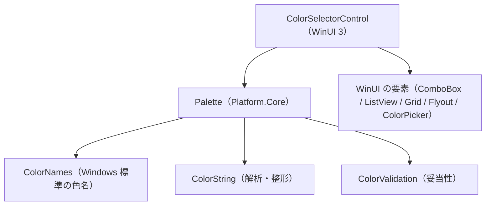

# EsUtil.Ui.WinUI3.ColorSelector システム仕様書

## 目次 <!-- omit from toc -->

- [1. 概要](#1-概要)
- [2. 技術スタック](#2-技術スタック)
- [3. アーキテクチャ](#3-アーキテクチャ)
- [4. 例外処理ポリシー](#4-例外処理ポリシー)
- [5. コンポーネント構成](#5-コンポーネント構成)
  - [5.1 入力欄（標準のコンボボックス）](#51-入力欄標準のコンボボックス)
  - [5.2 一覧のタブと幅](#52-一覧のタブと幅)
- [6. 依存関係](#6-依存関係)

---

## 1. 概要

WinUI 3 の要素だけで色選択の UI を組み立て、**色名・色文字列の規則はコア（`EsUtil.Platform.Core` の `Palette`）へ委譲**します。 これにより 3 つの UI 版が同じ入力と同じ保存値を共有します。

## 2. 技術スタック

| 項目 | 内容 |
| --- | --- |
| 言語 | C# 14（.NET 10） |
| UI | WinUI 3（`UserControl` / `ComboBox`（編集可） / `ListView` / `Grid` / `Button` / `Flyout` / `ColorPicker`） |
| ログ | `Microsoft.Extensions.Logging.Abstractions`（`LoggerMessage` ソース生成） |
| 色の規則 | `EsUtil.Platform.Core` の `Palette` |
| AOT | `IsAotCompatible=true`。 一覧へは `Items.Add` で 1 件ずつ渡す |

## 3. アーキテクチャ

- **UI 層が持つもの**: 標準のコンボボックスの入力の扱い、タブ付きの Flyout の開閉、タブの構築（一覧 / 格子 / カラーピッカー）、カスタム タブの色名の表示、ツールチップ（`ToolTipService`）、`SelectedColorChanged` の発火。
- **コアが持つもの**: 受理する入力、保存値と表示の形式（`ColorTextFormat`）、色名の表、並び順、妥当性の判定。

## 4. 例外処理ポリシー

共通方針は [`例外処理規約.md`](../../../.github/例外処理規約.md) に従います。 本プロジェクト固有の扱いはありません（無効な入力は例外ではなく検証状態として扱います）。

## 5. コンポーネント構成

| 型 | 役割 |
| --- | --- |
| `ColorSelectorControl` | 公開 API。 標準のコンボボックス（編集可）の入力・タブ付きの一覧・カラーピッカーの 3 経路を `SelectedColor` へ集約する（一覧は `Flyout`。 `ShouldConstrainToRootBounds = false` でウィンドウの外へ出られる）。 展開時に標準の一覧を閉じてから `CreateTabs` でタブを作り、項目は `Items.Add` で 1 件ずつ渡す |
| `ColorSelectorCustomTab` / `ColorSelectorCustomColor` / `ColorSelectorTabLayout` | 公開の入力型。 利用者が用途ごとのタブ（題名と色の並び、色名付きの一覧 / 6 列の格子）を足すために使う |
| `ColorSelectorItem` | 一覧の 1 件（表示名・適用値・分類・テーマの色の識別子） |
| `ColorSelectorCategory` | 一覧の項目の分類（`Theme` / `Named` / `Custom`） |
| `ColorSelectorTabSpec` | 一覧の 1 タブ（題名・識別子・並べ方・項目・カラーピッカーかどうか）。 表示の設定と中身から作り、空のタブは作らない |
| `LogMessage` | 変更の記録（`設定: 選択色 <旧> → <新>`） |

### 5.1 入力欄（標準のコンボボックス）

- **標準の要素をそのまま使う**: 入力欄と展開ボタンは `ComboBox`（`IsEditable = true`）であり、自前の枠・▼・… を持たない。 テンプレートの中の編集用 `TextBox` へ `TextChanged` / `LostFocus` を繋ぎ、入力のたびに色を反映し、フォーカス喪失時に無効な入力を戻す。
- **標準の一覧は出さない**: `DropDownOpened` の同じ処理の中で `IsDropDownOpen = false` にして標準の一覧を閉じ（描画される前に閉じるため一瞬も見えない）、タブ付きの Flyout は `DispatcherQueue` の次の処理で出す（同じ入力処理の中で出すと、閉じた標準の一覧の後始末に巻き込まれて閉じられるため。 開閉の往復を防ぐフラグを持つ）。
- **カスタム タブの色名を入力欄へ出す**: `FormatDisplayText` / `ResolveCustomName`（値は色として比べる）。 不透明度は入力の `+{n}%` から取る。
- **検証エラーの強調**は入力欄の枠線へ反映する（`HighlightBorderOnError` が true のときだけ赤くし、それ以外はテーマの枠線へ戻す）。

### 5.2 一覧のタブと幅

- **タブは作り直す**: タブの数は `ShowCustomTab` / `ShowThemeColorTab` / `ShowNamedColorTab` / `ShowPickerTab` / `CustomTabs` で変わるため、固定のタブを持たない。 一覧を開くたびに `CreateTabs`（表示の設定と中身から作る純粋関数）でタブを作り直す。 中身の無いタブは作らない。
- **並びは「カスタム → テーマカラー → 色名 → ColorPicker」**: 利用者が用意した色を先に出す。
- **同じタブから開く**: 直近に開いたタブの識別子を覚え、次に開くときはそのタブから始める（そのタブが無くなっていれば先頭）。
- **タブの題名は 1 つのときだけ省ける**: タブが 2 つ以上あるときは切り替えに必要なので、`ShowTabTitles` に関わらずタブの行を出す。 表示できるタブが 1 つも無ければ一覧を開かない。
- **一覧と格子**: 一覧のタブは「色の四角 + 色名」で、最大の高さ 360 の範囲で自分がスクロールする。 格子のタブは色の四角だけを 6 列（セル 32）に並べ、**スクロールしない**（16 色なら 3 行）。
- **カラーピッカーはタブの中**: 「ColorPicker」タブは `ColorPicker` と OK / キャンセルをタブの中へ直接置く（別のフライアウトを重ねない）。
- **タブの中身は開いたときに作る**: 開いていないタブ（特に ColorPicker）の要素を先に生成しない。 入れ物だけを置き、そのタブを初めて開いたときに中身を作る（ログもそのときに出す）。
- **一覧の幅は枠の幅を変えない**: 一覧の幅だけを `max(枠の幅, 内容の幅)` にする。 コントロールの幅・最小幅は変えない（開閉のたびに周りのレイアウトが動かないようにする）。

## 6. 依存関係

`EsUtil.Platform.Core` と Windows App SDK、ログ抽象だけを参照します（参照の許可範囲は [`依存関係.md`](../../../.github/依存関係.md)）。
