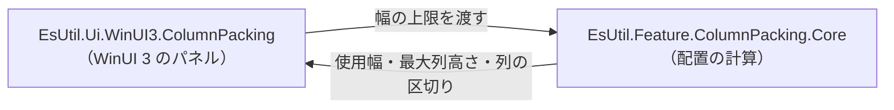

# EsUtil.Ui.WinUI3.ColumnPacking


%2B-0078D6)


**対応 OS**: Windows 10 バージョン 2004（ビルド 19041）以降。

WinUI 3 のパネルです。 子要素（および `ItemsSource` から作る要素）を**縦方向の複数列**へ並べ、最大列高さを最小化します。
配置の計算は UI 非依存の [`EsUtil.Feature.ColumnPacking.Core`](../../EsUtil/Feature.ColumnPacking.Core/README.md) が単一所有し、本パネルはその結果を要素の配置へ写すだけです。



## 目次 <!-- omit from toc -->

- [1. 概要](#1-概要)
- [2. 機能一覧](#2-機能一覧)
- [3. システム要件](#3-システム要件)
- [4. インストール](#4-インストール)
- [5. クイックスタート](#5-クイックスタート)
- [6. 描画動作](#6-描画動作)
- [7. 含まれるもの](#7-含まれるもの)
- [8. カスタマイズ](#8-カスタマイズ)
- [9. ログ](#9-ログ)
- [10. 未対応](#10-未対応)
- [11. サンプルアプリケーション](#11-サンプルアプリケーション)
- [12. ドキュメント](#12-ドキュメント)
- [13. プロジェクト構成](#13-プロジェクト構成)
- [14. テスト](#14-テスト)
- [15. ライセンス](#15-ライセンス)

## 1. 概要

- **2 種類の子**を同時に扱えます。 `ItemsSource` + `ItemTemplate` から作る要素と、XAML に直接書いた子要素です。 どちらを先に置くかは `ItemsSourceFirst` で決まります。
- **列の数は `ColumnLimit` まで**。 幅の上限（親から与えられた幅）に収まるよう、列数が決まります。
- **レイアウト結果は読み取り専用の依存関係プロパティ**（`LayoutUsedWidth` / `LayoutMinHeight` / `LayoutColumnCount` / `LayoutColumnSegments`）で読めます。 バインディングで表示できます。

## 2. 機能一覧

| 機能 | 内容 |
| --- | --- |
| 複数列の配置 | 子要素を列へ並べ、最大列高さを最小化します。 |
| ItemsSource と直接の子 | 両方を同時に並べられます（順序は `ItemsSourceFirst`）。 |
| 余白の指定 | 行間（`RowSpace`）と列間（`ColumnSpace`）を指定できます。 |
| 算法の選択 | `Method` で動的計画法・貪欲法・二分探索を選べます（既定は二分探索）。 |
| 結果の公開 | 使用幅・最大列高さ・列数・列の区切りを依存関係プロパティで公開します。 |
| 派生の余地 | `OnItemsSourceChangedInternal` などの仮想メソッドと、`Layout` プロパティを派生クラスへ公開します。 |

## 3. システム要件

| 項目 | 内容 |
| --- | --- |
| 対象フレームワーク | `net10.0-windows10.0.22621.0`（Windows App SDK 1.x） |
| 対応 OS | Windows 10 バージョン 2004（ビルド 19041）以降 |
| UI フレームワーク | WinUI 3（Windows App SDK 1.x。 パッケージ参照 `Microsoft.WindowsAppSDK`） |
| 言語 | C# 14（.NET 10） |
| Native AOT | 対応（解析警告 0 件をビルドで検査する） |

## 4. インストール

```powershell
dotnet add package EsUtil.Ui.WinUI3.ColumnPacking
```

依存する配置の計算（`EsUtil.Feature.ColumnPacking.Core`）は推移参照で解決されます。

## 5. クイックスタート

```xml
<Page
    xmlns:panel="using:EsUtil.Ui.WinUI3.ColumnPacking"
    ...>
    <Page.Resources>
        <DataTemplate x:Key="ItemTemplate" x:DataType="local:SampleItem">
            <Border Height="{x:Bind Height}" BorderBrush="RoyalBlue" BorderThickness="1">
                <TextBlock Text="{x:Bind Label}" Margin="8,4" />
            </Border>
        </DataTemplate>
    </Page.Resources>

    <ScrollViewer>
        <panel:ColumnPackingPanel
            ColumnLimit="4"
            RowSpace="8"
            ColumnSpace="8"
            ItemsSource="{x:Bind Items}"
            ItemTemplate="{StaticResource ItemTemplate}">
            <!-- ItemsSource と直接の子の両方を並べられる -->
            <Border Height="56"><TextBlock Text="直接の子" Margin="8,4" /></Border>
        </panel:ColumnPackingPanel>
    </ScrollViewer>
</Page>
```

```csharp
using EsUtil.Ui.WinUI3.ColumnPacking;
using Microsoft.UI.Xaml.Controls;

// 既定は二分探索。 最適解が必要なら動的計画法を選ぶ
var panel = new ColumnPackingPanel { ColumnLimit = 4, Method = ColumnPacker.Method.DynamicProgramming };
```

## 6. 描画動作

- **要素は絶対配置**します（`ArrangeOverride` で各子の矩形を決める）。 子の仮想化は行いません（全件を要素として保持します）。
- **配置の計算は `MeasureOverride` で 1 回だけ行い**、`ArrangeOverride` はその結果を使います。
- **幅の上限が足りない場合**は列数が減り、1 列になることもあります（アイテムの幅より狭い場合）。

## 7. 含まれるもの

`ColumnPackingPanel`（パネル本体）と、その基底の `DualSourceItemsPanel`（ItemsSource と直接の子の管理）、`DualSourceItemsManager`（管理の実装）。

## 8. カスタマイズ

| したいこと | 方法 |
| --- | --- |
| 余白・列数・算法を変える | `RowSpace` / `ColumnSpace` / `ColumnLimit` / `Method` を設定します。 |
| レイアウト結果を表示する | `LayoutMinHeight` / `LayoutUsedWidth` / `LayoutColumnCount` / `LayoutColumnSegments` をバインディングします。 |
| 独自の表示を足す | `ColumnPackingPanel` を継承し、`Layout` を読んで表示を組み立てます（[サンプル](sample/README.md) の `ColumnPackingPanelDebugText`）。 |

## 9. ログ

出力しません（配置の計算は決定的であり、状態の変化は依存関係プロパティとして読めます）。

## 10. 未対応

- **子の仮想化**（大量の項目をスクロールで作り直す仕組み）。
- **列の高さを指定する機能**（最大列高さは常に最小化します）。
- 詳細は [`docs/SPEC_API.md`](docs/SPEC_API.md) を参照してください。

## 11. サンプルアプリケーション

[`sample/`](sample/README.md) に、列数・余白・項目数を変えながら配置を確認できるアプリがあります。

## 12. ドキュメント

- 層の帰属 … [`../../README.md`](../../README.md)
- 依存の許可範囲 … [`../../.github/依存関係.md`](../../.github/依存関係.md)
- API リファレンス … [`docs/SPEC_API.md`](docs/SPEC_API.md)
- システム仕様書 … [`docs/SPEC_System.md`](docs/SPEC_System.md)

## 13. プロジェクト構成

```text
EsUtil.Ui.WinUI3/ColumnPacking/
├── docs/
├── sample/
├── src/
└── tests/
```

## 14. テスト

`tests/`（xUnit v3）。 `DualSourceItemsManager` の状態（`ItemsSourceFirst`・保存の有無・リセット）と、`ItemsSource` からの要素生成（`ItemsSource` または `ItemTemplate` が null の場合は空）を検証します。
パネル自身の配置は XAML のランタイムを要するため、単体テストでは検証せず、サンプル アプリで確認します（手順は [`../../.github/検証手順.md`](../../.github/検証手順.md)）。

## 15. ライセンス

MIT License（全文は [`../../LICENSE`](../../LICENSE) を参照）。
