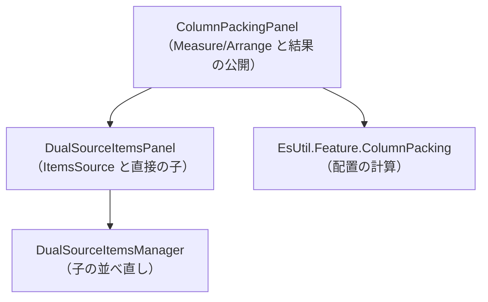
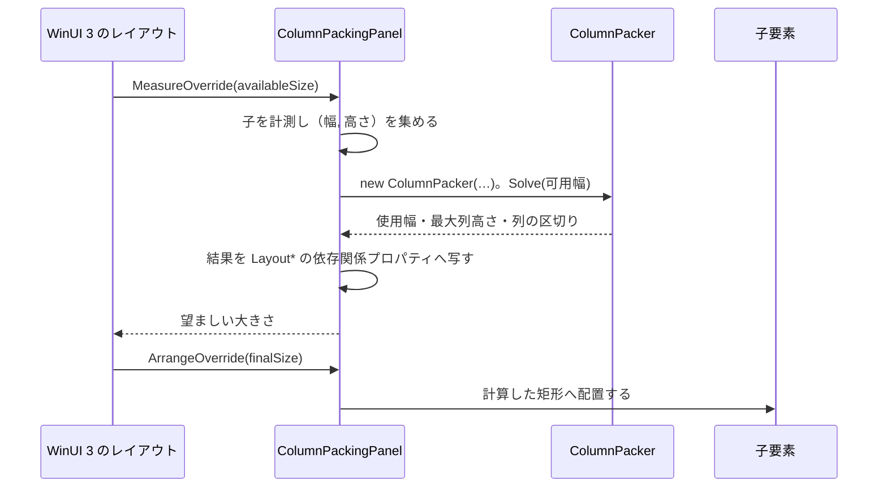

# EsUtil.Ui.WinUI3.ColumnPacking システム仕様書

WinUI 3 のパネルとして、複数列の配置を要素へ反映する層の内部仕様です。

## 目次 <!-- omit from toc -->

- [1. システム概要](#1-システム概要)
- [2. 技術スタック](#2-技術スタック)
- [3. アーキテクチャ](#3-アーキテクチャ)
  - [3.1 依存方向](#31-依存方向)
  - [3.2 レイアウトの流れ](#32-レイアウトの流れ)
- [4. コンポーネント構成](#4-コンポーネント構成)
- [5. 依存関係](#5-依存関係)
- [6. 例外処理ポリシー](#6-例外処理ポリシー)
- [7. テスト方針](#7-テスト方針)
- [8. 設計判断](#8-設計判断)

## 1. システム概要

**配置の計算は UI 非依存の [`EsUtil.Feature.ColumnPacking`](../../../EsUtil/Feature.ColumnPacking/README.md) が単一所有**します。 本パネルは「幅の上限を渡す」「返ってきた矩形へ子を配置する」「結果を依存関係プロパティへ写す」だけを行います。

子は 2 種類あります。 `ItemsSource` + `ItemTemplate` から作る要素と、XAML に直接書いた要素です。 どちらを先に置くかは `ItemsSourceFirst` が決め、並べ直しは `DualSourceItemsManager` が担います。

## 2. 技術スタック

| 項目 | 内容 |
| --- | --- |
| 対象フレームワーク | `net10.0-windows10.0.22621.0` |
| 対応 OS | Windows 10 バージョン 2004（ビルド 19041）以降（`SupportedOSPlatformVersion`） |
| UI フレームワーク | WinUI 3（Windows App SDK 1.x） |
| 配置の計算 | `EsUtil.Feature.ColumnPacking`（パッケージ参照） |
| テスト | xUnit v3（`tests/`）。 XAML のランタイムを要する部分はサンプルで確認する |
| Native AOT | `IsAotCompatible=true`（解析警告 0 件をビルドで検査） |

## 3. アーキテクチャ

### 3.1 依存方向



UI 層は同一 UI の変換ブリッジと、層を持たない機能パッケージを参照できます（[`.github/依存関係.md`](../../../.github/依存関係.md) §3 の R5）。

### 3.2 レイアウトの流れ



## 4. コンポーネント構成

```text
EsUtil.Ui.WinUI3/ColumnPacking/
├── docs/
├── sample/
├── src/
│   ├── ColumnPackingPanel.cs
│   ├── DualSourceItemsPanel.cs
│   └── DualSourceItemsManager.cs
└── tests/
```

| コンポーネント | 所在 | 内容 |
| --- | --- | --- |
| パネル本体 | `EsUtil.Ui.WinUI3/ColumnPacking/src/ColumnPackingPanel.cs` | 配置の計算の呼び出し・結果の公開・子の配置 |
| ItemsSource の管理 | `EsUtil.Ui.WinUI3/ColumnPacking/src/DualSourceItemsPanel.cs` | 依存関係プロパティと子の作り直し |
| 子の並べ直し | `EsUtil.Ui.WinUI3/ColumnPacking/src/DualSourceItemsManager.cs` | 直接の子の保存と `ItemsSource` の要素の生成 |
| サンプル | `EsUtil.Ui.WinUI3/ColumnPacking/sample/` | 列数・余白・項目数を変えて確認するアプリ（デバッグ表示の派生クラスを含む） |

## 5. 依存関係

- **`EsUtil.Feature.ColumnPacking`**（配置の計算）。
- **`Microsoft.WindowsAppSDK`** / **`Microsoft.Windows.SDK.BuildTools`**。
- `EsUtil.Platform.Core` などの他の EsUtil の層は参照しません。
- サンプルは `ProjectReference` で本体を参照します（サンプルは配布しないため）。

## 6. 例外処理ポリシー

- **例外を送出しません**（配置の計算の例外は、入力の検証をパネル側で行うことで防ぎます）。
- 幅が未確定（0 以下）の間は配置を計算しません（レイアウトの次のパスで計算します）。

## 7. テスト方針

- `DualSourceItemsManager` の状態（`ItemsSourceFirst`・保存の有無・`Reset`）と、`ItemsSource` からの要素生成（null の扱い）を単体テストで検証します。
- **パネル自身の配置は単体テストで検証しません**（XAML のランタイムが必要で、テスト プロセスでは XAML の型を生成できないため）。 サンプル アプリで確認します。

## 8. 設計判断

- **配置の計算を UI 非依存の層へ置く**: 同じ計算を UI ごとに書き直すと、UI によって並びが変わります。 計算を 1 か所に置き、パネルは写すだけにしています。
- **結果を依存関係プロパティで公開する**: バインディングで表示でき、派生クラスからも読めます（[サンプル](../sample/README.md) のデバッグ表示）。
- **子の仮想化を行わない**: 配置の計算が「全件の高さ」を必要とするためです（仮想化するには高さの推定が要り、結果が変わります）。
- **名前空間とアセンブリ名を `EsUtil.Ui.WinUI3.ColumnPacking` に揃える**: 型名（`ColumnPackingPanel`）をそのままパッケージ名にすると名前空間のセグメントと一致し、配下から型を参照できなくなる（`MA0049`。 `CS0118`）。 そのためパッケージ名は機能名、型名は実装の名前にしています。
