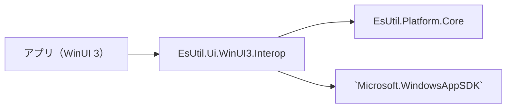

# EsUtil.Ui.WinUI3.Interop システム仕様書

WinUI 3 と EsUtil の型の境界を担うアセンブリの構造・依存・設計判断を扱います。 開発者向けの文書です。

## 目次 <!-- omit from toc -->

- [1. システム概要](#1-システム概要)
- [2. 技術スタック](#2-技術スタック)
- [3. アーキテクチャ](#3-アーキテクチャ)
- [4. コンポーネント構成](#4-コンポーネント構成)
- [5. 依存関係](#5-依存関係)
- [6. エラー処理ポリシー](#6-エラー処理ポリシー)
- [7. 実装上の注意](#7-実装上の注意)

## 1. システム概要

WinUI 3 の型と EsUtil の型の**境界**を担うアセンブリです。 UI フレームワークに依存する処理（型の変換と UI 固有の描画）だけを置き、それ以外は下の層へ委ねます。

## 2. 技術スタック

| 項目 | 内容 |
| --- | --- |
| 対象フレームワーク | `net10.0-windows10.0.22621.0` |
| UI フレームワーク | `Microsoft.WindowsAppSDK`（2.6 以降） |
| 共通基盤 | `EsUtil.Platform.Core`（値型・画像・OS の抽象） |
| テスト | xUnit v3 |

## 3. アーキテクチャ

- **依存の向きは 1 方向です**（アプリ → 本アセンブリ → コアと UI フレームワーク）。 本アセンブリからアプリへは参照しません。
- **変換の規則を 1 か所に持ちます**: 同じ変換をアプリや各コントロールへ写すと、片方だけ直したときに挙動が食い違います。

## 4. コンポーネント構成

| 区分 | 型 |
| --- | --- |
| `Imaging.TextMeasure` | 文字列の実寸（WinUI 3 のテキスト計測） |
| `Drawing.CompositionImageView` | コアの画像を Composition で描く表示ビュー |
| `Drawing.RectShapeLayer` | 矩形（角丸を含む）を Composition の図形として描く |
| `Drawing.DrawList` / `DrawRect` / `DrawRoundRect` | 描く図形の一覧（UI 非依存の値） |
| `Drawing.BmpStreamBuilder` | BMP を組み立てる（`Write` はファイル全体の配列を作らずにストリームへ書く） |
| `Bootstrapping.WindowsAppRuntimeBootstrap` | Windows App Runtime の初期化（`MddBootstrapInitialize2`）と、無い場合の導入（公式インストーラー）。 自己完結・MSIX では初期化しない |
| `Bootstrapping.WindowsAppRuntimeInventory` | インストール済みの版の列挙（`PackageManager.FindPackagesForUser`）と、必要とする版（パッケージのランタイム版）の判定 |
| `Bootstrapping.WindowsAppRuntimeInstallDialog`（internal） | 案内 UI（タスク ダイアログ。 使えない環境ではメッセージ ボックス）。 ダウンロード ページの URL（クリックで開く）と 3 択を表示する |
| `Bootstrapping.WindowsAppRuntimeDownloadPage`（internal） | ダウンロード ページの URL と、ブラウザーで開く手順（案内 UI と `WindowsAppRuntimeBootstrap` が共用する） |

## 5. 依存関係

`EsUtil.Platform.Core` と `Microsoft.WindowsAppSDK` を参照します。 参照してよいプロジェクトの規則は [`.github/依存関係.md`](../../../.github/依存関係.md) §3 が定めます。

- **ランタイムの版は参照しているパッケージから取ります**（`Microsoft.WindowsAppSDK.Release` / `Runtime.Version` の定数を `WindowsAppSdkIncludeVersionInfo` で取り込む）。 ライブラリ側に版や配布 URL の版を書きません（パッケージを上げれば追随する）。
- **インストール済みの版は OS のパッケージ マネージャーから列挙します**（`Windows.Management.Deployment.PackageManager.FindPackagesForUser`。 パッケージ ID を持たないアプリからも呼べることを実測 2026-11-05）。 フレームワーク パッケージのファミリ名はパッケージの定数（`Runtime.Packages.Framework.PackageFamilyName`）から取ります。
- **案内 UI は Win32 のタスク ダイアログ**（`TaskDialogIndirect`。 CsWin32 が生成）で出します。 WinUI の初期化前でも表示できるようにするため XAML を使いません。 `TaskDialogIndirect` は ComCtl32 v6（`app.manifest` の `Microsoft.Windows.Common-Controls` の宣言）でしか解決できないため（実測 2026-11-05: 宣言が無いと `EntryPointNotFoundException`）、**使えない場合はメッセージ ボックスへ落とします**（3 択の意味は本文に書く）。
- **Bootstrapper の呼び出しはソース生成の P/Invoke**（`LibraryImport`）です。 探索先はアプリのフォルダーに限り（`DefaultDllImportSearchPaths(SafeDirectories)`）、インストーラーの取得は `HttpClient` と `Process` だけで行います（リフレクションを使わないため Native AOT で動作する。 WinRT の列挙も AOT で発行したアプリから動作することを実測 2026-11-05）。

## 6. エラー処理ポリシー

- **未対応の値は既定値へ落とします**（キーの未定義値は `None`、対応の無い幾何は 0）。 例外にしません（UI の入力経路で例外を投げると操作が止まります）。
- **引数の null は `ArgumentNullException`** にします（呼び出し側の誤りであり、黙って既定値へ落とすと原因が分かりません）。
- **グラフィックス バックエンドが未登録の環境**（MewUI のテキスト計測など）では、UI フレームワークが投げる例外をそのまま伝えます（本アセンブリで握りつぶしません）。

## 7. 実装上の注意

- 描画は Composition を使います。
