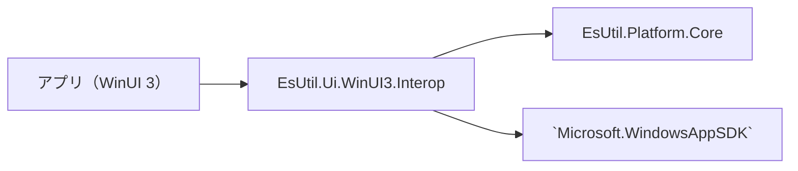

# EsUtil.Ui.WinUI3.Interop システム仕様書

WinUI 3 と EsUtil の型の境界を担うアセンブリの構造・依存・設計判断を扱います。 開発者向けの文書です。

## 目次 <!-- omit from toc -->

- [1. システム概要](#1-システム概要)
- [2. 技術スタック](#2-技術スタック)
- [3. アーキテクチャ](#3-アーキテクチャ)
- [4. コンポーネント構成](#4-コンポーネント構成)
- [5. 依存関係](#5-依存関係)
- [6. エラー処理ポリシー](#6-エラー処理ポリシー)
- [7. 実装上の注意](#7-実装上の注意)

## 1. システム概要

WinUI 3 の型と EsUtil の型の**境界**を担うアセンブリです。 UI フレームワークに依存する処理（型の変換と UI 固有の描画）だけを置き、それ以外は下の層へ委ねます。

## 2. 技術スタック

| 項目 | 内容 |
| --- | --- |
| 対象フレームワーク | `net10.0-windows10.0.22621.0` |
| UI フレームワーク | `Microsoft.WindowsAppSDK` |
| 共通基盤 | `EsUtil.Platform.Core`（値型・画像・OS の抽象） |
| テスト | xUnit v3 |

## 3. アーキテクチャ

- **依存の向きは 1 方向です**（アプリ → 本アセンブリ → コアと UI フレームワーク）。 本アセンブリからアプリへは参照しません。
- **変換の規則を 1 か所に持ちます**: 同じ変換をアプリや各コントロールへ写すと、片方だけ直したときに挙動が食い違います。

## 4. コンポーネント構成

| 区分 | 型 |
| --- | --- |
| `Imaging.ClientPixelScale` | 実効倍率（物理ピクセルと DIP の比） |
| `Imaging.TextMeasure` | 文字列の実寸（WinUI 3 のテキスト計測） |
| `Drawing.CompositionImageView` | コアの画像を Composition で描く表示ビュー |
| `Drawing.RectShapeLayer` | 矩形（角丸を含む）を Composition の図形として描く |
| `Drawing.DrawList` / `DrawRect` / `DrawRoundRect` | 描く図形の一覧（UI 非依存の値） |
| `Drawing.BmpStreamBuilder` | BMP をメモリ上で組み立てる（ICO の中身） |

## 5. 依存関係

`EsUtil.Platform.Core` と `Microsoft.WindowsAppSDK` を参照します。 参照してよいプロジェクトの規則は [`.github/依存関係.md`](../../../.github/依存関係.md) §3 が定めます。

## 6. エラー処理ポリシー

- **未対応の値は既定値へ落とします**（キーの未定義値は `None`、対応の無い幾何は 0）。 例外にしません（UI の入力経路で例外を投げると操作が止まります）。
- **引数の null は `ArgumentNullException`** にします（呼び出し側の誤りであり、黙って既定値へ落とすと原因が分かりません）。
- **グラフィックス バックエンドが未登録の環境**（MewUI のテキスト計測など）では、UI フレームワークが投げる例外をそのまま伝えます（本アセンブリで握りつぶしません）。

## 7. 実装上の注意

- 描画は Composition を使います（Skia を使いません）。
