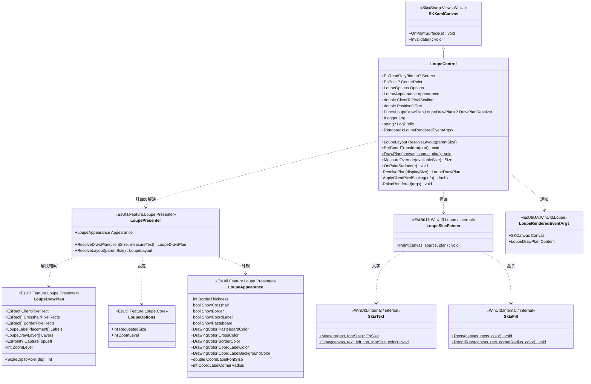
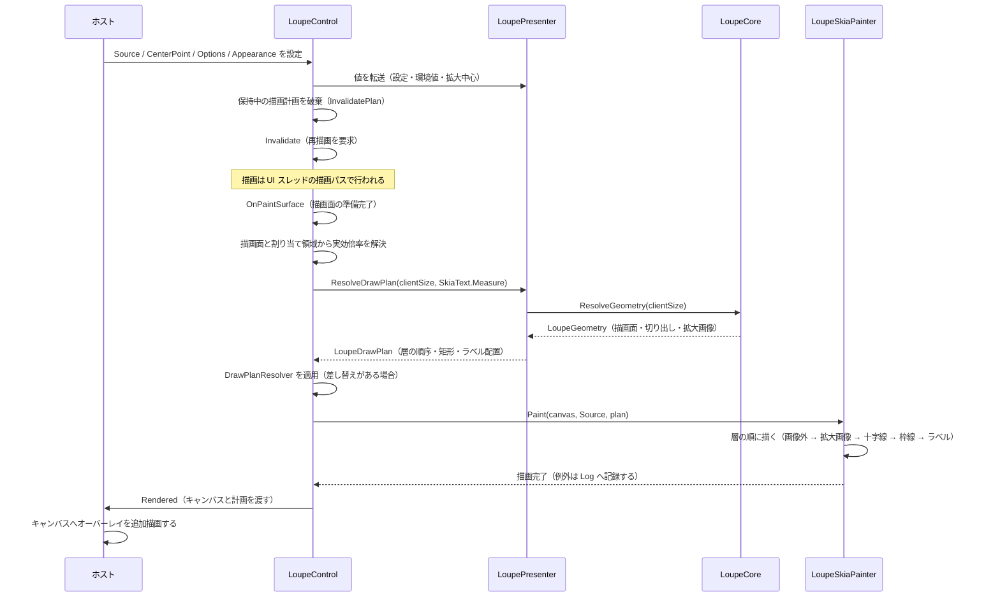

# EsUtil.Ui.WinUI3.Loupe システム仕様書

`LoupeControl`（WinUI 3 版ルーペ）のシステム概要・アーキテクチャ・依存関係・設計判断を記載します。

## 目次 <!-- omit from toc -->

- [1. システム概要](#1-システム概要)
- [2. 技術スタック](#2-技術スタック)
- [3. アーキテクチャ](#3-アーキテクチャ)
  - [3.1 依存方向](#31-依存方向)
  - [3.2 責務の分担](#32-責務の分担)
- [4. 例外処理ポリシー](#4-例外処理ポリシー)
- [5. コンポーネント構成](#5-コンポーネント構成)
- [6. クラス図](#6-クラス図)
- [7. シーケンス図（描画）](#7-シーケンス図描画)
- [8. 設計判断](#8-設計判断)
- [9. テスト方針](#9-テスト方針)
- [10. 未実装・今後の対応](#10-未実装今後の対応)
- [11. ログ](#11-ログ)

## 1. システム概要

`EsUtil.Ui.WinUI3.Loupe` は、他の UI 版 `LoupeControl` と**同一の UI 非依存コア（`EsUtil.Feature.Loupe.Core`）と提示層（`EsUtil.Feature.Loupe.Presenter`）** を使い、
描画（`SKCanvas`）のみを WinUI 3（Windows App SDK）で実装したルーペ コントロールです。

コアが担う範囲（数値の安全域補正・切り出し領域の計算・表示レイアウト）は複数の UI で完全に共通であり、
本プロジェクトはその計算結果をキャンバスへ描画するだけです。
これにより **UI ごとの見た目の差を作らずに済み**、UI 追加時の再実装は描画 API の呼び出しのみになります。

WinUI 3 固有の実装は次の 3 点です。

- 描画面に `SkiaSharp.Views.WinUI` の `SKXamlCanvas`（`Microsoft.UI.Xaml.Controls.Canvas` 派生）を使う。
- 公開プロパティを CLR プロパティとして公開し、値の補正と変更ログを setter に集約する。
- 中心座標ラベルを描画面へ描く（テキスト要素を重ねない）。

## 2. 技術スタック

| 区分 | 採用技術 |
| --- | --- |
| 対象フレームワーク | .NET 10（`net10.0-windows10.0.22621.0`。 `SupportedOSPlatformVersion` は `10.0.19041.0`） |
| 言語 | C# 14 |
| UI フレームワーク | WinUI 3（Windows App SDK 1.x。 `UseWinUI` を有効にする） |
| 描画 | SkiaSharp（描画実装 `LoupeSkiaPainter` が `SKCanvas` へ描く） |
| 描画面 | `SkiaSharp.Views.WinUI` の `SKXamlCanvas`（`SkiaSharp.Views.Windows` 名前空間） |
| プロパティ | CLR プロパティ（依存関係プロパティではない。 §8 を参照） |
| ログ | `Microsoft.Extensions.Logging.Abstractions`（`LoggerMessage` ソース生成） |
| テスト | xUnit v3（`dotnet test`。 実行可能なテスト プロジェクト） |

## 3. アーキテクチャ

### 3.1 依存方向

層の全体像（Core / Presenter / UI）は [`src/README.md`](../README.md) を参照してください。

```text
UI 層（WinUI 3 の実装）
  入力の受付・値の補正・通知の転送・描画先の用意（SKXamlCanvas）
    └──> EsUtil.Feature.Loupe.Presenter   どう描くか（描画計画の解決と外観）
           └──> EsUtil.Feature.Loupe.Core   何を描くか + 判断（状態・値・純粋計算・幾何）
                  └──> EsUtil.Platform.Core（Es* 値型・ICoordTransform）
※ Core は Presenter / UI を参照しない（依存は UI → Presenter → Core の一方向）。
```

他の UI 版との間に依存はありません（互いを参照しません）。 共通する計算は必ず `EsUtil.Feature.Loupe.Core` を経由します。

| 依存元 | 依存先 | 依存理由 |
| --- | --- | --- |
| `EsUtil.Ui.WinUI3.Loupe` | `EsUtil.Feature.Loupe.Presenter` | 描画計画（層の順序・矩形・ラベルの文言と配置）と外観の解決 |
| `EsUtil.Ui.WinUI3.Loupe` | `EsUtil.Platform.Core` | コア型（`EsReadOnlyBitmap` / `EsPoint` / `EsRect` / `DpiScaler` / `ICoordTransform`） |
| `EsUtil.Ui.WinUI3.Loupe` | `Microsoft.WindowsAppSDK` / `Microsoft.Windows.SDK.BuildTools` | WinUI 3 の要素と XAML のビルド |
| `EsUtil.Ui.WinUI3.Loupe` | `SkiaSharp.Views.WinUI` | 描画面（`SKXamlCanvas`）と Skia の描画 API |
| `EsUtil.Ui.WinUI3.Loupe` | `Microsoft.Extensions.Logging.Abstractions` | ログの定義（LoggerMessage ソース生成）と `NullLogger` |

### 3.2 責務の分担

| 層 | 責務 |
| --- | --- |
| `EsUtil.Feature.Loupe.Core` | 数値の安全域補正、表示レイアウト、切り出し領域の幾何（`LoupeGeometry`）、設定（`LoupeOptions`）の保持 |
| `EsUtil.Feature.Loupe.Presenter` | 描画計画（層の順序・装飾の矩形・ラベルの文言と配置）と外観（`LoupeAppearance`）の保持。 UI 非依存であり、UI フレームワークを参照しない |
| `EsUtil.Ui.WinUI3.Loupe` | 提示層が解決した描画計画を `LoupeSkiaPainter` で `SKCanvas` へ写す。 公開プロパティの受付（値の補正と変更ログ）。 表示倍率の追従 |
| ホスト（利用側のアプリ） | `Source` / `CenterPoint` の設定、表示位置の決定（コアのファサード `ResolveLayout` を利用）、入力の受付 |

## 4. 例外処理ポリシー

| 状況 | 挙動 |
| --- | --- |
| 描画中に拡大元が破棄された（`ObjectDisposedException`） | 拡大画像の層を描かずに戻る（描画実装 `LoupeSkiaPainter` が吸収する。 [例外処理規約.md](../../../.github/例外処理規約.md) §4） |
| 描画中のその他の例外 | 記録して再送出しない（`Log` へ Error を記録し、そのフレームの描画を中断する。 アプリは継続する） |
| 公開 API（`SetCoordTransform`）の例外 | 記録して再送出する（呼び出し側が対処できるようにする） |

共通方針（送出・捕捉・翻訳）は [例外処理規約.md](../../../.github/例外処理規約.md) §2・§3 に従います。

## 5. コンポーネント構成

| コンポーネント | 責務 | 主な型 |
| --- | --- | --- |
| コントロール | 公開プロパティの受付（値の補正と変更ログ）、描画計画の解決とキャッシュ、描画の起動、描画完了の通知 | `LoupeControl` |
| 描画実装（内部） | 描画計画（`LoupeDrawPlan`）を Skia の描画 API へ写す。 層の順序は計画に従い、中心座標ラベルも描く | `LoupeSkiaPainter` |
| 描画完了の通知 | 描画済みのキャンバスと実際に使われた描画計画を渡す | `LoupeRenderedEventArgs` |
| ログ定義 | 拡大元画像の差し替え、描画の例外、公開 API の例外の出力書式 | `LoupeLogMessage` |
| Skia の補助（内部） | テキストの実寸測定と描画、矩形の塗り、色・幾何の変換、描画面と表示領域からの実効倍率の解決、コアの画像のビュー | `SkiaText` / `SkiaFill` / `SkiaColorInterop` / `SkiaGeometryInterop` / `ClientPixelScale` / `EsBitmapSkiaExtensions` |
| テスト | 画素の検証（描画）、変換と補助の検証、ログの出力書式、描画計画の保持 | `LoupeSkiaPainterTests` ほか |

`LoupeControl` の役割:

- プロパティの変更で保持中の描画計画を破棄し、描画を無効化する（設定・外観・拡大中心）。
- `Options` の変更ではレイアウトの無効化も行う（要求サイズが変わるため）。
- 描画のたびに、描画面（物理ピクセル）と割り当て領域（DIP）の比から実効倍率を求め、`ClientToPixelScaling` と提示層へ反映する（DPI の変更通知が届かない状況でも拡大画像と図形の倍率が一致する）。
- 同じ入力（表示サイズとスケーリング係数）では描画計画を再解決しない（1 フレーム 1 回に留める）。

## 6. クラス図



## 7. シーケンス図（描画）



## 8. 設計判断

| 判断 | 理由 | 影響 |
| --- | --- | --- |
| 公開プロパティを CLR プロパティにする | WinUI 3 の `DependencyProperty` は WinRT へ投影できる型だけを登録できるため、コアと描画層の型（`EsReadOnlyBitmap` / `LoupeOptions` / `LoupeAppearance`）は依存関係プロパティにできない | XAML のバインディングでは設定できない（コードビハインドから設定する）。 同値判定と補正は setter に集約する |
| 基底クラスに `SKXamlCanvas` を選ぶ | 描画面（Skia の表面）を要素そのものにし、中間ビットマップを持たずに済む | 要素の大きさと描画面の大きさが一致する。 位置と描画のずれが構造的に起きない |
| 中心座標ラベルを描画面へ描く | ラベルを要素として重ねると、要素のフォントと実寸測定のフォントが分かれ、背景から文字がはみ出す。 測定と描画を同じ関数にすれば大きさが必ず一致する | ラベルの実寸測定（`SkiaText.Measure`）を提示層の解決へ渡し、描画も同じ関数を使う |
| 実効倍率を描画のたびに描画面から実測する | DPI の変更通知は追加直後のコントロールへ届かないことがある（保持値だけでは拡大画像と図形の倍率が食い違う） | `ClientToPixelScaling` はホストが明示しなくても正しい値へ追従する |
| 位置を持たない | 位置の計算（オフセット・親領域内への補正）はコアのファサードが単一所有する | ホストが `ResolveLayout` の結果で配置する（`Canvas` 等の親へ置く） |
| `MeasureOverride` で一辺 `RequestedSize` の正方形を返す | ルーペは正方形であり、要求サイズを親へ伝える | 親が余白を決める場合でも要求サイズが伝わる（配置はホストが行う） |
| Skia の描画プリミティブを Internal へ複製する | 本プロジェクトは独立したパッケージとして配布するため、利用側のプラットフォーム層へ依存できない（[依存関係.md](../../../.github/依存関係.md) §4.1） | 複製した型は `internal` とし、複製元を 1 行コメントで示す |

## 9. テスト方針

**WinUI 3 の XAML 型はヘッドレス環境で生成できない**（実測: `new LoupeControl()` は `COMException: クラスが登録されていません (0x80040154 / REGDB_E_CLASSNOTREG)` になり、`Microsoft.UI.Xaml.Controls.Canvas` の生成に失敗する）。 そのためテストは、XAML に依存しない範囲へ絞ります。

| 検証する範囲 | 検証内容 |
| --- | --- |
| 描画（`LoupeSkiaPainter`） | 層の順序、画像外の色、拡大画像の切り出しと行幅、十字線、枠線、中心座標ラベル（背景・文字・表示可否・スケーリング係数の換算）、既定描画の入口 |
| Skia の補助（Internal） | テキストの実寸と描画、矩形の塗りと角丸、色と幾何の変換、描画面からの実効倍率、コアの画像のビュー（所有権と行幅） |
| ログ | 出力書式（`LoupeLogMessage`）、同値の設定で出力しないこと、接頭辞の反映 |
| 通知 | 描画完了の引数が保持する値（キャンバス・計画） |

| 検証しない範囲 | 理由と代替 |
| --- | --- |
| `LoupeControl` のインスタンス（プロパティの補正・変更ログ・DPI 追従・描画計画のキャッシュ） | XAML 型の生成ができない（上記の実測）。 代替として、サンプル アプリケーション（アンパッケージの WinUI 3 アプリ）で動作を確認する |
| 実際の描画面（`SKXamlCanvas` の表面）の画素 | 描画面の生成にウィンドウが必要である。 代替として、同じ描画計画を `SKBitmap` のキャンバスへ描いて画素を検証する |
| XAML の読み込みとレイアウト | XAML のコンパイルとサンプル アプリの起動で確認する |

## 10. 未実装・今後の対応

- 拡大方式（補間）の切り替えは持たない（最近傍で描く）。
- ポインター入力による拡大中心の移動は持たない（ホストが入力を受けて `CenterPoint` を設定する）。
- 印刷・画像の書き出しは持たない（`Rendered` のキャンバスへ描いた結果をホストが保存する）。
- タッチ・ペン固有の入力の扱いは持たない。

## 11. ログ

| レベル | 出力書式 | 所有者 |
| --- | --- | --- |
| Debug | `[Loupe] Setting: Source {前} → {後}` | 本プロジェクトの `LoupeLogMessage` |
| Debug | `[Loupe] Setting: {名前} {前} → {後}` | コア（設定値・環境値・拡大中心）と提示層（外観） |
| Error | `[Loupe] Update exception` | 本プロジェクトの `LoupeLogMessage`（描画の例外） |
| Error | `[Loupe] {操作} で例外が発生` | 本プロジェクトの `LoupeLogMessage`（公開 API の例外） |

接頭辞は `LogPrefix` が提示層・コアへ伝搬し、全層のログが同じ接頭辞になります。 出力先とレベルの制御はホスト（利用側のアプリ）が所有します。
