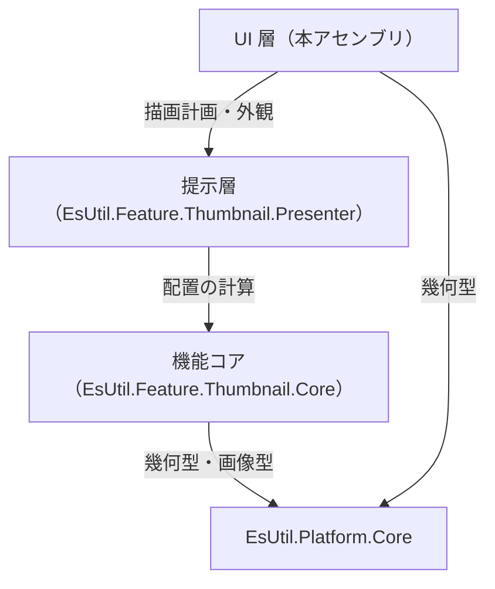
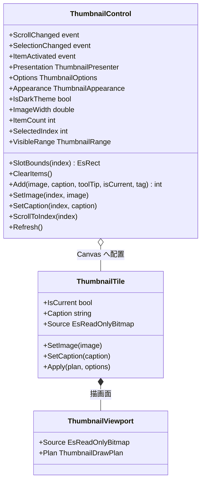
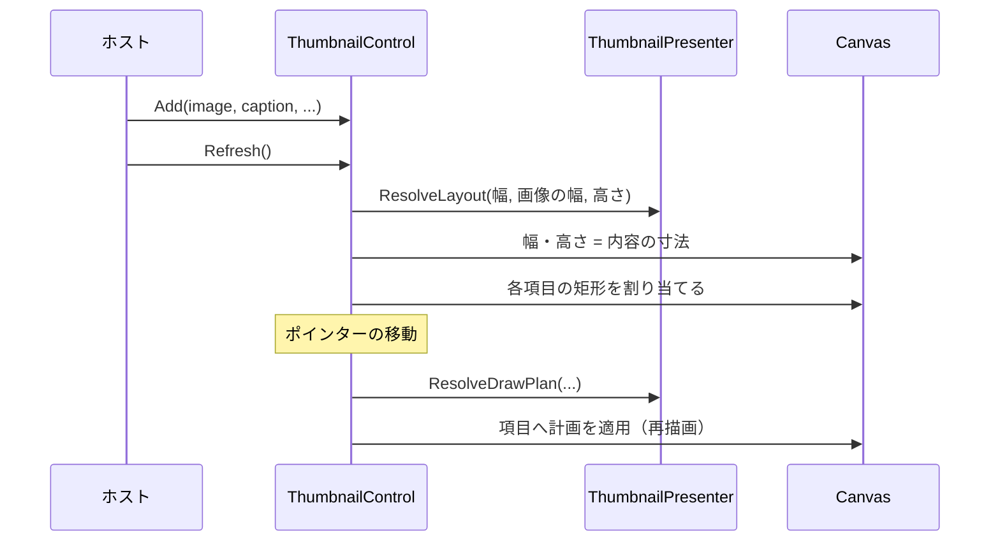

# EsUtil.Ui.WinUI3.Thumbnail システム仕様書

WinUI 3 版のサムネイル一覧コントロールの構造・依存・設計判断を扱います。 開発者向けの文書です。

## 目次 <!-- omit from toc -->

- [1. システム概要](#1-システム概要)
- [2. 技術スタック](#2-技術スタック)
- [3. アーキテクチャ](#3-アーキテクチャ)
  - [3.1 依存方向](#31-依存方向)
  - [3.2 責務の分担](#32-責務の分担)
  - [3.3 設計判断](#33-設計判断)
- [4. コンポーネント構成](#4-コンポーネント構成)
  - [4.1 可視性](#41-可視性)
- [5. クラス図](#5-クラス図)
- [6. 入力から描画までの流れ](#6-入力から描画までの流れ)
- [7. 影と画像の描画](#7-影と画像の描画)
- [8. エラー処理ポリシー](#8-エラー処理ポリシー)
- [9. 実装上の注意](#9-実装上の注意)

## 1. システム概要

本アセンブリは、サムネイル一覧を WinUI 3（Windows App SDK）のコントロールとして提供します。

- **配置と見た目は下の層が単一所有します**（`EsUtil.Feature.Thumbnail.Core` が並べ方、`EsUtil.Feature.Thumbnail.Presenter` が描画計画と外観）。
- **本アセンブリが行うのは 4 つだけ**: 入力の受付、スクロール、計画の適用（キャンバスへの絶対配置）、Skia による描画。
- 対象フレームワークは `net10.0-windows10.0.22621.0`（`UseWinUI`）です。

## 2. 技術スタック

| 種別 | 内容 |
| --- | --- |
| 言語 / フレームワーク | C# / .NET 10（`net10.0-windows10.0.22621.0`） |
| UI フレームワーク | WinUI 3（Windows App SDK。 `Grid` / `ScrollViewer` / `Canvas`） |
| 描画 | Skia（`SkiaSharp.Views.WinUI` の `SKXamlCanvas`） |
| 参照パッケージ | `EsUtil.Feature.Thumbnail.Presenter` / `EsUtil.Platform.Core` / `Microsoft.WindowsAppSDK` / `SkiaSharp.Views.WinUI` |
| テスト | xUnit v3（`EsUtil.Ui.WinUI3.Thumbnail.Tests`。 ログ定義と影の描画手順を検証する。 コントロールは XAML の初期化を必要とするため配布物の起動で確認する） |

## 3. アーキテクチャ

### 3.1 依存方向



- **依存は一方向**です（コアも提示層も WinUI 3 を知りません）。
- **本体プロジェクトは `ProjectReference` を持ちません**（ローカル フィードのパッケージを参照します）。

### 3.2 責務の分担

| 責務 | 所有者 |
| --- | --- |
| 折り返し・行の高さ・当たり判定・可視範囲 | `EsUtil.Feature.Thumbnail.Core` |
| 背景・影・名前の体裁、層の順序 | `EsUtil.Feature.Thumbnail.Presenter` |
| ポインターの受付・選択の決定・2 回押しの通知 | `ThumbnailControl` |
| スクロール（`ScrollViewer` の保持と通知） | `ThumbnailControl` |
| 項目の描画（背景・影・画像・名前） | `ThumbnailTile`（内部） |
| コアの画像 ⇔ Skia の画像の変換 | `Internal.EsBitmapSkiaExtensions` |
| 影の帯の描画 | `Internal.SkiaShadowRenderer` |

### 3.3 設計判断

- **`Canvas` へ絶対配置する**: WinUI 3 の標準パネルには任意の大きさの子を折り返すパネルがありません。 コアが返す矩形をそのまま使える `Canvas` の方が、折り返しの計算を XAML へ二重に持たせません。
- **`Grid` を継承する**: `ScrollViewer` を単独の基底にすると、スクロールの外側に余白や重なりを置けません。 一覧は `Grid` の子としてスクロールを持ちます。
- **影は Skia で描く**: 縮小キャンバス（`SKXamlCanvas`）の内容は XAML 要素より**背面**に合成されるため、影を要素（`Border` の `Shadow`）で重ねると画像が隠れます。 影も同じキャンバスへ描きます。
- **画像は非所有ビューで描く**: コアの画像（`EsReadOnlyBitmap`）のピクセルを複製せず、Skia の画像として包んで描きます。
- **倍率は描画面と割り当て領域の比から解決する**: `SKXamlCanvas` の描画情報（物理ピクセル）と `ActualWidth`（DIP）の比を使います（DPI の通知に依存しません）。
- **ポインターの移動は handled 済みでも受ける**: `ScrollViewer` が処理した移動も拾うため、`AddHandler` に `handledEventsToo: true` を指定します。

## 4. コンポーネント構成

```text
EsUtil.Ui.WinUI3/Thumbnail/
├── docs/
└── src/
    └── Internal/
```

| コンポーネント | 所在 | 内容 |
| --- | --- | --- |
| コントロール | `EsUtil.Ui.WinUI3/Thumbnail/src/ThumbnailControl.cs` | 公開面。 入力の受付・選択・スクロール・キャンバスへの配置 |
| 項目の要素 | `EsUtil.Ui.WinUI3/Thumbnail/src/ThumbnailTile.cs` | Skia の描画面と名前の要素（内部） |
| イベント引数 | `EsUtil.Ui.WinUI3/Thumbnail/src/ThumbnailActivatedEventArgs.cs` | 2 回押しの通知（公開） |
| 画像の変換 | `EsUtil.Ui.WinUI3/Thumbnail/src/Internal/EsBitmapSkiaExtensions.cs` | コアの画像を Skia の画像として包む（内部） |
| 影の描画 | `EsUtil.Ui.WinUI3/Thumbnail/src/Internal/SkiaShadowRenderer.cs` | 帯を単色で塗る（内部） |

### 4.1 可視性

| 対象 | 可視性 | 理由 |
| --- | --- | --- |
| `ThumbnailControl` / `ThumbnailActivatedEventArgs` | `public` | ホストが使う |
| `ThumbnailTile` / `Internal.*` | `internal` | コントロールの実装詳細 |
| `ThumbnailViewport` | `private`（入れ子） | 項目だけが使う描画面 |

## 5. クラス図



## 6. 入力から描画までの流れ



1. `Refresh()` が配置を解き、各項目の矩形を `Canvas` の子へ割り当てます。
2. ポインターの移動は位置から添字へ変換し、ホバーを切り替えます。
3. 押下は選択、2 回押しは `ItemActivated` の通知になります。
4. スクロールは内側の `ScrollViewer` が行い、`ViewChanged` を `ScrollChanged` として通知します。

## 7. 影と画像の描画

- **影**: `Internal.SkiaShadowRenderer` が `BuildDeviceBands` の帯を 1 画素ずつ単色で塗ります。 倍率は描画面の物理ピクセルと `ActualWidth` の比から求めます。
- **画像**: コアの画像を Skia の画像として包み（`Internal.EsBitmapSkiaExtensions`）、`SKCanvas.DrawImage` で描きます。 **ピクセルは複製しません**。
- **名前**: 要素（テキスト）として重ねます。 計画の `Bounds` をそのまま割り当てます。

## 8. エラー処理ポリシー

- **公開メソッドは引数を検証する**: 範囲外の添字は**何もせずに戻る**（一覧の組み直し中に古い添字が渡される経路があるため）。
- **null の画像は許容する**: `Add` / `SetImage` は画像なしの項目を作ります。
- 共通方針は [`../../../.github/例外処理規約.md`](../../../.github/例外処理規約.md) が所有します。

## 9. 実装上の注意

- **コアの画像を保持しない**: コントロールは画像の所有権を持ちません（`ClearItems` でも解放しません）。
- **`Canvas` の子は座標をそのまま使う**: 折り返し・行の高さはコアが決めます（XAML のレイアウトに任せません）。
- **`IsDarkTheme` / `ImageWidth` の変更は `Refresh()` を呼ぶ**: `Options` / `Appearance` は setter が配置を解き直すため自動で反映されます。
- **ログ**: 画像と項目数の変更は本コントロールが記録します（`Log` / `LogPrefix`。 設定・外観の変更は提示層、選択の変更はコアが記録するため、本コントロールは重複して出力しません）。
