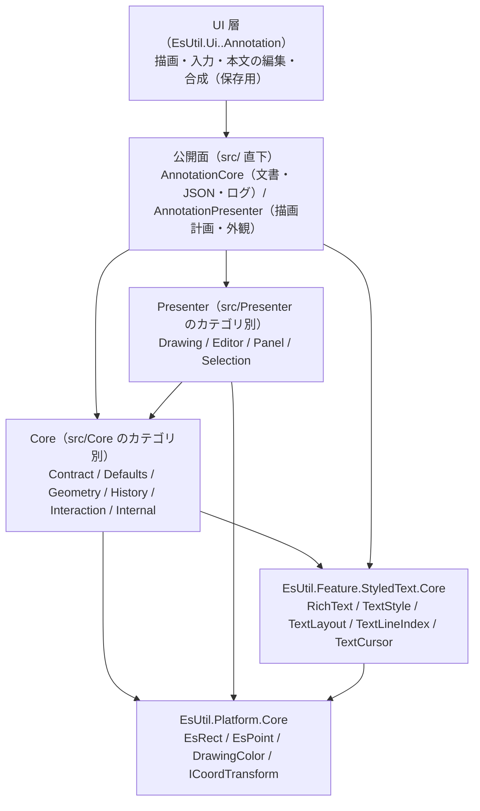

# EsUtil.Feature.Annotation.Core システム仕様書

## 目次

- [1. 概要](#1-概要)
- [2. 技術スタック](#2-技術スタック)
- [3. アーキテクチャ](#3-アーキテクチャ)
- [4. コンポーネント](#4-コンポーネント)
- [5. 依存関係](#5-依存関係)
- [6. 例外処理ポリシー](#6-例外処理ポリシー)

## 1. 概要

**画像に重ねる注釈（枠線・吹き出し）の Core と Presenter** です。 注釈は画像へ焼き込まず、レイヤーとして保持します。

| 項目 | 内容 |
| --- | --- |
| 目的 | 吹き出し・枠線を後から編集できる形で保持し、保存時に注釈 JSON と合成画像を書き出す |
| 対象 UI | Avalonia UI / MewUI / WinUI 3 / WinForms（4 つで共有） |
| 保存形式 | `<画像名>.annotations.json`（スキーマ版つき）と `<元画像名>.annotated.<拡張子>` |
| 座標 | **元画像ピクセル**（表示倍率・DPI に依存しない） |

## 2. 技術スタック

| 項目 | 内容 |
| --- | --- |
| 対象フレームワーク | `net10.0-windows10.0.17763.0` |
| 参照 | `EsUtil.Platform.Core`（値型とエラー境界）と `EsUtil.Feature.StyledText.Core`（文字の書式と行の計算）。 UI フレームワークには依存しない |
| シリアル化 | `System.Text.Json` のソース生成（Native AOT / トリミング対応）。 反射を使わない |
| テスト | xUnit v3（`EsUtil.Feature.Annotation.Core.Tests`） |

## 3. アーキテクチャ

- **Core は Presenter を参照しません**（描画計画を知らない）。
- **Presenter は描画 API を持ちません**（描画計画というデータを返し、UI が写す）。
- **編集の進行（文書・選択・履歴・本文の編集状態）は `AnnotationEditSession` が単一所有します**（UI は入力の受付と描画だけを行う）。
- **文字の計算は `EsUtil.Feature.StyledText.Core` が単一所有します**（書式・折り返し・行と文字位置の対応・書記素クラスタ）。 本アセンブリは**文字の実寸を要する**ため、`Func<string, TextStyle, EsSize>` として UI から受け取ります（ルーペの `measureText` と同じ形）。
- **公開面は `src/` 直下（名前空間 `EsUtil.Feature.Annotation`）に置き、層の内部は `src/Core/<カテゴリ>` / `src/Presenter/<カテゴリ>` へ置きます**（名前空間は `EsUtil.Feature.Annotation.Core.<カテゴリ>` / `.Presenter.<カテゴリ>`。 規則は [`.github/命名規約.md`](../../../.github/命名規約.md)）。 フォルダと名前空間の一覧は [`../README.md`](../README.md) §3 が持つ。

## 4. コンポーネント

| コンポーネント | 分類 | 責務 |
| --- | --- | --- |
| `AnnotationCore` | ファサード | 文書と注釈の生成・JSON の読み書き・付随ファイルの保存と削除・ログの定義の接頭辞と出力先の所有。 提示層（`Presenter`）を共有する |
| `AnnotationDocument` | Core | 注釈の集合（並びが重なり順）・画像の寸法・スキーマ版。 不変であり、すべての変更は新しい文書を返す（変化が無い場合は同じ実体。 収める・補正する規則は Core が単一所有する） |
| `AnnotationItem` / `FrameAnnotation` / `BubbleAnnotation` | Core | 注釈 1 件（`Id` / `Bounds` / `Appearance`）。 JSON は `Kind` で型を判別する |
| `BubbleTail` | Core | しっぽ（先端は独立・付け根は本体の辺に追従） |
| `RichText` / `TextRun` / `TextStyle` | `EsUtil.Feature.StyledText.Core` | 文字単位の書式（run が自分の文字列と解決済みの書式を持つ）。 本アセンブリは型を写さず、そのまま公開面に載せる |
| `AnnotationHitTest` | Core | 当たり判定（最前面から・先端は本体より優先） |
| `TextLayout` / `TextWrap`（内部） | `EsUtil.Feature.StyledText.Core`（`.Core.Text` / `.Core.Internal`） | 折り返しと行の配置（クラスタ単位・明示改行・行頭禁則。 行の高さは行内で最も大きい文字に合わせる） |
| `AnnotationJson` | Core（`src/` 直下・`public`） | JSON 文字列への変換・保存パスの解決・付随ファイルの判定（ファイル入出力は `AnnotationCore`） |
| `AnnotationJsonContext` / JSON 変換器（内部） | Core（`.Core.Internal`） | ソース生成の文脈・値の変換 |
| `AnnotationDefaults` / `AnnotationLimits` / `AnnotationDraftDefaultsFactory` | Core | 既定値と安全域（設定・JSON・入力の共通の補正）と、設定の値からの既定値の組み立て |
| `AnnotationHistory` | Core | 変更履歴（元に戻す・やり直す。 `BeginChange` / `CommitChange` で 1 操作 = 1 手にする） |
| `AnnotationPresenter` | Presenter | 描画計画の解決（折り返しの配置・しっぽの多角形・行の配置） |
| `AnnotationDrawPlan` / `AnnotationShapePlan` | Presenter | UI へ渡す 1 フレーム分の描画契約（行は `TextLinePlan` / `TextSegmentPlan`。 `EsUtil.Feature.StyledText.Core` が所有する） |
| `TextLineIndex` / `TextLineLayout` | `EsUtil.Feature.StyledText.Core`（`.Core.Text`） | 行と文字位置の対応（キャレット・選択範囲・位置から文字の特定） |
| `AnnotationEditingOutline` / `AnnotationEditorAppearance` / `AnnotationMarqueeMetrics` | Presenter | 編集中の枠・キャレットと選択範囲の色・選択枠の実寸近似の見た目と規則 |
| `AnnotationPanelController` / `AnnotationPanelPlacement` / `AnnotationPanelAppearance` / `AnnotationPanelKind` / `AnnotationPanelMetrics` / `IAnnotationPanelHost` | Presenter | フローティング パネルの開閉・配置・外観（UI は `IAnnotationPanelHost` を実装する） |
| `AnnotationSelectionPresenter` | Presenter | 選択中の注釈の外観・本文の余白・しっぽの差し替えの入口（文書を受け取り、変更後の文書を返す） |
| `AnnotationEditSession` / `AnnotationEditChange` | Presenter | 文書・選択・変更履歴・本文の編集状態の単一所有（4 つの UI 版は本型の操作を呼び、変更を購読する） |
| `TextEditState` | `EsUtil.Feature.StyledText.Core`（`.Presenter.Editing`） | 本文の編集状態（キャレット・選択・入力・削除・書式）。 文書も注釈の識別子も知らず、本文（`RichText`）を受け取って書き換えた本文を返す |
| `AnnotationViewTransform` | Core（`.Core.Geometry`） | 表示倍率と左上の位置、元画像ピクセルとローカル DIP の相互変換 |
| `TextCursor` / `TextStyleEdit` / `TextCompositionPreview` / `TextCaretBlink` | `EsUtil.Feature.StyledText.Core`（`.Core.Text`） | 文字位置を書記素クラスタ（絵文字・結合文字）で扱う規則・入力の挿入・変換中の文字列・点滅 |
| `AnnotationEditorLayout` / `AnnotationEditorText` / `AnnotationPaletteCatalog` / `AnnotationPaletteColor` / `AnnotationBubbleEdgeCatalog` | Presenter | 編集 UI の寸法・文言・代表色。 書式バーの並びと寸法・フォントの並べ方は書式付き文字列の編集層（`EsUtil.Feature.StyledText` の `Presenter.Formatting`）が所有する |
| `AnnotationCompositionPreview` | Presenter | IME の変換中の文字列を本文へ入れた描画用の文書（計算は `TextCompositionPreview` が持つ） |

**選択枠（8 方向のハンドル）は本アセンブリの責務ではありません**（Marquee の提示層を再利用する。 枠とハンドルの見た目を 4 つの UI 版で揃えるため）。

**ログ**: 本アセンブリはログの定義（`AnnotationLogMessage`。 接頭辞の既定値は `[Annotation]`）を持ちます。 レベルは頻度で決めます。 `Information` は利用者の明示的な操作（注釈ファイルの読み込み・保存・付随ファイルの削除）・設定（行間）の変更、`Debug` は生成（ファサード・提示層）と状態の変化（選択・本文の編集・書式の適用・履歴の移動・パネルの表示と位置・押下と解放）、`Trace` は高頻度の値（ドラッグ中の文書の変更）、`Error` は公開ファサードの操作で発生した例外です。 毎フレームの描画計画の解決と当たり判定は記録しません（規則は [`.github/ログ規約.md`](../../../.github/ログ規約.md)）。

## 5. 依存関係

| 方向 | 内容 |
| --- | --- |
| 許可 | 本アセンブリ → `EsUtil.Platform.Core` / `EsUtil.Feature.StyledText.Core` |
| 許可 | UI 層（`EsUtil.Ui.<UI>.Annotation`）→ 本アセンブリ |
| 禁止 | 本アセンブリ → UI 層（フレームワークに依存しない） |
| 禁止 | 本アセンブリ → ホスト（アプリ。 本アセンブリは上位の層に依存しない） |

規則の所有者は [`.github/依存関係.md`](../../../.github/依存関係.md) です。

## 6. 例外処理ポリシー

| 場面 | 扱い |
| --- | --- |
| JSON として解釈できない | `JsonException` を投げる（呼び出し側が利用者へ通知する） |
| 未知の注釈種別 | `JsonException`（前方互換はスキーマ版で扱う） |
| 値が安全域の外 | **例外にしない**。 `AnnotationLimits` / `Normalized()` が補正する（描画を止めない） |
| 引数が null | `ArgumentNullException`（公開メソッドの入口で 1 回だけ検証する） |
| 付随ファイルを削除できない | `Error` を記録して再スローする（画像だけの状態と食い違うため、呼び出し側が利用者へ通知する） |

共通方針は [`.github/例外処理規約.md`](../../../.github/例外処理規約.md) が所有します。
