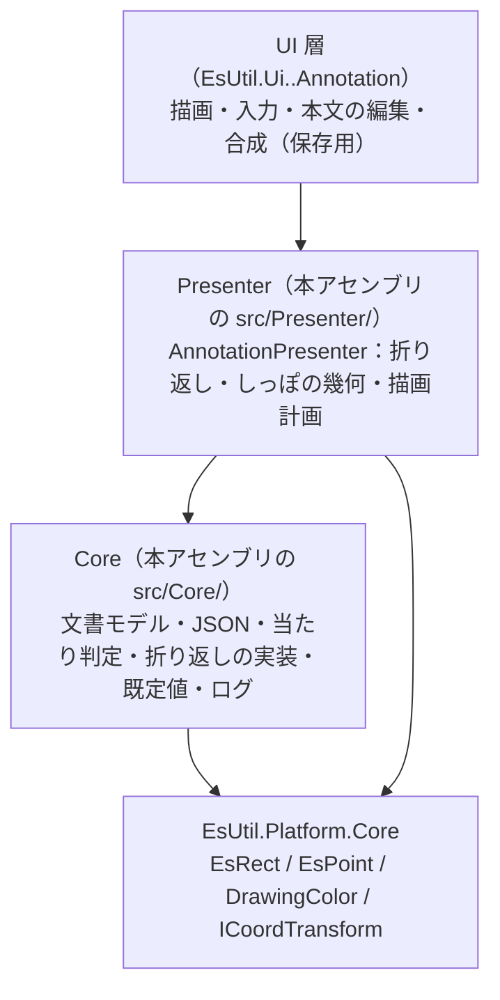

# EsUtil.Feature.Annotation.Core システム仕様書

## 目次

- [1. 概要](#1-概要)
- [2. 技術スタック](#2-技術スタック)
- [3. アーキテクチャ](#3-アーキテクチャ)
- [4. コンポーネント](#4-コンポーネント)
- [5. 依存関係](#5-依存関係)
- [6. 例外処理ポリシー](#6-例外処理ポリシー)

## 1. 概要

**画像に重ねる注釈（枠線・吹き出し）の Core と Presenter** です。 注釈は画像へ焼き込まず、レイヤーとして保持します。

| 項目 | 内容 |
| --- | --- |
| 目的 | 吹き出し・枠線を後から編集できる形で保持し、保存時に注釈 JSON と合成画像を書き出す |
| 対象 UI | Avalonia UI / MewUI / WinUI 3 / WinForms（4 つで共有） |
| 保存形式 | `<画像名>.annotations.json`（スキーマ版つき）と `<元画像名>.annotated.<拡張子>` |
| 座標 | **元画像ピクセル**（表示倍率・DPI に依存しない） |

## 2. 技術スタック

| 項目 | 内容 |
| --- | --- |
| 対象フレームワーク | `net10.0-windows10.0.17763.0` |
| 参照 | `EsUtil.Platform.Core` のみ（値型とエラー境界）。 UI フレームワークには依存しない |
| シリアル化 | `System.Text.Json` のソース生成（Native AOT / トリミング対応）。 反射を使わない |
| テスト | xUnit v3（`EsUtil.Feature.Annotation.Core.Tests`） |

## 3. アーキテクチャ

- **Core は Presenter を参照しません**（描画計画を知らない）。
- **Presenter は描画 API を持ちません**（描画計画というデータを返し、UI が写す）。
- **折り返しだけは実寸を要する**ため、`Func<string, AnnotationTextStyle, EsSize>` として UI から受け取ります（ルーペの `measureText` と同じ形）。

## 4. コンポーネント

| コンポーネント | 分類 | 責務 |
| --- | --- | --- |
| `AnnotationDocument` | Core | 注釈の集合（並びが重なり順）・画像の寸法・スキーマ版。 変更は新しい文書を返す |
| `AnnotationItem` / `FrameAnnotation` / `BubbleAnnotation` | Core | 注釈 1 件（`Id` / `Bounds` / `Appearance`）。 JSON は `Kind` で型を判別する |
| `BubbleTail` | Core | しっぽ（先端は独立・付け根は本体の辺に追従） |
| `RichText` / `TextRun` / `AnnotationTextStyle` | Core | 文字単位の書式（run が自分の文字列と解決済みの書式を持つ） |
| `AnnotationHitTest` | Core | 当たり判定（最前面から・先端は本体より優先） |
| `AnnotationTextWrap`（内部） | Core | 折り返し（文字単位・明示改行・行頭禁則） |
| `AnnotationJson` / `AnnotationJsonContext`（内部） | Core | JSON の読み書き（ソース生成 + 明示の変換器）と保存パスの解決 |
| `AnnotationDefaults` / `AnnotationLimits` | Core | 既定値と安全域（設定・JSON・入力の共通の補正） |
| `AnnotationPresenter` | Presenter | 描画計画の解決（折り返しの配置・しっぽの多角形・行の配置） |
| `AnnotationDrawPlan` / `AnnotationShapePlan` / `AnnotationTextLinePlan` / `AnnotationTextSegmentPlan` | Presenter | UI へ渡す 1 フレーム分の描画契約 |

**選択枠（8 方向のハンドル）は本アセンブリの責務ではありません**（Marquee の提示層を再利用する。 枠とハンドルの見た目を 4 つの UI 版で揃えるため）。

**ログ**: 本アセンブリはログを出力しません（値を所有するホストが記録します。 規則は [`.github/ログ規約.md`](../../../.github/ログ規約.md)）。

## 5. 依存関係

| 方向 | 内容 |
| --- | --- |
| 許可 | 本アセンブリ → `EsUtil.Platform.Core` |
| 許可 | UI 層（`EsUtil.Ui.<UI>.Annotation`）→ 本アセンブリ |
| 禁止 | 本アセンブリ → UI 層（フレームワークに依存しない） |
| 禁止 | 本アセンブリ → ホスト（アプリ。 本アセンブリは上位の層に依存しない） |

規則の所有者は [`.github/依存関係.md`](../../../.github/依存関係.md) です。

## 6. 例外処理ポリシー

| 場面 | 扱い |
| --- | --- |
| JSON として解釈できない | `JsonException` を投げる（呼び出し側が利用者へ通知する） |
| 未知の注釈種別 | `JsonException`（前方互換はスキーマ版で扱う） |
| 値が安全域の外 | **例外にしない**。 `AnnotationLimits` / `Normalized()` が補正する（描画を止めない） |
| 引数が null | `ArgumentNullException`（公開メソッドの入口で 1 回だけ検証する） |

共通方針は [`.github/例外処理規約.md`](../../../.github/例外処理規約.md) が所有します。
