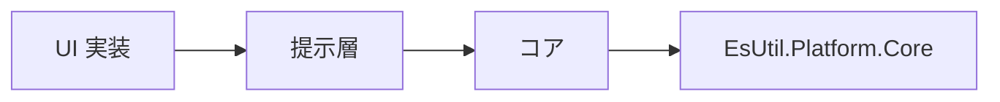
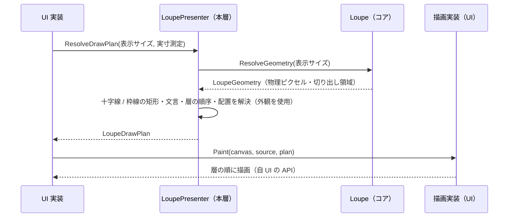

# EsUtil.Feature.Loupe.Core 提示層システム仕様書

ルーペ（拡大鍵）の見た目を定める **コントロール化を前提としない UI 非依存層**の構造・依存・例外処理・設計判断を記載します。 公開 API は [`SPEC_API.md`](SPEC_API.md)、使い方は [`../README.md`](../README.md) を参照してください。

## 目次 <!-- omit from toc -->

- [1. システム概要](#1-システム概要)
- [2. 技術スタック](#2-技術スタック)
- [3. アーキテクチャ](#3-アーキテクチャ)
  - [3.1 依存方向](#31-依存方向)
  - [3.2 データフロー（描画計画 → 描画）](#32-データフロー描画計画--描画)
- [4. コンポーネント構成](#4-コンポーネント構成)
- [5. 例外処理ポリシー](#5-例外処理ポリシー)
- [6. 可視性ポリシー](#6-可視性ポリシー)
- [7. テスト方針](#7-テスト方針)
- [8. 設計判断（UI 非依存の境界と描画 API の抽象を持たない理由）](#8-設計判断ui-非依存の境界と描画-api-の抽象を持たない理由)
- [9. ログ](#9-ログ)

## 1. システム概要

| 項目 | 内容 |
| --- | --- |
| 目的 | 「どう見せるか」（描画計画と外観）を 1 箇所に集約し、UI ごとの実装差から切り離す |
| 提供形態 | クラスライブラリ（`EsUtil.Feature.Loupe.Core.dll`。 コアと同じアセンブリ） |
| 想定利用者 | UI 実装と、それらを組み込むホストアプリケーション |
| 汎用性 | 特定のアプリに依存しない（描画 API の抽象も持たないため、UI フレームワーク非依存） |

## 2. 技術スタック

| 項目 | 内容 |
| --- | --- |
| ターゲット | `net10.0-windows10.0.20348.0` |
| 言語 | C# 14（`Nullable` 有効・`ImplicitUsings` 有効） |
| ルート名前空間 | `EsUtil.Feature.Loupe`（**公開面はすべてここに属する**。 ファサードと、ファサードのメンバーの型（`LoupeDrawPlan` / `LoupeDrawLayer` / `LoupeAppearance` / `LoupeLabelPlacement`））。 `internal` の型だけが層フォルダ `src/Presenter/` の配下（`EsUtil.Feature.Loupe.Presenter.Drawing`）に残る（ログ定義は `src/Logging/` の `EsUtil.Feature.Loupe.Logging`） |
| ドキュメント生成 | `GenerateDocumentationFile` 有効（生成した XML はパッケージへ同封する） |
| テスト | xUnit v3（UI 初期化不要。 `InternalsVisibleTo` で `internal` を検証する） |
| 依存 | 同一アセンブリのコアと `EsUtil.Platform.Core` のみ（UI フレームワークを参照しない） |

## 3. アーキテクチャ

### 3.1 依存方向



- 本層は UI フレームワークを参照しません（**描画 API の抽象も持ちません**）。
- コアは提示層を参照しません（提示層がコアの幾何を使う向きだけ。 同じアセンブリ内の依存である）。

### 3.2 データフロー（描画計画 → 描画）



## 4. コンポーネント構成

**公開面**（ファサード `LoupePresenter.cs` とその partial、およびファサードから返る・渡す型（`LoupeDrawPlan` / `LoupeDrawLayer` / `LoupeAppearance` / `LoupeLabelPlacement`））は `src/` 直下（ルート名前空間）に属します。 **内部手順**（`internal`）は層フォルダ（`src/Presenter/`）の配下へ置き、名前空間に層名を挟みます。
**1 ファイル 1 型**とし、**名前空間はフォルダに追従**させます（`src/` 直下は `EsUtil.Feature.Loupe`。 層フォルダ `src/Presenter/` の配下は `EsUtil.Feature.Loupe.Presenter.<フォルダ名>`）。 規則は [`.github/命名規約.md`](../../../.github/命名規約.md) が単一所有します。

| ファイル | 型 | 可視性 | 責務 |
| --- | --- | --- | --- |
| `EsUtil/Feature.Loupe.Core/src/LoupePresenter.cs` | `LoupePresenter` | public | 提示のファサード。 コアのラップ、外観の保持、描画計画（`ResolveDrawPlan`）と表示レイアウト（`ResolveLayout`）の解決、層の組合せ表の単一所有 |
| `EsUtil/Feature.Loupe.Core/src/LoupeAppearance.cs` | `LoupeAppearance` | public | 外観（色・フォント・角丸・枠線の太さ・ラベルのオフセット・表示可否）の単一所有と補正 |
| `EsUtil/Feature.Loupe.Core/src/LoupeDrawPlan.cs` | `LoupeDrawPlan` | public | 描画計画の値（UI が見る唯一の描画値） |
| `EsUtil/Feature.Loupe.Core/src/LoupeDrawLayer.cs` | `LoupeDrawLayer` | public | 描画層と順序の単一所有 |
| `EsUtil/Feature.Loupe.Core/src/Presenter/Drawing/LoupeTextPlacement.cs` | `LoupeTextPlacement` | internal | 文言・基準点・描画領域（本層の `internal` の写像だけが使う） |
| `EsUtil/Feature.Loupe.Core/src/LoupePresenter.DrawPlan.cs` | `LoupePresenter`（`DrawPlan` partial） | internal | 十字線（縦横 2 本）と枠線（4 辺）の矩形の計算 |
| `EsUtil/Feature.Loupe.Core/src/LoupeLabelPlacement.cs` | `LoupeLabelPlacement` | public | ラベル要素の配置指示 |
| `EsUtil/Feature.Loupe.Core/src/LoupePresenter.LabelPlan.cs` | `LoupePresenter`（`LabelPlan` partial） | internal | 実寸 → 配置指示の写像（クランプの単一所有） |
| `EsUtil/Feature.Loupe.Core/src/LoupePresenter.LabelTexts.cs` | `LoupePresenter`（`LabelTexts` partial） | internal | 文言（`EsPoint.Format`）と基準点（左上の内側）の生成 |
| `EsUtil/Feature.Loupe.Core/src/Logging/LoupeLogMessage.cs` | `LoupeLogMessage` | internal | アセンブリのログ定義（生成・ロガー設定・設定変更・外観の変更。 コアと共有する） |

## 5. 例外処理ポリシー

`LoupePresenter.ResolveDrawPlan` / `LoupePresenter.ResolveLabelPlacements` は引数（`measureText` / `appearance`）が null なら `ArgumentNullException` を送出します。 描画中にソースが破棄された場合（`ObjectDisposedException`）の吸収は描画実装（各 UI）の責務です。

## 6. 可視性ポリシー

- UI が参照する型（`LoupePresenter` / `LoupeAppearance` / `LoupeDrawPlan` / `LoupeDrawLayer` / `LoupeLabelPlacement`）は `public`  とします。
- **本層の内部手順だけが使う型は `internal`** とします（`LoupeTextPlacement`。 ファサードから推移的に到達できない型は公開面ではない）。
- 本層とテストだけが使う内部手順（`LoupePresenter` の `DrawPlan` / `LabelPlan` / `LabelTexts` partial のメンバーと `LoupeLogMessage`）は `internal` とし、単体テストにのみ `InternalsVisibleTo`（`EsUtil.Feature.Loupe.Core.Tests`）で公開します。 **`partial` はファイル分割であって可視性ではなく**、`LabelPlan` の実寸 → 配置の写像（`ResolveLabelPlacements`）も内部手順です。

## 7. テスト方針

| 方針 | 内容 |
| --- | --- |
| UI 初期化不要 | 描画計画の値は UI 型を持たないため `[Fact]` / `[Theory]` で並列実行する |
| 単位 | 描画計画の値・外観・装飾矩形・寸法換算・ラベル写像・ログ定義 |
| 画素の検証 | 描画 API を持つ UI 側のテストが担う（本層は描画 API を持たないため） |

```powershell
dotnet test EsUtil/Feature.Loupe.Core/tests/EsUtil.Feature.Loupe.Core.Tests.csproj
```

## 8. 設計判断（UI 非依存の境界と描画 API の抽象を持たない理由）

| 判断 | 内容 |
| --- | --- |
| 描画計画を本層に置く（コアに置かない） | コアは「何を描くか（幾何・判断）」だけを決める。 装飾矩形・文言・表示可否・描画順は描画の都合であり、コアに置くと色・フォントをコアへ持ち込むことになる |
| **描画 API の抽象を持たない** | UI フレームワークごとの描画モデルは異なり、抽象に集約すると対象 UI（WinUI3 / WinForms 等）が増えるたびに抽象が肥大して差異を吸収しきれなくなる。 本層は描画計画というデータを返し、描画は各 UI が自前で行う |
| 色の型 | UI 非依存の `System.Drawing.Color` とし、UI の色型への変換は描画の境界で行う |
| ラベルの体裁 | 「背景 = 文字の実寸 + 内側余白 × 2」「クランプ」は描画にだけ必要な規則のため、本層が単一所有する（実寸 → 配置の写像は partial（`LabelPlan`）の内部手順） |
| 中間ビットマップの非同期生成 | UI のディスパッチャーに依存し、中間ビットマップを持つ UI にだけ必要なため、その UI 実装が所有する |
| 差し替えの入口 | 外観（`LoupeAppearance`）の差し替えと、コントロールが持つ `DrawPlanResolver`（`Func<LoupeDrawPlan, LoupeDrawPlan>`）による描画計画の差し替えの 2 つとする。 派生による上書きは許さない（`LoupePresenter` は `sealed`。 契約を 1 つに保つため） |

## 9. ログ

ログの定義と書式はアセンブリに 1 つだけ置きます（`src/Logging/LoupeLogMessage.cs`。 コアと提示層で共有する。 接頭辞は `[Loupe]`。 規則は [`.github/ログ規約.md`](../../../.github/ログ規約.md) が単一所有します）。

**値の保持と変更の記録は値を所有する側が行います**。 提示層は、本層が単一所有する外観の変更だけを記録します（コアへ委譲するだけの値はコアが記録します）。

| 契機 | 出力 | レベル |
| --- | --- | --- |
| 生成（コンストラクター注入時、または `Log` の初回設定時） | `提示層を作成しました` | Information |
| `Log` の set | `ロガーを接続しました`（初回のみ） | Debug |
| `Appearance` の set | 変化した項目だけ（`LogAppearanceChanged`。 書式 `Setting: {Name} {OldValue} → {NewValue}`） | Information |
| `Options` / `ClientToPixelScaling` / `CenterPoint` / `PositionOffset` / `SetCoordTransform` | コアが記録する（本層は何も出力しない） | — |
| `ResolveLayout` / `ResolveDrawPlan` | 出力しない（毎フレーム呼ばれる） | — |

**生成の記録は、ロガーが注入された時点（コンストラクターまたは初回の `Log` 設定）に行います**（構築時点では出力先が未設定であり、その場で出力しても記録が残らないため。 コアも同じ規則で生成を記録します）。

**UI が出力するログ（拡大元画像の変更・描画の例外）の定義と書式は各 UI が所有します**（接頭辞だけを `[Loupe]` に揃える）。 **UI 固有の処理に対応するログも各 UI 実装が所有します**（中間ビットマップを生成する描画パイプライン固有のログ等）。
