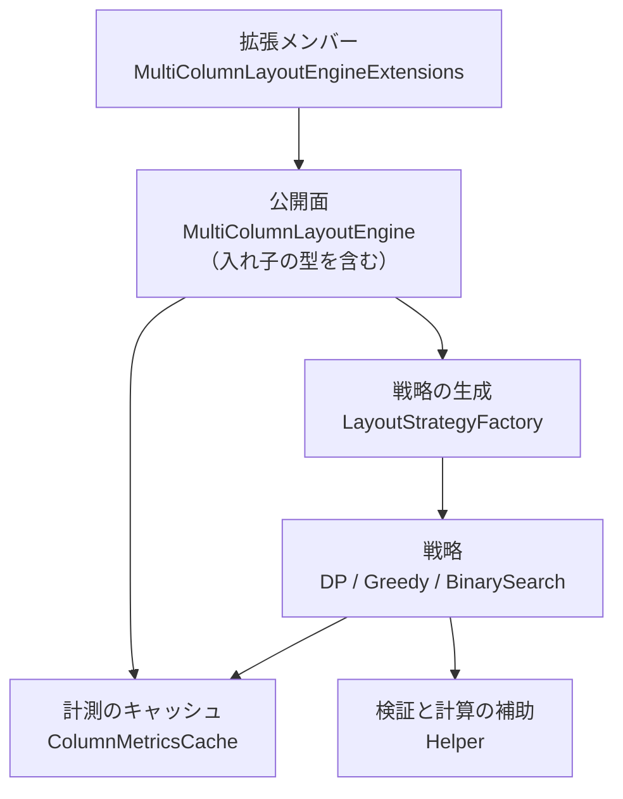
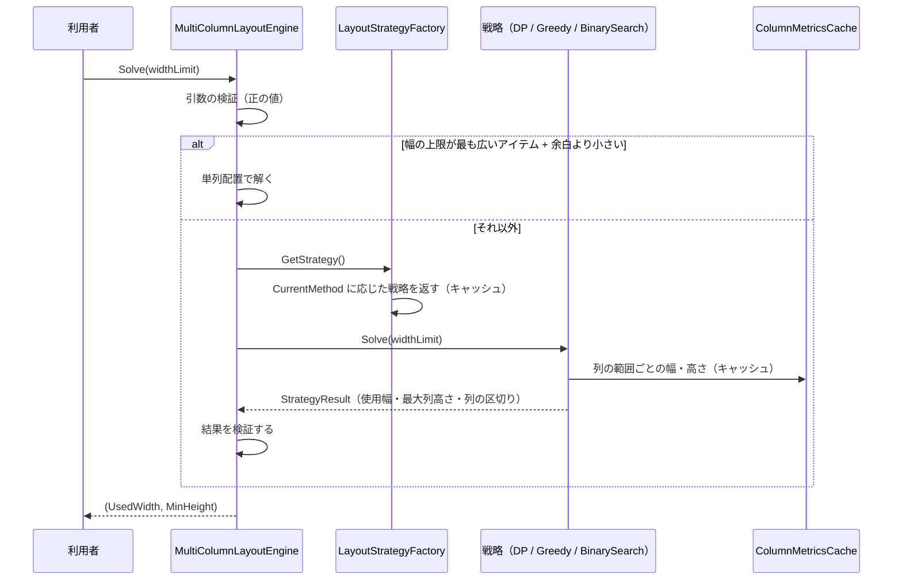

# EsUtil.Feature.MultiColumn システム仕様書

複数のアイテムを複数の列へ並べ、最大列高さを最小化する計算層の内部仕様です。

## 目次 <!-- omit from toc -->

- [1. システム概要](#1-システム概要)
- [2. 技術スタック](#2-技術スタック)
- [3. アーキテクチャ](#3-アーキテクチャ)
  - [3.1 依存方向](#31-依存方向)
  - [3.2 データフロー](#32-データフロー)
- [4. コンポーネント構成](#4-コンポーネント構成)
- [5. 依存関係](#5-依存関係)
- [6. 例外処理ポリシー](#6-例外処理ポリシー)
- [7. テスト方針](#7-テスト方針)
- [8. 設計判断](#8-設計判断)

## 1. システム概要

「アイテムの並びを変えずに、列の数と各列の区切りを決める」問題を解きます。 目的関数は**最大列高さの最小化**です（列の高さが揃うほど、一覧の下にできる余白が小さくなります）。

入力はアイテムの（幅, 高さ）・余白・列数の上限・幅の上限であり、出力は使った幅・最大列高さ・列ごとの範囲・アイテムごとの矩形です。 描画は行いません。

## 2. 技術スタック

| 項目 | 内容 |
| --- | --- |
| 対象フレームワーク | `net10.0` |
| 言語 | C# 14（拡張メンバー `extension` ブロック、`field` キーワード、コレクション式） |
| テスト | xUnit v3（`tests/`） |
| ログ | なし（計算層のため。 呼び出し側が結果を記録する） |
| Native AOT | `IsAotCompatible=true`（解析警告 0 件をビルドで検査） |

## 3. アーキテクチャ

### 3.1 依存方向



依存は上から下への一方向です。 公開面（`MultiColumnLayoutEngine` と拡張メンバー）だけが `public` で、戦略・キャッシュ・補助は `internal` です。

### 3.2 データフロー



## 4. コンポーネント構成

```text
EsUtil/Feature.MultiColumn/
├── docs/
├── src/
│   ├── MultiColumnLayoutEngine.cs
│   ├── MultiColumnLayoutEngine.Base.cs
│   ├── MultiColumnLayoutEngine.BinarySearchOptions.cs
│   ├── MultiColumnLayoutEngine.Method.cs
│   ├── MultiColumnLayoutEngine.MetadataKey.cs
│   ├── MultiColumnLayoutEngineExtensions.cs
│   └── Internal/
└── tests/
```

| コンポーネント | 所在 | 内容 |
| --- | --- | --- |
| 公開面（本体） | `EsUtil/Feature.MultiColumn/src/MultiColumnLayoutEngine.Base.cs` | アイテムと余白の保持・`Solve`・結果の取得（`partial`） |
| 公開面（算法の切り替え） | `EsUtil/Feature.MultiColumn/src/MultiColumnLayoutEngine.cs` | `CurrentMethod` と補足情報の取得 |
| 公開面（入れ子の型） | `EsUtil/Feature.MultiColumn/src/MultiColumnLayoutEngine.*.cs` | `Method` / `BinarySearchOptions` / `MetadataKey` |
| 拡張メンバー | `EsUtil/Feature.MultiColumn/src/MultiColumnLayoutEngineExtensions.cs` | 算法を引数で指定する `Solve` と状態参照のプロパティ |
| 戦略の生成 | `EsUtil/Feature.MultiColumn/src/Internal/LayoutStrategyFactory.cs` | 算法ごとの戦略を生成し、キャッシュする |
| 戦略 | `EsUtil/Feature.MultiColumn/src/Internal/*LayoutStrategy.cs` | 動的計画法・貪欲法・二分探索 |
| 計測のキャッシュ | `EsUtil/Feature.MultiColumn/src/Internal/ColumnMetricsCache.cs` | 列の範囲ごとの幅・高さを保持する |
| 値の型 | `EsUtil/Feature.MultiColumn/src/Internal/` | `Size` / `Space` / `ColumnSegment` / `StrategyResult` |
| 検証と補助 | `EsUtil/Feature.MultiColumn/src/Internal/Helper.cs` | 引数の検証・結果の検証 |

## 5. 依存関係

- **EsUtil のパッケージを参照しません**（最下層と同じ扱い）。 外部の NuGet パッケージも参照しません。
- **利用側**: [`EsUtil.Ui.WinUI3.MultiColumn`](../../../EsUtil.Ui.WinUI3/MultiColumn/README.md) が本パッケージを参照します（同じ計算を UI ごとに書き直さないため）。
- 許可範囲の規則は [`.github/依存関係.md`](../../../.github/依存関係.md)。

## 6. 例外処理ポリシー

| 状況 | 例外 |
| --- | --- |
| 幅の上限が 0 以下・NaN・無限大 | `ArgumentException` |
| アイテムの高さが負・NaN | `ArgumentException` |
| 列数の上限が 1 未満 | `ArgumentException` |
| 二分探索の調整値が範囲外 | `ArgumentOutOfRangeException` |
| 計算結果が幅の上限を超える・単列配置より高い | `InvalidOperationException`（実装の誤りを示す） |

計算の失敗は**例外で知らせます**（既定値へ黙って置き換えません）。 呼び出し側は入力の検証をしてから呼びます。

## 7. テスト方針

- **算法ごとの性質**を検証します（動的計画法の結果が貪欲法以下であること、二分探索が貪欲法と動的計画法の間に入ること）。
- **境界値**（アイテム 0 件・1 件・幅の上限が最小・列数の上限 1・高さ 0）を検証します。
- **例外**（不正な引数・不正な調整値）を検証します。
- **キャッシュ**（同じ範囲を 2 回計測しても結果が変わらないこと・`ClearCache` で再計算されること）を検証します。
- 計測用のプログラム（旧リポジトリの `Benchmark`）は、CI では実行しない `[Fact(Skip = ...)]` として残しています。

## 8. 設計判断

- **描画 API を持たない**: 位置と大きさを数値で返すため、どの UI のパネルからも同じ結果になります。 描画の都合（要素の生成・仮想化）は UI 側の関心事です。
- **算法を差し替えられる**: アイテム数と必要な精度で計算量を選べるようにしています（最適解が必要なら動的計画法、速度が必要なら貪欲法）。
- **キャッシュをインスタンスが持つ**: 列の範囲ごとの計測は同じ解の中で何度も参照されるため、解の間だけ保持します（アイテムを変えたら `ClearCache`）。
- **名前空間とアセンブリ名を `EsUtil.Feature.MultiColumn` に揃える**: 型名（`MultiColumnLayoutEngine`）をそのままパッケージ名にすると名前空間のセグメントと一致し、配下から型を参照できなくなる（`MA0049`。 `CS0118`）。 そのためパッケージ名は機能名、型名は実装の名前にしています。
