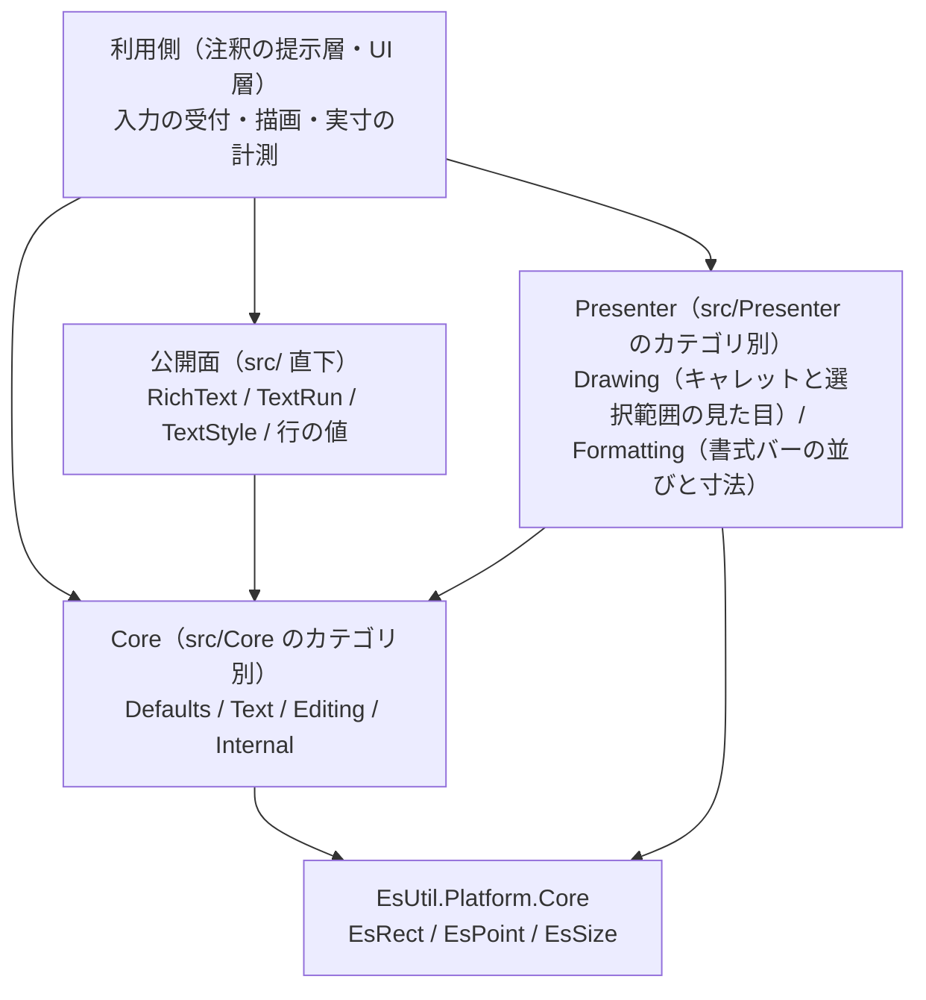

# EsUtil.Feature.StyledText.Core システム仕様書

## 目次

- [1. 概要](#1-概要)
- [2. 技術スタック](#2-技術スタック)
- [3. アーキテクチャ](#3-アーキテクチャ)
- [4. コンポーネント](#4-コンポーネント)
- [5. 依存関係](#5-依存関係)
- [6. 例外処理ポリシー](#6-例外処理ポリシー)

## 1. 概要

**書式付きの文字列を扱う計算層**です。 文字の並び・折り返し・行と文字位置の対応を UI から分離し、4 つの UI 版（Avalonia UI / MewUI / WinUI 3 / WinForms）で同じ結果にします。

| 項目 | 内容 |
| --- | --- |
| 目的 | 本文の書式（run）・折り返し・キャレットの位置・削除の単位を 1 か所で決める |
| 対象 UI | Avalonia UI / MewUI / WinUI 3 / WinForms（4 つで共有） |
| 座標 | **元画像ピクセル**（表示倍率・DPI に依存しない） |
| 文字位置 | 本文の先頭からの文字数（0 起点）。 移動・削除・折り返しは**書記素クラスタ**の境界 |

## 2. 技術スタック

| 項目 | 内容 |
| --- | --- |
| 対象フレームワーク | `net10.0-windows10.0.17763.0` |
| 参照 | `EsUtil.Platform.Core` のみ（値型とエラー境界）。 UI フレームワークには依存しない |
| 文字の実寸 | UI から `Func<string, TextStyle, EsSize>` として受け取る（本層は測り方を持たない） |
| 書記素クラスタ | `System.Globalization.StringInfo`（サロゲート ペア・結合文字を 1 つの単位として扱う） |
| テスト | xUnit v3（`EsUtil.Feature.StyledText.Core.Tests`） |

## 3. アーキテクチャ

- **折り返しと行の配置は 1 か所で決めます**（`TextLayout`。 折り返しの位置と行の縦位置は対であり、別々に実装するとキャレットの高さと食い違う）。
- **文字の実寸だけを UI に委ねます**（描画エンジンによって字幅が違うため。 位置の決め方は本層が単一所有する）。
- **文字位置の境界は `TextCursor` が単一所有します**（キャレット・選択・削除・折り返し・書式の範囲が同じ境界を使う）。
- **編集している本文の値と状態（キャレット・選択・以降の入力へ効かせる書式）、キーの割り当てはコアが単一所有します**（`TextEditor` / `TextEditKeyMap`。 `src/Core/Editing`）。 UI は自分のキーの型を写し、`TextEditor` を操作して描画と通知だけを行います。
- **書式バーを出す条件はコアが単一所有します**（`TextEditor.ShouldShowFormatBar`。 編集中・自動表示が有効・1 文字以上を選択）。 4 つの UI 版は本値だけを見てバーを出し入れし、条件を写しません。
- **公開面は `src/` 直下（名前空間 `EsUtil.Feature.StyledText`）に置き、層の内部は `src/Core/<カテゴリ>` / `src/Presenter/<カテゴリ>` へ置きます**（名前空間は `EsUtil.Feature.StyledText.Core.<カテゴリ>` / `.Presenter.<カテゴリ>`。 規則は [`.github/命名規約.md`](../../../.github/命名規約.md)）。 フォルダと名前空間の一覧は [`../README.md`](../README.md) §3 が持つ。

## 4. コンポーネント

| コンポーネント | 分類 | 責務 |
| --- | --- | --- |
| `RichText` / `TextRun` / `TextStyle` | Core（`src/` 直下） | 書式付きの文字列（run が自分の文字列と書式を持つ）。 範囲の書式の差し替え・変換、文字の挿入・削除、安全域への補正 |
| `TextLinePlan` / `TextSegmentPlan` / `TextLineMetrics` / `TextCaretRect` | Core（`src/` 直下） | 行と区間の矩形・行の実寸・キャレットの矩形（利用側へ渡す値） |
| `TextLayout` | Core（`.Core.Text`） | 折り返しと行の配置（本文の矩形 → 行の並び。 行の高さは行内で最も大きい文字に合わせる） |
| `TextWrap`（内部） | Core（`.Core.Internal`） | 折り返しの実装（クラスタ単位・明示改行・行頭禁則） |
| `TextCursor` | Core（`.Core.Text`） | 書記素クラスタの境界（移動・選択・削除・折り返しの単位） |
| `TextLineIndex` / `TextLineLayout` | Core（`.Core.Text`） | 行と文字位置の対応（区間の原点からの距離で測る。 キャレット・選択範囲・位置から文字の特定） |
| `TextStyleEdit` | Core（`.Core.Text`） | 入力する文字列の挿入（以降の入力へ効かせる書式の反映）と、書式を適用する範囲の規則 |
| `TextCompositionPreview` / `TextCaretBlink` | Core（`.Core.Text`） | IME の変換中の文字列を入れた描画用の値・キャレットの点滅の規則 |
| `TextEditor` | Core（`.Core.Editing`） | **編集中の本文の値と状態**（本文・キャレット・選択・以降の入力へ効かせる書式・変換中の文字列）。 本文の操作・キーの実行・折り返しとキャレット位置の解決を 1 か所にまとめ、**書式バーを表示する条件（編集中・1 文字以上を選択）も単一所有する**。 編集する対象（文書・識別子）を知らない |
| `TextEditState` | Core（`.Core.Editing`） | 本文の編集状態（キャレット・選択・入力・削除・書式）。 本文を受け取って書き換えた本文を返し、編集する対象（文書・識別子）を知らない（`TextEditor` が本文と組にして公開する） |
| `TextEditChange` | Core（`.Core.Editing`） | 編集で変わった内容（`Text` / `Selection` / `Editing`）。 UI が描画の更新と通知を選ぶ |
| `TextInput` | Core（`.Core.Text`） | 本文へ入れる文字列の正規化（改行を `\n` へ揃える） |
| `TextEditKeyMap` / `TextEditKey` / `TextEditModifiers` / `TextEditCommand` / `TextEditRequest` | Core（`.Core.Editing`） | キーの割り当て（どのキーがどの操作になるか）。 修飾キーとキーの組み合わせを 1 か所で決める |
| `TextDefaults` / `TextLimits` | Core（`.Core.Defaults`） | 既定値（フォントの優先順・大きさ・既定の書式）と安全域（設定・JSON・入力の共通の補正） |

**本アセンブリはログを出力しません**（純粋な計算のみを行うため。 記録は利用側が行う。 規則は [`.github/ログ規約.md`](../../../.github/ログ規約.md)）。

## 5. 依存関係

| 方向 | 内容 |
| --- | --- |
| 許可 | 本アセンブリ → `EsUtil.Platform.Core` |
| 許可 | 注釈の機能（`EsUtil.Feature.Annotation.Core`）・UI 層 → 本アセンブリ |
| 禁止 | 本アセンブリ → 注釈の機能・UI 層（特定の機能の語彙に依存しない） |

規則の所有者は [`.github/依存関係.md`](../../../.github/依存関係.md) です。

## 6. 例外処理ポリシー

| 場面 | 扱い |
| --- | --- |
| 値が安全域の外 | **例外にしない**。 `TextLimits` / `TextStyle.Normalized()` が補正する（描画を止めない） |
| 引数が null | `ArgumentNullException`（公開メソッドの入口で 1 回だけ検証する） |
| 文字位置が範囲外 | **例外にしない**。 本文の範囲へ丸める（クラスタの境界へ揃える） |
| 行が無い | `TextLineIndex.Create` は `null`、`ResolveCaret` は `null` を返す（空の本文は正常な状態である） |

共通方針は [`.github/例外処理規約.md`](../../../.github/例外処理規約.md) が所有します。
