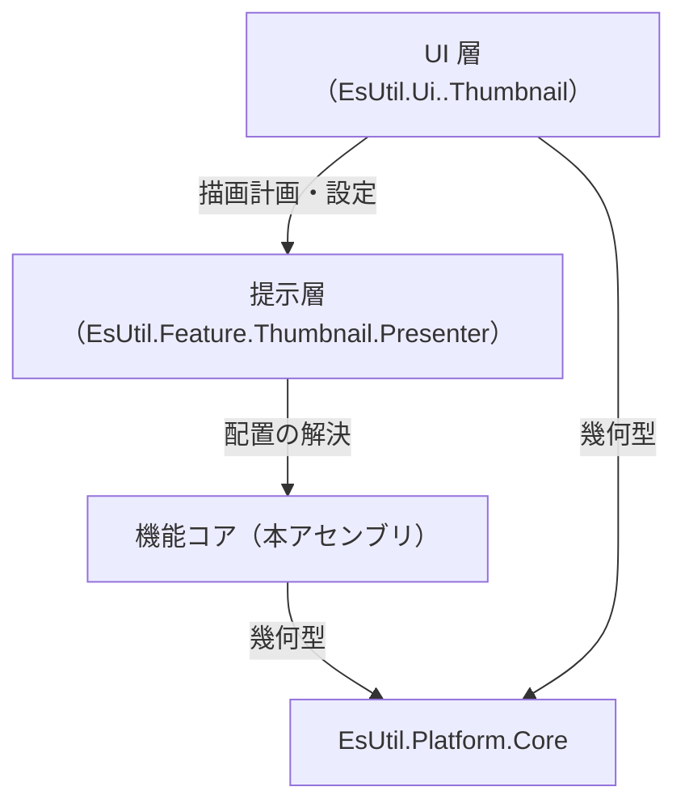
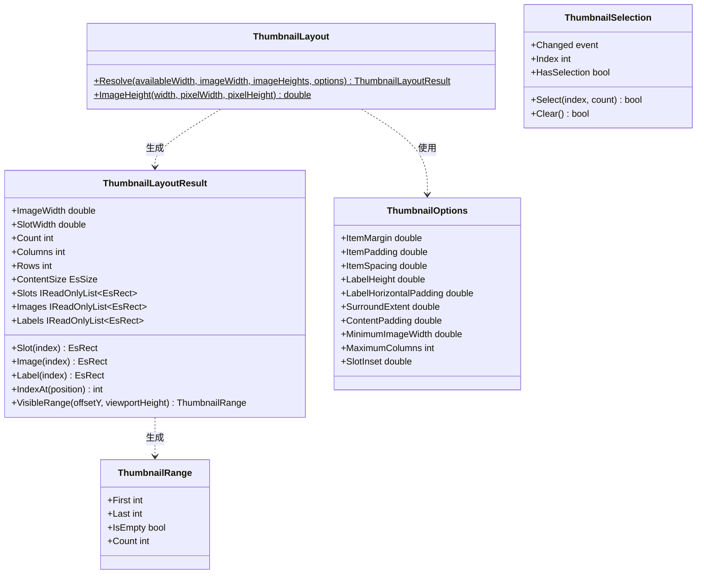
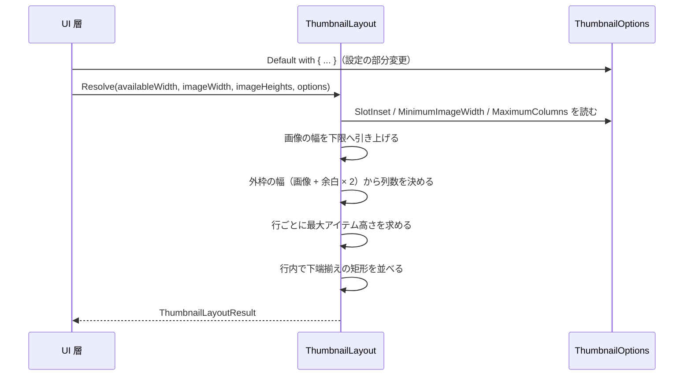

# EsUtil.Feature.Thumbnail.Core システム仕様書

サムネイル一覧の**UI 非依存の計算層**の構造・依存・設計判断を扱います。 開発者向けの文書です。

## 目次 <!-- omit from toc -->

- [1. システム概要](#1-システム概要)
- [2. 技術スタック](#2-技術スタック)
- [3. アーキテクチャ](#3-アーキテクチャ)
  - [3.1 依存方向](#31-依存方向)
  - [3.2 責務の分担](#32-責務の分担)
  - [3.3 設計判断](#33-設計判断)
- [4. コンポーネント構成](#4-コンポーネント構成)
  - [4.1 可視性](#41-可視性)
- [5. クラス図](#5-クラス図)
- [6. 配置の解決フロー](#6-配置の解決フロー)
- [7. エラー処理ポリシー](#7-エラー処理ポリシー)
- [8. 実装上の注意](#8-実装上の注意)

## 1. システム概要

本アセンブリは、サムネイル一覧の**並べ方**（折り返し・行の高さ・下端揃え）と**選択**、**見えている範囲**を決める純粋計算を提供します。

- **UI ごとに書き分けると並びがずれる**ため、規則を 1 か所に置きます（UI フレームワーク標準の折り返しパネルは行内で上端揃えになり、画像の縦横比で高さが変わると名前の位置が揃いません）。
- **描画と画像は持ちません**。 入力は長さ（幅・高さ）だけで、出力は矩形と添字です。
- 対象フレームワークは `net10.0` です（Windows 固有 API を使いません）。

## 2. 技術スタック

| 種別 | 内容 |
| --- | --- |
| 言語 / フレームワーク | C# / .NET 10（`net10.0`） |
| 参照パッケージ | `EsUtil.Platform.Core`（幾何型 `EsPoint` / `EsSize` / `EsRect`） |
| テスト | xUnit v3（`EsUtil.Feature.Thumbnail.Tests`。 配置・選択・選択のログを検証する。 `InternalsVisibleTo` で内部手順も検証する） |

## 3. アーキテクチャ

### 3.1 依存方向



- **依存は一方向**です（コアは提示層も UI も知りません）。
- **本体プロジェクトは `ProjectReference` を持ちません**（ローカル フィードのパッケージを参照します）。 テストだけが対象プロジェクトを `ProjectReference` で参照します。

### 3.2 責務の分担

| 責務 | 所有者 |
| --- | --- |
| 折り返し・行の高さ・下端揃え・項目の矩形 | `ThumbnailLayout` / `ThumbnailLayoutResult` |
| 設定の既定値と補正（余白・行の寸法・列数の上限） | `ThumbnailOptions` |
| 単一選択の規則（範囲外は解除・同値は通知しない） | `ThumbnailSelection` |
| 当たり判定・可視範囲 | `ThumbnailLayoutResult` |
| 色・フォント・影・層の順序 | 提示層（`EsUtil.Feature.Thumbnail.Presenter`） |
| 入力の受付・スクロール・描画 API の呼び出し | UI 層（`EsUtil.Ui.<UI>.Thumbnail`） |

### 3.3 設計判断

- **行の高さを行ごとに決める**: 画像の縦横比で項目の高さが変わっても、行内で下端を揃えれば名前の 1 文字目の位置が揃います。 全体で 1 つの行の高さに揃えると、縦長の画像がある行だけ間延びします。
- **当たり判定は外枠で行う**: 子要素のヒット テストに依存すると、影や名前の要素の有無で当たり判定が変わります。 入力は位置から添字を求める形に統一します。
- **幅が未確定でも結果を返す**: レイアウトの途中（幅が 0）でも呼べるようにし、1 列の暫定結果を返します。 呼び出し側は幅の確定後に呼び直します（例外で止めると、初期化の順序に依存する不具合になります）。
- **`VisibleRange` は交差で判定する**: 一部だけ見えている項目も含めます（含めないと、スクロールのたびに項目の生成と破棄がちらつきます）。
- **画像を持たない**: 画像の所有権はホストにあります。 コアが参照を保持すると、一覧の組み直しと画像の解放の順序が問題になります。
- **選択を独立した型にする**: 「選択できるのは 1 件だけ」「範囲外は選択しない」という規則を UI ごとに書くと、一覧を組み直したときの選択の残り方が UI で変わります。

## 4. コンポーネント構成

```text
EsUtil/Feature.Thumbnail.Core/
├── docs/
├── src/
└── tests/
```

| コンポーネント | 所在 | 内容 |
| --- | --- | --- |
| 配置の計算 | `EsUtil/Feature.Thumbnail.Core/src/ThumbnailLayout.cs` | 折り返し・行の高さ・下端揃え・縦横比の高さ（公開） |
| 配置の結果 | `EsUtil/Feature.Thumbnail.Core/src/ThumbnailLayoutResult.cs` | 矩形の一覧・内容の寸法・当たり判定・可視範囲（公開） |
| 設定 | `EsUtil/Feature.Thumbnail.Core/src/ThumbnailOptions.cs` | 既定値と補正（公開） |
| 選択 | `EsUtil/Feature.Thumbnail.Core/src/ThumbnailSelection.cs` | 単一選択の状態と通知（公開） |
| 範囲 | `EsUtil/Feature.Thumbnail.Core/src/ThumbnailRange.cs` | 連続した範囲（公開） |

### 4.1 可視性

| 対象 | 可視性 | 理由 |
| --- | --- | --- |
| 上表の型とメンバー | `public` | UI 層・提示層・ホストが使う |
| `ThumbnailLayoutResult` のコンストラクター | `internal` | 結果は `ThumbnailLayout.Resolve` が作り、利用者は組み立てない（値の整合を 1 か所で保証する） |

## 5. クラス図



## 6. 配置の解決フロー



1. `imageWidth` を `MinimumImageWidth` 以上へ引き上げます。
2. 外枠の幅（`imageWidth` + `SlotInset` × 2）と `ItemSpacing` から列数を決めます（`MaximumColumns` で上限を切る）。
3. 行ごとに「その行の最大アイテム高さ」を求めます。
4. 各項目を**行内で下端揃え**にし、外枠・画像・名前の矩形を作ります。
5. 内容の寸法（`ContentSize`）は「列数 × 外枠の幅 + 間隔」と「行の高さの合計」に `ContentPadding` を加えた値です。

## 7. エラー処理ポリシー

- **利用者の入力の誤りは例外で知らせる**: `Resolve` は `imageHeights` に負の値が含まれる場合に `ArgumentOutOfRangeException` を送出します（長さとして成立しない値であり、黙って補正すると配置のずれの原因が隠れます）。
- **回復できる誤りは補正する**: 設定の負の値は 0、`MinimumImageWidth` の 0 以下は既定値へ補正します（設定はホストが実行時に与える値であり、例外で止めるほどではありません）。
- **範囲外の添字は例外にしない**: `Slot` / `Image` / `Label` は空の矩形を返し、`IndexAt` は -1 を返します（呼び出し側は「見つからない」を通常の経路として扱います）。
- 共通方針は [`../../../.github/例外処理規約.md`](../../../.github/例外処理規約.md) が所有します。

## 8. 実装上の注意

- **行の途中で列数を変えない**: 折り返しは行単位です。 列数は幅から決まるため、同じ呼び出しの中で変わりません。
- **`VisibleRange` は `offsetY` を含めて判定する**: 矩形は内容の座標であり、スクロール位置は含みません。
- **`Empty` を共有する**: `ThumbnailLayoutResult.Empty` は変更できません（不変です）。
- **ログ**: 選択の変更は本クラスが記録します（`Log` / `LogPrefix`。 出力書式とレベルは [`SPEC_API.md`](SPEC_API.md) §2.5 と [`../../../.github/ログ規約.md`](../../../.github/ログ規約.md) が定めます。 配置の計算は純粋計算のため出力しません）。
