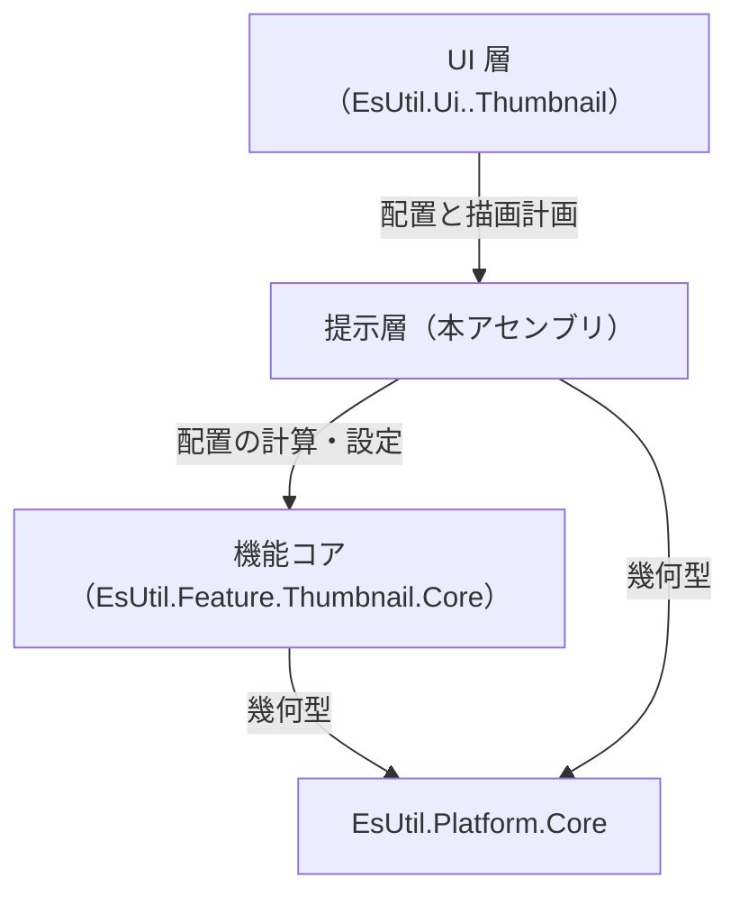
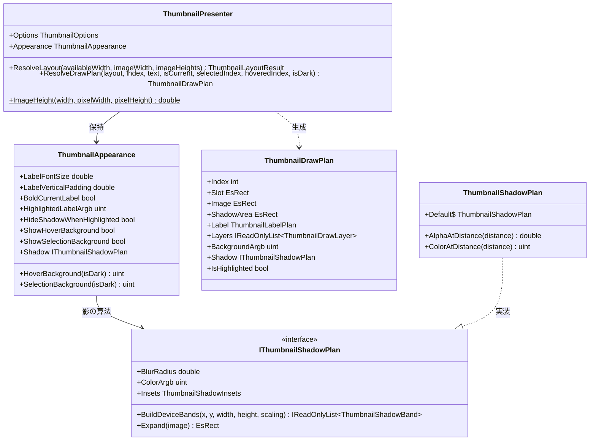
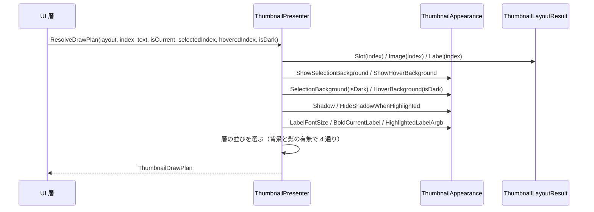
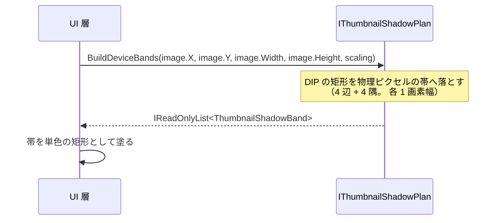

# EsUtil.Feature.Thumbnail.Presenter システム仕様書

サムネイルの**外観・影・描画計画**を単一所有する UI 非依存の提示層の構造・依存・設計判断を扱います。 開発者向けの文書です。

## 目次 <!-- omit from toc -->

- [1. システム概要](#1-システム概要)
- [2. 技術スタック](#2-技術スタック)
- [3. アーキテクチャ](#3-アーキテクチャ)
  - [3.1 依存方向](#31-依存方向)
  - [3.2 責務の分担](#32-責務の分担)
  - [3.3 設計判断](#33-設計判断)
- [4. コンポーネント構成](#4-コンポーネント構成)
  - [4.1 可視性](#41-可視性)
- [5. クラス図](#5-クラス図)
- [6. 描画計画の解決フロー](#6-描画計画の解決フロー)
- [7. 影の描画フロー](#7-影の描画フロー)
- [8. エラー処理ポリシー](#8-エラー処理ポリシー)
- [9. 実装上の注意](#9-実装上の注意)

## 1. システム概要

本アセンブリは、サムネイル 1 件を**どう見せるか**（背景・影・名前の体裁と配置、描く順序）を計画として返します。

- **外観と描画計画を単一所有する**ため、4 つの UI 版の見た目が同じになります。
- **描画 API を持ちません**（キャンバスの抽象も作りません）。 計画は値であり、UI が自分の描画 API で写します。
- **設定の長さはコアが持ちます**（`ThumbnailOptions`）。 本層が持つのは色・フォントサイズ・影の濃さと表示可否です。

## 2. 技術スタック

| 種別 | 内容 |
| --- | --- |
| 言語 / フレームワーク | C# / .NET 10（`net10.0`） |
| 参照パッケージ | `EsUtil.Feature.Thumbnail.Core` / `EsUtil.Platform.Core`（幾何型） |
| テスト | xUnit v3（`EsUtil.Feature.Thumbnail.Presenter.Tests`。 描画計画と設定・外観の変更ログを検証する） |

## 3. アーキテクチャ

### 3.1 依存方向



- **依存は一方向**です（本層は UI を知りません。 コアは本層を知りません）。
- **本体プロジェクトは `ProjectReference` を持ちません**（ローカル フィードのパッケージを参照します）。

### 3.2 責務の分担

| 責務 | 所有者 |
| --- | --- |
| 配置（折り返し・行の高さ・下端揃え）・選択・可視範囲 | `EsUtil.Feature.Thumbnail.Core` |
| 外観（色・フォントサイズ・太字・表示可否） | `ThumbnailAppearance` |
| 描画計画（矩形・層の順序・背景色・影の有無） | `ThumbnailPresenter.ResolveDrawPlan` |
| 影の算法（濃さのプロファイル・帯の生成） | `ThumbnailShadowPlan`（差し替え点は `IThumbnailShadowPlan`） |
| 描画 API の呼び出し（帯を塗る・画像を描く・文字を置く） | UI 層 |

### 3.3 設計判断

- **描画計画を値にする**: 描画 API の抽象を作ると、UI が増えるたびに抽象が肥大します（即時描画・リテインド描画の違いを吸収できません）。 計画を `readonly record struct` で返し、UI が写す形にします。
- **`ThumbnailPresenter` を `sealed` にしない**: 差し替え点を 3 つ用意するためです（外観の値・影の算法・`ResolveDrawPlan` の上書き）。 派生を禁止すると、ホストが独自の見た目を作れません。
- **背景は選択をホバーより優先する**: 両方を重ねると 2 色が合成され、選択中にマウスを乗せたときだけ色が変わります。 選択の状態を優先して 1 色にします。
- **影を「1 画素の帯」で表す**: グラデーション ブラシの端の扱いは描画 API ごとに異なります（実測: GDI+ は軸の外側を繰り返し、影の外側へ最も濃い 1 画素を描く）。 濃さを画素単位で計画すれば、どの UI 版も「単色の矩形を塗る」だけで同じ結果になります。
- **4 辺を同じ濃さにする**: 影を下方向へずらすと上辺だけが薄くなり、画像との間に白っぽい隙間が見えます（実測）。 4 辺とも画像の端で最も濃く、外側へ同じ割合で薄くします。
- **4 隅もグラデーションを使わない**: 放射グラデーションは描画 API ごとに半径・中心の解釈が揺れ、隅だけ濃い点や薄い筋として見えました（実測）。 隅の濃さは**画像の隅の頂点からの斜めの距離**で決めます。
- **影の余白をレイアウトへ反映する**: 影の算法を差し替えて余白が広がったとき、レイアウト側の余白が狭いままだと影が切れます。 `ResolveLayout` が `Insets` を見て `SurroundExtent` を広げます。
- **色は `uint` の ARGB で持つ**: UI ごとの色型（`Color` / `SKColor` / `System.Drawing.Color`）を持ち込むと、本層が UI に依存します。

## 4. コンポーネント構成

```text
EsUtil/Feature.Thumbnail.Presenter/
├── docs/
├── src/
└── tests/
```

| コンポーネント | 所在 | 内容 |
| --- | --- | --- |
| 提示のファサード | `EsUtil/Feature.Thumbnail.Presenter/src/ThumbnailPresenter.cs` | 配置と描画計画の解決（公開） |
| 外観 | `EsUtil/Feature.Thumbnail.Presenter/src/ThumbnailAppearance.cs` | 色・体裁・影の有無（公開） |
| 描画計画 | `EsUtil/Feature.Thumbnail.Presenter/src/ThumbnailDrawPlan.cs` | 1 件分の計画（公開） |
| 名前の計画 | `EsUtil/Feature.Thumbnail.Presenter/src/ThumbnailLabelPlan.cs` | 文言・矩形・体裁（公開） |
| 層 | `EsUtil/Feature.Thumbnail.Presenter/src/ThumbnailDrawLayer.cs` | 層と順序（公開） |
| 影の差し替え点 | `EsUtil/Feature.Thumbnail.Presenter/src/IThumbnailShadowPlan.cs` | 影の算法の契約（公開） |
| 既定の影 | `EsUtil/Feature.Thumbnail.Presenter/src/ThumbnailShadowPlan.cs` | 実測値のプロファイルと帯の生成（公開） |
| 影の値型 | `EsUtil/Feature.Thumbnail.Presenter/src/ThumbnailShadowEdge.cs` ほか | 辺・停止点・帯・余白（公開） |

### 4.1 可視性

| 対象 | 可視性 | 理由 |
| --- | --- | --- |
| 上表の型とメンバー | `public` | UI 層とホスト（差し替え）が使う |
| `ThumbnailShadowEdge` のコンストラクター | `internal` | 辺の計画は `ThumbnailShadowPlan` だけが作る（値の整合を 1 か所で保証する） |
| 層の並びの定数 | `private` | 並びは `ResolveDrawPlan` が単一所有する（UI へ公開しない） |

## 5. クラス図



## 6. 描画計画の解決フロー



**層の並びの選び方**:

| 背景 | 影 | 層の並び |
| --- | --- | --- |
| あり | あり | Background → Shadow → Image → Label |
| あり | なし | Background → Image → Label |
| なし | あり | Shadow → Image → Label |
| なし | なし | Image → Label |

## 7. 影の描画フロー



1. 画像の矩形（DIP）と DPI の倍率を渡します。
2. 影の濃さを**画素単位の単色**へ落とします（ぼかしの計算はここで完了します）。
3. UI は返された帯を**単色の矩形として塗るだけ**です。

## 8. エラー処理ポリシー

- **契約違反は例外で知らせる**: `ResolveDrawPlan` は `layout` が null の場合に `ArgumentNullException`、`ThumbnailShadowPlan` は濃さのプロファイルが空の場合に `ArgumentException` を送出します。
- **設定の誤りは補正する**: フォントサイズの 0 以下は既定値、余白の負の値は 0 として扱います。
- **範囲外の添字は例外にしない**: `ResolveDrawPlan` は空の計画（`default`）を返します（UI は範囲内の項目だけを描きます）。
- 共通方針は [`../../../.github/例外処理規約.md`](../../../.github/例外処理規約.md) が所有します。

## 9. 実装上の注意

- **計画は 1 フレーム 1 回だけ解決する**: `ResolveDrawPlan` を描画のたびに呼ぶと、状態の変化と描画の内容がずれます（UI は解決した計画を保持して描きます）。
- **`with` 式で計画を部分変更できる**: ホストが `ResolveDrawPlan` を上書きする場合、`base` の結果を `with` で変更すると層の並びの整合を保てます。
- **影の余白はレイアウト側で確保する**: `ShadowArea` は描画の範囲を示すだけで、項目の大きさは `ResolveLayout` が決めます。
- **ログ**: 設定と外観の変更は本層が記録します（`Log` / `LogPrefix`。 変化した項目だけを Debug で出力し、初回のロガー設定時に生成を 1 度だけ Information で出力します）。
