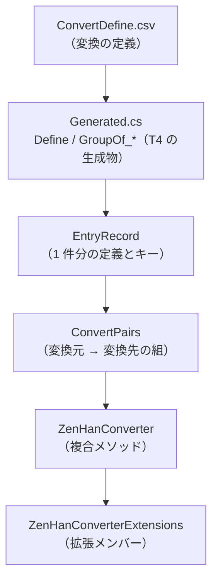
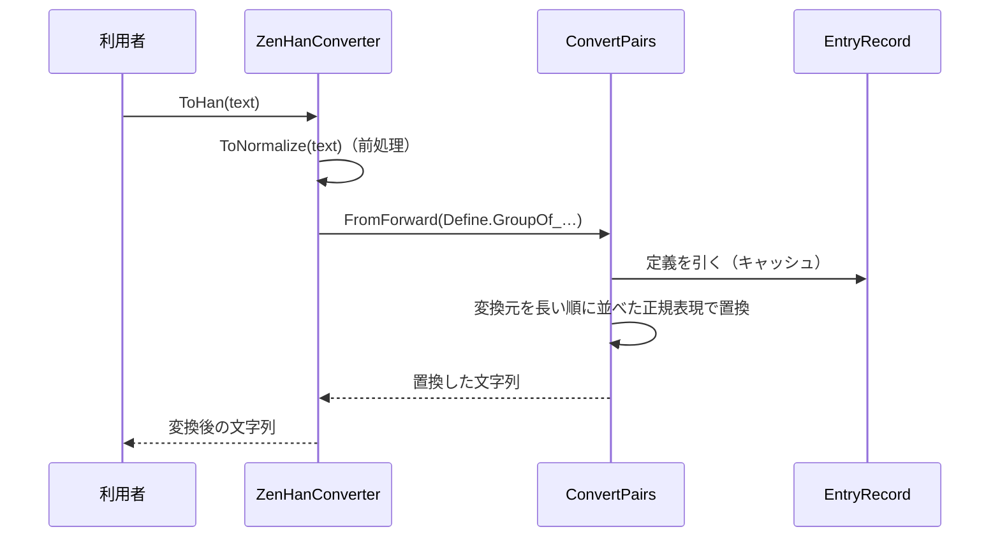

# EsUtil.Feature.ZenHanConverter システム仕様書

日本語テキストの全角・半角・かな・記号の変換を提供する層の内部仕様です。

## 目次 <!-- omit from toc -->

- [1. システム概要](#1-システム概要)
- [2. 技術スタック](#2-技術スタック)
- [3. アーキテクチャ](#3-アーキテクチャ)
  - [3.1 依存方向](#31-依存方向)
  - [3.2 変換の流れ](#32-変換の流れ)
- [4. コンポーネント構成](#4-コンポーネント構成)
- [5. 依存関係](#5-依存関係)
- [6. 例外処理ポリシー](#6-例外処理ポリシー)
- [7. テスト方針](#7-テスト方針)
- [8. 設計判断](#8-設計判断)

## 1. システム概要

**変換の定義（データ）と変換の手順（コード）を分けています**。 定義は `ConvertDefine.csv` が単一所有し、T4（`Generated.tt`）が C# の不変リスト（`Define.AllList`）と、カテゴリ・グループごとの集まり（`Define.GroupOf_*`）を生成します。

公開する変換は、定義の集まりを `ConvertPairs`（変換元 → 変換先の組）へ写し、文字列へ順に適用するだけです。 複合メソッド（`ToHan` / `ToZenWithKatakana` など）は「どの集まりを、どの順に適用するか」だけを持ちます。

## 2. 技術スタック

| 項目 | 内容 |
| --- | --- |
| 対象フレームワーク | `net10.0` |
| 言語 | C# 14（`extension` ブロック、`field` キーワード、コレクション式） |
| 生成 | T4（`Generated.tt`）。 生成物 `Generated.cs` はコミットする |
| データ | `ConvertDefine.csv`（UTF-8） |
| テスト | xUnit v3（`tests/`） |
| Native AOT | `IsAotCompatible=true`（解析警告 0 件をビルドで検査） |

## 3. アーキテクチャ

### 3.1 依存方向



依存は上から下への一方向です。 データ（CSV）が定義の所有者であり、コードはそれを写すだけです。

### 3.2 変換の流れ



## 4. コンポーネント構成

```text
EsUtil/Feature.ZenHanConverter/
├── docs/
├── src/
│   ├── ZenHanConverter.cs
│   ├── ZenHanConverterExtensions.cs
│   ├── ConvertPairs.cs
│   ├── EntryRecord.cs
│   ├── Helper.cs
│   ├── Generated.cs（T4 の生成物。 コミットする）
│   ├── Generated.tt
│   └── ConvertDefine.csv
└── tests/
```

| コンポーネント | 所在 | 内容 |
| --- | --- | --- |
| 変換メソッド | `EsUtil/Feature.ZenHanConverter/src/ZenHanConverter.cs` | 複合メソッド（定義の集まりを順に適用する） |
| 拡張メンバー | `EsUtil/Feature.ZenHanConverter/src/ZenHanConverterExtensions.cs` | 文字列のインスタンス メソッドとして呼ぶ入口 |
| 変換ペア | `EsUtil/Feature.ZenHanConverter/src/ConvertPairs.cs` | 組の保持・連結・連鎖・置換（キャッシュ付き） |
| 定義 | `EsUtil/Feature.ZenHanConverter/src/EntryRecord.cs` | 1 件分の定義・キーによる取得・キャッシュ |
| 補助 | `EsUtil/Feature.ZenHanConverter/src/Helper.cs` | `U+XXXX` 表記の復号 |
| 生成物 | `EsUtil/Feature.ZenHanConverter/src/Generated.cs` | CSV から生成した定義の一覧と集まり |
| 定義のデータ | `EsUtil/Feature.ZenHanConverter/src/ConvertDefine.csv` | 変換の定義（単一所有） |

## 5. 依存関係

- **EsUtil のパッケージを参照しません**。 外部の NuGet パッケージも参照しません（`System.Collections.Immutable` は .NET に含まれます）。
- **利用側**: 特定のアプリに依存しません（テキスト処理の汎用ライブラリ）。
- 許可範囲の規則は [`.github/依存関係.md`](../../../.github/依存関係.md)。

## 6. 例外処理ポリシー

| 状況 | 例外 |
| --- | --- |
| `null` の文字列を渡した | `ArgumentNullException` |
| 存在しないキーで `GetEntry` を呼んだ | `KeyNotFoundException` |
| キーの形式が不正 | `KeyNotFoundException`（メッセージに形式を示す） |

変換の失敗（対象外の文字）は**例外にせず、そのまま返します**（部分的な変換を許すため）。

## 7. テスト方針

- **変換メソッドごとの代表例**（全角・半角・カナ・記号・空白・ダッシュ）を検証します。
- **定義の生成**（CSV の件数と先頭エントリの一致）を検証します。
- **キーによる取得**（階層ごとの `GetEntryKey` と `GetEntry`）と、存在しないキーの例外を検証します。
- **連鎖変換**（`Chain` / `ChainMerge`）の組み合わせを検証します。

## 8. 設計判断

- **定義を CSV に置く**: 変換の追加・修正をコードの変更なしで行えるようにするためです。 生成物もコミットし、T4 を実行できない環境でもビルドできるようにしています。
- **名前空間を `EsUtil.Feature.Text` にする**: 型 `ZenHanConverter` と名前空間セグメントを一致させない規則（`MA0049`）に従うためです。
- **置換は長い変換元から**: 1 文字ずつ置換すると「きゃ」のような 2 文字の定義が壊れるためです。
- **生成物の識別子はデータに従う**: `GroupOf_Ascii_Alphabet_Large` のような名前は CSV から機械的に作られます。 命名規則の例外として扱い、ファイル スコープで解析を無効にしています（[`.editorconfig`](../../../.editorconfig)）。
