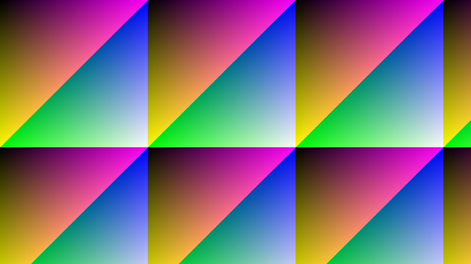
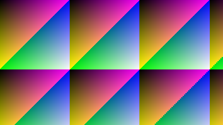
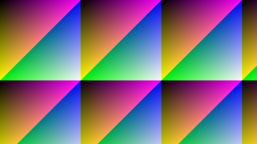
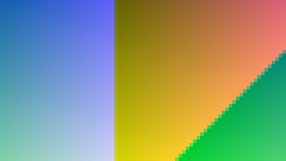
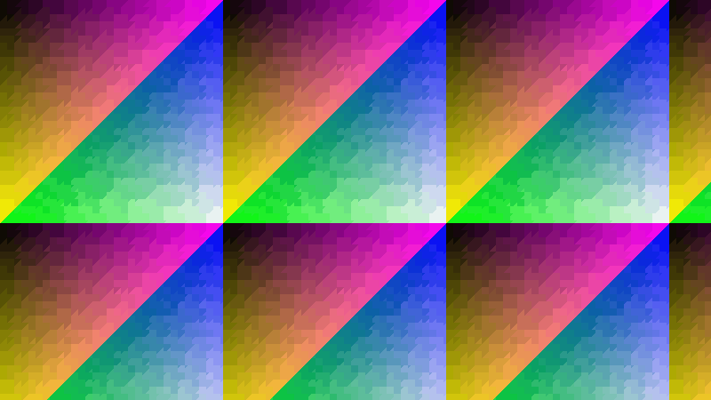
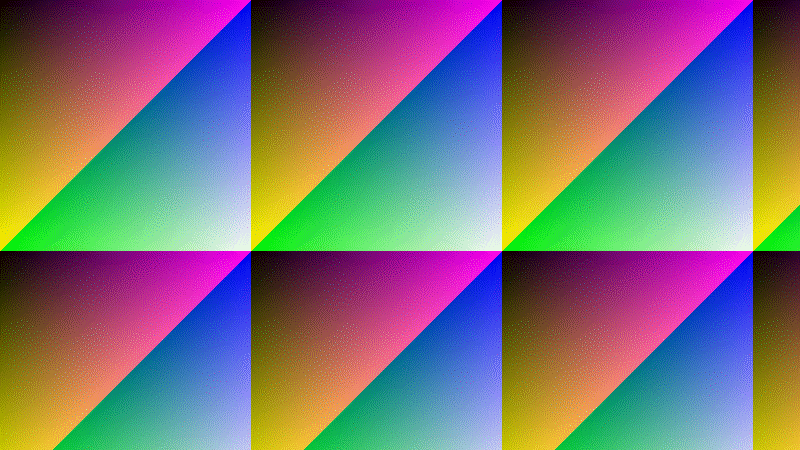
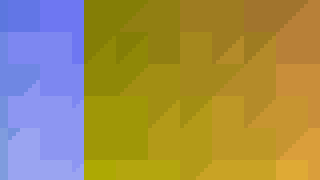
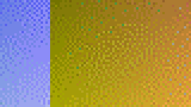
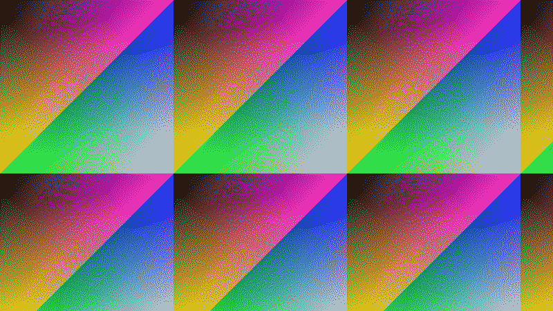
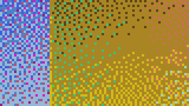

# EsUtil.Platform.Core 計測結果

本プロジェクトの Imaging（`EsUtil/Platform.Core/src/Imaging/`）の**所要とメモリの実測値**を単一所有する文書です（[`.github/ドキュメント規約.md`](../../../.github/ドキュメント規約.md) §1・§10）。

計測値はコードのコメント・仕様書・README へ書かず、本ドキュメントだけが持ちます（数値を書いた時点で古くなるため）。 表は**どの型を計測したか**と**どの寸法か**を軸にした 2 軸表です。

## 目次 <!-- omit from toc -->

- [1. 使い方](#1-使い方)
- [2. 計測環境](#2-計測環境)
- [3. 計測の対象](#3-計測の対象)
- [4. 生成と複製](#4-生成と複製)
  - [4.1 Create](#41-create)
  - [4.2 CreateFilled](#42-createfilled)
  - [4.3 FromPixelCopy](#43-frompixelcopy)
  - [4.4 Copy](#44-copy)
  - [4.5 FromReadOnlyBitmap](#45-fromreadonlybitmap)
  - [4.6 FromPixmap](#46-frompixmap)
  - [4.7 InstallPixels](#47-installpixels)
  - [4.8 FromBitmap（凍結の有無）](#48-frombitmap凍結の有無)
- [5. 切り出しと 0 コピーのビュー](#5-切り出しと-0-コピーのビュー)
  - [5.1 Crop](#51-crop)
  - [5.2 ToPixmap](#52-topixmap)
  - [5.3 ToPixmap（入れ子）](#53-topixmap入れ子)
- [6. 縮小（長辺 320 へ収める）](#6-縮小長辺-320-へ収める)
  - [6.1 EsBitmap](#61-esbitmap)
  - [6.2 EsReadOnlyBitmap](#62-esreadonlybitmap)
  - [6.3 EsPixmap](#63-espixmap)
  - [6.4 EsBitmap（縮小先を変えた場合）](#64-esbitmap縮小先を変えた場合)
  - [6.5 EsReadOnlyBitmap（縮小先を変えた場合）](#65-esreadonlybitmap縮小先を変えた場合)
  - [6.6 EsPixmap（縮小先を変えた場合）](#66-espixmap縮小先を変えた場合)
  - [6.7 出力の品質（品質 × 寸法）](#67-出力の品質品質--寸法)
- [7. 減色](#7-減色)
  - [7.1 EsBitmap（ディザ）](#71-esbitmapディザ)
  - [7.2 EsReadOnlyBitmap（ディザ）](#72-esreadonlybitmapディザ)
  - [7.3 EsPixmap（ディザ）](#73-espixmapディザ)
  - [7.4 内容による違い（3840x2160・256 色）](#74-内容による違い3840x2160256-色)
- [8. 画素の取得・設定・走査](#8-画素の取得設定走査)
  - [8.1 GetPixel](#81-getpixel)
  - [8.2 SetPixel](#82-setpixel)
  - [8.3 Clear](#83-clear)
  - [8.4 ReadOnlyPixels](#84-readonlypixels)
  - [8.5 Pixels](#85-pixels)
- [9. ファイル入出力（Windows 専用の符号化）](#9-ファイル入出力windows-専用の符号化)
  - [9.1 Save](#91-save)
  - [9.2 Save（BMP）](#92-savebmp)
  - [9.3 Save（PNG）](#93-savepng)
  - [9.4 Save（JPEG）](#94-savejpeg)
  - [9.5 Save（GIF）](#95-savegif)
  - [9.6 Save の出力の大きさ](#96-save-の出力の大きさ)
  - [9.7 Load](#97-load)
- [10. 縮小と減色のサンプル](#10-縮小と減色のサンプル)
  - [10.1 縮小（実施前 → 実施後）](#101-縮小実施前--実施後)
  - [10.2 縮小の拡大（Low / Mid / High）](#102-縮小の拡大low--mid--high)
  - [10.3 減色（256 色・実施前 → 実施後）](#103-減色256-色実施前--実施後)
  - [10.4 減色の拡大（256 色）](#104-減色の拡大256-色)
  - [10.5 減色（16 色・実施前 → 実施後）](#105-減色16-色実施前--実施後)
  - [10.6 減色の拡大（16 色）](#106-減色の拡大16-色)
- [11. 改善の記録](#11-改善の記録)
  - [11.1 画素の取得と設定](#111-画素の取得と設定)
  - [11.2 一時配列は借りて返す](#112-一時配列は借りて返す)
  - [11.3 縮小の実装を WIC へ移した記録と、補間ごとの比較](#113-縮小の実装を-wic-へ移した記録と補間ごとの比較)
  - [11.4 減色の実装を WIC へ移した記録](#114-減色の実装を-wic-へ移した記録)
  - [11.5 0 コピーのビュー（EsPixmap）](#115-0-コピーのビューespixmap)
  - [11.6 ビューの全走査は行の間隔も読む](#116-ビューの全走査は行の間隔も読む)
  - [11.7 凍結した画像の共有](#117-凍結した画像の共有)
  - [11.8 保存の形式](#118-保存の形式)
- [12. 読み方と留意点](#12-読み方と留意点)

## 1. 使い方

```powershell
# 計測して本ドキュメントの計測結果を差し替える
pwsh -NoProfile -File EsUtil/Platform.Core/docs/Result_Measurement.ps1

# 表示だけ（文書を書き換えない）
pwsh -NoProfile -File EsUtil/Platform.Core/docs/Result_Measurement.ps1 -NoWrite

# 計測回数を増やす（値のばらつきを減らす）
pwsh -NoProfile -File EsUtil/Platform.Core/docs/Result_Measurement.ps1 -Iterations 50 -Warmup 60
```

- 一時プロジェクト（Release / `net10.0`）を `%TEMP%` 配下へ生成して実行し、本ドキュメントの「計測開始」マーカーと「計測終了」マーカーの間を差し替えます。
- 1 回の計測には **5 分半程度**かかります（ウォームアップを厚く取り、減色を全組み合わせで測るため）。
- プロセッサの名前は `Get-CimInstance Win32_Processor` から取り、計測プログラムへ環境変数で渡します（.NET からは取れないため）。
- **`-Warmup` は 40 回を下限とします**（それより小さい値を指定しても 40 回で計測します）。 実行時は呼び出しの回数で最適化の段階を上げるため、回数が少ないと**最適化されていないコードの所要**を測ってしまい、測定の順番だけで数倍の差が出ます。
- 計測するのは**公開 API だけ**です（内部型の名前を計測コードへ埋め込まないため、実装を変えても計測が壊れません）。
- 計測の対象と表の軸は `EsUtil/Platform.Core/docs/Result_Measurement.ps1` が所有します（対象を増やすときはスクリプトを直します）。
- 計測で一時的に作るファイルはスクリプトが片付けます（実行後は `%TEMP%` に残しません）。

<!-- 計測開始（EsUtil/Platform.Core/docs/Result_Measurement.ps1 が差し替える） -->

<!-- markdownlint-disable MD060 -->

## 2. 計測環境

| 項目 | 値 |
| --- | --- |
| 計測日時 | 2026-10-28 10:25:43 +09:00 |
| OS | Microsoft Windows 10.0.26300 |
| プロセッサ | 12th Gen Intel(R) Core(TM) i7-12700 |
| 論理コア | 20 / X64 |
| .NET | 10.0.14 |
| サーバー GC | False |
| 構成 | Release（最適化あり） |
| ウォームアップ / 計測回数 | 40 回の後に 3 巡へ分けて 1 巡 7 回（合計 21 回。 妨害の無い最小値）。 ファイル入出力は 1 巡 5 回、画素の取得と設定は 1 巡 5 回 |

**計測のばらつき**は、同じ仕事（1920x1080 の生成と長辺 320 への縮小）を**続けて 2 度**測ったずれ（10%。 プロセスの起動直後の巡は外して数える）と、**計測の巡をまたいだ**ずれ（最後 ÷ 最初。 生成 101%、縮小 89%。 最大 1.1 倍）です。 表の中の行を比べるときは前者（隣り合う 2 度のずれ）を境目にし（§3 の備考）、**表をまたいで値を比べるときは後者を足して読みます**。

## 3. 計測の対象

計測するのは **公開 API だけ**です（内部型の名前を計測コードへ埋め込まないため、実装を変えても計測が壊れません）。 対象は次の 3 型で、すべての表が**どの型を計測したか**を行または節の軸に持ちます。

| 型 | 何であるか | 計測に使う入口 |
| --- | --- | --- |
| EsBitmap | 書き換え可能な画像 | `Create` 系・`SetPixel`・`Pixels`・`Clear`・`SetReadOnly` |
| EsReadOnlyBitmap | 読み取り専用の画像 | `Create` 系・`FromBitmap`・`Copy`・`Save`・`Load` |
| EsPixmap | 画像の一部を指す 0 コピーの読み取りビュー | `ToPixmap`（生成の唯一の入口）・`Resize`・`ReduceColors` |

**所要の表**は、行を型・品質・内容など、列を寸法として、行の 1 番目（表ごとに定めた基準）を 100% とした**速度比**を足します。

所要はセルごとに単位 `ms` を付け、**列の中で桁を揃えて右揃え**にします（0.000001 ms（1 ナノ秒）まで表示し、それ未満は `<0.000001` と書きます）。 `-` はその型にメソッドが無い（対称でない）ことを表します。 1 マイクロ秒を下回る操作は、タイマーの分解能に埋もれるため **1 回の計測につき 100 回呼び、1 回あたりへ換算**します。 **値はコードスパンで囲まず**、桁を揃える詰め物の空白はそのまま書きます（`MD060` を計測結果の範囲だけ無効化しています。 [`.github/検証手順.md`](../../../.github/検証手順.md) §11）。

**速度比**は同じ寸法の 1 行目との比です（`基準の所要 ÷ その行の所要`。 100% より大きいほど速い）。 速度比の列は、寸法の列と同じ順に並べます。 基準の所要が 0.001 ms 未満の表では示しません（ばらつきが比率を支配するため）。

**所要は妨害の無い最短値（最小値）**です（3 巡へ分けて測り、まとめた標本の最小値を採ります）。 機械の妨害を含む値（中央値・平均）は**実装の違いを比べる**目的に使えないためです（§2 のばらつきの目安を参照）。

**備考**は、速度比の列が示す**列ごとの差を行ごとに総括したもの**です（列ごとの比較結果は述べません）。 行のすべての列の比が 100% ± 10% の内側なら `差は誤差の範囲`（差が計測のばらつきに埋もれています）、外側へ出た場合は**比の範囲と向き**（`速い` / `遅い` / `列により速い・遅い`）を述べます。 境目の 10% は、続けて 2 度測った同じ仕事のずれ（§2）と 10% の大きいほうです。 **比が意味を持たない行**（速度比を示さない表のすべての行、その型にメソッドが無い行、所要が分解能 0.001 ms に埋もれる列しか無い行）は `-` とし、1 行目は `基準` と書きます。

**寸法の軸**は元の画像（`EsPixmap` はビュー）の寸法です。 縮小だけは**縮小先を長辺 320 に固定**し（型と寸法の比較を揃えるため）、縮小先を変えた表を別に示します。 減色は 256 色を既定とし、色数とディザの表を別に示します。

計測に使う画像は**折り返す勾配**です（B = X % 251・G = Y % 251・R = (X + Y) % 251・A = 255。 決定的で、実行のたびに同じ画像になります）。 折り返すのは、画像の一部を切り出したビューと元画像とで**色の範囲を揃える**ためです（減色の費用は色の範囲で決まるため、折り返さない勾配では内容の違うもの同士を比べることになります）。 減色だけは内容の影響が大きいため、内容を変えた表を別に示します。

**品質の表**は、出力がどれだけ元の画素に近いかを **PSNR (dB)** で示します（大きいほど近い）。 縮小は **{EsImageQuality.High}（Fant）の結果を基準**とし（最も正確な縮小）、減色は**元画像を基準**とします。 1 画素ごとの差では**ディザの狙い（縞を散らすこと）が見えない**ため、減色は**縞の出にくさ**（4×4 の平均で見た PSNR）も示します（§7.9・§7.11）。

画素の領域（`幅 × 4 × 高さ`）は**アンマネージド**であり、所要の表には現れません（ビューは `行間隔 × 高さ`）。

| 項目 | 3840x2160 | 1920x1080 | 640x360 |
| --- | ---: | ---: | ---: |
| 画素の領域 (B) | 33,177,600 | 8,294,400 | 921,600 |

1 回だけ呼ぶ操作（`Dispose` / `ThrowIfDisposed`）と、実体ごとに 1 度しか呼べない操作（`SetReadOnly`）は、所要が他の処理に支配されるため計測しません。 `ToString` 系（`ToSizeText`）と、幅・高さ・行の間隔などのプロパティ（フィールドの読み取りだけ）も同様です。

## 4. 生成と複製

メソッドごとに、行を型・列を寸法とした 2 軸表を示します。

### 4.1 Create

| 型 | 3840x2160 | 1920x1080 | 640x360 | 速度比 | 備考 |
| --- | ---: | ---: | ---: | ---: | --- |
| EsBitmap | 6.117 ms | 1.709 ms | 0.0127 ms | 100% / 100% / 100% | 基準 |
| EsReadOnlyBitmap | 6.322 ms | 1.583 ms | 0.0124 ms |  97% / 108% / 102% | 差は誤差の範囲 |
| EsPixmap | - | - | - |          - / - / - | - |

### 4.2 CreateFilled

| 型 | 3840x2160 | 1920x1080 | 640x360 | 速度比 | 備考 |
| --- | ---: | ---: | ---: | ---: | --- |
| EsBitmap | 6.407 ms | 1.621 ms | 0.0127 ms | 100% / 100% / 100% | 基準 |
| EsReadOnlyBitmap | 6.287 ms | 1.523 ms | 0.0127 ms | 102% / 106% / 100% | 差は誤差の範囲 |
| EsPixmap | - | - | - |          - / - / - | - |

### 4.3 FromPixelCopy

| 型 | 3840x2160 | 1920x1080 | 640x360 | 速度比 | 備考 |
| --- | ---: | ---: | ---: | ---: | --- |
| EsBitmap | 5.759 ms | 1.193 ms | 0.0312 ms | 100% / 100% / 100% | 基準 |
| EsReadOnlyBitmap | 5.718 ms | 1.230 ms | 0.0340 ms |   101% / 97% / 92% | 差は誤差の範囲 |
| EsPixmap | - | - | - |          - / - / - | - |

### 4.4 Copy

| 型 | 3840x2160 | 1920x1080 | 640x360 | 速度比 | 備考 |
| --- | ---: | ---: | ---: | ---: | --- |
| EsBitmap | 5.498 ms | 1.195 ms | 0.0302 ms | 100% / 100% / 100% | 基準 |
| EsReadOnlyBitmap | 5.661 ms | 1.215 ms | 0.0333 ms |    97% / 98% / 91% | 差は誤差を超える（1 行目の 91〜98%・遅い） |
| EsPixmap | - | - | - |          - / - / - | - |

### 4.5 FromReadOnlyBitmap

| 型 | 3840x2160 | 1920x1080 | 640x360 | 速度比 | 備考 |
| --- | ---: | ---: | ---: | ---: | --- |
| EsBitmap | 5.763 ms | 1.194 ms | 0.0309 ms | 100% / 100% / 100% | 基準 |
| EsReadOnlyBitmap | - | - | - |          - / - / - | - |
| EsPixmap | - | - | - |          - / - / - | - |

### 4.6 FromPixmap

| 型 | 3840x2160 | 1920x1080 | 640x360 | 速度比 | 備考 |
| --- | ---: | ---: | ---: | ---: | --- |
| EsBitmap | 5.571 ms | 1.193 ms | 0.0295 ms | 100% / 100% / 100% | 基準 |
| EsReadOnlyBitmap | 5.855 ms | 1.179 ms | 0.0301 ms |   95% / 101% / 98% | 差は誤差の範囲 |
| EsPixmap | - | - | - |          - / - / - | - |

### 4.7 InstallPixels

| 型 | 3840x2160 | 1920x1080 | 640x360 | 速度比 | 備考 |
| --- | ---: | ---: | ---: | ---: | --- |
| EsBitmap | 0.000042 ms | 0.000044 ms | 0.000041 ms | - / - / - | - |
| EsReadOnlyBitmap | 0.000048 ms | 0.000047 ms | 0.000043 ms | - / - / - | - |
| EsPixmap | - | - | - | - / - / - | - |

### 4.8 FromBitmap（凍結の有無）

書き換え可能な画像から読み取り専用の画像を作る唯一の入口です（`EsBitmap` からは作れません）。 行を凍結の有無・列を寸法とした 2 軸表を示します。 凍結済みは 0 コピーで共有し、未凍結は複製します。

| 状態 | 3840x2160 | 1920x1080 | 640x360 | 速度比 | 備考 |
| --- | ---: | ---: | ---: | ---: | --- |
| 未凍結（複製） |     5.631 ms |     1.164 ms |    0.0301 ms | 100% / 100% / 100% | 基準 |
| 凍結済み（共有） | <0.000001 ms | <0.000001 ms | <0.000001 ms |          - / - / - | - |

## 5. 切り出しと 0 コピーのビュー

メソッドごとに、行を型・列を寸法とした 2 軸表を示します。

### 5.1 Crop

| 型 | 3840x2160 | 1920x1080 | 640x360 | 速度比 | 備考 |
| --- | ---: | ---: | ---: | ---: | --- |
| EsBitmap | 1.598 ms | 0.4200 ms | 0.0056 ms | 100% / 100% / 100% | 基準 |
| EsReadOnlyBitmap | 1.674 ms | 0.4023 ms | 0.0056 ms |  95% / 104% / 100% | 差は誤差の範囲 |
| EsPixmap | - | - | - |          - / - / - | - |

### 5.2 ToPixmap

| 型 | 3840x2160 | 1920x1080 | 640x360 | 速度比 | 備考 |
| --- | ---: | ---: | ---: | ---: | --- |
| EsBitmap | 0.000025 ms | 0.000029 ms | 0.000022 ms | - / - / - | - |
| EsReadOnlyBitmap | 0.000029 ms | 0.000024 ms | 0.000022 ms | - / - / - | - |
| EsPixmap | 0.000026 ms | 0.000026 ms | 0.000021 ms | - / - / - | - |

### 5.3 ToPixmap（入れ子）

| 型 | 3840x2160 | 1920x1080 | 640x360 | 速度比 | 備考 |
| --- | ---: | ---: | ---: | ---: | --- |
| EsBitmap | 0.000026 ms | 0.000025 ms | 0.000021 ms | - / - / - | - |
| EsReadOnlyBitmap | 0.000025 ms | 0.000025 ms | 0.000021 ms | - / - / - | - |
| EsPixmap | 0.000027 ms | 0.000028 ms | 0.000022 ms | - / - / - | - |

## 6. 縮小（長辺 320 へ収める）

縮小先を**長辺 320 に固定**し、型ごとに、行を品質・列を元画像の寸法とした 2 軸表を示します。

### 6.1 EsBitmap

| 品質 | 3840x2160 | 1920x1080 | 640x360 | 速度比 | 備考 |
| --- | ---: | ---: | ---: | ---: | --- |
| Low | 6.526 ms | 1.683 ms | 0.2541 ms | 100% / 100% / 100% | 基準 |
| Mid | 6.227 ms | 1.490 ms | 0.1880 ms | 105% / 113% / 135% | 差は誤差を超える（1 行目の 105〜135%・速い） |
| High | 9.711 ms | 2.636 ms | 0.3021 ms |    67% / 64% / 84% | 差は誤差を超える（1 行目の 64〜84%・遅い） |

### 6.2 EsReadOnlyBitmap

| 品質 | 3840x2160 | 1920x1080 | 640x360 | 速度比 | 備考 |
| --- | ---: | ---: | ---: | ---: | --- |
| Low | 6.490 ms | 1.690 ms | 0.2540 ms | 100% / 100% / 100% | 基準 |
| Mid | 6.200 ms | 1.482 ms | 0.1871 ms | 105% / 114% / 136% | 差は誤差を超える（1 行目の 105〜136%・速い） |
| High | 9.734 ms | 2.662 ms | 0.3043 ms |    67% / 63% / 83% | 差は誤差を超える（1 行目の 63〜83%・遅い） |

### 6.3 EsPixmap

| 品質 | 3840x2160 | 1920x1080 | 640x360 | 速度比 | 備考 |
| --- | ---: | ---: | ---: | ---: | --- |
| Low | 6.550 ms | 2.961 ms | 1.065 ms | 100% / 100% / 100% | 基準 |
| Mid | 6.036 ms | 2.882 ms | 1.036 ms | 109% / 103% / 103% | 差は誤差の範囲 |
| High | 9.680 ms | 4.240 ms | 1.135 ms |    68% / 70% / 94% | 差は誤差を超える（1 行目の 68〜94%・遅い） |

### 6.4 EsBitmap（縮小先を変えた場合）

元画像は 3840x2160 に固定し、行を縮小先・列を品質とした 2 軸表を示します。 長辺 320 は品質の表と同じ計測です。

| 縮小先 | Low | Mid | High | 速度比 | 備考 |
| --- | ---: | ---: | ---: | ---: | --- |
| 長辺 320 |  6.526 ms |  6.227 ms |  9.711 ms | 100% / 100% / 100% | 基準 |
| 長辺 960 |  9.067 ms |  7.791 ms | 12.459 ms |    72% / 80% / 78% | 差は誤差を超える（1 行目の 72〜80%・遅い） |
| 長辺 1920 | 15.003 ms | 11.465 ms | 15.544 ms |    43% / 54% / 62% | 差は誤差を超える（1 行目の 43〜62%・遅い） |

### 6.5 EsReadOnlyBitmap（縮小先を変えた場合）

元画像は 3840x2160 に固定し、行を縮小先・列を品質とした 2 軸表を示します。 長辺 320 は品質の表と同じ計測です。

| 縮小先 | Low | Mid | High | 速度比 | 備考 |
| --- | ---: | ---: | ---: | ---: | --- |
| 長辺 320 |  6.490 ms |  6.200 ms |  9.734 ms | 100% / 100% / 100% | 基準 |
| 長辺 960 |  9.076 ms |  7.761 ms | 12.521 ms |    72% / 80% / 78% | 差は誤差を超える（1 行目の 72〜80%・遅い） |
| 長辺 1920 | 14.996 ms | 11.534 ms | 15.908 ms |    43% / 54% / 61% | 差は誤差を超える（1 行目の 43〜61%・遅い） |

### 6.6 EsPixmap（縮小先を変えた場合）

元画像は 3840x2160 に固定し、行を縮小先・列を品質とした 2 軸表を示します。 長辺 320 は品質の表と同じ計測です。

| 縮小先 | Low | Mid | High | 速度比 | 備考 |
| --- | ---: | ---: | ---: | ---: | --- |
| 長辺 320 |  6.550 ms |  6.036 ms |  9.680 ms | 100% / 100% / 100% | 基準 |
| 長辺 960 |  9.073 ms |  7.719 ms | 12.465 ms |    72% / 78% / 78% | 差は誤差を超える（1 行目の 72〜78%・遅い） |
| 長辺 1920 | 14.950 ms | 11.552 ms | 16.085 ms |    44% / 52% / 60% | 差は誤差を超える（1 行目の 44〜60%・遅い） |

### 6.7 出力の品質（品質 × 寸法）

縮小先を長辺 320 に固定し、**High（Fant）の結果を基準**とした PSNR (dB) です（大きいほど基準に近い）。 行を品質・列を元画像の寸法とした 2 軸表を示します。 値は 3 型で同じでした（同じ実装を共有しているためです）。

| 品質 | 3840x2160 | 1920x1080 | 640x360 | 速度比 | 備考 |
| --- | ---: | ---: | ---: | ---: | --- |
| Low | 16.66 dB | 20.21 dB | 28.71 dB | 100% / 100% / 100% | 基準 |
| Mid | 25.03 dB | 29.45 dB | 48.15 dB | 105% / 113% / 135% | 差は誤差を超える（1 行目の 105〜135%・速い） |
| High |     ∞ dB |     ∞ dB |     ∞ dB |    67% / 64% / 84% | 差は誤差を超える（1 行目の 64〜84%・遅い） |

## 7. 減色

型ごとに、行を品質またはディザ・列を元画像の寸法とした 2 軸表を示します。

### 7.1 EsBitmap（ディザ）

| 指定（Mid） | 3840x2160 | 1920x1080 | 640x360 | 速度比 | 備考 |
| --- | ---: | ---: | ---: | ---: | --- |
| 16 色（ディザなし） |  54.449 ms | 14.151 ms | 1.451 ms | 100% / 100% / 100% | 基準 |
| 256 色（ディザなし） |  56.059 ms | 15.531 ms | 2.926 ms |    97% / 91% / 50% | 差は誤差を超える（1 行目の 50〜97%・遅い） |
| 16 色（誤差拡散） | 128.492 ms | 32.680 ms | 3.444 ms |    42% / 43% / 42% | 差は誤差を超える（1 行目の 42〜43%・遅い） |
| 256 色（誤差拡散） | 129.446 ms | 34.194 ms | 4.968 ms |    42% / 41% / 29% | 差は誤差を超える（1 行目の 29〜42%・遅い） |

### 7.2 EsReadOnlyBitmap（ディザ）

| 指定（Mid） | 3840x2160 | 1920x1080 | 640x360 | 速度比 | 備考 |
| --- | ---: | ---: | ---: | ---: | --- |
| 16 色（ディザなし） |  55.212 ms | 14.067 ms | 1.447 ms | 100% / 100% / 100% | 基準 |
| 256 色（ディザなし） |  56.356 ms | 15.709 ms | 2.988 ms |    98% / 90% / 48% | 差は誤差を超える（1 行目の 48〜98%・遅い） |
| 16 色（誤差拡散） | 128.044 ms | 32.456 ms | 3.370 ms |    43% / 43% / 43% | 差は誤差を超える（1 行目の 43〜43%・遅い） |
| 256 色（誤差拡散） | 129.322 ms | 34.136 ms | 4.897 ms |    43% / 41% / 30% | 差は誤差を超える（1 行目の 30〜43%・遅い） |

### 7.3 EsPixmap（ディザ）

| 指定（Mid） | 3840x2160 | 1920x1080 | 640x360 | 速度比 | 備考 |
| --- | ---: | ---: | ---: | ---: | --- |
| 16 色（ディザなし） |  55.143 ms | 17.128 ms | 3.198 ms | 100% / 100% / 100% | 基準 |
| 256 色（ディザなし） |  56.055 ms | 18.809 ms | 4.754 ms |    98% / 91% / 67% | 差は誤差を超える（1 行目の 67〜98%・遅い） |
| 16 色（誤差拡散） | 128.202 ms | 35.675 ms | 5.356 ms |    43% / 48% / 60% | 差は誤差を超える（1 行目の 43〜60%・遅い） |
| 256 色（誤差拡散） | 129.303 ms | 36.946 ms | 6.949 ms |    43% / 46% / 46% | 差は誤差を超える（1 行目の 43〜46%・遅い） |

### 7.4 内容による違い（3840x2160・256 色）

減色の費用は**画素が入った箱の数**で決まるため、内容を変えた表を示します（行を型・列を内容とした 2 軸表）。 平坦は箱が 1 つで下限の側、ノイズは箱が最大で上限の側です。

| 型 | 平坦 | グラデーション | ノイズ | 速度比 | 備考 |
| --- | ---: | ---: | ---: | ---: | --- |
| EsBitmap | 54.647 ms | 56.059 ms | 55.842 ms | 100% / 100% / 100% | 基準 |
| EsReadOnlyBitmap | 54.628 ms | 56.356 ms | 55.816 ms |  100% / 99% / 100% | 差は誤差の範囲 |
| EsPixmap | 54.403 ms | 56.055 ms | 56.226 ms |  100% / 100% / 99% | 差は誤差の範囲 |

## 8. 画素の取得・設定・走査

メソッドごとに、行を型・列を寸法とした 2 軸表を示します。 `GetPixel` と `SetPixel` は **1 回あたり 1,000,000 画素**を扱う時間、`Clear` / `ReadOnlyPixels` / `Pixels` は **1 回あたり全画素**を扱う時間です。

### 8.1 GetPixel

| 型 | 3840x2160 | 1920x1080 | 640x360 | 速度比 | 備考 |
| --- | ---: | ---: | ---: | ---: | --- |
| EsBitmap | 3.878 ms | 3.921 ms | 0.8997 ms | 100% / 100% / 100% | 基準 |
| EsReadOnlyBitmap | 3.854 ms | 3.894 ms | 0.9031 ms | 101% / 101% / 100% | 差は誤差の範囲 |
| EsPixmap | 3.763 ms | 3.785 ms | 0.8685 ms | 103% / 104% / 104% | 差は誤差の範囲 |

### 8.2 SetPixel

| 型 | 3840x2160 | 1920x1080 | 640x360 | 速度比 | 備考 |
| --- | ---: | ---: | ---: | ---: | --- |
| EsBitmap | 3.830 ms | 3.832 ms | 3.801 ms | 100% / 100% / 100% | 基準 |
| EsReadOnlyBitmap | - | - | - |          - / - / - | - |
| EsPixmap | - | - | - |          - / - / - | - |

### 8.3 Clear

| 型 | 3840x2160 | 1920x1080 | 640x360 | 速度比 | 備考 |
| --- | ---: | ---: | ---: | ---: | --- |
| EsBitmap | 1.577 ms | 0.1728 ms | 0.0122 ms | 100% / 100% / 100% | 基準 |
| EsReadOnlyBitmap | - | - | - |          - / - / - | - |
| EsPixmap | - | - | - |          - / - / - | - |

### 8.4 ReadOnlyPixels

| 型 | 3840x2160 | 1920x1080 | 640x360 | 速度比 | 備考 |
| --- | ---: | ---: | ---: | ---: | --- |
| EsBitmap | 9.849 ms | 2.341 ms | 0.2669 ms | 100% / 100% / 100% | 基準 |
| EsReadOnlyBitmap | 9.811 ms | 2.376 ms | 0.2628 ms |  100% / 99% / 102% | 差は誤差の範囲 |
| EsPixmap | 9.745 ms | 4.745 ms |  1.551 ms |   101% / 49% / 17% | 差は誤差を超える（1 行目の 17〜101%・列により速い・遅い） |

### 8.5 Pixels

| 型 | 3840x2160 | 1920x1080 | 640x360 | 速度比 | 備考 |
| --- | ---: | ---: | ---: | ---: | --- |
| EsBitmap | 7.314 ms | 1.742 ms | 0.1885 ms | 100% / 100% / 100% | 基準 |
| EsReadOnlyBitmap | - | - | - |          - / - / - | - |
| EsPixmap | - | - | - |          - / - / - | - |

## 9. ファイル入出力（Windows 専用の符号化）

メソッドごとに、行を型・列を寸法とした 2 軸表を示します。

### 9.1 Save

| 型 | 3840x2160 | 1920x1080 | 640x360 | 速度比 | 備考 |
| --- | ---: | ---: | ---: | ---: | --- |
| EsBitmap | 79.550 ms | 20.325 ms | 2.474 ms | 100% / 100% / 100% | 基準 |
| EsReadOnlyBitmap | 78.876 ms | 20.488 ms | 2.482 ms |  101% / 99% / 100% | 差は誤差の範囲 |
| EsPixmap | - | - | - |          - / - / - | - |

### 9.2 Save（BMP）

| 型 | 3840x2160 | 1920x1080 | 640x360 | 速度比 | 備考 |
| --- | ---: | ---: | ---: | ---: | --- |
| EsBitmap | 26.113 ms | 5.106 ms | 0.6471 ms | 100% / 100% / 100% | 基準 |
| EsReadOnlyBitmap | 26.695 ms | 5.131 ms | 0.6174 ms |  98% / 100% / 105% | 差は誤差の範囲 |
| EsPixmap | - | - | - |          - / - / - | - |

### 9.3 Save（PNG）

| 型 | 3840x2160 | 1920x1080 | 640x360 | 速度比 | 備考 |
| --- | ---: | ---: | ---: | ---: | --- |
| EsBitmap | 79.330 ms | 20.314 ms | 2.475 ms | 100% / 100% / 100% | 基準 |
| EsReadOnlyBitmap | 78.965 ms | 20.392 ms | 2.400 ms | 100% / 100% / 103% | 差は誤差の範囲 |
| EsPixmap | - | - | - |          - / - / - | - |

### 9.4 Save（JPEG）

| 型 | 3840x2160 | 1920x1080 | 640x360 | 速度比 | 備考 |
| --- | ---: | ---: | ---: | ---: | --- |
| EsBitmap | 33.771 ms | 8.577 ms | 1.024 ms | 100% / 100% / 100% | 基準 |
| EsReadOnlyBitmap | 33.483 ms | 8.323 ms | 1.079 ms |  101% / 103% / 95% | 差は誤差の範囲 |
| EsPixmap | - | - | - |          - / - / - | - |

### 9.5 Save（GIF）

| 型 | 3840x2160 | 1920x1080 | 640x360 | 速度比 | 備考 |
| --- | ---: | ---: | ---: | ---: | --- |
| EsBitmap | 92.203 ms | 26.444 ms | 5.012 ms | 100% / 100% / 100% | 基準 |
| EsReadOnlyBitmap | 93.422 ms | 26.327 ms | 5.009 ms |  99% / 100% / 100% | 差は誤差の範囲 |
| EsPixmap | - | - | - |          - / - / - | - |

### 9.6 Save の出力の大きさ

保存したファイルの大きさ (B) です（行を形式・列を寸法とした 2 軸表）。 `EsBitmap` で測った値です（`EsReadOnlyBitmap` も同じ画素を書くため同じ大きさになります）。 画像の内容は折り返す勾配であり、内容で圧縮の効きが変わります。 拡張子から判定する版と形式を指定した版は同じ大きさになります（同じ処理であることの確認になります）。

| 形式 | 3840x2160 | 1920x1080 | 640x360 |
| --- | ---: | ---: | ---: |
| PNG（`Save(path)` 既定） |    104,284 |    28,176 |   4,043 |
| BMP（形式を指定） | 33,177,654 | 8,294,454 | 921,654 |
| PNG（形式を指定） |    104,284 |    28,176 |   4,043 |
| JPEG（品質 90） |  1,146,649 |   288,738 |  31,784 |
| GIF（256 色へ減色） |    907,214 |   255,705 |  35,664 |

### 9.7 Load

| 型 | 3840x2160 | 1920x1080 | 640x360 | 速度比 | 備考 |
| --- | ---: | ---: | ---: | ---: | --- |
| EsBitmap | 11.591 ms | 3.384 ms | 0.3800 ms | 100% / 100% / 100% | 基準 |
| EsReadOnlyBitmap | 11.797 ms | 3.161 ms | 0.3658 ms |  98% / 107% / 104% | 差は誤差の範囲 |
| EsPixmap | - | - | - |          - / - / - | - |

## 10. 縮小と減色のサンプル

計測に使った画像（折り返す勾配）で、**実施前と実施後**を並べます（所要や PSNR では分からない見え方を確かめるためです）。 サンプルの元画像は **800x450** です（計測の 3840x2160 のままでは実施前を等倍で表示できないため）。 **縮小先は計測と同じ長辺 320**、**減色は同じ寸法のまま**です。 画像は計測スクリプトが生成します（手で作った画像は置きません）。

**縮小の粗さは縮小の比率で変わります**。 サンプルの比（2.5 倍）は計測（12 倍）より小さいため、Low（最近傍）の粗さは**計測より小さく出ます**。

### 10.1 縮小（実施前 → 実施後）

実施前は 800x450 です。 **実施前だけを等倍で示し**、その下へ**実施後 3 つを同じ大きさ**（長辺 320 → 320x180）で並べます（**縮小の見え方は同じ大きさ同士で比べる**ためです）。

| 実施前 |
| --- |
|  |

| 実施後 Low | 実施後 Mid | 実施後 High |
| --- | --- | --- |
|  |  |  |

縮小先の長辺は**計測と同じ 320** です。 元画像を **800x450**（計測は 3840x2160）にしているため、比は **2.5 倍**です。 元画像を 640x360 にすると**ちょうど 2 倍**になり、補間の違いが画素の差として現れにくくなります。 3 つの違いを見るため、**割り切れない比**にしています。

### 10.2 縮小の拡大（Low / Mid / High）

実施後の**1 画素を 4×4 で写した**ものです（実施後の (68, 39) から 80x45 の領域。 **実施前は上の表**を参照）。 縮小の違いは細かい模様に出るため、拡大すると**Low（最近傍）の階段**（元の模様を飛ばして拾うため）と、**Mid・High のなだらかさ**が見えます。

| 実施後 Low（拡大） | 実施後 Mid（拡大） | 実施後 High（拡大） |
| --- | --- | --- |
|  |  |  |

### 10.3 減色（256 色・実施前 → 実施後）

実施前は 800x450（全色）です。 実施後は同じ寸法のまま 256 色へ減色した結果です。 縮小していないため、**減色だけの違い**が分かります。 所要は §7、1 画素ごとの差は §7.8 です。

| 実施前 | 実施後（ディザなし） | 実施後（ディザあり） |
| --- | --- | --- |
|  |  |  |

### 10.4 減色の拡大（256 色）

上の表の**1 画素を 4×4 で写した**ものです（実施前の (230, 120) から 80x45 の領域）。 **ディザの粒**（色を混ぜて中間色に見せる点）が見えます。 縞の出にくさは §7.9 です。

| 実施前（拡大） | 実施後（ディザなし・拡大） | 実施後（ディザあり・拡大） |
| --- | --- | --- |
|  |  |  |

### 10.5 減色（16 色・実施前 → 実施後）

実施前は 800x450（全色）です。 実施後は同じ寸法のまま 16 色へ減色した結果です。 縮小していないため、**減色だけの違い**が分かります。 所要は §7、1 画素ごとの差は §7.10 です。

| 実施前 | 実施後（ディザなし） | 実施後（ディザあり） |
| --- | --- | --- |
|  |  |  |

### 10.6 減色の拡大（16 色）

上の表の**1 画素を 4×4 で写した**ものです（実施前の (230, 120) から 80x45 の領域）。 **ディザの粒**（色を混ぜて中間色に見せる点）が見えます。 縞の出にくさは §7.11 です。

| 実施前（拡大） | 実施後（ディザなし・拡大） | 実施後（ディザあり・拡大） |
| --- | --- | --- |
|  |  |  |

<!-- markdownlint-enable MD060 -->

<!-- 計測終了 -->

## 11. 改善の記録

計測で確認したことを記録します（数値は本ドキュメントの計測結果が持ちます。 ここには「何を根拠に何を決めたか」だけを書きます）。

### 11.1 画素の取得と設定

画素の取得（`GetPixel`）と設定（`SetPixel`）は、内部のバッファのアドレスを生成時に 1 度だけ求めて保持し、破棄済みの判定をフィールドの直接の読み取りで行います。 仮想呼び出しを含むアドレス取得と、インライン化されない破棄済み判定の呼び出しを画素ごとに繰り返さないためです。

### 11.2 一時配列は借りて返す

減色は、色番号（1 画素 1 バイト）の作業場所のように**大きい配列を繰り返し必要とします**。 呼び出しごとに確保すると LOH に入り、繰り返すほど Gen2 の GC を誘発します。 `ArrayPool<T>` から借りて返すようにし、**借りた配列は使う前に必要な範囲だけを消す**（内容は次の借り手が消すため、返すときに消しません）ことで、減色を繰り返しても確保が積み上がりません。 縮小は WIC が作業場所を持つため、本ライブラリ側に借りる配列はありません。

### 11.3 縮小の実装を WIC へ移した記録と、補間ごとの比較

**縮小の計算を自前で持つのをやめ、OS の WIC（`IWICBitmapScaler`）へ移しました**。 理由は**経路によって画質が変わらないこと**です（読み込み時（`Load(path, maxSize)`）の縮小は元から WIC のスケーラーであり、自前の縮小を別に持つと「読み込んで縮小」と「表示用に縮小」で画素が変わります）。 併せて、面積平均・双線形・最近傍の 3 実装（列の対応表・並列化のしきい値・行の余白の扱いを含む約 350 行）を WIC の補間の指定へ置き換えました。

**`EsImageQuality` は補間の指定へ写ります**（`Low` = `NearestNeighbor` / `Mid` = `Linear` / `High` = `Fant`）。

**元画像の画素は複製しません**（`CreateBitmapFromMemory` へ `fixed` した領域を渡し、スコープ内で縮小を終えます）。 画素形式の変換器も挟みません（`32bppPBGRA` のままスケーラーへ渡します）。 段階ごとの並列化としきい値は無くなりました（WIC が内部で行います）。

#### 速度（最小値。 同一入力・11 回）

自前実装（WIC へ移す前の実装）と WIC の 5 つの補間を同じ条件で測りました。

| 元画像 → 長辺 | 自前 Low | WIC NearestNeighbor | 自前 Mid | WIC Linear | WIC Cubic | 自前 High | WIC Fant | WIC HighQualityCubic |
| --- | ---: | ---: | ---: | ---: | ---: | ---: | ---: | ---: |
| 640x360 → 320（2 倍） | `0.12 ms` | `0.47 ms` | `0.25 ms` | `0.44 ms` | `1.25 ms` | `0.24 ms` | `0.53 ms` | `1.01 ms` |
| 1920x1080 → 320（6 倍） | `0.09 ms` | `1.68 ms` | `0.22 ms` | `1.58 ms` | `3.33 ms` | `0.55 ms` | `2.73 ms` | `6.51 ms` |
| 1920x1080 → 960（2 倍） | `0.32 ms` | `3.33 ms` | `0.99 ms` | `2.50 ms` | `10.71 ms` | `0.86 ms` | `3.43 ms` | `7.59 ms` |
| 3840x2160 → 320（12 倍） | `0.09 ms` | `6.62 ms` | `0.26 ms` | `6.38 ms` | `8.19 ms` | `1.19 ms` | `10.06 ms` | `23.24 ms` |
| 3840x2160 → 960（4 倍） | `0.40 ms` | `8.85 ms` | `1.05 ms` | `7.39 ms` | `21.78 ms` | `1.65 ms` | `12.31 ms` | `25.70 ms` |

- **自前実装は 2〜78 倍速い**です。 読み出す画素が縮小先に必要な分だけで済むためです（`Low` は 1 画素につき元の 1 画素、`Mid`/`High` も列の対応表で行ごとに最小の範囲だけを読む）。 **WIC のスケーラーは補間の種類によらず元画像を全走査**するため、費用は元画像の画素数で決まります。
- **WIC 同士では `NearestNeighbor` < `Linear` < `Cubic` < `Fant` < `HighQualityCubic`** の順に遅い（`HighQualityCubic` は `Fant` の 2〜3 倍）。 **最も遅い `HighQualityCubic` が最も画質が高いわけではありません**（下記）。
- **小さい画像では差が縮みます**（640x360 → 320 で自前 0.24 ms 対 `Fant` 0.53 ms）。 2 倍の縮小では WIC の固定費（COM の生成・確保）が支配的になります。

#### 品質（面積平均を「基準」とした比較）

**「基準」は整数ブロックの面積平均**です。 各出力画素が受け持つ元の矩形（`x0 = floor(x·W/TW)` 〜 `x1 = floor((x+1)·W/TW)`、行も同様）の画素値をすべて足し、**最後に 1 回だけ割る**（切捨て）ものです。 面積平均は**縮小で情報を落とさない**（元の画素がすべて結果へ 1 回ずつ寄与する）ため、縮小の基準として最も素直な定義です。

**これは「正解（ground truth）」ではありません。** 次の 3 点を区別します。

- **元の情景は無い**: 入力は既に標本化された画像であり、縮小前の連続な信号は分かりません。 測れるのは「別の算法との距離」だけです。
- **理想は用途で変わる**: 面積平均は**リンギングを生まず、細線のエネルギーを保つ**（文字・罫線が落ちない）。 一方 Lanczos 系は**支持幅を広げて細部を強調**する（写真では標準的だが、細線の縁に白黒の縞が出る）。 どちらが「正しい」かは用途で決まります。
- **基準を変えると値が変わる**: 同じ実装でも、基準を変えれば PSNR は大きく動きます（実測）。

| 基準どうしの距離（実測） | 1080p → 320（6 倍） | 4K → 320（12 倍） | 1080p → 960（2 倍） |
| --- | ---: | ---: | ---: |
| 面積平均（切捨て） vs 面積平均（四捨五入） | 55.54 dB | 51.14 dB | 56.35 dB |
| 面積平均（切捨て） vs Lanczos-3（アンチエイリアスあり） | 34.62 dB | 37.37 dB | 27.47 dB |

したがって**PSNR は同じ基準の中でだけ比較できます**（「55 dB」と「34 dB」を別の表で比べても意味がありません）。 下表は**面積平均（切捨て）を固定の基準**とした値です。

| 元画像 → 長辺 | 画像 | 自前 Low | WIC NearestNeighbor | 自前 Mid | WIC Linear | WIC Cubic | 自前 High | WIC Fant | WIC HighQualityCubic |
| --- | --- | ---: | ---: | ---: | ---: | ---: | ---: | ---: | ---: |
| 1920x1080 → 320 | 画面キャプチャ風 | 13.81 dB（±247） | 14.03 dB（±248） | 23.17 dB（±131） | 23.17 dB（±131） | 20.59 dB（±162） | **基準と同じ**（±0） | 55.54 dB（±1） | 36.35 dB（±27） |
| 1920x1080 → 960 | 画面キャプチャ風 | 14.66 dB（±192） | 14.66 dB（±192） | **基準と同じ**（±0） | **基準と同じ**（±0） | 30.60 dB（±35） | 56.35 dB（±1） | **基準と同じ**（±0） | 28.58 dB（±65） |
| 3840x2160 → 320 | ノイズ | 10.79 dB（±149） | 10.79 dB（±147） | 16.91 dB（±126） | 16.91 dB（±126） | 14.76 dB（±145） | **基準と同じ**（±0） | 51.14 dB（±1） | 38.12 dB（±15） |
| 3840x2160 → 960 | ノイズ | 11.04 dB（±189） | 11.03 dB（±199） | 18.03 dB（±138） | 18.03 dB（±137） | 15.39 dB（±162） | **基準と同じ**（±0） | 51.13 dB（±1） | 29.12 dB（±42） |

- **自前 High の誤差 0 は定義上当然**です（基準と同じ算法）。 意味があるのは**他の実装が基準からどれだけ離れるか**です。
- **`Fant` は面積平均そのもの**です（追加計測: 四捨五入の面積平均と**完全一致**（∞）、切捨ての面積平均と 51〜56 dB ＝ 丸め 1 段の差）。 「近似」ではなく**同じフィルタで、丸めだけが四捨五入**です。
- **`Cubic` と `HighQualityCubic` は縮小に使えません**: 支持幅を広げる補間は**リンギング（細線の縁の白黒の縞）**を生じ、4 倍以上の縮小では `Linear` より低い PSNR になります（±162 / ±65 の誤差）。 **遅い上に画質が低い**ため、段階へ加える理由がありません。
- **`Linear` はちょうど 2 倍の縮小でのみ基準と一致**します（各軸の重みが 0.5 ずつになるため）。 6 倍・12 倍では 17〜23 dB まで落ちます（細線が背景へ混ざる）。
- **`NearestNeighbor` は最も低い**（10〜15 dB）。 位置が合えば細線が残り、合わなければ消えるため、**同じ画像でも縮小率で見え方が跳ねます**。

**基準を Lanczos-3 に変えても順位は変わりません**（画面キャプチャ風・1080p → 320 で `Low` 14.01 dB / `Linear` 22.95 dB / `Fant` 34.82 dB）。 ただし**2 倍の縮小では `Linear` と `Fant` がほぼ同等**になります（Lanczos-3 に対して 27.47 dB / 27.42 dB）。 この 2 倍の縮小では、双線形が 2x2 の平均そのものになるためです。

#### 判断

**メモリ上の縮小では、WIC に速度・品質とも勝てる段はありません。** 自前 `High` は `Fant` と**同じフィルタ**（丸めだけが切捨てと四捨五入の違い）で 6〜8 倍速く、自前 `Mid`（双線形）は `Linear` と**画素が完全に一致**したまま 7〜25 倍速く、自前 `Low`（最近傍）も `NearestNeighbor` と同等の画質で 22〜78 倍速いからです。

**WIC を使い続ける価値があるのは「ファイルから読むときの縮小」だけ**です（`Load(path, maxSize)`。 原寸のバッファを作らずにデコードしながら縮小するため、**原寸デコードより速い**）。 メモリ上の縮小を自前へ戻す判断をする場合は、この表を根拠にできます（`EsImageQuality` の意味は変わりません）。

### 11.4 減色の実装を WIC へ移した記録

**減色の計算を自前で持つのをやめ、OS の WIC（`IWICPalette` の中央値分割 + `IWICFormatConverter` の 8bpp インデックスへの変換）へ移しました**。 理由は**保存の `ColorCount` と同じパレットを使うこと**です（同じ「色数へ減らす」計算を 2 つ持つと、同じ色数でも保存経路によって画素が変わります）。

- **所要はほぼ同じ**です（1920x1080・256 色・ディザなしで 19.5 ms。 自前実装は 22 ms / 10 ms（写真風 / 画面キャプチャ風））。 その後、**色番号から書き込み先へ直接書く**ようにし（画像 1 枚分の複製と画素ごとの乗算を無くした）、1920x1080 で `256 色 / ディザなし` 18.0 ms → 16.1 ms、`16 色 / ディザなし` 16.5 ms → 14.4 ms になりました（ディザありは約 5% 減）。
- **画素誤差は自前実装の方がわずかに小さい**です（写真風の PSNR 33.5 dB 対 30.6 dB）。 **画面キャプチャ風の画像は WIC でも画素が完全に一致**します（PSNR 99 dB）。
- **品質の段階（`EsImageQuality`）と、減色の作業量の記述（箱・参照表・詰め直しの反復）は無くなりました**（WIC に段階が無いため）。 `EsImageQuality` は**縮小だけ**の指定です。
- **透過は「透明か不透明か」の 2 値**になりました（WIC のパレットが透明色を 1 つ持つため。 以前はアルファを 4 段階でパレットへ持てました）。

### 11.5 0 コピーのビュー（EsPixmap）

切り出しの複製を作らずに一部を読む入口（`ToPixmap`）は、実体の生成と共有の参照カウントだけを行います。 切り出しの複製（`Crop`）に対して所要と確保の両方で有利であり、ルーペの描画は**切り出しの複製を経由しません**。 射影（表示用の画像）をそのまま使える場合は元矩形つきの描画で済ませ、使えない場合（オフスクリーン描画・射影の寸法が違う場合）も **0 コピーのビューを表示用へ変換**します（`Crop` は使いません）。

### 11.6 ビューの全走査は行の間隔も読む

ビューは元画像の**行の間隔を引き継ぐ**ため、全走査（`ReadOnlyPixels`）が読む範囲は `幅 × 4 × 高さ` ではなく `行の間隔 × 高さ` になります。 元画像より狭いビューでは、その差がそのまま走査の所要になります（ビューの幅が元画像の 1/6 であれば、同じ高さでも 6 倍近い範囲を読みます）。 狭いビューを繰り返し走査する場面では、ビューではなく `幅 × 4` の行の間隔を持つ画像へ写すか、走査の対象をビューの行に限るかを選びます。

### 11.7 凍結した画像の共有

書き換え可能な画像から読み取り専用の画像を作る入口（`FromBitmap`）は、**元が凍結済みなら 0 コピーで共有**し、**未凍結なら複製**します（凍結の有無で費用が 4 桁以上変わります。 §4.8 が根拠です）。 凍結は「この実体からは書けない」ことの宣言であり、それを受けて**同じ画素を指す実体を増やす**判断ができます。 共有した場合はどちらを先に破棄しても画素は有効なままです（参照を数えて解放します）。

### 11.8 保存の形式

保存の費用は**形式で 4 倍前後変わります**（同じ画素を書く場合。 §9.2〜§9.5 が根拠です）。 無圧縮（BMP）は画素数に比例するだけであり、可逆圧縮（PNG）は圧縮の計算が加わり、非可逆圧縮（JPEG）は圧縮の計算が軽い代わりに画素の情報を捨てます。 256 色へ減色する形式（GIF）は減色の費用（§7）が加わります。 出力の大きさは形式と内容の両方で変わるため、保存の表では**所要と出力の大きさを分けて**示します（§9.6）。

## 12. 読み方と留意点

- **所要は妨害の無い最短値（最小値）**です。 実行時は呼び出しの回数で最適化の段階を上げるため、ウォームアップを 40 回以上取ってから測ります（回数が少ないと、同じ処理でも測定の順番だけで数倍の差が出ます）。 標本は**巡（既定 3 巡）へ分けて**取り、まとめた最小値を採ります（1 つの時点で続けて測ると、機械が遅い状態の値がそのまま表へ入ります）。
- **同じ処理の所要でも、機械の妨害で 2 倍以上に見えることがあります**（実測。 計測の巡をまたいだ同じ仕事の比は §2 に示します）。 したがって**表をまたいで値を比べるときは、差がその範囲を超えているか**を確かめてください。 **同じ表の中の行は続けて測る**ため、行の比較はこれより小さな差で済みます（備考の列が示す境目）。
- **所要が 1 マイクロ秒を下回る操作は、1 回の計測で 100 回呼んで 1 回あたりへ換算**します（タイマーの刻みに埋もれるため）。 この換算した値は**タイマーの刻みとループの費用**を含みます。
- **速度比は同じ寸法の 1 行目との比**です（`基準の所要 ÷ その行の所要`。 100% より大きいほど速い）。 基準の所要が 1 マイクロ秒未満の表では示しません（ばらつきが比率を支配するため）。 **備考の列**が、その行の差が計測のばらつきの範囲かどうかを述べます（§3）。
- **計測に使う画像は折り返す勾配**です（決定的で、実行のたびに同じ画像になります）。 実際の画面の取り込みは内容が違うため、**減色と保存の大きさは内容で変わります**（減色は §7.7、保存は §9.6 を参照）。
- **画素の領域は所要の表に現れません**（`Create` 系が確保する画素はアンマネージドです。 `幅 × 4 × 高さ`）。 所要の表が持つのは所要だけです。
- **ビューの全走査（`ReadOnlyPixels`）は行の間隔も読みます**。 ビューは元画像の行の間隔を引き継ぐため、元画像の幅がビューより広いほど読む範囲が広がります（§8.4 を参照）。
- **値は環境で変わります**（CPU のコア数・メモリ帯域・GC の設定）。 本ドキュメントの値は「計測環境」の項に記した 1 台での実測です。
- **ファイル入出力は Windows 専用の符号化（GDI+）**を使います（他の OS では計測しません）。
- **並列化を判定するしきい値は実測で決めた値**です（§11.3）。 コア数の少ない機械では並列化の損益分岐が大きくなるため、しきい値には 2 倍の余裕を持たせています。
