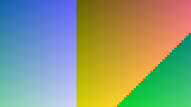

# EsUtil.Platform.Core 計測結果

本プロジェクトの Imaging（`EsUtil/Platform.Core/src/Imaging/`）の**所要とメモリの実測値**を単一所有する文書です（[`.github/ドキュメント規約.md`](../../../.github/ドキュメント規約.md) §1・§10）。

計測値はコードのコメント・仕様書・README へ書かず、本ドキュメントだけが持ちます（数値を書いた時点で古くなるため）。 表は**どの型を計測したか**と**どの寸法か**を軸にした 2 軸表です。

## 目次 <!-- omit from toc -->

- [1. 使い方](#1-使い方)
- [2. 計測環境](#2-計測環境)
- [3. 計測の対象](#3-計測の対象)
- [4. 生成と複製](#4-生成と複製)
  - [4.1 Create](#41-create)
  - [4.2 CreateFilled](#42-createfilled)
  - [4.3 FromPixelCopy](#43-frompixelcopy)
  - [4.4 Copy](#44-copy)
  - [4.5 FromReadOnlyBitmap](#45-fromreadonlybitmap)
  - [4.6 FromPixmap](#46-frompixmap)
  - [4.7 InstallPixels](#47-installpixels)
  - [4.8 FromBitmap（凍結の有無）](#48-frombitmap凍結の有無)
- [5. 切り出しと 0 コピーのビュー](#5-切り出しと-0-コピーのビュー)
  - [5.1 Crop](#51-crop)
  - [5.2 ToPixmap](#52-topixmap)
  - [5.3 ToPixmap（入れ子）](#53-topixmap入れ子)
- [6. 縮小（長辺 320 へ収める）](#6-縮小長辺-320-へ収める)
  - [6.1 EsBitmap](#61-esbitmap)
  - [6.2 EsReadOnlyBitmap](#62-esreadonlybitmap)
  - [6.3 EsPixmap](#63-espixmap)
  - [6.4 EsBitmap（縮小先を変えた場合）](#64-esbitmap縮小先を変えた場合)
  - [6.5 EsReadOnlyBitmap（縮小先を変えた場合）](#65-esreadonlybitmap縮小先を変えた場合)
  - [6.6 EsPixmap（縮小先を変えた場合）](#66-espixmap縮小先を変えた場合)
  - [6.7 出力の良さ（縮小の方法 × 寸法）](#67-出力の良さ縮小の方法--寸法)
- [7. 減色](#7-減色)
  - [7.1 EsBitmap（ディザ）](#71-esbitmapディザ)
  - [7.2 EsReadOnlyBitmap（ディザ）](#72-esreadonlybitmapディザ)
  - [7.3 EsPixmap（ディザ）](#73-espixmapディザ)
  - [7.4 内容による違い（3840x2160・256 色）](#74-内容による違い3840x2160256-色)
- [8. 画素の取得・設定・走査](#8-画素の取得設定走査)
  - [8.1 GetPixel](#81-getpixel)
  - [8.2 SetPixel](#82-setpixel)
  - [8.3 Clear](#83-clear)
  - [8.4 ReadOnlyPixels](#84-readonlypixels)
  - [8.5 Pixels](#85-pixels)
- [9. ファイル入出力（Windows 専用の符号化）](#9-ファイル入出力windows-専用の符号化)
  - [9.1 Save](#91-save)
  - [9.2 Save（BMP）](#92-savebmp)
  - [9.3 Save（PNG）](#93-savepng)
  - [9.4 Save（JPEG）](#94-savejpeg)
  - [9.5 Save（GIF）](#95-savegif)
  - [9.6 Save の出力の大きさ](#96-save-の出力の大きさ)
  - [9.7 Load](#97-load)
- [10. 縮小と減色のサンプル](#10-縮小と減色のサンプル)
  - [10.1 縮小（実施前 → 実施後）](#101-縮小実施前--実施後)
  - [10.2 縮小の拡大（WicNearestNeighbor / WicFant / EsBilinear / EsBox）](#102-縮小の拡大wicnearestneighbor--wicfant--esbilinear--esbox)
  - [10.3 減色（256 色・実施前 → 実施後）](#103-減色256-色実施前--実施後)
  - [10.4 減色の拡大（256 色）](#104-減色の拡大256-色)
  - [10.5 減色（16 色・実施前 → 実施後）](#105-減色16-色実施前--実施後)
  - [10.6 減色の拡大（16 色）](#106-減色の拡大16-色)
- [11. 改善の記録](#11-改善の記録)
  - [11.1 画素の取得と設定](#111-画素の取得と設定)
  - [11.2 一時配列は借りて返す](#112-一時配列は借りて返す)
  - [11.3 縮小の方法（WIC と自前）の比較](#113-縮小の方法wic-と自前の比較)
    - [速度（§6.1 の再掲。 3840x2160 → 長辺 320）](#速度61-の再掲-3840x2160--長辺-320)
    - [参照との一致度（Lanczos-3 を参照）](#参照との一致度lanczos-3-を参照)
    - [判断](#判断)
  - [11.4 減色の実装を WIC へ移した記録](#114-減色の実装を-wic-へ移した記録)
  - [11.5 0 コピーのビュー（EsPixmap）](#115-0-コピーのビューespixmap)
  - [11.6 ビューの全走査は行の間隔も読む](#116-ビューの全走査は行の間隔も読む)
  - [11.7 凍結した画像の共有](#117-凍結した画像の共有)
  - [11.8 保存の形式](#118-保存の形式)
- [12. 読み方と留意点](#12-読み方と留意点)

## 1. 使い方

```powershell
# 計測して本ドキュメントの計測結果を差し替える
pwsh -NoProfile -File EsUtil/Platform.Core/docs/Result_Measurement.ps1

# 表示だけ（文書を書き換えない）
pwsh -NoProfile -File EsUtil/Platform.Core/docs/Result_Measurement.ps1 -NoWrite

# 計測回数を増やす（値のばらつきを減らす）
pwsh -NoProfile -File EsUtil/Platform.Core/docs/Result_Measurement.ps1 -Iterations 50 -Warmup 60
```

- 一時プロジェクト（Release / `net10.0`）を `%TEMP%` 配下へ生成して実行し、本ドキュメントの「計測開始」マーカーと「計測終了」マーカーの間を差し替えます。
- 1 回の計測には **5 分半程度**かかります（ウォームアップを厚く取り、減色を全組み合わせで測るため）。
- プロセッサの名前は `Get-CimInstance Win32_Processor` から取り、計測プログラムへ環境変数で渡します（.NET からは取れないため）。
- **`-Warmup` は 40 回を下限とします**（それより小さい値を指定しても 40 回で計測します）。 実行時は呼び出しの回数で最適化の段階を上げるため、回数が少ないと**最適化されていないコードの所要**を測ってしまい、測定の順番だけで数倍の差が出ます。
- 計測するのは**公開 API だけ**です（内部型の名前を計測コードへ埋め込まないため、実装を変えても計測が壊れません）。
- 計測の対象と表の軸は `EsUtil/Platform.Core/docs/Result_Measurement.ps1` が所有します（対象を増やすときはスクリプトを直します）。
- 計測で一時的に作るファイルはスクリプトが片付けます（実行後は `%TEMP%` に残しません）。

<!-- 計測開始（EsUtil/Platform.Core/docs/Result_Measurement.ps1 が差し替える） -->

<!-- markdownlint-disable MD060 -->

## 2. 計測環境

| 項目 | 値 |
| --- | --- |
| 計測日時 | 2026-10-28 17:15:05 +09:00 |
| OS | Microsoft Windows 10.0.26300 |
| プロセッサ | 12th Gen Intel(R) Core(TM) i7-12700 |
| 論理コア | 20 / X64 |
| .NET | 10.0.14 |
| サーバー GC | False |
| 構成 | Release（最適化あり） |
| ウォームアップ / 計測回数 | 40 回の後に 3 巡へ分けて 1 巡 7 回（合計 21 回。 妨害の無い最小値）。 ファイル入出力は 1 巡 5 回、画素の取得と設定は 1 巡 5 回 |

**計測のばらつき**は、同じ仕事（1920x1080 の生成と長辺 320 への縮小）を**続けて 2 度**測ったずれ（10%。 プロセスの起動直後の巡は外して数える）と、**計測の巡をまたいだ**ずれ（最後 ÷ 最初。 生成 96%、縮小 90%。 最大 1.1 倍）です。 表の中の行を比べるときは前者（隣り合う 2 度のずれ）を境目にし（§3 の備考）、**表をまたいで値を比べるときは後者を足して読みます**。

## 3. 計測の対象

計測するのは **公開 API だけ**です（内部型の名前を計測コードへ埋め込まないため、実装を変えても計測が壊れません）。 対象は次の 3 型で、すべての表が**どの型を計測したか**を行または節の軸に持ちます。

| 型 | 何であるか | 計測に使う入口 |
| --- | --- | --- |
| EsBitmap | 書き換え可能な画像 | `Create` 系・`SetPixel`・`Pixels`・`Clear`・`SetReadOnly` |
| EsReadOnlyBitmap | 読み取り専用の画像 | `Create` 系・`FromBitmap`・`Copy`・`Save`・`Load` |
| EsPixmap | 画像の一部を指す 0 コピーの読み取りビュー | `ToPixmap`（生成の唯一の入口）・`Resize`・`ReduceColors` |

**所要の表**は、行を型・品質・内容など、列を寸法として、行の 1 番目（表ごとに定めた基準）を 100% とした**速度比**を足します。

所要はセルごとに単位 `ms` を付け、**列の中で桁を揃えて右揃え**にします（0.000001 ms（1 ナノ秒）まで表示し、それ未満は `<0.000001` と書きます）。 `-` はその型にメソッドが無い（対称でない）ことを表します。 1 マイクロ秒を下回る操作は、タイマーの分解能に埋もれるため **1 回の計測につき 100 回呼び、1 回あたりへ換算**します。 **値はコードスパンで囲まず**、桁を揃える詰め物の空白はそのまま書きます（`MD060` を計測結果の範囲だけ無効化しています。 [`.github/検証手順.md`](../../../.github/検証手順.md) §11）。

**速度比**は同じ寸法の 1 行目との比です（`基準の所要 ÷ その行の所要`。 100% より大きいほど速い）。 速度比の列は、寸法の列と同じ順に並べます。 基準の所要が 0.001 ms 未満の表では示しません（ばらつきが比率を支配するため）。

**所要は妨害の無い最短値（最小値）**です（3 巡へ分けて測り、まとめた標本の最小値を採ります）。 機械の妨害を含む値（中央値・平均）は**実装の違いを比べる**目的に使えないためです（§2 のばらつきの目安を参照）。

**備考**は、速度比の列が示す**列ごとの差を行ごとに総括したもの**です（列ごとの比較結果は述べません）。 行のすべての列の比が 100% ± 10% の内側なら `差は誤差の範囲`（差が計測のばらつきに埋もれています）、外側へ出た場合は**比の範囲と向き**（`速い` / `遅い` / `列により速い・遅い`）を述べます。 境目の 10% は、続けて 2 度測った同じ仕事のずれ（§2）と 10% の大きいほうです。 **比が意味を持たない行**（速度比を示さない表のすべての行、その型にメソッドが無い行、所要が分解能 0.001 ms に埋もれる列しか無い行）は `-` とし、1 行目は `速度の基準` と書きます。

**寸法の軸**は元の画像（`EsPixmap` はビュー）の寸法です。 縮小だけは**縮小先を長辺 320 に固定**し（型と寸法の比較を揃えるため）、縮小先を変えた表を別に示します。 減色は 256 色を既定とし、色数とディザの表を別に示します。

計測に使う画像は**折り返す勾配**です（B = X % 251・G = Y % 251・R = (X + Y) % 251・A = 255。 決定的で、実行のたびに同じ画像になります）。 折り返すのは、画像の一部を切り出したビューと元画像とで**色の範囲を揃える**ためです（減色の費用は色の範囲で決まるため、折り返さない勾配では内容の違うもの同士を比べることになります）。 減色だけは内容の影響が大きいため、内容を変えた表を別に示します。

**良さの表**は、出力がどれだけ参照に近いかを **PSNR (dB)** で示します（大きいほど参照に近い。 縮小の参照は Lanczos-3、減色の参照は元画像です）。 1 画素ごとの差では**ディザの狙い（縞を散らすこと）が見えない**ため、減色は**縞の出にくさ**（4×4 の平均で見た PSNR）も示します（§7.9・§7.11）。

画素の領域（`幅 × 4 × 高さ`）は**アンマネージド**であり、所要の表には現れません（ビューは `行間隔 × 高さ`）。

| 項目 | 3840x2160 | 1920x1080 | 640x360 |
| --- | ---: | ---: | ---: |
| 画素の領域 (B) | 33,177,600 | 8,294,400 | 921,600 |

1 回だけ呼ぶ操作（`Dispose` / `ThrowIfDisposed`）と、実体ごとに 1 度しか呼べない操作（`SetReadOnly`）は、所要が他の処理に支配されるため計測しません。 `ToString` 系（`ToSizeText`）と、幅・高さ・行の間隔などのプロパティ（フィールドの読み取りだけ）も同様です。

## 4. 生成と複製

メソッドごとに、行を型・列を寸法とした 2 軸表を示します。

### 4.1 Create

| 型 | 3840x2160 | 1920x1080 | 640x360 | 速度比 | 備考 |
| --- | ---: | ---: | ---: | ---: | --- |
| EsBitmap | 6.188 ms | 1.597 ms | 0.0124 ms | 100% / 100% / 100% | 速度の基準 |
| EsReadOnlyBitmap | 6.132 ms | 1.571 ms | 0.0124 ms | 101% / 102% / 100% | 差は誤差の範囲 |
| EsPixmap | - | - | - |          - / - / - | - |

### 4.2 CreateFilled

| 型 | 3840x2160 | 1920x1080 | 640x360 | 速度比 | 備考 |
| --- | ---: | ---: | ---: | ---: | --- |
| EsBitmap | 6.169 ms | 1.546 ms | 0.0124 ms | 100% / 100% / 100% | 速度の基準 |
| EsReadOnlyBitmap | 6.202 ms | 1.613 ms | 0.0125 ms |    99% / 96% / 99% | 差は誤差の範囲 |
| EsPixmap | - | - | - |          - / - / - | - |

### 4.3 FromPixelCopy

| 型 | 3840x2160 | 1920x1080 | 640x360 | 速度比 | 備考 |
| --- | ---: | ---: | ---: | ---: | --- |
| EsBitmap | 5.379 ms | 1.192 ms | 0.0293 ms | 100% / 100% / 100% | 速度の基準 |
| EsReadOnlyBitmap | 5.406 ms | 1.201 ms | 0.0290 ms |  100% / 99% / 101% | 差は誤差の範囲 |
| EsPixmap | - | - | - |          - / - / - | - |

### 4.4 Copy

| 型 | 3840x2160 | 1920x1080 | 640x360 | 速度比 | 備考 |
| --- | ---: | ---: | ---: | ---: | --- |
| EsBitmap | 5.442 ms | 1.128 ms | 0.0297 ms | 100% / 100% / 100% | 速度の基準 |
| EsReadOnlyBitmap | 5.442 ms | 1.121 ms | 0.0297 ms | 100% / 101% / 100% | 差は誤差の範囲 |
| EsPixmap | - | - | - |          - / - / - | - |

### 4.5 FromReadOnlyBitmap

| 型 | 3840x2160 | 1920x1080 | 640x360 | 速度比 | 備考 |
| --- | ---: | ---: | ---: | ---: | --- |
| EsBitmap | 5.381 ms | 1.185 ms | 0.0297 ms | 100% / 100% / 100% | 速度の基準 |
| EsReadOnlyBitmap | - | - | - |          - / - / - | - |
| EsPixmap | - | - | - |          - / - / - | - |

### 4.6 FromPixmap

| 型 | 3840x2160 | 1920x1080 | 640x360 | 速度比 | 備考 |
| --- | ---: | ---: | ---: | ---: | --- |
| EsBitmap | 5.582 ms | 1.180 ms | 0.0300 ms | 100% / 100% / 100% | 速度の基準 |
| EsReadOnlyBitmap | 5.553 ms | 1.176 ms | 0.0296 ms | 101% / 100% / 101% | 差は誤差の範囲 |
| EsPixmap | - | - | - |          - / - / - | - |

### 4.7 InstallPixels

| 型 | 3840x2160 | 1920x1080 | 640x360 | 速度比 | 備考 |
| --- | ---: | ---: | ---: | ---: | --- |
| EsBitmap | 0.000044 ms | 0.000041 ms | 0.000036 ms | - / - / - | - |
| EsReadOnlyBitmap | 0.000045 ms | 0.000045 ms | 0.000040 ms | - / - / - | - |
| EsPixmap | - | - | - | - / - / - | - |

### 4.8 FromBitmap（凍結の有無）

書き換え可能な画像から読み取り専用の画像を作る唯一の入口です（`EsBitmap` からは作れません）。 行を凍結の有無・列を寸法とした 2 軸表を示します。 凍結済みは 0 コピーで共有し、未凍結は複製します。

| 状態 | 3840x2160 | 1920x1080 | 640x360 | 速度比 | 備考 |
| --- | ---: | ---: | ---: | ---: | --- |
| 未凍結（複製） |     5.391 ms |     1.144 ms |    0.0297 ms | 100% / 100% / 100% | 速度の基準 |
| 凍結済み（共有） | <0.000001 ms | <0.000001 ms | <0.000001 ms |          - / - / - | - |

## 5. 切り出しと 0 コピーのビュー

メソッドごとに、行を型・列を寸法とした 2 軸表を示します。

### 5.1 Crop

| 型 | 3840x2160 | 1920x1080 | 640x360 | 速度比 | 備考 |
| --- | ---: | ---: | ---: | ---: | --- |
| EsBitmap | 1.602 ms | 0.4029 ms | 0.0037 ms | 100% / 100% / 100% | 速度の基準 |
| EsReadOnlyBitmap | 1.626 ms | 0.4034 ms | 0.0039 ms |   99% / 100% / 95% | 差は誤差の範囲 |
| EsPixmap | - | - | - |          - / - / - | - |

### 5.2 ToPixmap

| 型 | 3840x2160 | 1920x1080 | 640x360 | 速度比 | 備考 |
| --- | ---: | ---: | ---: | ---: | --- |
| EsBitmap | 0.000029 ms | 0.000025 ms | 0.000021 ms | - / - / - | - |
| EsReadOnlyBitmap | 0.000023 ms | 0.000026 ms | 0.000021 ms | - / - / - | - |
| EsPixmap | 0.000024 ms | 0.000025 ms | 0.000021 ms | - / - / - | - |

### 5.3 ToPixmap（入れ子）

| 型 | 3840x2160 | 1920x1080 | 640x360 | 速度比 | 備考 |
| --- | ---: | ---: | ---: | ---: | --- |
| EsBitmap | 0.000023 ms | 0.000025 ms | 0.000022 ms | - / - / - | - |
| EsReadOnlyBitmap | 0.000023 ms | 0.000023 ms | 0.000022 ms | - / - / - | - |
| EsPixmap | 0.000023 ms | 0.000023 ms | 0.000021 ms | - / - / - | - |

## 6. 縮小（長辺 320 へ収める）

縮小先を**長辺 320 に固定**し、型ごとに、行を縮小の方法・列を元画像の寸法とした 2 軸表を示します。

### 6.1 EsBitmap

| 縮小の方法 | 3840x2160 | 1920x1080 | 640x360 | 速度比 | 備考 |
| --- | ---: | ---: | ---: | ---: | --- |
| WicNearestNeighbor |  6.364 ms |  1.637 ms | 0.2503 ms |         100% / 100% / 100% | 速度の基準 |
| WicLinear |  5.768 ms |  1.426 ms | 0.1823 ms |         110% / 115% / 137% | 差は誤差を超える（1 行目の 110〜137%・速い） |
| WicCubic |  7.630 ms |  3.050 ms | 0.9829 ms |            83% / 54% / 25% | 差は誤差を超える（1 行目の 25〜83%・遅い） |
| WicFant |  9.368 ms |  2.593 ms | 0.2928 ms |            68% / 63% / 85% | 差は誤差を超える（1 行目の 63〜85%・遅い） |
| WicHighQualityCubic | 22.994 ms |  6.024 ms | 0.7408 ms |            28% / 27% / 34% | 差は誤差を超える（1 行目の 27〜34%・遅い） |
| EsNearestNeighbor | 0.0247 ms | 0.0109 ms | 0.0111 ms | 25,764% / 15,015% / 2,255% | 差は誤差を超える（1 行目の 2,255〜25,764%・速い） |
| EsBilinear | 0.1484 ms | 0.0888 ms | 0.1238 ms |     4,288% / 1,843% / 202% | 差は誤差を超える（1 行目の 202〜4,288%・速い） |
| EsBox |  1.226 ms | 0.3942 ms | 0.1386 ms |         519% / 415% / 181% | 差は誤差を超える（1 行目の 181〜519%・速い） |

### 6.2 EsReadOnlyBitmap

| 縮小の方法 | 3840x2160 | 1920x1080 | 640x360 | 速度比 | 備考 |
| --- | ---: | ---: | ---: | ---: | --- |
| WicNearestNeighbor |  6.311 ms |  1.619 ms | 0.2486 ms |         100% / 100% / 100% | 速度の基準 |
| WicLinear |  5.785 ms |  1.416 ms | 0.1849 ms |         109% / 114% / 134% | 差は誤差を超える（1 行目の 109〜134%・速い） |
| WicCubic |  7.667 ms |  3.043 ms | 0.9874 ms |            82% / 53% / 25% | 差は誤差を超える（1 行目の 25〜82%・遅い） |
| WicFant |  9.466 ms |  2.580 ms | 0.2950 ms |            67% / 63% / 84% | 差は誤差を超える（1 行目の 63〜84%・遅い） |
| WicHighQualityCubic | 23.083 ms |  6.079 ms | 0.7446 ms |            27% / 27% / 33% | 差は誤差を超える（1 行目の 27〜33%・遅い） |
| EsNearestNeighbor | 0.0134 ms | 0.0096 ms | 0.0099 ms | 47,099% / 16,866% / 2,511% | 差は誤差を超える（1 行目の 2,511〜47,099%・速い） |
| EsBilinear | 0.1504 ms | 0.1098 ms | 0.1252 ms |     4,196% / 1,475% / 199% | 差は誤差を超える（1 行目の 199〜4,196%・速い） |
| EsBox |  1.018 ms | 0.3939 ms | 0.1225 ms |         620% / 411% / 203% | 差は誤差を超える（1 行目の 203〜620%・速い） |

### 6.3 EsPixmap

| 縮小の方法 | 3840x2160 | 1920x1080 | 640x360 | 速度比 | 備考 |
| --- | ---: | ---: | ---: | ---: | --- |
| WicNearestNeighbor |  6.373 ms |  2.821 ms |  1.018 ms |          100% / 100% / 100% | 速度の基準 |
| WicLinear |  5.802 ms |  2.758 ms | 0.9970 ms |          110% / 102% / 102% | 差は誤差の範囲 |
| WicCubic |  7.800 ms |  4.549 ms |  1.813 ms |             82% / 62% / 56% | 差は誤差を超える（1 行目の 56〜82%・遅い） |
| WicFant |  9.399 ms |  3.895 ms |  1.100 ms |             68% / 72% / 93% | 差は誤差を超える（1 行目の 68〜93%・遅い） |
| WicHighQualityCubic | 23.099 ms |  7.686 ms |  1.620 ms |             28% / 37% / 63% | 差は誤差を超える（1 行目の 28〜63%・遅い） |
| EsNearestNeighbor | 0.0122 ms | 0.0110 ms | 0.0089 ms | 52,234% / 25,642% / 11,433% | 差は誤差を超える（1 行目の 11,433〜52,234%・速い） |
| EsBilinear | 0.1428 ms | 0.1036 ms | 0.1213 ms |      4,463% / 2,723% / 839% | 差は誤差を超える（1 行目の 839〜4,463%・速い） |
| EsBox |  1.023 ms | 0.3928 ms | 0.1231 ms |          623% / 718% / 827% | 差は誤差を超える（1 行目の 623〜827%・速い） |

### 6.4 EsBitmap（縮小先を変えた場合）

元画像は 3840x2160 に固定し、行を縮小先・列を縮小の方法とした 2 軸表を示します。 長辺 320 は縮小の方法の表と同じ計測です。

| 縮小先 | WicNearestNeighbor | WicLinear | WicCubic | WicFant | WicHighQualityCubic | EsNearestNeighbor | EsBilinear | EsBox | 速度比 | 備考 |
| --- | ---: | ---: | ---: | ---: | ---: | ---: | ---: | ---: | ---: | --- |
| 長辺 320 |  6.364 ms |  5.768 ms |  7.630 ms |  9.368 ms | 22.994 ms | 0.0247 ms | 0.1484 ms | 1.226 ms | 100% / 100% / 100% / 100% / 100% / 100% / 100% / 100% | 速度の基準 |
| 長辺 960 |  8.801 ms |  7.540 ms | 21.069 ms | 11.928 ms | 25.420 ms | 0.4312 ms | 0.8644 ms | 1.604 ms |          72% / 77% / 36% / 79% / 90% / 6% / 17% / 76% | 差は誤差を超える（1 行目の 6〜90%・遅い） |
| 長辺 1920 | 14.671 ms | 11.149 ms | 40.658 ms | 15.548 ms | 30.879 ms |  1.171 ms |  3.031 ms | 3.274 ms |           43% / 52% / 19% / 60% / 74% / 2% / 5% / 37% | 差は誤差を超える（1 行目の 2〜74%・遅い） |

### 6.5 EsReadOnlyBitmap（縮小先を変えた場合）

元画像は 3840x2160 に固定し、行を縮小先・列を縮小の方法とした 2 軸表を示します。 長辺 320 は縮小の方法の表と同じ計測です。

| 縮小先 | WicNearestNeighbor | WicLinear | WicCubic | WicFant | WicHighQualityCubic | EsNearestNeighbor | EsBilinear | EsBox | 速度比 | 備考 |
| --- | ---: | ---: | ---: | ---: | ---: | ---: | ---: | ---: | ---: | --- |
| 長辺 320 |  6.311 ms |  5.785 ms |  7.667 ms |  9.466 ms | 23.083 ms | 0.0134 ms | 0.1504 ms | 1.018 ms | 100% / 100% / 100% / 100% / 100% / 100% / 100% / 100% | 速度の基準 |
| 長辺 960 |  8.816 ms |  7.688 ms | 21.414 ms | 11.877 ms | 25.555 ms | 0.4408 ms | 0.7585 ms | 1.598 ms |          72% / 75% / 36% / 80% / 90% / 3% / 20% / 64% | 差は誤差を超える（1 行目の 3〜90%・遅い） |
| 長辺 1920 | 14.670 ms | 11.302 ms | 40.712 ms | 15.175 ms | 30.975 ms |  1.209 ms |  3.157 ms | 3.114 ms |           43% / 51% / 19% / 62% / 75% / 1% / 5% / 33% | 差は誤差を超える（1 行目の 1〜75%・遅い） |

### 6.6 EsPixmap（縮小先を変えた場合）

元画像は 3840x2160 に固定し、行を縮小先・列を縮小の方法とした 2 軸表を示します。 長辺 320 は縮小の方法の表と同じ計測です。

| 縮小先 | WicNearestNeighbor | WicLinear | WicCubic | WicFant | WicHighQualityCubic | EsNearestNeighbor | EsBilinear | EsBox | 速度比 | 備考 |
| --- | ---: | ---: | ---: | ---: | ---: | ---: | ---: | ---: | ---: | --- |
| 長辺 320 |  6.373 ms |  5.802 ms |  7.800 ms |  9.399 ms | 23.099 ms | 0.0122 ms | 0.1428 ms | 1.023 ms | 100% / 100% / 100% / 100% / 100% / 100% / 100% / 100% | 速度の基準 |
| 長辺 960 |  8.808 ms |  7.561 ms | 21.507 ms | 12.133 ms | 25.928 ms | 0.4333 ms | 0.7368 ms | 1.591 ms |          72% / 77% / 36% / 77% / 89% / 3% / 19% / 64% | 差は誤差を超える（1 行目の 3〜89%・遅い） |
| 長辺 1920 | 14.784 ms | 11.233 ms | 40.536 ms | 15.341 ms | 31.000 ms |  1.324 ms |  3.078 ms | 3.094 ms |           43% / 52% / 19% / 61% / 75% / 1% / 5% / 33% | 差は誤差を超える（1 行目の <1〜75%・遅い） |

### 6.7 出力の良さ（縮小の方法 × 寸法）

縮小先を長辺 320 に固定し、**Lanczos-3（独立した参照実装）を参照**とした PSNR (dB) です（大きいほど参照に近い）。 **参照との一致度であり、画質の優劣ではありません**（参照もリンギングを持つため、リンギングする方法ほど高く出ます）。 行を縮小の方法・列を元画像の寸法とした 2 軸表を示します。 値は 3 型で同じでした（同じ実装を共有しているためです）。

| 縮小の方法 | 3840x2160 | 1920x1080 | 640x360 | 速度比 | 備考 |
| --- | ---: | ---: | ---: | ---: | --- |
| WicNearestNeighbor | 16.58 dB | 20.14 dB | 28.70 dB |         100% / 100% / 100% | 速度の基準 |
| WicLinear | 24.62 dB | 29.09 dB | 45.96 dB |         110% / 115% / 137% | 差は誤差を超える（1 行目の 110〜137%・速い） |
| WicCubic | 24.47 dB | 28.75 dB | 44.42 dB |            83% / 54% / 25% | 差は誤差を超える（1 行目の 25〜83%・遅い） |
| WicFant | 35.83 dB | 41.20 dB | 45.82 dB |            68% / 63% / 85% | 差は誤差を超える（1 行目の 63〜85%・遅い） |
| WicHighQualityCubic | 40.68 dB | 45.12 dB | 47.30 dB |            28% / 27% / 34% | 差は誤差を超える（1 行目の 27〜34%・遅い） |
| EsNearestNeighbor | 17.75 dB | 21.02 dB | 28.20 dB | 25,764% / 15,015% / 2,255% | 差は誤差を超える（1 行目の 2,255〜25,764%・速い） |
| EsBilinear | 24.62 dB | 29.11 dB | 47.03 dB |     4,288% / 1,843% / 202% | 差は誤差を超える（1 行目の 202〜4,288%・速い） |
| EsBox | 35.81 dB | 41.00 dB | 47.03 dB |         519% / 415% / 181% | 差は誤差を超える（1 行目の 181〜519%・速い） |

## 7. 減色

型ごとに、行を品質またはディザ・列を元画像の寸法とした 2 軸表を示します。

### 7.1 EsBitmap（ディザ）

| 指定（Mid） | 3840x2160 | 1920x1080 | 640x360 | 速度比 | 備考 |
| --- | ---: | ---: | ---: | ---: | --- |
| 16 色（ディザなし） |  54.833 ms | 13.884 ms | 1.765 ms | 100% / 100% / 100% | 速度の基準 |
| 256 色（ディザなし） |  55.982 ms | 15.664 ms | 3.252 ms |    98% / 89% / 54% | 差は誤差を超える（1 行目の 54〜98%・遅い） |
| 16 色（誤差拡散） | 126.626 ms | 32.316 ms | 3.802 ms |    43% / 43% / 46% | 差は誤差を超える（1 行目の 43〜46%・遅い） |
| 256 色（誤差拡散） | 128.392 ms | 33.843 ms | 5.263 ms |    43% / 41% / 34% | 差は誤差を超える（1 行目の 34〜43%・遅い） |

### 7.2 EsReadOnlyBitmap（ディザ）

| 指定（Mid） | 3840x2160 | 1920x1080 | 640x360 | 速度比 | 備考 |
| --- | ---: | ---: | ---: | ---: | --- |
| 16 色（ディザなし） |  54.691 ms | 13.981 ms | 1.821 ms | 100% / 100% / 100% | 速度の基準 |
| 256 色（ディザなし） |  56.076 ms | 15.645 ms | 3.268 ms |    98% / 89% / 56% | 差は誤差を超える（1 行目の 56〜98%・遅い） |
| 16 色（誤差拡散） | 127.037 ms | 32.084 ms | 3.731 ms |    43% / 44% / 49% | 差は誤差を超える（1 行目の 43〜49%・遅い） |
| 256 色（誤差拡散） | 129.023 ms | 33.597 ms | 5.255 ms |    42% / 42% / 35% | 差は誤差を超える（1 行目の 35〜42%・遅い） |

### 7.3 EsPixmap（ディザ）

| 指定（Mid） | 3840x2160 | 1920x1080 | 640x360 | 速度比 | 備考 |
| --- | ---: | ---: | ---: | ---: | --- |
| 16 色（ディザなし） |  54.439 ms | 17.244 ms | 3.285 ms | 100% / 100% / 100% | 速度の基準 |
| 256 色（ディザなし） |  55.552 ms | 18.459 ms | 4.723 ms |    98% / 93% / 70% | 差は誤差を超える（1 行目の 70〜98%・遅い） |
| 16 色（誤差拡散） | 127.811 ms | 35.092 ms | 5.328 ms |    43% / 49% / 62% | 差は誤差を超える（1 行目の 43〜62%・遅い） |
| 256 色（誤差拡散） | 128.392 ms | 36.707 ms | 6.906 ms |    42% / 47% / 48% | 差は誤差を超える（1 行目の 42〜48%・遅い） |

### 7.4 内容による違い（3840x2160・256 色）

減色の費用は**画素が入った箱の数**で決まるため、内容を変えた表を示します（行を型・列を内容とした 2 軸表）。 平坦は箱が 1 つで下限の側、ノイズは箱が最大で上限の側です。

| 型 | 平坦 | グラデーション | ノイズ | 速度比 | 備考 |
| --- | ---: | ---: | ---: | ---: | --- |
| EsBitmap | 54.127 ms | 55.982 ms | 55.131 ms | 100% / 100% / 100% | 速度の基準 |
| EsReadOnlyBitmap | 54.141 ms | 56.076 ms | 55.208 ms | 100% / 100% / 100% | 差は誤差の範囲 |
| EsPixmap | 54.359 ms | 55.552 ms | 55.085 ms | 100% / 101% / 100% | 差は誤差の範囲 |

## 8. 画素の取得・設定・走査

メソッドごとに、行を型・列を寸法とした 2 軸表を示します。 `GetPixel` と `SetPixel` は **1 回あたり 1,000,000 画素**を扱う時間、`Clear` / `ReadOnlyPixels` / `Pixels` は **1 回あたり全画素**を扱う時間です。

### 8.1 GetPixel

| 型 | 3840x2160 | 1920x1080 | 640x360 | 速度比 | 備考 |
| --- | ---: | ---: | ---: | ---: | --- |
| EsBitmap | 3.856 ms | 3.969 ms | 0.8768 ms | 100% / 100% / 100% | 速度の基準 |
| EsReadOnlyBitmap | 3.783 ms | 3.888 ms | 0.8739 ms | 102% / 102% / 100% | 差は誤差の範囲 |
| EsPixmap | 3.690 ms | 3.693 ms | 0.8925 ms |  104% / 107% / 98% | 差は誤差の範囲 |

### 8.2 SetPixel

| 型 | 3840x2160 | 1920x1080 | 640x360 | 速度比 | 備考 |
| --- | ---: | ---: | ---: | ---: | --- |
| EsBitmap | 3.826 ms | 3.749 ms | 3.818 ms | 100% / 100% / 100% | 速度の基準 |
| EsReadOnlyBitmap | - | - | - |          - / - / - | - |
| EsPixmap | - | - | - |          - / - / - | - |

### 8.3 Clear

| 型 | 3840x2160 | 1920x1080 | 640x360 | 速度比 | 備考 |
| --- | ---: | ---: | ---: | ---: | --- |
| EsBitmap | 1.124 ms | 0.1691 ms | 0.0116 ms | 100% / 100% / 100% | 速度の基準 |
| EsReadOnlyBitmap | - | - | - |          - / - / - | - |
| EsPixmap | - | - | - |          - / - / - | - |

### 8.4 ReadOnlyPixels

| 型 | 3840x2160 | 1920x1080 | 640x360 | 速度比 | 備考 |
| --- | ---: | ---: | ---: | ---: | --- |
| EsBitmap | 9.820 ms | 2.321 ms | 0.2687 ms | 100% / 100% / 100% | 速度の基準 |
| EsReadOnlyBitmap | 9.723 ms | 2.325 ms | 0.2689 ms | 101% / 100% / 100% | 差は誤差の範囲 |
| EsPixmap | 9.800 ms | 4.817 ms |  1.595 ms |   100% / 48% / 17% | 差は誤差を超える（1 行目の 17〜100%・列により速い・遅い） |

### 8.5 Pixels

| 型 | 3840x2160 | 1920x1080 | 640x360 | 速度比 | 備考 |
| --- | ---: | ---: | ---: | ---: | --- |
| EsBitmap | 7.211 ms | 1.712 ms | 0.1885 ms | 100% / 100% / 100% | 速度の基準 |
| EsReadOnlyBitmap | - | - | - |          - / - / - | - |
| EsPixmap | - | - | - |          - / - / - | - |

## 9. ファイル入出力（Windows 専用の符号化）

メソッドごとに、行を型・列を寸法とした 2 軸表を示します。

### 9.1 Save

| 型 | 3840x2160 | 1920x1080 | 640x360 | 速度比 | 備考 |
| --- | ---: | ---: | ---: | ---: | --- |
| EsBitmap | 78.447 ms | 19.968 ms | 2.419 ms | 100% / 100% / 100% | 速度の基準 |
| EsReadOnlyBitmap | 77.609 ms | 20.328 ms | 2.445 ms |   101% / 98% / 99% | 差は誤差の範囲 |
| EsPixmap | - | - | - |          - / - / - | - |

### 9.2 Save（BMP）

| 型 | 3840x2160 | 1920x1080 | 640x360 | 速度比 | 備考 |
| --- | ---: | ---: | ---: | ---: | --- |
| EsBitmap | 24.800 ms | 5.064 ms | 0.6040 ms | 100% / 100% / 100% | 速度の基準 |
| EsReadOnlyBitmap | 26.003 ms | 5.168 ms | 0.5606 ms |   95% / 98% / 108% | 差は誤差の範囲 |
| EsPixmap | - | - | - |          - / - / - | - |

### 9.3 Save（PNG）

| 型 | 3840x2160 | 1920x1080 | 640x360 | 速度比 | 備考 |
| --- | ---: | ---: | ---: | ---: | --- |
| EsBitmap | 77.814 ms | 19.736 ms | 2.347 ms | 100% / 100% / 100% | 速度の基準 |
| EsReadOnlyBitmap | 77.810 ms | 19.974 ms | 2.312 ms |  100% / 99% / 102% | 差は誤差の範囲 |
| EsPixmap | - | - | - |          - / - / - | - |

### 9.4 Save（JPEG）

| 型 | 3840x2160 | 1920x1080 | 640x360 | 速度比 | 備考 |
| --- | ---: | ---: | ---: | ---: | --- |
| EsBitmap | 32.624 ms | 8.187 ms | 1.003 ms | 100% / 100% / 100% | 速度の基準 |
| EsReadOnlyBitmap | 32.502 ms | 8.274 ms | 1.008 ms |   100% / 99% / 99% | 差は誤差の範囲 |
| EsPixmap | - | - | - |          - / - / - | - |

### 9.5 Save（GIF）

| 型 | 3840x2160 | 1920x1080 | 640x360 | 速度比 | 備考 |
| --- | ---: | ---: | ---: | ---: | --- |
| EsBitmap | 91.722 ms | 26.017 ms | 4.906 ms | 100% / 100% / 100% | 速度の基準 |
| EsReadOnlyBitmap | 91.624 ms | 25.954 ms | 4.882 ms | 100% / 100% / 100% | 差は誤差の範囲 |
| EsPixmap | - | - | - |          - / - / - | - |

### 9.6 Save の出力の大きさ

保存したファイルの大きさ (B) です（行を形式・列を寸法とした 2 軸表）。 `EsBitmap` で測った値です（`EsReadOnlyBitmap` も同じ画素を書くため同じ大きさになります）。 画像の内容は折り返す勾配であり、内容で圧縮の効きが変わります。 拡張子から判定する版と形式を指定した版は同じ大きさになります（同じ処理であることの確認になります）。

| 形式 | 3840x2160 | 1920x1080 | 640x360 |
| --- | ---: | ---: | ---: |
| PNG（`Save(path)` 既定） |    104,284 |    28,176 |   4,043 |
| BMP（形式を指定） | 33,177,654 | 8,294,454 | 921,654 |
| PNG（形式を指定） |    104,284 |    28,176 |   4,043 |
| JPEG（品質 90） |  1,146,649 |   288,738 |  31,784 |
| GIF（256 色へ減色） |    907,214 |   255,705 |  35,664 |

### 9.7 Load

| 型 | 3840x2160 | 1920x1080 | 640x360 | 速度比 | 備考 |
| --- | ---: | ---: | ---: | ---: | --- |
| EsBitmap | 11.784 ms | 3.365 ms | 0.3798 ms | 100% / 100% / 100% | 速度の基準 |
| EsReadOnlyBitmap | 11.336 ms | 3.241 ms | 0.4031 ms |  104% / 104% / 94% | 差は誤差の範囲 |
| EsPixmap | - | - | - |          - / - / - | - |

## 10. 縮小と減色のサンプル

計測に使った画像（折り返す勾配）で、**実施前と実施後**を並べます（所要や PSNR では分からない見え方を確かめるためです）。 サンプルの元画像は **800x450** です（計測の 3840x2160 のままでは実施前を等倍で表示できないため）。 **縮小先は計測と同じ長辺 320**、**減色は同じ寸法のまま**です。 画像は計測スクリプトが生成します（手で作った画像は置きません）。

**縮小の粗さは縮小の比率で変わります**。 サンプルの比（2.5 倍）は計測（12 倍）より小さいため、EsNearestNeighbor（最近傍）の粗さは**計測より小さく出ます**。

### 10.1 縮小（実施前 → 実施後）

実施前は 800x450 です。 **実施前だけを等倍で示し**、その下へ**実施後 3 つを同じ大きさ**（長辺 320 → 320x180）で並べます（**縮小の見え方は同じ大きさ同士で比べる**ためです）。

| 実施前 |
| --- |
|  |

| 実施後 WicNearestNeighbor | 実施後 WicFant | 実施後 EsBilinear | 実施後 EsBox |
| --- | --- | --- | --- |
|  |  |  |  |

縮小先の長辺は**計測と同じ 320** です。 元画像を **800x450**（計測は 3840x2160）にしているため、比は **2.5 倍**です。 元画像を 640x360 にすると**ちょうど 2 倍**になり、補間の違いが画素の差として現れにくくなります。 3 つの違いを見るため、**割り切れない比**にしています。

### 10.2 縮小の拡大（WicNearestNeighbor / WicFant / EsBilinear / EsBox）

実施後の**1 画素を 4×4 で写した**ものです（実施後の (68, 39) から 80x45 の領域。 **実施前は上の表**を参照）。 縮小の違いは細かい模様に出るため、拡大すると**EsNearestNeighbor（最近傍）の階段**（元の模様を飛ばして拾うため）と、**EsBilinear・EsBox のなだらかさ**が見えます。

| 実施後 WicNearestNeighbor（拡大） | 実施後 WicFant（拡大） | 実施後 EsBilinear（拡大） | 実施後 EsBox（拡大） |
| --- | --- | --- | --- |
|  |  |  |  |

### 10.3 減色（256 色・実施前 → 実施後）

実施前は 800x450（全色）です。 実施後は同じ寸法のまま 256 色へ減色した結果です。 縮小していないため、**減色だけの違い**が分かります。 所要は §7、1 画素ごとの差は §7.8 です。

| 実施前 | 実施後（ディザなし） | 実施後（ディザあり） |
| --- | --- | --- |
|  |  |  |

### 10.4 減色の拡大（256 色）

上の表の**1 画素を 4×4 で写した**ものです（実施前の (230, 120) から 80x45 の領域）。 **ディザの粒**（色を混ぜて中間色に見せる点）が見えます。 縞の出にくさは §7.9 です。

| 実施前（拡大） | 実施後（ディザなし・拡大） | 実施後（ディザあり・拡大） |
| --- | --- | --- |
|  |  |  |

### 10.5 減色（16 色・実施前 → 実施後）

実施前は 800x450（全色）です。 実施後は同じ寸法のまま 16 色へ減色した結果です。 縮小していないため、**減色だけの違い**が分かります。 所要は §7、1 画素ごとの差は §7.10 です。

| 実施前 | 実施後（ディザなし） | 実施後（ディザあり） |
| --- | --- | --- |
|  |  |  |

### 10.6 減色の拡大（16 色）

上の表の**1 画素を 4×4 で写した**ものです（実施前の (230, 120) から 80x45 の領域）。 **ディザの粒**（色を混ぜて中間色に見せる点）が見えます。 縞の出にくさは §7.11 です。

| 実施前（拡大） | 実施後（ディザなし・拡大） | 実施後（ディザあり・拡大） |
| --- | --- | --- |
|  |  |  |

<!-- markdownlint-enable MD060 -->

<!-- 計測終了 -->

## 11. 改善の記録

計測で確認したことを記録します（数値は本ドキュメントの計測結果が持ちます。 ここには「何を根拠に何を決めたか」だけを書きます）。

### 11.1 画素の取得と設定

画素の取得（`GetPixel`）と設定（`SetPixel`）は、内部のバッファのアドレスを生成時に 1 度だけ求めて保持し、破棄済みの判定をフィールドの直接の読み取りで行います。 仮想呼び出しを含むアドレス取得と、インライン化されない破棄済み判定の呼び出しを画素ごとに繰り返さないためです。

### 11.2 一時配列は借りて返す

減色は、色番号（1 画素 1 バイト）の作業場所のように**大きい配列を繰り返し必要とします**。 呼び出しごとに確保すると LOH に入り、繰り返すほど Gen2 の GC を誘発します。 `ArrayPool<T>` から借りて返すようにし、**借りた配列は使う前に必要な範囲だけを消す**（内容は次の借り手が消すため、返すときに消しません）ことで、減色を繰り返しても確保が積み上がりません。 縮小は WIC が作業場所を持つため、本ライブラリ側に借りる配列はありません。

### 11.3 縮小の方法（WIC と自前）の比較

縮小は **`EsImageScalingMode` が方法を選びます**。 `Wic` で始まる 5 つは **OS の WIC（`IWICBitmapScaler`）**へ、
`Es` で始まる 3 つは **本ライブラリの計算**へ振り分けます（どちらも同じ公開 API から使えます）。

| 系統 | 方法 | 計算する側 | 読み込み経路（`Load(path, maxSize)`）との画素 |
| --- | --- | --- | --- |
| WIC | `WicNearestNeighbor` / `WicLinear` / `WicCubic` / `WicFant` / `WicHighQualityCubic` | OS（WIC） | **一致**（`WicFant`） |
| 自前 | `EsNearestNeighbor` / `EsBilinear` / `EsBox` | 本ライブラリ | 一致しない |

**既定は `WicFant`** です（読み込み時の縮小と同じ補間であり、経路によって画素が変わらないため）。 **速度を優先する場合は `EsBox`** が同じフィルタで 5.5 倍以上速いため、用途で選べます。

**元画像の画素は複製しません**（WIC へは `fixed` した領域を参照させ、自前の計算は `ReadOnlySpan` をそのまま読みます）。 WIC へ渡すときに画素形式の変換器も挟みません（`32bppPBGRA` のままスケーラーへ渡します）。

#### 速度（§6.1 の再掲。 3840x2160 → 長辺 320）

| 方法 | 所要 | `WicNearestNeighbor` との比 |
| --- | ---: | ---: |
| `EsNearestNeighbor` | `0.019 ms` | **338 倍速い** |
| `EsBilinear` | `0.123 ms` | 52 倍速い |
| `EsBox` | `0.208 ms` | 31 倍速い |
| `WicLinear` | `6.03 ms` | 1.07 倍 |
| `WicNearestNeighbor` | `6.46 ms` | 100%（速度の基準） |
| `WicCubic` | `7.57 ms` | 0.85 倍 |
| `WicFant` | `9.44 ms` | 0.68 倍 |
| `WicHighQualityCubic` | `22.96 ms` | 0.28 倍 |

- **自前の 3 つは WIC より 3〜340 倍速い**です。 **縮小先に必要な画素だけ**を読むためで、`EsBox`（面積平均）でも元画像の各画素を 1 回だけ読みます。
- **WIC は補間の種類によらず元画像を全走査**します。 したがって WIC 同士の差は「1 出力画素あたりのタップ数」だけで決まり、`HighQualityCubic` が最も遅くなります。
- **小さい画像では差が縮みます**（640x360 → 320 で `EsBox` 0.19 ms 対 `WicFant` 0.29 ms）。 2 倍の縮小では WIC の固定費（COM の生成・確保）が支配的になります。

#### 参照との一致度（Lanczos-3 を参照）

**参照は Lanczos-3（アンチエイリアスの効いた縮小の標準）**です。

$$L(x)=\mathrm{sinc}(x)\cdot\mathrm{sinc}(x/3),\quad |x|<3,\qquad \mathrm{sinc}(x)=\frac{\sin\pi x}{\pi x}$$

縮小率 $s$ に対しカーネルを $s$ 倍に引き伸ばし（支持幅 $3s$。 広げないと細部が折り返します）、水平 → 垂直の 2 パスで積和し、最後に 0〜255 へ丸めます。

**参照をライブラリの実装にしない理由**: 自分を参照にするとその方法が必ず ∞ dB になり、**実装を変えると参照も動いて版をまたいで比べられません**。 Lanczos-3 は実装から独立しています。

**PSNR は 10·log10(255²/MSE)**（MSE は BGR の 3 成分。 大きいほど参照に近い）。 数値は §6.7（3840x2160・勾配・長辺 320）です。

| 方法 | PSNR | 備考 |
| --- | ---: | --- |
| `WicNearestNeighbor` | 16.58 dB | 位置が合えば細線が残り、合わなければ消える |
| `EsNearestNeighbor` | 17.75 dB | 同上（元の列の選び方が WIC と違う） |
| `WicCubic` | 24.47 dB | タップ数が少なく、面積平均の近似として不足 |
| `WicLinear` | 24.62 dB | 2×2 の重み付き平均 |
| `EsBilinear` | 24.62 dB | **`WicLinear` と同じ値**（同じ算法。 画素は最大 1 だけ違う） |
| `WicFant` | 35.83 dB | 面積平均と同じフィルタ |
| `EsBox` | 35.81 dB | **`WicFant` とほぼ同じ**（丸めが切捨てと四捨五入） |
| `WicHighQualityCubic` | **40.68 dB** | 最も参照に近い（＝最もリンギングする） |

- **`EsBox` と `WicFant` はほぼ同じ値**です（35.81 / 35.83 dB）。 同じフィルタであり、違いは丸めだけです。
- **`EsBilinear` と `WicLinear` は同じ値**です（24.62 dB）。 同じ算法のため、**画素もほぼ一致**します（実測の最大差 1）。
- **`WicHighQualityCubic` が最も高い**のは、**Lanczos-3 も負のローブ（リンギング）を持つ**ためです。 **この PSNR は「画質の良さ」ではなく「参照との一致度」**であり、参照にリンギングがあればリンギングする方法が高く出ます。

**参照を面積平均に変えると順位が逆転します**（同じ実装・同じ入力。 1080p → 320・画面キャプチャ風）:

| 方法 | Lanczos-3 を参照 | 面積平均を参照 |
| --- | ---: | ---: |
| `WicFant` | 34.82 dB | 55.54 dB |
| `WicHighQualityCubic` | **41.01 dB** | 36.35 dB |
| `EsBox`（面積平均） | 34.62 dB | ∞ dB（基準そのもの） |

#### 判断

**速度は自前（`Es` で始まる方法）が圧倒的に有利**です（3〜340 倍）。 **WIC を使い続ける価値があるのは「ファイルから読むときの縮小」**（`Load(path, maxSize)`。 原寸のバッファを作らずにデコードしながら縮小するため、**原寸デコードより速い**）と、**読み込み経路と画素を揃えたい場合**（`WicFant`）です。

**どれが「良い画質」かは用途で決まります**（この節の表は参照との一致度しか示しません）:

| 用途 | 推奨 | 理由 |
| --- | --- | --- |
| 読み込み経路と画素を揃える（既定） | `WicFant` | デコード時の縮小と同じ補間 |
| 画面キャプチャ（文字・罫線）を速く | `EsBox` | `WicFant` と同じフィルタで 5.5 倍速く、リンギングが無い |
| 写真風の鮮鋭さ | `WicHighQualityCubic` | 最も参照に近い（ただし 2.4 倍遅く、細線の縁に白黒の縞が出る） |
| 最低限のコスト | `EsNearestNeighbor` | 最も速い（画質は最も低い） |

### 11.4 減色の実装を WIC へ移した記録

**減色の計算を自前で持つのをやめ、OS の WIC（`IWICPalette` の中央値分割 + `IWICFormatConverter` の 8bpp インデックスへの変換）へ移しました**。 理由は**保存の `ColorCount` と同じパレットを使うこと**です（同じ「色数へ減らす」計算を 2 つ持つと、同じ色数でも保存経路によって画素が変わります）。

- **所要はほぼ同じ**です（1920x1080・256 色・ディザなしで 19.5 ms。 自前実装は 22 ms / 10 ms（写真風 / 画面キャプチャ風））。 その後、**色番号から書き込み先へ直接書く**ようにし（画像 1 枚分の複製と画素ごとの乗算を無くした）、1920x1080 で `256 色 / ディザなし` 18.0 ms → 16.1 ms、`16 色 / ディザなし` 16.5 ms → 14.4 ms になりました（ディザありは約 5% 減）。
- **画素誤差は自前実装の方がわずかに小さい**です（写真風の PSNR 33.5 dB 対 30.6 dB）。 **画面キャプチャ風の画像は WIC でも画素が完全に一致**します（PSNR 99 dB）。
- **減色の作業量の記述（箱・参照表・詰め直しの反復）は無くなりました**（WIC に段階が無いため）。 縮小の段階は `EsImageScalingMode`（WIC 5 種 + 自前 3 種）が持ちます。
- **透過は「透明か不透明か」の 2 値**になりました（WIC のパレットが透明色を 1 つ持つため。 以前はアルファを 4 段階でパレットへ持てました）。

### 11.5 0 コピーのビュー（EsPixmap）

切り出しの複製を作らずに一部を読む入口（`ToPixmap`）は、実体の生成と共有の参照カウントだけを行います。 切り出しの複製（`Crop`）に対して所要と確保の両方で有利であり、ルーペの描画は**切り出しの複製を経由しません**。 射影（表示用の画像）をそのまま使える場合は元矩形つきの描画で済ませ、使えない場合（オフスクリーン描画・射影の寸法が違う場合）も **0 コピーのビューを表示用へ変換**します（`Crop` は使いません）。

### 11.6 ビューの全走査は行の間隔も読む

ビューは元画像の**行の間隔を引き継ぐ**ため、全走査（`ReadOnlyPixels`）が読む範囲は `幅 × 4 × 高さ` ではなく `行の間隔 × 高さ` になります。 元画像より狭いビューでは、その差がそのまま走査の所要になります（ビューの幅が元画像の 1/6 であれば、同じ高さでも 6 倍近い範囲を読みます）。 狭いビューを繰り返し走査する場面では、ビューではなく `幅 × 4` の行の間隔を持つ画像へ写すか、走査の対象をビューの行に限るかを選びます。

### 11.7 凍結した画像の共有

書き換え可能な画像から読み取り専用の画像を作る入口（`FromBitmap`）は、**元が凍結済みなら 0 コピーで共有**し、**未凍結なら複製**します（凍結の有無で費用が 4 桁以上変わります。 §4.8 が根拠です）。 凍結は「この実体からは書けない」ことの宣言であり、それを受けて**同じ画素を指す実体を増やす**判断ができます。 共有した場合はどちらを先に破棄しても画素は有効なままです（参照を数えて解放します）。

### 11.8 保存の形式

保存の費用は**形式で 4 倍前後変わります**（同じ画素を書く場合。 §9.2〜§9.5 が根拠です）。 無圧縮（BMP）は画素数に比例するだけであり、可逆圧縮（PNG）は圧縮の計算が加わり、非可逆圧縮（JPEG）は圧縮の計算が軽い代わりに画素の情報を捨てます。 256 色へ減色する形式（GIF）は減色の費用（§7）が加わります。 出力の大きさは形式と内容の両方で変わるため、保存の表では**所要と出力の大きさを分けて**示します（§9.6）。

## 12. 読み方と留意点

- **所要は妨害の無い最短値（最小値）**です。 実行時は呼び出しの回数で最適化の段階を上げるため、ウォームアップを 40 回以上取ってから測ります（回数が少ないと、同じ処理でも測定の順番だけで数倍の差が出ます）。 標本は**巡（既定 3 巡）へ分けて**取り、まとめた最小値を採ります（1 つの時点で続けて測ると、機械が遅い状態の値がそのまま表へ入ります）。
- **同じ処理の所要でも、機械の妨害で 2 倍以上に見えることがあります**（実測。 計測の巡をまたいだ同じ仕事の比は §2 に示します）。 したがって**表をまたいで値を比べるときは、差がその範囲を超えているか**を確かめてください。 **同じ表の中の行は続けて測る**ため、行の比較はこれより小さな差で済みます（備考の列が示す境目）。
- **所要が 1 マイクロ秒を下回る操作は、1 回の計測で 100 回呼んで 1 回あたりへ換算**します（タイマーの刻みに埋もれるため）。 この換算した値は**タイマーの刻みとループの費用**を含みます。
- **速度比は同じ寸法の 1 行目との比**です（`基準の所要 ÷ その行の所要`。 100% より大きいほど速い）。 基準の所要が 1 マイクロ秒未満の表では示しません（ばらつきが比率を支配するため）。 **備考の列**が、その行の差が計測のばらつきの範囲かどうかを述べます（§3）。
- **計測に使う画像は折り返す勾配**です（決定的で、実行のたびに同じ画像になります）。 実際の画面の取り込みは内容が違うため、**減色と保存の大きさは内容で変わります**（減色は §7.7、保存は §9.6 を参照）。
- **画素の領域は所要の表に現れません**（`Create` 系が確保する画素はアンマネージドです。 `幅 × 4 × 高さ`）。 所要の表が持つのは所要だけです。
- **ビューの全走査（`ReadOnlyPixels`）は行の間隔も読みます**。 ビューは元画像の行の間隔を引き継ぐため、元画像の幅がビューより広いほど読む範囲が広がります（§8.4 を参照）。
- **値は環境で変わります**（CPU のコア数・メモリ帯域・GC の設定）。 本ドキュメントの値は「計測環境」の項に記した 1 台での実測です。
- **ファイル入出力は Windows 専用の符号化（GDI+）**を使います（他の OS では計測しません）。
- **並列化を判定するしきい値は実測で決めた値**です（§11.3）。 コア数の少ない機械では並列化の損益分岐が大きくなるため、しきい値には 2 倍の余裕を持たせています。
