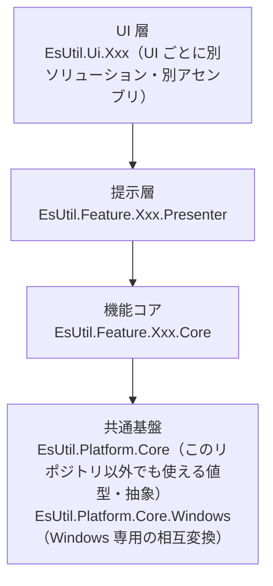
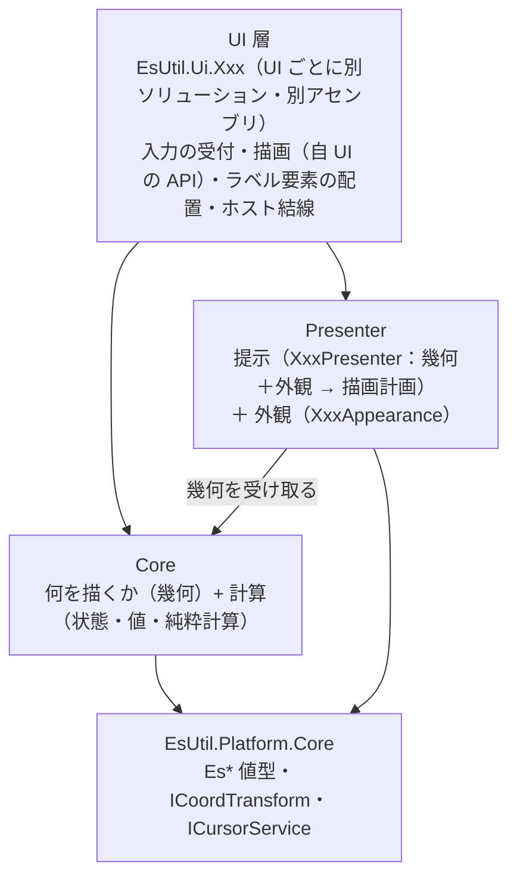

# コントロールの層構成（Core / Presenter / UI）

本リポジトリのコントロールは、**UI 非依存のコアを複数の UI（AvaloniaUI / MewUI / WinUI3 / WinForms）で共有する**ために層を分けています。
本ドキュメントは「層の依存の向き」と「どこに何を置くか」の単一の説明です。 各層の中身は各プロジェクトの `README.md` / `SPEC_*.md` を参照してください。

## 1. 全体の階層

依存は常に上から下への一方向です（詳細は [`.github/依存関係.md`](../.github/依存関係.md)）。

## 2. コントロール層の 3 層

**Core（何を描くか・判断・計算） / Presenter（提示＝描画計画と外観） / UI（フレームワーク固有の描画と配線）** の 3 層です。 UI 層が Presenter と Core の両方を参照し、**Presenter はコアの計算結果を使って描画計画を組み立てる**向きに依存します（コアは Presenter を参照しません）。

**Core は Presenter を参照しません**（描画 API も描画の抽象も知りません）。
**Presenter はコントロール化を前提としません**（ホイール操作・ビューポート連携・再描画のスケジューリングなど、組み込み先があるときにだけ必要な規則を持ちません）。

| 層 | 置くもの | 置かないもの | 依存先 | Loupe の例 |
| --- | --- | --- | --- | --- |
| **Core** | 「何を描くか」の判断・状態・設定の既定値と補正・純粋計算・**描画の幾何（切り出し領域・描画面）**・**コアが出力するログ定義** | 色・フォントサイズ・表示可否・UI フレームワークの型・**描画 API と描画の抽象**・コントロール化を前提とした処理（組み込み先の概念） | `EsUtil.Platform.Core` | `LoupeCore`（`ResolveLayout` / `ResolveGeometry`）/ `LoupeGeometry` / `LoupeOptions` / `LoupeLayout` |
| **Presenter** | **提示（`XxxPresenter`：幾何＋外観 → 描画計画（層の順序・装飾矩形・文言・配置））**・**外観（`XxxAppearance`：色・フォント・角丸・枠線の太さ・表示可否）**・**テキストを要素に写す配置計算（`XxxLabelPlan`）**・**本層が所有する設定の変更ログ** | コア単体でも成立する計算（選択・表示レイアウト）・UI フレームワークの型・**描画 API の抽象**・**コントロール化を前提とした処理**（入力の解釈・ビューポート連携・組み込み先の概念） | `Core` / `EsUtil.Platform.Core` | `LoupePresenter` / `LoupeAppearance` / `LoupeDrawPlan` / `LoupeDrawLayer` |
| **UI** | 入力イベントの受付とコア型への変換・効果の適用・通知の公開イベントへの転送・**描画（自 UI の描画 API で描画計画を描く）**・ラベル要素の配置・**コントロール化を前提とした処理（ホイール操作・ビューポート連携）**・**本 UI が出力するログ定義** | 判断・計算・既定値（コアが単一所有する）・層の順序（Presenter がデータとして単一所有する） | `Core` / `Presenter` / `EsUtil.Platform.Core`（単独配布するため、コピーしたヘルパー以外で本リポジトリ外の層を参照しない。 [`.github/依存関係.md`](../.github/依存関係.md) §4.1） | `LoupeControl` / `LoupeContextPainter` / `LoupeSkiaPainter` |

## 3. どこに置くかを決める 3 つの問い

1. **単体でそのコントロールを使っても存在する概念か** — する なら **Core**。 例: 選択の判断・表示レイアウト・切り出し領域の計算。
2. **描画にだけ必要で、コアの計算・判断に入らないか** — そうなら **Presenter**（色・フォント・枠線の太さ・表示可否と、それを使って描画計画を組み立てる手順）。
3. **フレームワーク固有の機構か** — そうなら **UI**（入力の受付・描画 API の呼び出し・要素の配置・UI 型への写像）。 例: `DrawingContext` / `SKCanvas` の確保、`Border` + `TextBlock` の配置、カーソル型の写像。

> **「1 が成立するなら 1 が優先」**（Core に置けるものは Core に置く。 描画にだけ必要な設定と描画計画の解決だけが Presenter に残る）。
> **コントロール化を前提とした処理は UI へ置く**（ホイール操作・ビューポートの変化の追従・入力の解釈は、コントロールを何かへ組み込んで初めて必要になる）。

UI 層に残すのは「フレームワーク固有の型を使うもの」と「コントロール化を前提とした処理」です（入力の受付・効果の適用・通知の転送・描画・要素の配置・境界の 1 行変換・ホイール操作）。

## 4. 「何を描くか（幾何）は Core・どう見せるか（描画計画と外観）は Presenter・どう描くかは UI」

もっとも紛らわしい点です。 **Core は色もフォントサイズも描画 API も描画の抽象も持ちません**（描画にだけ必要なものであり、Core の計算・判断に入らないため）。 **Core が持つのは描画の幾何**（切り出し領域・描画面）です。 **その幾何と外観から描画計画（層の順序・装飾矩形・文言・配置）を組み立てるのが Presenter の `XxxPresenter`** であり、**実際に描くのは各 UI が自 UI の描画 API で行います**（`XxxContextPainter` / `XxxSkiaPainter`）。

**描画 API の抽象（キャンバスの抽象）は持ちません**。 UI フレームワークごとの描画モデル（即時描画 / リテインド / 描画プリミティブの違い）は抽象に集約しきれず、対象 UI が増えるたびに抽象が肥大するためです。 Presenter は**描画計画というデータ**を返し、UI がそれを自前の API で写します。

**テキスト（ラベル）は Presenter が文言・基準点・配置まで解決し、UI 層が扱いを決めます**。 **テキスト要素（`TextBlock` 等）として置くか canvas へ描くかは UI 層の判断**です。 Presenter は値（`XxxLabelPlacement`）を渡し、UI は要素として置くか文字として描くかを選びます（要素は親の描画より後に描かれるため常に最上位になります）。

| 何 | どこ | 理由 |
| --- | --- | --- |
| 描画の幾何（切り出し領域・描画面） | **Core** | 単体のルーペでも成立する計算である（描画面のサイズ・切り出し領域は選択に依存しない） |
| 描画計画（層の順序・装飾矩形・文言・配置）と外観（色・フォント・枠線の太さ・表示可否） | **Presenter** | 描画にだけ必要な設定・規則であり、コアの計算・判断に入らない。 コアに置くと色・フォントをコアへ持ち込むことになる |
| テキストを要素に写す配置計算（`XxxLabelPlan`） | **Presenter** | 実寸（描画 API 依存）から配置矩形を求める。 体裁値（内側余白・フォントサイズ・色・角丸）の所有も Presenter（`XxxAppearance`）である。 **UI 層が要素として置くか画像として描くかの選択は各 UI に残る** |
| 実際の描画（描画 API の呼び出し） | **UI** | 描画 API は UI フレームワーク固有であり、抽象で吸収しきれない |
| 描画面の確保（`DrawingContext` / `SKCanvas`） | **UI** | フレームワーク固有の機構（描画コールバック・再描画のスケジューリング）である |
| 注入・配線 | **UI** | コントロールの公開プロパティ（`Options` / `Appearance`）と入力イベントの配線はフレームワーク固有である |

**帰属の規則**: **計算（幾何・判断・状態）は Core、描画計画と外観（色・フォント・枠線の太さ・表示可否）は Presenter、描画 API の呼び出しと配線（コントロール化を前提とした処理を含む）は UI** です。 色とフォントをコアの設定値へ入れないのは、「何を描くか」の判断に使われないためです（描画の可否は色のアルファではなく外観の明示フラグが決めます）。

**描画計画のまとめ型**: 描画計画（`XxxDrawPlan`）は「フレーム 1 枚分」のまとめ型であり、Presenter から UI へ渡す唯一の描画契約です。 項目が複数の値を 1 つの概念としてまとめる場合にだけ専用型を作ります（単一のコレクションで足りる項目に型を作りません）。

アセンブリ参照の向きは `UI → 提示層（Presenter）→ Core` です（提示層は Core の幾何（`XxxGeometry`）を使うので Core を参照する）。 **逆向きの参照はありません**。

**コントロールを差し替えるには**: 描画計画の構成を変える場合は `XxxPresenter` を継承して `ResolveDrawPlan` を上書きする（または `XxxPresenter` を継承した別の型を作る）。 見た目だけを変える場合は外観（`XxxAppearance`）を差し替える。 コアの公開 API だけで描画計画を組み立てられるため、`XxxPresenter` を使わない独自実装も可能です。

## 5. UI 層が受け取る画像

**UI 層が拡大元・切り出し元の画像として受け取る型は、コアの具象型（`EsReadOnlyBitmap`）である**（4 つの UI（AvaloniaUI / MewUI / WinUI3 / WinForms）で同じ契約にする）。 コントロールは画素を読んで切り出すため、「読む入口を持つ型」を要求し、ホストがその型へ変換して渡す。

| 何 | 型 | 理由 |
| --- | --- | --- |
| 拡大元（切り出し元）の画像 | コアの具象型（`EsReadOnlyBitmap?`） | コントロールは画素を読む。 読む入口と「書き換えない」ことが型に現れている必要がある |
| 表示用の射影（ホストが表示に使っている自 UI の画像） | UI フレームワークの具象型（**省略可能な引数または任意プロパティ**） | ホストが既に持っている画像を「複製を作らないヒント」として渡すだけであり、省略しても描ける |

- **抽象（インターフェース）を新設しない**: 「この画像はコアの画像を取り出せるか」を `interface` で表すと、**実装の差し替え点ではないインターフェース**を作ることになる（[`コーディング規約.md`](../.github/コーディング規約.md) §5 「`interface` は実装の差し替え点であり、権利や状態の表明ではない。 権利は型（具象型）で表す」）。 画像の種類は**型（具象型）**で表し、未知の型から画素を取り出す仕組み（反射）を持たない（[`ビルド設定規約.md`](../.github/ビルド設定規約.md) 付録 A）。
- **表示用の射影を省略可能にする理由**: 射影は**表示にだけ**必要であり、コントロールが切り出しに要求するものではない（射影が無い経路（オフスクリーン描画）でも拡大元の画素から描ける）。 したがって必須の引数・必須のプロパティにしない。
- **表示用の射影は「寸法が拡大元と一致するときだけ」使う**: 描画 API は元矩形を画像の座標系で解釈するため、拡大元の座標系（ピクセル）と一致しない射影をそのまま使うと切り出す領域がずれる。 一致しない射影は**無視して拡大元から描く**（DPI の違いや指定漏れが誤った描画結果にならない）。
- **ホストは表示用の射影を変換して渡す**: UI の画像（表示境界の型）しか持たないホストは、コアの画像へ変換したものを拡大元として渡す（変換の責務が呼び出し側に現れる）。

## 6. コントロールごとの層

| コントロール | Core | Presenter | UI |
| --- | --- | --- | --- |
| `MarqueeControl` | あり | あり（提示 + 外観） | AvaloniaUI / MewUI / WinUI3 / WinForms |
| `ThumbnailControl` | あり（配置・選択・可視範囲） | あり（提示 + 外観 + 影） | AvaloniaUI / MewUI / WinUI3 / WinForms |
| `LoupeControl` | あり | あり（提示 + 外観） | AvaloniaUI / MewUI / WinUI3 / WinForms |
| `ColorComboBoxControl` | なし（色文字列の解析・検証は UI が持つ） | なし | AvaloniaUI |

**コアだけを持つ機能**（提示層を必要としないもの）は、`EsUtil.Feature.<機能>.Core` の 1 パッケージだけを持ちます。 UI 層はこれを参照できます（[`.github/依存関係.md`](../.github/依存関係.md) §3）。

| 機能 | パッケージ | UI |
| --- | --- | --- |
| 複数列の配置（最大列高さの最小化） | `EsUtil.Feature.ColumnPacking.Core` | `EsUtil.Ui.WinUI3.ColumnPacking` |
| 全角・半角・かなの変換 | `EsUtil.Feature.ZenHan.Core` | なし（UI を持たない） |

**コントロール化を前提とした処理は UI が持ちます**: ホイール操作（どの入力がズーム・パンかを決める）・ビューポートの変化の追従・組み込み先の概念は、コントロールを何かへ組み込んで初めて必要になるためです。

## 7. 各層のドキュメント

| コントロール | Core | Presenter |
| --- | --- | --- |
| Marquee | [`EsUtil.Feature.Marquee.Core`](../EsUtil/Feature.Marquee.Core/README.md) | [`EsUtil.Feature.Marquee.Presenter`](../EsUtil/Feature.Marquee.Presenter/README.md) |
| Loupe | [`EsUtil.Feature.Loupe.Core`](../EsUtil/Feature.Loupe.Core/README.md) | [`EsUtil.Feature.Loupe.Presenter`](../EsUtil/Feature.Loupe.Presenter/README.md) |
| Thumbnail | [`EsUtil.Feature.Thumbnail.Core`](../EsUtil/Feature.Thumbnail.Core/README.md) | [`EsUtil.Feature.Thumbnail.Presenter`](../EsUtil/Feature.Thumbnail.Presenter/README.md) |
| ColumnPacking | [`EsUtil.Feature.ColumnPacking.Core`](../EsUtil/Feature.ColumnPacking.Core/README.md) | なし |
| ZenHan | [`EsUtil.Feature.ZenHan.Core`](../EsUtil/Feature.ZenHan.Core/README.md) | なし |

UI 層は [`EsUtil.Ui.AvaloniaUI.ColorComboBox`](../EsUtil.Ui.AvaloniaUI/ColorPicker/README.md) / [`EsUtil.Ui.AvaloniaUI.Marquee`](../EsUtil.Ui.AvaloniaUI/Marquee/README.md) / [`EsUtil.Ui.MewUI.Marquee`](../EsUtil.Ui.MewUI/Marquee/README.md) / [`EsUtil.Ui.WinUI3.Marquee`](../EsUtil.Ui.WinUI3/Marquee/README.md) / [`EsUtil.Ui.WinForms.Marquee`](../EsUtil.Ui.WinForms/Marquee/README.md) /
[`EsUtil.Ui.AvaloniaUI.Loupe`](../EsUtil.Ui.AvaloniaUI/Loupe/README.md) / [`EsUtil.Ui.MewUI.Loupe`](../EsUtil.Ui.MewUI/Loupe/README.md) / [`EsUtil.Ui.WinUI3.Loupe`](../EsUtil.Ui.WinUI3/Loupe/README.md) / [`EsUtil.Ui.WinForms.Loupe`](../EsUtil.Ui.WinForms/Loupe/README.md) /
[`EsUtil.Ui.AvaloniaUI.Thumbnail`](../EsUtil.Ui.AvaloniaUI/Thumbnail/README.md) / [`EsUtil.Ui.MewUI.Thumbnail`](../EsUtil.Ui.MewUI/Thumbnail/README.md) / [`EsUtil.Ui.WinUI3.Thumbnail`](../EsUtil.Ui.WinUI3/Thumbnail/README.md) / [`EsUtil.Ui.WinForms.Thumbnail`](../EsUtil.Ui.WinForms/Thumbnail/README.md)、
共通基盤は [`EsUtil.Platform.Core`](../EsUtil/Platform.Core/README.md) / [`EsUtil.Platform.Core.Windows`](../EsUtil/Platform.Core.Windows/README.md) を参照してください。

## 8. 名前空間とフォルダ

名前空間とフォルダの対応表・`Control` を除く短縮名の制約（CS0118）・アセンブリ名の規則は [`.github/命名規約.md`](../.github/命名規約.md) が単一所有します。 本ドキュメントは層の帰属（Core / Presenter / UI のどれに置くか）だけを扱います。
