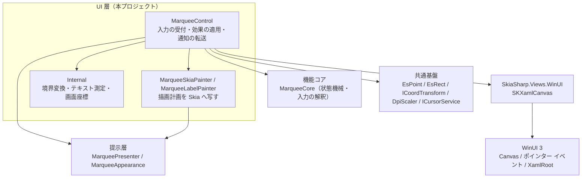
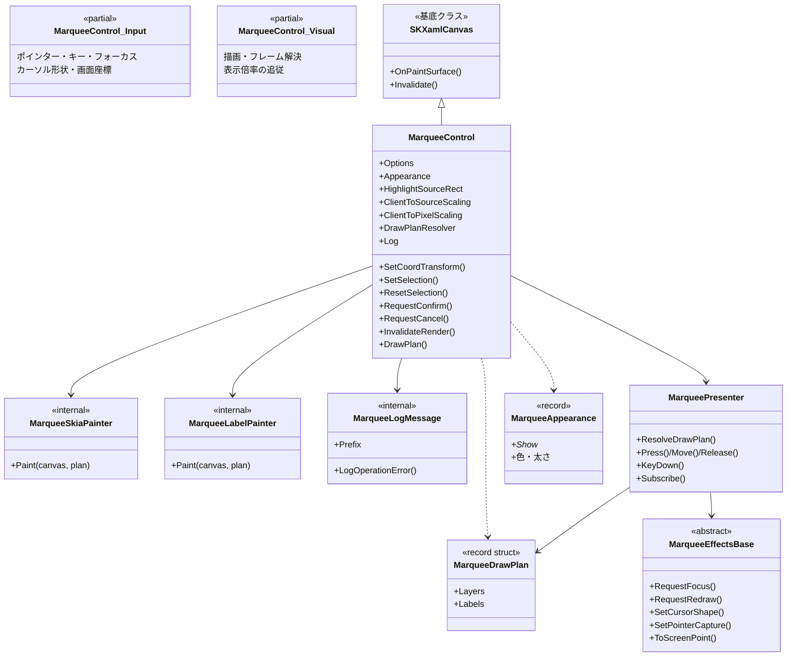
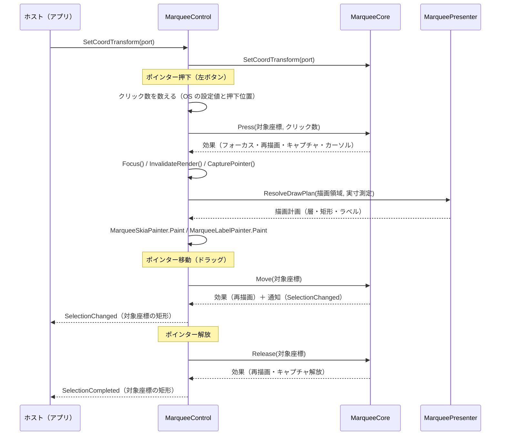
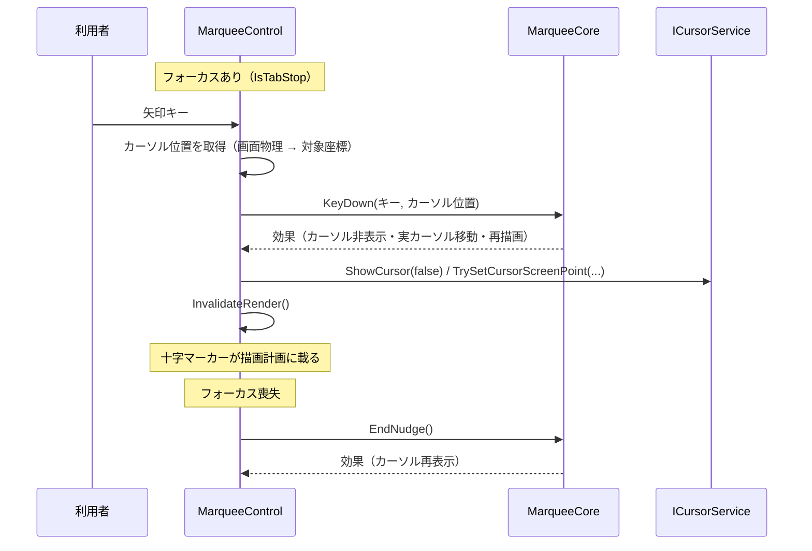
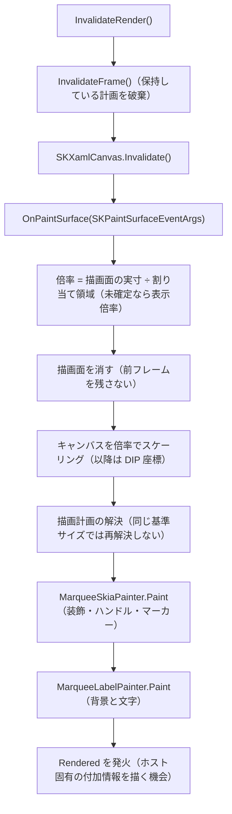

# EsUtil.Feature.Marquee.ControlWinUI3 システム仕様書

`EsUtil.Feature.Marquee.ControlWinUI3` の構造・依存・設計判断を記載します。

## 目次 <!-- omit from toc -->

- [1. システム概要](#1-システム概要)
- [2. 技術スタック](#2-技術スタック)
- [3. アーキテクチャ](#3-アーキテクチャ)
  - [3.1 依存方向](#31-依存方向)
  - [3.2 責務の分担](#32-責務の分担)
  - [3.3 設計判断](#33-設計判断)
- [4. コンポーネント構成](#4-コンポーネント構成)
- [5. クラス図](#5-クラス図)
- [6. シーケンス図（新規選択のドラッグ）](#6-シーケンス図新規選択のドラッグ)
- [7. シーケンス図（矢印キー nudge）](#7-シーケンス図矢印キー-nudge)
- [8. 状態遷移](#8-状態遷移)
- [9. 描画フロー](#9-描画フロー)
- [10. 例外処理ポリシー](#10-例外処理ポリシー)
- [11. 実装上の注意](#11-実装上の注意)
- [12. 未実装（今後の判断）](#12-未実装今後の判断)

## 1. システム概要

画像やスクリーンの上へ重ねて使う、リサイズ可能なドラッグ矩形（マーキー）の WinUI 3 コントロールです。

**選択の計算と判断は UI 非依存の層が所有し、本コントロールは UI フレームワーク固有の仕事だけを行います。**

| 層 | プロジェクト | 本コントロールとの関係 |
| --- | --- | --- |
| 機能コア | `EsUtil.Feature.Marquee.Core` | 選択の状態機械・入力の解釈・注目矩形の決定・幾何の計算（本コントロールは判断を持ちません） |
| 提示層 | `EsUtil.Feature.Marquee.Presenter` | 外観（色・体裁・表示可否）と描画計画（層の順序・装飾の矩形・ラベル配置）の解決 |
| 共通基盤 | `EsUtil.Platform.Core` | コア幾何型・座標変換ポート・DPI 換算・カーソル サービス |
| UI 層 | `EsUtil.Feature.Marquee.ControlWinUI3` | 入力の受付・効果の適用・通知の転送・描画（本プロジェクト） |

## 2. 技術スタック

| 項目 | 値 | 理由 |
| --- | --- | --- |
| 対象フレームワーク | `net10.0-windows10.0.22621.0` | WinUI 3（Windows App SDK）を使う層の割り当て（[`.github/ビルド設定規約.md`](../../../.github/ビルド設定規約.md) §5） |
| `UseWinUI` | `true` | XAML のコンパイルと WinUI 3 の参照解決を行う |
| `SupportedOSPlatformVersion` | `10.0.19041.0` | `Microsoft.UI.Input.InputSystemCursor`（カーソル形状の設定）が使える下限 |
| UI フレームワーク | Windows App SDK 1.x（`Microsoft.WindowsAppSDK`） | WinUI 3 のコントロール基盤（`Canvas` / ポインター イベント / `XamlRoot`） |
| 描画 | SkiaSharp 3.x（`SkiaSharp.Views.WinUI`） | コアの幾何と色をそのまま描ける描画 API。 `SKXamlCanvas` が描画面を提供する |
| ログ | `Microsoft.Extensions.Logging.Abstractions` | ホストが出力先を注入できる形にする（本コントロールは定義だけを持つ） |
| P/Invoke | `DllImport`（`user32.dll`） | 画面物理座標 ↔ クライアント座標の変換と、ダブルクリックの時間の上限の取得。 安全でないコードの許可（`AllowUnsafeBlocks`）を必要としない |

**対応アーキテクチャ**: x64 / x86 / arm64。 自己完結で配置するアプリ（サンプル等）は対象アーキテクチャを明示する必要があります。

## 3. アーキテクチャ

### 3.1 依存方向



依存は常に UI 層 → 提示層 → 機能コア → 共通基盤の向きです（[`.github/依存関係.md`](../../../.github/依存関係.md)）。
本コントロールは本リポジトリ外のプロジェクトを参照しません（単独のパッケージとして配布できるようにするため）。

### 3.2 責務の分担

| 何 | 所有者 |
| --- | --- |
| 入力の解釈・状態遷移・ハンドルのヒットテスト・nudge の許可条件・確定/キャンセルの判断 | 機能コア（`EsUtil.Feature.Marquee.Core`） |
| 外観（色・フォントサイズ・枠線の太さ・表示可否）・描画計画（層の順序・装飾の矩形・ラベル配置） | 提示層（`EsUtil.Feature.Marquee.Presenter`） |
| 入力の受付・効果の適用・通知の転送・描画・カーソル形状の写像・画面座標の変換 | 本コントロール |
| 描画計画を Skia の描画 API へ写すこと（判断しない） | `MarqueeSkiaPainter` / `MarqueeLabelPainter` |

**本コントロールは描画計画を解決しません**（`MarqueePresenter.ResolveDrawPlan` が返した値を写すだけです）。
**表示可否（`Show*`）は描画側が判断します**（計画は可否で値を消さないため、ホストは止めた項目の値も使えます）。

### 3.3 設計判断

| 判断 | 理由 |
| --- | --- |
| `SKXamlCanvas`（`Canvas`）を基底クラスにする | 描画面（`SKSurface`）をフレームワークが用意し、コントロールは自 UI の描画 API で描くだけで済む。 中間ビットマップを作らない |
| ラベルも同じ描画面へ描く | XAML の要素（`Border` + `TextBlock`）として置くと、実寸の測定（XAML のレイアウト）と描画（Skia）が別のエンジンになり、背景から文字がはみ出しうる。 同じエンジンに揃える |
| 描画の倍率を描画面の実寸から求める | XAML のルートが未確定の間は表示倍率が既定値（`1.0`）のため、保持値だけに頼ると図形が 100% で描かれる。 描画面（物理ピクセル）÷ 割り当て領域（DIP）で実測する |
| ダブルクリックを OS の設定値で判定する | WinUI 3 のポインター イベントはクリック数を報告しない。 固定値をコントロールが決めると OS の設定と食い違う |
| 画面座標の変換だけを Win32 に委ねる | XAML のルートは表示倍率とコンテンツ内の相対座標までしか与えない（nudge でカーソルを動かすには画面物理座標が要る） |
| `DllImport` を使う（`LibraryImport` ではなく） | `LibraryImport` は安全でないコードの許可（`AllowUnsafeBlocks`）を要求する。 3 つの Win32 API のためにプロジェクト全体で許可しない |
| 内部ヘルパーをプロジェクトへ複製する | 本コントロールを単独のパッケージとして配布できるようにするため（[`.github/依存関係.md`](../../../.github/依存関係.md) §4.1） |

## 4. コンポーネント構成

```text
EsUtil.Feature.Marquee.ControlWinUI3/
    README.md
    docs/
        SPEC_API.md
        SPEC_System.md
    sample/
        App.xaml
        App.xaml.cs
        MainWindow.xaml
        MainWindow.xaml.cs
        Logging/
            InMemoryLogger.cs
        Presentation/
            GuideMarqueePlan.cs
        Views/
            TestPatternCanvas.cs
    src/WinUI3/
        EsUtil.Feature.Marquee.ControlWinUI3.csproj
        MarqueeControl.cs
        MarqueeControl.Input.cs
        MarqueeControl.Visual.cs
        MarqueeLabelPainter.cs
        MarqueeLogMessage.cs
        MarqueePointEventArgs.cs
        MarqueeRenderedEventArgs.cs
        MarqueeSkiaPainter.cs
        SelectionRectEventArgs.cs
        Internal/
            ClientPixelScale.cs
            DoubleClickDetector.cs
            EsGeometryWinUI3Interop.cs
            EsKeyWinUI3Interop.cs
            ScreenConverter.cs
            SkiaColorInterop.cs
            SkiaFill.cs
            SkiaGeometryInterop.cs
            SkiaText.cs
            Win32Interop.cs
    tests/WinUI3/
        EsUtil.Feature.Marquee.ControlWinUI3.Tests.csproj
        RecordingLogger.cs
        MarqueeLabelPainter.Tests.cs
        MarqueeLogMessage.Tests.cs
        MarqueeSkiaPainter.Tests.cs
        Internal/
            ClientPixelScale.Tests.cs
            DoubleClickDetector.Tests.cs
            EsGeometryWinUI3Interop.Tests.cs
            EsKeyWinUI3Interop.Tests.cs
            SkiaColorInterop.Tests.cs
            SkiaFill.Tests.cs
            SkiaGeometryInterop.Tests.cs
            SkiaText.Tests.cs
```

## 5. クラス図



| ファイル | 型 | 可視性 | 役割 |
| --- | --- | --- | --- |
| `MarqueeControl.cs` | `MarqueeControl` | `public` | 公開 API（プロパティ・イベント・メソッド）と通知の転送、コアが要求する効果の適用 |
| `MarqueeControl.Input.cs` | `MarqueeControl`（partial） | `public` | ポインター・キー・フォーカスの処理、カーソル形状、画面座標の変換 |
| `MarqueeControl.Visual.cs` | `MarqueeControl`（partial） | `public` | 描画（`OnPaintSurface`）、フレームの解決、表示倍率の追従 |
| `MarqueeSkiaPainter.cs` | `MarqueeSkiaPainter` | `internal` | 図形の層（装飾・ハンドル・マーカー）を Skia へ写す |
| `MarqueeLabelPainter.cs` | `MarqueeLabelPainter` | `internal` | ラベル（背景と文字）を Skia へ写す |
| `MarqueeLogMessage.cs` | `MarqueeLogMessage` | `internal` | ログ定義（接頭辞・操作の例外） |
| `MarqueeRenderedEventArgs.cs` | `MarqueeRenderedEventArgs` | `public` | 描画完了の通知（キャンバスと描画内容） |
| `MarqueePointEventArgs.cs` | `MarqueePointEventArgs` | `public` | 座標の通知（対象座標とスナップショット） |
| `SelectionRectEventArgs.cs` | `SelectionRectEventArgs` | `public` | 矩形の通知（対象座標とスナップショット） |

## 6. シーケンス図（新規選択のドラッグ）



## 7. シーケンス図（矢印キー nudge）



## 8. 状態遷移

状態機械は機能コアが所有します（`MarqueeState` / `MarqueeSession`）。 本コントロールは状態を持ちません。

| 状態 | 契機 | 本コントロールの仕事 |
| --- | --- | --- |
| 待機 | 初期状態・確定・キャンセル後 | 追従位置の取り直し（`TryGetCurrentLoupePosition`）とポインター移動の通知 |
| 新規選択のドラッグ | 左押下（ハンドルにヒットしない） | 押下・移動・解放の座標を対象座標へ変換して通知 |
| リサイズ・移動 | 左押下（ハンドルにヒット） | 同上（カーソル形状の写像はコアの指示に従う） |
| nudge | 矢印キー（選択あり・許可条件を満たす） | カーソルの非表示と実カーソルの移動、再描画 |
| 確定済み | Enter・内側のダブルクリック | 通知の転送（選択はコアがクリアする） |

## 9. 描画フロー



**描画計画は 1 フレーム 1 回だけ解決します**（同じ基準サイズの間は保持した値をそのまま使います）。
状態が変わると `InvalidateFrame()` が破棄し、次の描画で最新の状態を反映します。

## 10. 例外処理ポリシー

共通の方針は [`.github/例外処理規約.md`](../../../.github/例外処理規約.md) に従います。 本コントロール固有の扱いだけを次に示します。

| 状況 | 扱い |
| --- | --- |
| 公開ファサードの操作（`SetCoordTransform` / `SetSelection` / `ResetSelection` / `RequestCancel` / `RequestConfirm`）で下位の層が例外を投げた | `BoundaryCatch.IsRecoverable` で判定して `MarqueeLogMessage.LogOperationError` へ記録し、`throw` で呼び出し側へ伝搬します（スタックトレースは `throw;` で保つ） |
| 画面座標の変換に失敗した（ウィンドウ未特定・`ScreenToClient` の失敗） | 例外にせず、等価変換（入力をそのまま使う）か `false` を返します |
| カーソル位置を取得できない | `TryGetCurrentLoupePosition` が `false` を返し、nudge の基点を記録しません |
| 倍率が未確定（非数・`0` 以下） | `DpiScaler.NormalizeScaling` で基準値へ寄せます（描画は続行します） |
| 引数が `null`（キャンバス等） | `ArgumentNullException` を投げます（呼び出し側の実装誤り） |

**引数の検証は `try` の外に置きます**（プログラミング エラーは捕捉の対象外です）。

## 11. 実装上の注意

| 注意 | 理由 |
| --- | --- |
| 描画面は毎フレーム消す | `SKXamlCanvas` の描画面は前フレームの画素を保持するため、消さないと選択矩形が残像になる |
| 背景（`Background`）をコントロールが塗らない | 消すのは透明（`SKColors.Transparent`）にする。 下の画像を透かすため（`SKXamlCanvas` は初回の描画で背景を自前のブラシへ差し替える） |
| ポインターは押下時に記録する | `CapturePointer` はポインター オブジェクトを要求するため、コアからの要求時に渡せるよう保持する |
| `KeyDown` / `PointerPressed` はイベントを購読する | WinUI 3 の `UIElement` は `OnPointerPressed` 等の `protected override` の入口を持たない |
| ポインターの進入・退出を自前で覚える | `UIElement` は「ポインターが上にあるか」を公開しない（追従位置の取り直しの条件に使う） |
| ラベルの内側余白を配置指示から取る | 背景は「文字の実寸 + 内側余白 × 2」であり、文字の原点は余白の分だけ内側になる |
| 表示倍率を XAML のルートの変化で追従させる | モニター間の移動で倍率が変わっても、枠線・ハンドルの画面上の大きさを保つ |
| 内部ヘルパーの実装を 1 箇所に集約する | 同じ変換（色・座標・測定）を各所へ書くと、片方だけ直して食い違う |

## 12. 未実装（今後の判断）

| 項目 | 状況 |
| --- | --- |
| コントロール本体の自動テスト | XAML のランタイム初期化（`Application` と `DispatcherQueue`）を必要とするため、テスト ホストでは生成できない。 入力経路はサンプルでの手動確認に委ねている |
| ビューポート（スクロール・ズーム）の自動連携 | ホストが変化を検知して `InvalidateRender()` を呼ぶ前提としている（他 UI 版も同じ分担） |
| タッチ・ペン入力の最適化 | 左ボタン相当の入力として扱う（ヒット テスト半径は `Options.HandleHitRadius` で調整できる） |
| 高コントラスト テーマへの追従 | 配色はホストが `Appearance` で与える（XAML のテーマ資源には追従しない） |
